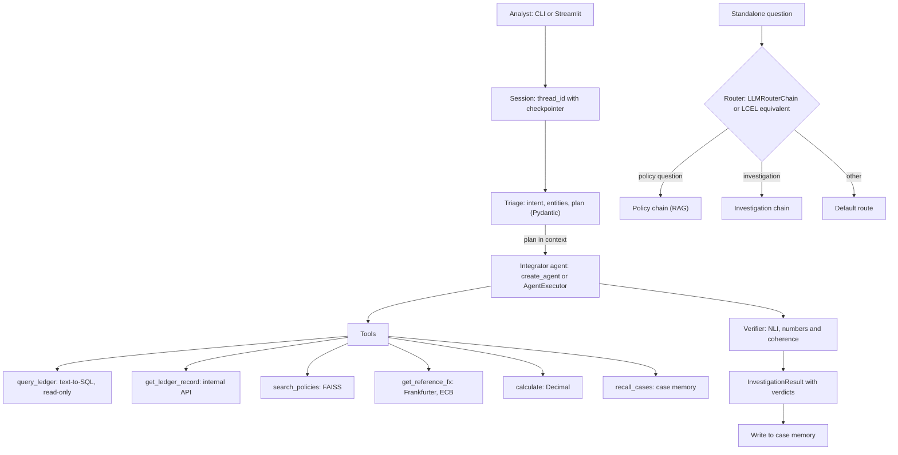
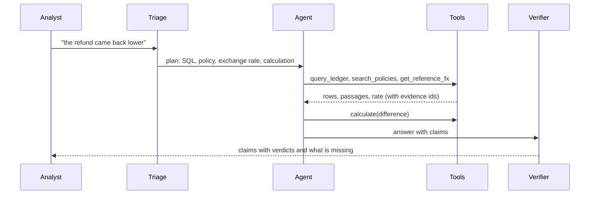

# LedgerLens

[](https://github.com/erikunha/ledgerlens/actions/workflows/gate.yml)


[](LICENSE)

A LangChain agent that investigates payment complaints. It queries a transaction ledger, searches operations policies, compares against a reference exchange rate, does the arithmetic in code, and checks every claim in its own answer against the evidence it used. When the evidence is not enough, the answer says what is missing and the case goes to human review.

A run has four model tasks, and the model of each one is chosen by the task: the plan of the investigation, the statement that reads the ledger, the rewrite of the search of the policies and the answer with the tools ([ADR-078](docs/decisions/ADR-078-the-model-of-each-slot-is-chosen-by-the-work-it-does.md)). The runtime is still one agent with a deterministic verifier. A studio of specialist agents is under construction behind a flag, and it ships only if a paired comparison measures a gain ([ADR-P007](docs/design/adrs/ADR-P007-no-multiagent-by-default.md)).


## Why an agent

A payment operations analyst gets complaints like "the refund came back lower", "I was charged twice" or "the chargeback did not post". To answer, they combine four sources: the transaction ledger, policies, a reference exchange rate, and arithmetic that cannot be wrong. The path changes with every case:

- a status request needs only SQL;
- a refund in another currency needs SQL, policy, exchange rate and arithmetic, in that order;
- an ambiguous request needs a question back.

A fixed chain either runs every step every time or leaves cases out. The agent picks its steps from the request and the evidence, and the answer shows what it picked.

## What it does

- Turns the complaint into a validated triage object (Pydantic): intent, entities, urgency and a step-by-step plan. Triage runs before the agent, and the plan goes into the agent's context.
- Uses six tools:
  - `query_ledger`: text-to-SQL on a read-only database, with a guard that refuses `UPDATE`, `DROP` and internal tables;
  - `get_ledger_record`: the internal ledger API;
  - `search_policies`: policy search over a prebuilt FAISS index, with query rewriting;
  - `get_reference_fx`: ECB reference exchange rates through the Frankfurter API;
  - `calculate`: a calculator built on `Decimal`, so numbers never come from the model;
  - `recall_cases`: long-term case memory.
- Keeps the session history and retrieves similar past cases by meaning.
- Verifies every claim in the answer: an NLI (natural language inference) model judges the text claims, and code checks numbers, rates and exchange-rate dates against the cited evidence.
- Escalates to human review by rule: a dispute deadline close to expiring, suspicious text in a record, an exchange-rate source that is down, claims with no evidence.
- Returns an `InvestigationResult`: the answer, each claim with its evidence, a verdict per claim (`supported`, `contradicted`, `not_enough_evidence`), what is missing, and whether human review is needed.
- Never changes data. The agent only recommends.

## The direction of the work

The roadmap of this repository is the design package imported in [`docs/design/`](docs/design/), and the plan that runs it is [`docs/roadmap-v3.md`](docs/roadmap-v3.md) and the folders of [`specs/`](specs/). Four things are moving at once, and each one says what it has proved and what it has not.

- **The model of each task is chosen by the task.** The four slots of a run are the plan of the investigation, the statement that reads the ledger, the rewrite of the search of the policies and the answer with the tools. A deployment declares the cascade of models it may run, from the lightest to the most capable, and every slot takes the cheapest model of the cascade that fits its task and that really calls the tools when the task needs it ([ADR-078](docs/decisions/ADR-078-the-model-of-each-slot-is-chosen-by-the-work-it-does.md)). The decision is written before the run starts and published with the recording, so a reader sees which model did which part.
- **A studio of specialist agents is being built, and it is experimental.** The dispatcher of the specialists, the checkpoints of the graph and the budget that bounds them are specified in [`specs/013-r11-multiagent-orchestration-studio/`](specs/013-r11-multiagent-orchestration-studio/). The plan of a case, the registry of the specialists, the dispatcher and the scheduler are built in [`ledgerlens/orchestration/`](ledgerlens/orchestration/), behind a flag that is off in the shipped configuration, and the comparison that would open it was registered before it ran ([`docs/orchestration/baseline.md`](docs/orchestration/baseline.md)). The main runtime stays one agent with a deterministic verifier, and the studio only becomes the default when a paired comparison over the same cases measures a gain ([ADR-P007](docs/design/adrs/ADR-P007-no-multiagent-by-default.md)). No such measurement exists yet, and this README does not claim one.
- **The routing of the inference has been measured against one model.** The router that ADR-078 starts, the budget that holds the run and the price of each model with the day it was verified are specified in [`specs/016-r15-inference-routing-and-finops/`](specs/016-r15-inference-routing-and-finops/). The comparison of the two routes over the same 31 cases is published in [`docs/routing.md`](docs/routing.md): over that cohort the arm of one model was the more accurate one, the cascade used fewer tokens per correct case and a lower p95 of the latency, and the two runs of the comparison disagreed about the accuracy, so the difference of the accuracy is not established. One run per case makes the numbers a trend and not a statistical significance, and the money of the cascade is unknown, because the price of `gpt-4.1` was never verified in this repository ([ADR-083](docs/decisions/ADR-083-the-routing-is-measured-against-one-model-over-the-same-cases-and-every-number-carries-its-set.md)). A model that fails a task is retried with another model of the cascade only when the deployment consented to it and the remaining budget covers it, and the default of the deployment is no retry at all ([ADR-084](docs/decisions/ADR-084-the-fallback-of-a-run-happens-only-with-a-consent-of-the-deployment-and-with-the-budget-that-is-left.md)). The retry is wired into the triage of the run and into the model of the graph, and the live path of the visitor keeps its one model ([ADR-085](docs/decisions/ADR-085-the-retry-of-a-failed-model-is-wired-into-the-triage-of-the-run-and-into-the-model-of-the-graph.md)).
- **The economics of a cohort is computed and never measured from a guess.** The cost per case that was actually resolved, the money of a review and the loss a wrong decision carries are specified in [`specs/011-r9-cost-per-case-and-decision-utility/`](specs/011-r9-cost-per-case-and-decision-utility/) and built in [`ledgerlens/economics/`](ledgerlens/economics/). The module reads the results of the runs that already happened and it never calls a model, every amount is a `Decimal`, and a price that was never verified or a probability that was never calibrated stays unknown and is never a zero ([ADR-086](docs/decisions/ADR-086-the-economics-module-computes-and-never-calls-a-model-and-an-unknown-stays-unknown.md)).
- **A case that needs a person is a typed task, and the agent never decides it.** The task, the table of its states and the route that takes the decision are specified in [`specs/012-r10-human-review-and-approval/`](specs/012-r10-human-review-and-approval/) and built in [`ledgerlens/review/`](ledgerlens/review/), and the page that says what the review is and what it refuses to do is [`docs/review.md`](docs/review.md). The identity of the reviewer is the session of the request and never the content of the case, the history is append only, a decision over a stale revision is a conflict, and a refusal discloses nothing about the task. The queue of the review does not exist yet: what exists is a simulator of it, whose defaults are fictional and whose capacity is never a plan of a team ([ADR-087](docs/decisions/ADR-087-the-review-is-a-typed-task-the-identity-of-the-reviewer-is-the-session-and-the-agent-never-decides.md), [ADR-088](docs/decisions/ADR-088-the-queue-of-the-review-is-a-simulation-with-fictional-defaults-and-its-capacity-is-never-a-plan-of-a-team.md), [`docs/queue.md`](docs/queue.md)).

## Architecture



One investigation, step by step:



The integrator comes in two versions with the same tools, the same prompt and the same verifier: `create_agent` (LangChain 1.x, with a checkpointer) and `AgentExecutor` with `RunnableWithMessageHistory` over a SQLite history. The legacy APIs sit next to their current equivalents, for comparison ([ADR-010](docs/decisions/ADR-010-modern-integrator-legacy-as-demonstration.md)).

Details are in [`docs/architecture.md`](docs/architecture.md), [`docs/tools.md`](docs/tools.md) and the [decision records (ADRs)](docs/decisions/). The [readiness audit of 2027](docs/readiness-2027.md) reads the eight components of the system and says what each one still has to prove, with the file and the line behind every claim.

## Data

Real public data first, simulation only where no public source covers the need ([ADR-009](docs/decisions/ADR-009-public-data-first-simulation-for-gaps.md)):

| Layer | Source |
|---|---|
| Orders and cancellations | UCI Online Retail II (CC BY 4.0) |
| Reference exchange rates | ECB through Frankfurter v1, cross-checked against the Brazilian central bank PTAX rate |
| Business days | the `holidays` library (TARGET and B3 calendars) |
| Card brands | CC BY 4.0 BIN list |
| Simulated with a fixed seed | merchants, chargebacks, settlements and fees, exchange-rate markup, planted anomalies |

Events go into an append-only `events` table, and a projector builds the tables the agent reads. `data/scenarios.json` lists every planted anomaly with its ground truth. Attributions are in [`NOTICE`](NOTICE).

## Quickstart

The site of the demo shows the product, and it answers on http://localhost:3000. The two prerequisites are Python 3.12, for the agent, and Node 24, for the site:

```bash
cd apps/web
npm ci
npm run dev
```

### Offline, no keys

Needs Python 3.12 and [uv](https://docs.astral.sh/uv/).

```bash
uv sync --extra dev --extra app --extra api
export LEDGERLENS_OFFLINE=1
bash scripts/gate.sh        # ruff and pytest, all offline
```

Offline mode uses scripted chat, recorded HTTP responses and the committed sample ledger. Policy and case search use deterministic word counts with 64 hash buckets. They require no model download. Online search defaults to OpenAI. Set `LEDGERLENS_EMBEDDINGS=fastembed` and build its index to use FastEmbed explicitly. The offline policy index lives in `data/index/policies_offline/`. Rebuild it with `LEDGERLENS_OFFLINE=1 uv run python scripts/build_index.py`.

### Demo app (Streamlit)

The demo is a small payments portal, LedgerLens Pay, with fictional accounts from the generated data. It opens signed in as customer C-0412; **Switch demo account** at the top picks another customer or merchant of a planted case (for example merchant M-03 or merchant M-09). The left side shows that account's activity in tabs (Activity, Refunds, Disputes and, for a merchant, Payouts): amount first, then what the line is, its date and a status pill, with filters. Open a line to see its details (transaction id, card, exchange rate applied, fees, deadlines) and press **Ask about this**: the question about that line lands in the Help box on the right, ready to edit before sending. The agent answers as the support assistant. It gets the signed-in account and the line you picked as context, and its tools read a copy of the ledger that holds only that account's records.

Each answer carries the agent trace, a run tree like LangSmith's, drawn live while the agent works: triage, each model call (with tokens) and tool call (arguments, the response envelope and the generated SQL), the verdict on each claim and escalation. When the investigation ends, the trace collapses into a one-line summary and the answer appears below it, with its citations and the ledger records the assistant read marked on the statement. The switch **Show the agent trace** (on by default) hides the trace and the citations, so the answer reads as a support reply. Offline, the planted questions have scripted answers: the FX refund gap (TX-2048), the duplicate charge (TX-2051 and TX-2052), the dispute near its deadline (CB-0310), the payout calculation (ST-0044) and an id that does not exist (TX-9999). **Ask about this** is offered only on those lines; other questions need a configured model.

```bash
uv run streamlit run app/streamlit_app.py
```

### The public site (Next.js)

The public site of the demo is a static export of Next.js that plays the recorded investigations of the design package.

```bash
cd apps/web
npm ci              # the locked install, once
npm run build       # produces the static export in out/
npm run preview     # serves the export as plain files, on http://localhost:3000
```

The two commands that produce the site and serve it are `npm run build` and `npm run preview`. The site needs Node 24 and nothing else.

The two routes that reach the backend, the sandbox and the live mode, need the backend of the demo running in another terminal, with the origin of this site declared so that the browser may call it:

```bash
LEDGERLENS_CORS_ORIGINS=http://localhost:3000 uv run ledgerlens-demo --port 8010
```

`LEDGERLENS_CORS_ORIGINS` takes a comma separated list of the exact origins of the browser, and the backend sends the CORS headers only to the origins of that list. This site is served on `http://localhost:3000`, so that is the origin to declare. Without it the browser blocks the calls and the page reports `NETWORK_ERROR` instead of the catalogue of the models.

The recorded half of the site serves the recorded artifacts of the repository and calls nobody, so it works with no key, no account and no network. It publishes two catalogs of the same ten scenarios. `/replay` is the catalog of the recordings made with the scripted model, and `/replay/scenario/<id>`, for example `/replay/scenario/S01`, is one of them: the recording is a formula, and anybody can run the capture again and get the same bytes. `/replay-real` is the catalog of the recordings made with a real model, and `/replay-real/scenario/<id>` is one of those: the recording is a run, and it is not reproducible byte for byte. A visitor opens `/sandbox` as well, the sandbox of the visitor, where a published case is forked into a private branch of the session. The sandbox is the one route that reaches the backend of the demo, and it needs no key. A fourth route, `/live`, is the live mode and it needs a key of your own. The tour of the architecture is at `/engineering`.

[`apps/web/README.md`](apps/web/README.md) has the commands, the tests and the rules of the folder. [`docs/frontend.md`](docs/frontend.md) has the three rooms of the site and the contract of its URL.

### Watch it run

The video below is the demo app running online with a real model, recorded on 2026-11-11: the question, the agent trace drawn live while the agent works, and the answer with the citations of the sources it used.


[docs/demo.md](docs/demo.md) has the recording notes: the mode, what the video shows, the numbers on screen and how it was recorded.

### Online, with a real model

Copy `.env.example` to `.env`, fill in the keys (`OPENAI_API_KEY` and, for traces and experiments, `LANGSMITH_API_KEY`), and run without `LEDGERLENS_OFFLINE`. The default model is `gpt-4.1-mini`, with live exchange rates.

## Live mode: bring your own key

The demo runs with no key at all. The live mode is the opt-in branch of it: the visitor runs a real case with a key of their own provider, inside a hard budget, and everything else keeps working exactly as before. In this milestone the branch is server side and it is complete: the routes and the pages that consume them were delivered in R3 ([ADR-035](docs/decisions/ADR-035-the-facade-of-the-live-mode.md), [ADR-066](docs/decisions/ADR-066-the-pages-of-the-live-mode-exist-and-the-readme-was-the-one-that-was-wrong.md)).

The demo of the visitor is served by one command, with the origin of the site declared so that the browser of the visitor may call it:

```bash
LEDGERLENS_CORS_ORIGINS=http://localhost:3000 uv run ledgerlens-demo --port 8010
```

The origin of the site is `http://localhost:3000`, the origin of this README, and the backend sends the CORS headers only to the origins that the deployment declares in `LEDGERLENS_CORS_ORIGINS`. The name of the variable, the list of the exact origins and the refusal of the wildcard are in [docs/frontend.md](docs/frontend.md).

That command serves the wired application of the demo: the live mode and the sandbox of the visitor in one application, over one session issuer, one store of branches, one branch layer and one vault of the credentials, so the branch that the sandbox forks is the branch that the live run reads ([ADR-039](docs/decisions/ADR-039-the-wired-application-of-the-demo.md)). The visitor sees one cookie and one session over the two facades. The two facades alone are two visitors with an issuer each, and the plain factory of `uvicorn` still serves a live mode without a branch layer, which refuses every run with `503 BRANCH_LAYER_MISSING`. [The quickstart of the live mode](specs/003-r3-bring-your-own-key/quickstart.md) shows the whole flow, with the real answers.

What it does:

- the key arrives once, in `POST /v1/credentials`, and it lives in the memory of the server process and nowhere else: no file, no database, no log, no trace, no URL. The answer carries an opaque handle, the provider and the expiry, and never the key itself;
- the handle is bound to the session of the visitor. A handle of another session is refused with the same message as a handle that never existed;
- the credential dies when the visitor forgets it, when the session ends, when its time to live passes, when the vault is full, when the server restarts, or when the provider refuses the key too many times. A credential never outlives the session that holds it;
- the model comes from the catalogue of the server, which lists only the models whose tool calling was really tested. A model that is not in the allowlist is refused by the server, and a model that lacks the capability the architecture needs is refused with the missing capability named, never replaced by another one;
- the run is bounded by the caps the visitor sets: the calls of the model, the calls of the tools, the output tokens, the wall clock and the money. The contract also accepts the optional cap of the input tokens, which is checked on the plan of the run, before the call, because the size of the request is known before the call. The cost report shows the observed cost and the estimated cost apart, and a model whose price was never verified shows no amount at all;
- "forget key" is always there and takes effect at once, and cancelling a run stops the calls that have not started. A call that was already at the provider is a best effort, and the answer says so.

**The disclosure.** It travels in headers, because the contract of the handle accepts no other field:

| Header | What it says |
|---|---|
| `X-LedgerLens-Key-Storage` | the key is not stored: it lives in the memory of the server and the credential is dropped when the session ends |
| `X-LedgerLens-Billing-Disclosure` | your provider may charge you for the calls of this run |
| `X-LedgerLens-Key-Erasure` | the memory of the machine cannot be guaranteed to be erased: the server drops the key when the credential ends, but no runtime can promise that no copy of the text of the key survives in the memory of the interpreter or in a swap of the operating system |

**The limitation.** The product never writes the key anywhere and drops it when the credential ends, but nobody can promise that no copy of the text of the key survives in the memory of the interpreter or in a swap of the operating system. The server wipes what it can and says out loud that it cannot promise the rest.

While the product runs offline (`LEDGERLENS_OFFLINE=1`) the live mode is refused with a readable reason, and the replay and the sandbox keep working exactly as before.

## Results

Online evaluation: 30 cases, three runs of each variant, `gpt-4.1-mini` at temperature 0. Mean [min, max] over the three runs.

| Variant | Correctness | Groundedness | Tool trajectory (equivalent, unordered) | Explanation (LLM judge) | Sent to human review (of 30) |
|---|---|---|---|---|---|
| A: chain with no tools | 0.17 [0.17, 0.17] | 0.00 | 0.00 | 0.70 [0.69, 0.72] | 30.0 |
| B: ReAct agent | 0.55 [0.51, 0.58] | 0.00 | 0.68 [0.60, 0.73] | 0.83 [0.80, 0.87] | 29.0 [28, 30] |
| C: full agent with verifier | 0.82 [0.79, 0.85] | 0.74 [0.71, 0.76] | 0.73 [0.73, 0.73] | 0.79 [0.77, 0.81] | 9.3 [8, 10] |

- The full agent (C) gets the facts right far more often than the tool-free chain (A) and the ReAct agent (B), and it is the only variant whose answers are grounded in cited evidence.
- Verification keeps about two thirds of C's answers out of the human review queue. A and B cite no evidence, so every answer goes to review.
- C's tool trajectory reaches 0.73 with the declared equivalence (reading one record by id with `query_ledger` or `get_ledger_record`), short of the 0.80 target.
- On its 43-case verification set (`data/eval/verification_set.jsonl`) the verifier gets every verdict right: contradiction recall 1.00, no false positives. That number is the WHOLE verifier over its 43 records, the NLI and the code checks together, and not the NLI accuracy of the calibration, which is measured over 70 NLI cases. The 30 text cases of that set are the tuning set of the sweep of [ADR-007](docs/decisions/ADR-007-nli-verification.md), so this is a measure over the data the thresholds were chosen on, and not a generalization to unseen data: the held out set of the verifier is a different set, declared with the role `held_out` ([ADR-052](docs/decisions/ADR-052-the-manifest-of-the-eval-datasets.md), [ADR-059](docs/decisions/ADR-059-the-held-out-set-is-read-by-two-blind-machines-and-adjudicated.md)).
- On the held out set of 48 cases (`data/eval/verification_heldout.jsonl`), the set that no decision of this repository was taken against, the verifier gets 24 of the 48 right (0.500): 23 of the 47 cases that go through the NLI model and one that the code decides. The false `supported` is 4 and the false `contradicted` is 0, and the verifier says `not_enough_evidence` for half of the set, 24 cases, where the blind reading said it for six. The labels come from two independent blind readings with an adjudication of the two cases where the readings diverged, and they disagree with the recipe of the generator in 2 of the 48 ([ADR-059](docs/decisions/ADR-059-the-held-out-set-is-read-by-two-blind-machines-and-adjudicated.md)).
- One B case failed in one run because the model wrote a malformed ReAct step; the harness now skips such steps instead of dropping the case.
- Thirty cases show a trend, not statistical significance. They are the cases of `data/eval/eval_cases.jsonl`, a tuning set of this repository, so the correctness of the three variants is a measure of their fit and not a generalization to unseen data ([ADR-052](docs/decisions/ADR-052-the-manifest-of-the-eval-datasets.md)). The run cost about US$ 0.59 at list price.

The full report is in [`data/eval/report_online.md`](data/eval/report_online.md); the offline report, with the scripted model, is in [`data/eval/report_offline.md`](data/eval/report_offline.md).

[`docs/evaluation.md`](docs/evaluation.md) says what each number above is allowed to claim: the split role of the dataset it was measured over, the manifest that pins it, the contamination policy, the calibration pin, and the held out set with the number over it and the three counts of its blind reading.

## Tests and gate

`bash scripts/gate.sh` runs `ruff check` and `pytest -q` with `LEDGERLENS_OFFLINE=1`. From a fresh checkout, build the sample database first:

```bash
uv run python -c 'from ledgerlens.eval.dataset import build_sample_ledger; build_sample_ledger("data/ledger.db")'
bash scripts/gate.sh
```

CI runs both commands. The replay tests compare the original SQLite file digest, so the Python job uses the build that includes SQLite 3.53.1. The tests also cover the SQL guard, the calculator, the tools, the verifier and escalation, both integrators with deterministic scripts, the simulator and the evaluation. [Python CI configuration](.github/workflows/gate.yml)

## Layout

```text
ledgerlens/   package: config, schemas, prompts, chains, tools, memory, agents, verify, observability, eval, sim
app/          Streamlit demo portal (LedgerLens Pay) with the Help assistant
scripts/      gate, build_index, fetch_public_data, record_fixtures
data/         policies, fixtures, prebuilt FAISS index, sample, evaluation sets and reports
tests/        pytest suites mirroring the package
specs/        the specifications of the work, one folder per feature
docs/         architecture, tools, contracts, the roadmap and decisions (ADRs)
```

## Limitations

- The exchange rate is an ECB reference, not the rate the acquirer applied. The agent says so.
- The source orders are real but old, with shifted dates. Chargebacks, settlements, fees and markups are simulated and marked in the `origin` column.
- Thirty evaluation cases show a trend, not statistical significance.
- The FastEmbed benchmark measures recall on the hard questions with and without query rewriting ([ADR-006](docs/decisions/ADR-006-embeddings-and-index.md)).
- The NLI model often marks true sentences as not enough evidence, so many real answers still go to human review. Numbers, rates and exchange-rate dates are checked by code.
- The answer is produced by an AI agent, and a person reviews the cases that need review.
- The model of each task of a run is chosen by the task, and the claim that this costs less for the same answer is a hypothesis until the paired comparison of the evaluation measures it. The studio of specialist agents is experimental and becomes the default only if that comparison measures a gain ([ADR-P007](docs/design/adrs/ADR-P007-no-multiagent-by-default.md)).
- The agent only recommends. It does not move money or change records.
- The live mode never writes the key to a file, a log or a trace and drops it when the credential ends, but no runtime can promise that no copy of the text of the key survives in the memory of the interpreter or in a swap of the operating system.
- A live run is paid for by the visitor: the provider of the visitor may charge the visitor for the calls of the run.

## License

MIT, see [`LICENSE`](LICENSE). Data sources keep their own licenses (see [`NOTICE`](NOTICE)).
