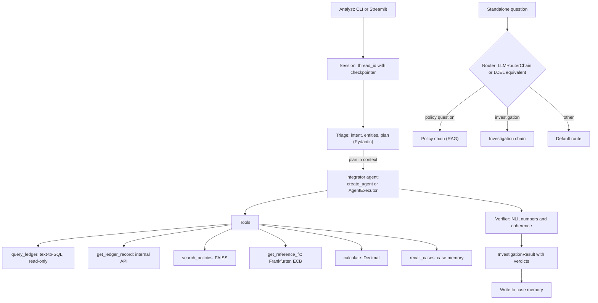
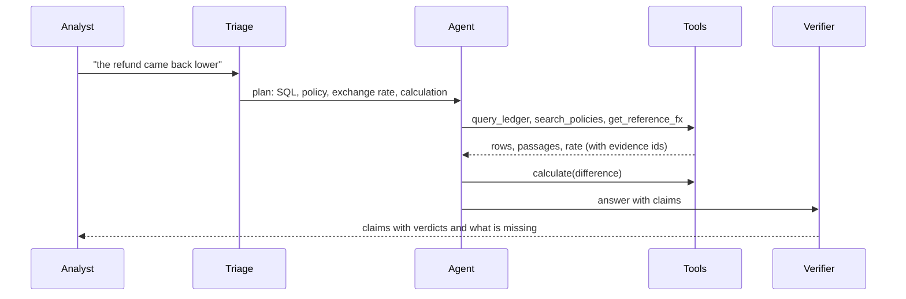

# LedgerLens

[](https://github.com/erikunha/ledgerlens/actions/workflows/gate.yml)


[](LICENSE)

A LangChain agent that investigates payment complaints. It queries a transaction ledger, searches operations policies, compares against a reference exchange rate, does the arithmetic in code, and checks every claim in its own answer against the evidence it used. When the evidence is not enough, the answer says what is missing and the case goes to human review.


## Why an agent

A payment operations analyst gets complaints like "the refund came back lower", "I was charged twice" or "the chargeback did not post". To answer, they combine four sources: the transaction ledger, policies, a reference exchange rate, and arithmetic that cannot be wrong. The path changes with every case:

- a status request needs only SQL;
- a refund in another currency needs SQL, policy, exchange rate and arithmetic, in that order;
- an ambiguous request needs a question back.

A fixed chain either runs every step every time or leaves cases out. The agent picks its steps from the request and the evidence, and the answer shows what it picked.

## What it does

- Turns the complaint into a validated triage object (Pydantic): intent, entities, urgency and a step-by-step plan. Triage runs before the agent, and the plan goes into the agent's context.
- Uses six tools:
  - `query_ledger`: text-to-SQL on a read-only database, with a guard that refuses `UPDATE`, `DROP` and internal tables;
  - `get_ledger_record`: the internal ledger API;
  - `search_policies`: policy search over a prebuilt FAISS index, with query rewriting;
  - `get_reference_fx`: ECB reference exchange rates through the Frankfurter API;
  - `calculate`: a calculator built on `Decimal`, so numbers never come from the model;
  - `recall_cases`: long-term case memory.
- Keeps the session history and retrieves similar past cases by meaning.
- Verifies every claim in the answer: an NLI (natural language inference) model judges the text claims, and code checks numbers, rates and exchange-rate dates against the cited evidence.
- Escalates to human review by rule: a dispute deadline close to expiring, suspicious text in a record, an exchange-rate source that is down, claims with no evidence.
- Returns an `InvestigationResult`: the answer, each claim with its evidence, a verdict per claim (`supported`, `contradicted`, `not_enough_evidence`), what is missing, and whether human review is needed.
- Never changes data. The agent only recommends.

## Architecture



One investigation, step by step:



The integrator comes in two versions with the same tools, the same prompt and the same verifier: `create_agent` (LangChain 1.x, with a checkpointer) and `AgentExecutor` with `RunnableWithMessageHistory` over a SQLite history. The legacy APIs sit next to their current equivalents, for comparison ([ADR-010](docs/decisions/ADR-010-modern-integrator-legacy-as-demonstration.md)).

Details are in [`docs/architecture.md`](docs/architecture.md), [`docs/tools.md`](docs/tools.md) and the [decision records (ADRs)](docs/decisions/).

## Data

Real public data first, simulation only where no public source covers the need ([ADR-009](docs/decisions/ADR-009-public-data-first-simulation-for-gaps.md)):

| Layer | Source |
|---|---|
| Orders and cancellations | UCI Online Retail II (CC BY 4.0) |
| Reference exchange rates | ECB through Frankfurter v1, cross-checked against the Brazilian central bank PTAX rate |
| Business days | the `holidays` library (TARGET and B3 calendars) |
| Card brands | CC BY 4.0 BIN list |
| Simulated with a fixed seed | merchants, chargebacks, settlements and fees, exchange-rate markup, planted anomalies |

Events go into an append-only `events` table, and a projector builds the tables the agent reads. `data/scenarios.json` lists every planted anomaly with its ground truth. Attributions are in [`NOTICE`](NOTICE).

## Quickstart

### Offline, no keys

Needs Python 3.12 and [uv](https://docs.astral.sh/uv/).

```bash
uv sync --extra dev --extra app --extra api
export LEDGERLENS_OFFLINE=1
bash scripts/gate.sh        # ruff and pytest, all offline
```

In offline mode the chat model is a scripted model, embeddings are local (fastembed), HTTP reads recorded responses, and data comes from a committed sample. The agent code does not change. On the first run, fastembed downloads the embedding model into the local cache.

### Demo app (Streamlit)

The demo is a small payments portal, LedgerLens Pay, with fictional accounts from the generated data. It opens signed in as customer C-0412; **Switch demo account** at the top picks another customer or merchant of a planted case (for example merchant M-03 or merchant M-09). The left side shows that account's activity in tabs (Activity, Refunds, Disputes and, for a merchant, Payouts): amount first, then what the line is, its date and a status pill, with filters. Open a line to see its details (transaction id, card, exchange rate applied, fees, deadlines) and press **Ask about this**: the question about that line lands in the Help box on the right, ready to edit before sending. The agent answers as the support assistant. It gets the signed-in account and the line you picked as context, and its tools read a copy of the ledger that holds only that account's records.

Each answer carries the agent trace, a run tree like LangSmith's, drawn live while the agent works: triage, each model call (with tokens) and tool call (arguments, the response envelope and the generated SQL), the verdict on each claim and escalation. When the investigation ends, the trace collapses into a one-line summary and the answer appears below it, with its citations and the ledger records the assistant read marked on the statement. The switch **Show the agent trace** (on by default) hides the trace and the citations, so the answer reads as a support reply. Offline, the planted questions have scripted answers: the FX refund gap (TX-2048), the duplicate charge (TX-2051 and TX-2052), the dispute near its deadline (CB-0310), the payout calculation (ST-0044) and an id that does not exist (TX-9999). **Ask about this** is offered only on those lines; other questions need a configured model.

```bash
uv run streamlit run app/streamlit_app.py
```

### Online, with a real model

Copy `.env.example` to `.env`, fill in the keys (`OPENAI_API_KEY` and, for traces and experiments, `LANGSMITH_API_KEY`), and run without `LEDGERLENS_OFFLINE`. The default model is `gpt-4.1-mini`, with live exchange rates.

## Results

Online evaluation: 30 cases, three runs of each variant, `gpt-4.1-mini` at temperature 0. Mean [min, max] over the three runs.

| Variant | Correctness | Groundedness | Tool trajectory (equivalent, unordered) | Explanation (LLM judge) | Sent to human review (of 30) |
|---|---|---|---|---|---|
| A: chain with no tools | 0.17 [0.17, 0.17] | 0.00 | 0.00 | 0.70 [0.69, 0.72] | 30.0 |
| B: ReAct agent | 0.55 [0.51, 0.58] | 0.00 | 0.64 [0.57, 0.70] | 0.83 [0.80, 0.87] | 29.0 [28, 30] |
| C: full agent with verifier | 0.82 [0.79, 0.85] | 0.74 [0.71, 0.76] | 0.73 [0.73, 0.73] | 0.79 [0.77, 0.81] | 9.3 [8, 10] |

- The full agent (C) gets the facts right far more often than the tool-free chain (A) and the ReAct agent (B), and it is the only variant whose answers are grounded in cited evidence.
- Verification keeps about two thirds of C's answers out of the human review queue. A and B cite no evidence, so every answer goes to review.
- C's tool trajectory reaches 0.73 with the declared equivalence (reading one record by id with `query_ledger` or `get_ledger_record`), short of the 0.80 target.
- On its 43-case verification set the verifier gets every verdict right: contradiction recall 1.00, no false positives.
- One B case failed in one run because the model wrote a malformed ReAct step; the harness now skips such steps instead of dropping the case.
- Thirty cases show a trend, not statistical significance. The run cost about US$ 0.59 at list price.

The full report is in [`data/eval/report_online.md`](data/eval/report_online.md); the offline report, with the scripted model, is in [`data/eval/report_offline.md`](data/eval/report_offline.md).

## Tests and gate

`bash scripts/gate.sh` runs `ruff check` and `pytest -q` with `LEDGERLENS_OFFLINE=1`. It is the same command CI runs ([`.github/workflows/gate.yml`](.github/workflows/gate.yml)). The tests cover the SQL guard, the calculator, the tools, the verifier and escalation, both integrators with deterministic scripts, the simulator and the evaluation. The `data/ledger.db` database is generated from the versioned sample and is not needed for the gate.

## Layout

```text
ledgerlens/   package: config, schemas, prompts, chains, tools, memory, agents, verify, observability, eval, sim
app/          Streamlit demo portal (LedgerLens Pay) with the Help assistant
scripts/      gate, build_index, fetch_public_data, record_fixtures
data/         policies, fixtures, prebuilt FAISS index, sample, evaluation sets and reports
tests/        pytest suites mirroring the package
docs/         architecture, tools, contracts and decisions (ADRs)
```

## Limitations

- The exchange rate is an ECB reference, not the rate the acquirer applied. The agent says so.
- The source orders are real but old, with shifted dates. Chargebacks, settlements, fees and markups are simulated and marked in the `origin` column.
- Thirty evaluation cases show a trend, not statistical significance.
- Policy retrieval from the offline index misses some hard questions; query rewriting recovers most of them ([ADR-006](docs/decisions/ADR-006-embeddings-and-index.md)).
- The NLI model often marks true sentences as not enough evidence, so many real answers still go to human review. Numbers, rates and exchange-rate dates are checked by code.
- The agent only recommends. It does not move money or change records.

## License

MIT, see [`LICENSE`](LICENSE). Data sources keep their own licenses (see [`NOTICE`](NOTICE)).
