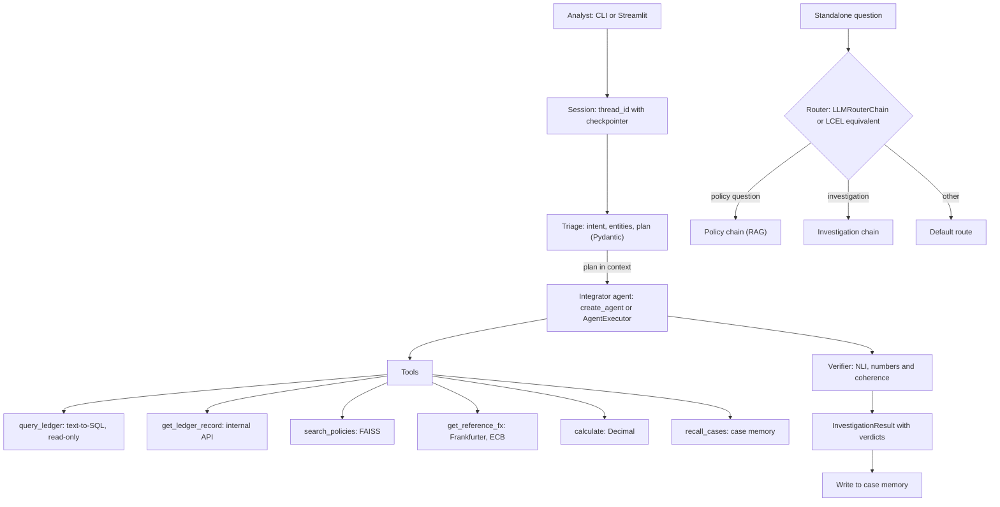
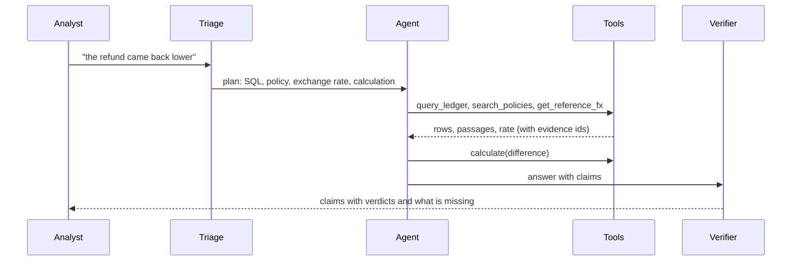

> Nota de tradução: este arquivo é a tradução em português brasileiro do original em inglês [`README.md`](README.md). O texto em inglês é a fonte da verdade: em caso de divergência entre os dois, prevalece o texto em inglês, conforme o [ADR-016](docs/decisions/ADR-016-brazilian-portuguese-translation-layer.md).

# LedgerLens

[](https://github.com/erikunha/ledgerlens/actions/workflows/gate.yml)


[](LICENSE)

Um agente LangChain que investiga reclamações de pagamento. Ele consulta o ledger de transações, busca políticas de operações, compara com uma taxa de câmbio de referência, faz a aritmética em código e verifica cada afirmação da própria resposta contra as evidências que usou. Quando a evidência não é suficiente, a resposta diz o que falta e o caso vai para revisão humana.


## Por que um agente

Um analista de operações de pagamento recebe reclamações como "o reembolso voltou menor", "me cobraram duas vezes" ou "o chargeback não foi lançado". Para responder, ele combina quatro fontes: o ledger de transações, as políticas, uma taxa de câmbio de referência e uma aritmética que não pode dar errado. O caminho muda a cada caso:

- um pedido de status precisa só de SQL;
- um reembolso em outra moeda precisa de SQL, política, taxa de câmbio e aritmética, nessa ordem;
- um pedido ambíguo pede uma pergunta de volta.

Uma chain fixa ou executa todas as etapas todas as vezes, ou deixa casos de fora. O agente escolhe as etapas a partir do pedido e da evidência, e a resposta mostra o que ele escolheu.

## O que ele faz

- Transforma a reclamação em um objeto de triagem validado (Pydantic): intenção, entidades, urgência e um plano passo a passo. A triagem roda antes do agente, e o plano entra no contexto do agente.
- Usa seis ferramentas:
  - `query_ledger`: text-to-SQL em um banco somente leitura, com uma guarda que recusa `UPDATE`, `DROP` e tabelas internas;
  - `get_ledger_record`: a API interna do ledger;
  - `search_policies`: busca de políticas sobre um índice FAISS pré-construído, com reescrita de consulta;
  - `get_reference_fx`: taxas de câmbio de referência do BCE pela API Frankfurter;
  - `calculate`: uma calculadora construída sobre `Decimal`, de modo que os números nunca vêm do modelo;
  - `recall_cases`: memória de casos de longo prazo.
- Mantém o histórico da sessão e recupera casos passados semelhantes por significado.
- Verifica cada afirmação da resposta: um modelo de NLI (inferência de linguagem natural) julga as afirmações de texto, e código confere números, taxas e datas de câmbio contra a evidência citada.
- Escala para revisão humana por regra: prazo de disputa perto de expirar, texto suspeito em um registro, fonte de taxa de câmbio fora do ar, afirmações sem evidência.
- Retorna um `InvestigationResult`: a resposta, cada afirmação com sua evidência, um veredito por afirmação (`supported`, `contradicted`, `not_enough_evidence`), o que falta e se a revisão humana é necessária.
- Nunca altera dados. O agente apenas recomenda.

## Arquitetura



Uma investigação, passo a passo:



O integrador vem em duas versões com as mesmas ferramentas, o mesmo prompt e o mesmo verificador: `create_agent` (LangChain 1.x, com checkpointer) e `AgentExecutor` com `RunnableWithMessageHistory` sobre um histórico em SQLite. As APIs legadas ficam ao lado das equivalentes atuais, para comparação ([ADR-010](docs/decisions/ADR-010-modern-integrator-legacy-as-demonstration.md)).

Os detalhes estão em [`docs/architecture.md`](docs/architecture.md), [`docs/tools.md`](docs/tools.md) e nos [registros de decisão (ADRs)](docs/decisions/). A [auditoria de prontidão para 2027](docs/readiness-2027.md) lê os oito componentes do sistema e diz o que cada um ainda precisa provar, com o arquivo e a linha por trás de cada afirmação.

## Dados

Dados públicos reais primeiro, simulação apenas onde nenhuma fonte pública cobre a necessidade ([ADR-009](docs/decisions/ADR-009-public-data-first-simulation-for-gaps.md)):

| Camada | Fonte |
|---|---|
| Pedidos e cancelamentos | UCI Online Retail II (CC BY 4.0) |
| Taxas de câmbio de referência | BCE via Frankfurter v1, conferidas com a taxa PTAX do banco central brasileiro |
| Dias úteis | a biblioteca `holidays` (calendários TARGET e B3) |
| Bandeiras de cartão | lista de BINs CC BY 4.0 |
| Simulado com uma semente fixa | merchants, chargebacks, settlements e fees, markup de câmbio, anomalias plantadas |

Os eventos entram em uma tabela `events` append-only, e um projetor constrói as tabelas que o agente lê. `data/scenarios.json` lista cada anomalia plantada com sua ground truth. As atribuições estão em [`NOTICE`](NOTICE).

## Início rápido

O site da demonstração mostra o produto, e ele responde em http://localhost:3000. Os dois pré-requisitos são Python 3.12, para o agente, e Node 24, para o site:

```bash
cd apps/web
npm ci
npm run dev
```

### Offline, sem chaves

Precisa de Python 3.12 e do [uv](https://docs.astral.sh/uv/).

```bash
uv sync --extra dev --extra app --extra api
export LEDGERLENS_OFFLINE=1
bash scripts/gate.sh        # ruff and pytest, all offline
```

No modo offline o modelo de chat é um modelo scriptado, os embeddings são locais (fastembed), o HTTP lê respostas gravadas e os dados vêm de uma amostra commitada. O código do agente não muda. Na primeira execução, o fastembed baixa o modelo de embeddings para o cache local.

### Aplicativo de demonstração (Streamlit)

A demonstração é um pequeno portal de pagamentos, o LedgerLens Pay, com contas fictícias vindas dos dados gerados. Ele abre já autenticado como o cliente C-0412; o **Switch demo account**, no topo, escolhe outro cliente ou merchant de um caso plantado (por exemplo o merchant M-03 ou o merchant M-09). O lado esquerdo mostra a atividade da conta em abas (Activity, Refunds, Disputes e, para um merchant, Payouts): primeiro o valor, depois o que é a linha, sua data e um selo de status, com filtros. Abra uma linha para ver os detalhes (id da transação, cartão, taxa de câmbio aplicada, fees, prazos) e pressione **Ask about this**: a pergunta sobre aquela linha cai na caixa Help, à direita, pronta para editar antes de enviar. O agente responde como o assistente de suporte. Ele recebe como contexto a conta autenticada e a linha escolhida, e suas ferramentas leem uma cópia do ledger que contém apenas os registros dessa conta.

Cada resposta carrega o trace do agente, uma árvore de execução como a do LangSmith, desenhada ao vivo enquanto o agente trabalha: a triagem, cada chamada de modelo (com tokens) e cada chamada de ferramenta (argumentos, o envelope de resposta e o SQL gerado), o veredito sobre cada afirmação e o escalonamento. Quando a investigação termina, o trace recolhe em um resumo de uma linha e a resposta aparece abaixo dele, com suas citações e os registros do ledger que o assistente leu marcados no extrato. A opção **Show the agent trace** (ativada por padrão) oculta o trace e as citações, e a resposta passa a ler como uma resposta de suporte. Offline, as perguntas plantadas têm respostas scriptadas: a diferença no reembolso por câmbio (TX-2048), a cobrança duplicada (TX-2051 e TX-2052), a disputa perto do prazo (CB-0310), o cálculo do payout (ST-0044) e um id que não existe (TX-9999). O **Ask about this** aparece apenas nessas linhas; outras perguntas precisam de um modelo configurado.

```bash
uv run streamlit run app/streamlit_app.py
```

### O site público (Next.js)

O site público da demonstração é uma exportação estática do Next.js que reproduz as investigações gravadas do pacote de design.

```bash
cd apps/web
npm ci              # a instalação travada, uma vez
npm run build       # produz a exportação estática em out/
npm run preview     # serve a exportação como arquivos simples, em http://localhost:3000
```

Os dois comandos que produzem o site e o servem são `npm run build` e `npm run preview`. O site precisa do Node 24 e de mais nada.

A metade gravada do site serve os artefatos gravados do repositório e não chama ninguém, então funciona sem chave, sem conta e sem rede. O visitante abre três rotas: `/replay`, o catálogo dos cenários publicados; `/replay/scenario/<id>`, uma investigação gravada, por exemplo `/replay/scenario/S01`; e `/sandbox`, o sandbox do visitante, onde um caso publicado é bifurcado em um branch privado da sessão. O sandbox é a única rota que chega ao backend da demonstração, e ela não precisa de chave. Uma quarta rota, `/live`, é o modo ao vivo e precisa de uma chave do próprio visitante. O tour da arquitetura está em `/engineering`.

[`apps/web/README.md`](apps/web/README.md) traz os comandos, os testes e as regras da pasta. [`docs/frontend.md`](docs/frontend.md) traz as três salas do site e o contrato da URL dele.

### Veja a execução

O vídeo abaixo é o app de demonstração rodando online com um modelo real, gravado em 2026-11-11: a pergunta, o trace do agente desenhado ao vivo enquanto o agente trabalha, e a resposta com as citações das fontes usadas.


[docs/demo.md](docs/demo.md) tem as notas da gravação: o modo, o que o vídeo mostra, os números na tela e como ele foi gravado.

### Online, com um modelo real

Copie `.env.example` para `.env`, preencha as chaves (`OPENAI_API_KEY` e, para traces e experimentos, `LANGSMITH_API_KEY`) e execute sem `LEDGERLENS_OFFLINE`. O modelo padrão é `gpt-4.1-mini`, com taxas de câmbio ao vivo.

## Modo ao vivo: traga a sua própria chave

A demonstração funciona sem nenhuma chave. O modo ao vivo é o ramo que você escolhe ativar: o visitante roda um caso real com uma chave do próprio provedor, dentro de um orçamento rígido, e todo o resto continua funcionando exatamente como antes. Neste marco, o ramo é do lado do servidor: as rotas existem e as páginas que as consomem ainda não ([ADR-035](docs/decisions/ADR-035-the-facade-of-the-live-mode.md)).

A demonstração do visitante é servida por um comando:

```bash
uv run ledgerlens-demo --port 8010
```

Esse comando serve a aplicação ligada da demonstração: o modo ao vivo e o sandbox do visitante em uma só aplicação, sobre um único emissor de sessão, um único repositório de branches, uma única camada de branches e um único cofre de credenciais, de modo que o branch que o sandbox bifurca é o branch que a execução ao vivo lê ([ADR-039](docs/decisions/ADR-039-the-wired-application-of-the-demo.md)). O visitante vê um cookie e uma sessão nas duas fachadas. As duas fachadas sozinhas são dois visitantes com um emissor cada, e a fábrica simples do `uvicorn` ainda serve um modo ao vivo sem camada de branches, que recusa toda execução com `503 BRANCH_LAYER_MISSING`. [O início rápido do modo ao vivo](specs/003-r3-bring-your-own-key/quickstart.md) mostra o fluxo inteiro, com as respostas reais.

O que ele faz:

- a chave chega uma vez, em `POST /v1/credentials`, e vive na memória do processo do servidor e em nenhum outro lugar: nem arquivo, nem banco de dados, nem log, nem trace, nem URL. A resposta carrega um handle opaco, o provedor e o prazo de validade, e nunca a chave em si;
- o handle fica preso à sessão do visitante. Um handle de outra sessão é recusado com a mesma mensagem de um handle que nunca existiu;
- a credencial morre quando o visitante a esquece, quando a sessão termina, quando passa o tempo de vida, quando o cofre enche, quando o servidor reinicia ou quando o provedor recusa a chave vezes demais. Uma credencial nunca sobrevive à sessão que a segura;
- o modelo vem do catálogo do servidor, que lista apenas os modelos cujo uso de ferramentas foi mesmo testado. Um modelo fora da lista é recusado pelo servidor, e um modelo sem a capacidade de que a arquitetura precisa é recusado com a capacidade que falta nomeada, nunca trocado por outro;
- a execução é limitada pelos tetos que o visitante define: as chamadas do modelo, as chamadas das ferramentas, os tokens de saída, o relógio de parede e o dinheiro. O contrato também aceita o teto opcional dos tokens de entrada, verificado no plano da execução, antes da chamada, porque o tamanho do pedido é conhecido antes da chamada. O relatório de custo mostra o custo observado e o custo estimado separados, e um modelo cujo preço nunca foi verificado não mostra valor nenhum;
- "esquecer a chave" está sempre lá e vale na hora, e cancelar uma execução interrompe as chamadas que ainda não começaram. Uma chamada que já estava no provedor é um esforço máximo, e a resposta diz isso.

**A divulgação.** Ela viaja em cabeçalhos, porque o contrato do handle não aceita nenhum outro campo:

| Cabeçalho | O que diz |
|---|---|
| `X-LedgerLens-Key-Storage` | a chave não é guardada: ela vive na memória do servidor e a credencial é descartada quando a sessão termina |
| `X-LedgerLens-Billing-Disclosure` | o seu provedor pode cobrar por você as chamadas desta execução |
| `X-LedgerLens-Key-Erasure` | a memória da máquina não pode ser garantida como apagada: o servidor descarta a chave quando a credencial termina, mas nenhum runtime pode prometer que nenhuma cópia do texto da chave sobrevive na memória do interpretador ou em uma swap do sistema operacional |

**A limitação.** O produto nunca escreve a chave em lugar nenhum e a descarta quando a credencial termina, mas ninguém pode prometer que nenhuma cópia do texto da chave sobreviva na memória do interpretador ou em uma swap do sistema operacional. O servidor limpa o que pode e diz em voz alta que não pode prometer o resto.

Enquanto o produto roda offline (`LEDGERLENS_OFFLINE=1`), o modo ao vivo é recusado com um motivo legível, e o replay e o sandbox continuam funcionando exatamente como antes.

## Resultados

Avaliação online: 30 casos, três execuções de cada variante, `gpt-4.1-mini` a temperatura 0. Média [mín, máx] sobre as três execuções.

| Variante | Corretude | Groundedness | Trajetória de ferramentas (equivalente, sem ordem) | Explicação (juiz LLM) | Enviadas para revisão humana (de 30) |
|---|---|---|---|---|---|
| A: chain sem ferramentas | 0.17 [0.17, 0.17] | 0.00 | 0.00 | 0.70 [0.69, 0.72] | 30.0 |
| B: agente ReAct | 0.55 [0.51, 0.58] | 0.00 | 0.64 [0.57, 0.70] | 0.83 [0.80, 0.87] | 29.0 [28, 30] |
| C: agente completo com verificador | 0.82 [0.79, 0.85] | 0.74 [0.71, 0.76] | 0.73 [0.73, 0.73] | 0.79 [0.77, 0.81] | 9.3 [8, 10] |

- O agente completo (C) acerta os fatos com muito mais frequência que a chain sem ferramentas (A) e o agente ReAct (B), e é a única variante cujas respostas estão ancoradas em evidência citada.
- A verificação mantém cerca de dois terços das respostas de C fora da fila de revisão humana. A e B não citam evidência, então toda resposta vai para revisão.
- A trajetória de ferramentas de C chega a 0.73 com a equivalência declarada (ler um registro por id com `query_ledger` ou `get_ledger_record`), abaixo da meta de 0.80.
- No seu conjunto de verificação de 43 casos (`data/eval/verification_set.jsonl`) o verificador acerta todos os vereditos: recall de contradição 1.00, sem falsos positivos. Esse número é o verificador INTEIRO sobre os seus 43 registros, o NLI e as verificações de código juntos, e não a acurácia do NLI da calibração, que é medida sobre 70 casos de NLI. Os 30 casos de texto desse conjunto são o conjunto de ajuste da varredura do [ADR-007](docs/decisions/ADR-007-nli-verification.md), então esta é uma medida sobre os dados em que os limiares foram escolhidos, e não uma generalização para dados nunca vistos: o conjunto reservado do verificador é outro conjunto, declarado com o papel `held_out` ([ADR-052](docs/decisions/ADR-052-the-manifest-of-the-eval-datasets.md), [ADR-059](docs/decisions/ADR-059-the-held-out-set-is-read-by-two-blind-machines-and-adjudicated.md)).
- No conjunto reservado de 48 casos (`data/eval/verification_heldout.jsonl`), o conjunto contra o qual nenhuma decisão deste repositório foi tomada, o verificador acerta 24 dos 48 (0,500): 23 dos 47 casos que passam pelo modelo de NLI e um que o código decide. O falso `supported` é 4 e o falso `contradicted` é 0, e o verificador diz `not_enough_evidence` em metade do conjunto, 24 casos, onde a leitura cega disse em seis. Os rótulos vêm de duas leituras cegas independentes com a adjudicação dos dois casos em que as leituras divergiram, e discordam da receita do gerador em 2 dos 48 ([ADR-059](docs/decisions/ADR-059-the-held-out-set-is-read-by-two-blind-machines-and-adjudicated.md)).
- Um caso de B falhou em uma execução porque o modelo escreveu um passo ReAct malformado; o harness agora pula esses passos em vez de descartar o caso.
- Trinta casos mostram uma tendência, não significância estatística. São os casos de `data/eval/eval_cases.jsonl`, um conjunto de ajuste deste repositório, então a corretude das três variantes é uma medida do ajuste delas e não uma generalização para dados nunca vistos ([ADR-052](docs/decisions/ADR-052-the-manifest-of-the-eval-datasets.md)). A execução custou cerca de US$ 0.59 a preço de tabela.

O relatório completo está em [`data/eval/report_online.md`](data/eval/report_online.md); o relatório offline, com o modelo scriptado, está em [`data/eval/report_offline.md`](data/eval/report_offline.md).

[`docs/evaluation.md`](docs/evaluation.md) diz o que cada número acima pode afirmar: o papel do conjunto de dados em que ele foi medido, o manifesto que o prende, a política de contaminação, o pino da calibração e o conjunto reservado com o número sobre ele e as três contagens da sua leitura cega.

## Testes e gate

`bash scripts/gate.sh` executa `ruff check` e `pytest -q` com `LEDGERLENS_OFFLINE=1`. É o mesmo comando que o CI executa ([`.github/workflows/gate.yml`](.github/workflows/gate.yml)). Os testes cobrem a guarda de SQL, a calculadora, as ferramentas, o verificador e o escalonamento, os dois integradores com scripts determinísticos, o simulador e a avaliação. O banco `data/ledger.db` é gerado a partir da amostra versionada e não é necessário para o gate.

## Estrutura

```text
ledgerlens/   package: config, schemas, prompts, chains, tools, memory, agents, verify, observability, eval, sim
app/          Streamlit demo portal (LedgerLens Pay) with the Help assistant
scripts/      gate, build_index, fetch_public_data, record_fixtures
data/         policies, fixtures, prebuilt FAISS index, sample, evaluation sets and reports
tests/        pytest suites mirroring the package
docs/         architecture, tools, contracts and decisions (ADRs)
```

## Limitações

- A taxa de câmbio é uma referência do BCE, não a taxa que o adquirente aplicou. O agente diz isso.
- Os pedidos de origem são reais, mas antigos, com datas deslocadas. Chargebacks, settlements, fees e markups são simulados e marcados na coluna `origin`.
- Trinta casos de avaliação mostram uma tendência, não significância estatística.
- A recuperação de políticas pelo índice offline perde algumas perguntas difíceis; a reescrita de consulta recupera a maioria delas ([ADR-006](docs/decisions/ADR-006-embeddings-and-index.md)).
- O modelo de NLI costuma marcar frases verdadeiras como sem evidência suficiente, então muitas respostas reais ainda vão para revisão humana. Números, taxas e datas de câmbio são conferidos por código.
- A resposta é produzida por um agente de IA, e uma pessoa revisa os casos que precisam de revisão.
- O agente apenas recomenda. Ele não move dinheiro nem altera registros.
- O modo ao vivo nunca escreve a chave em um arquivo, um log ou um trace e a descarta quando a credencial termina, mas nenhum runtime pode prometer que nenhuma cópia do texto da chave sobrevive na memória do interpretador ou em uma swap do sistema operacional.
- Uma execução ao vivo é paga pelo visitante: o provedor do visitante pode cobrar do visitante pelas chamadas da execução.

## Licença

MIT, consulte [`LICENSE`](LICENSE). As fontes de dados mantêm suas próprias licenças (consulte [`NOTICE`](NOTICE)).
