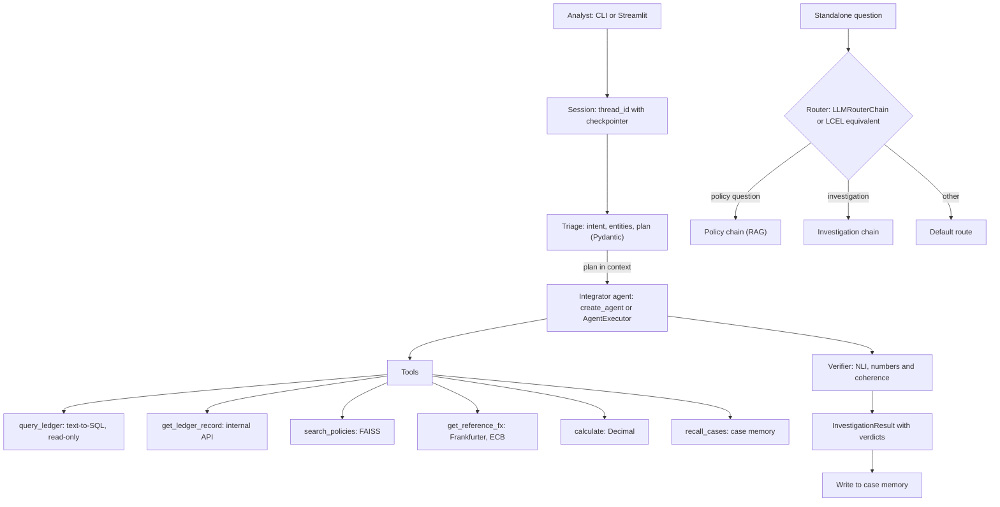
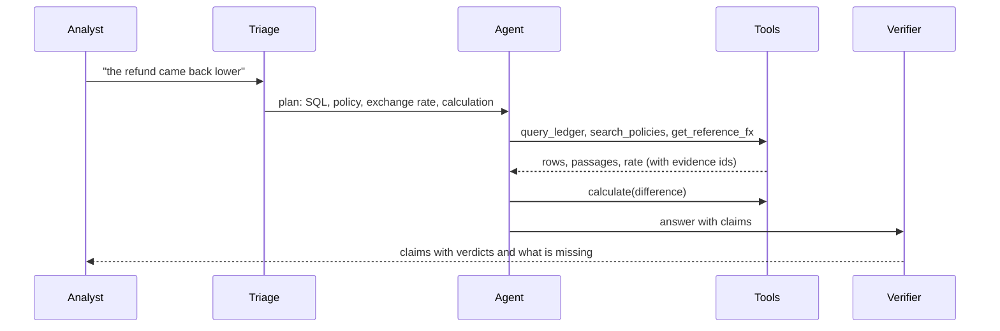

> Nota de tradução: este arquivo é a tradução em português brasileiro do original em inglês [`README.md`](README.md). O texto em inglês é a fonte da verdade: em caso de divergência entre os dois, prevalece o texto em inglês, conforme o [ADR-016](docs/decisions/ADR-016-brazilian-portuguese-translation-layer.md).

# LedgerLens

[](https://github.com/erikunha/ledgerlens/actions/workflows/gate.yml)


[](LICENSE)

Um agente LangChain que investiga reclamações de pagamento. Ele consulta o ledger de transações, busca políticas de operações, compara com uma taxa de câmbio de referência, faz a aritmética em código e verifica cada afirmação da própria resposta contra as evidências que usou. Quando a evidência não é suficiente, a resposta diz o que falta e o caso vai para revisão humana.


## Por que um agente

Um analista de operações de pagamento recebe reclamações como "o reembolso voltou menor", "me cobraram duas vezes" ou "o chargeback não foi lançado". Para responder, ele combina quatro fontes: o ledger de transações, as políticas, uma taxa de câmbio de referência e uma aritmética que não pode dar errado. O caminho muda a cada caso:

- um pedido de status precisa só de SQL;
- um reembolso em outra moeda precisa de SQL, política, taxa de câmbio e aritmética, nessa ordem;
- um pedido ambíguo pede uma pergunta de volta.

Uma chain fixa ou executa todas as etapas todas as vezes, ou deixa casos de fora. O agente escolhe as etapas a partir do pedido e da evidência, e a resposta mostra o que ele escolheu.

## O que ele faz

- Transforma a reclamação em um objeto de triagem validado (Pydantic): intenção, entidades, urgência e um plano passo a passo. A triagem roda antes do agente, e o plano entra no contexto do agente.
- Usa seis ferramentas:
  - `query_ledger`: text-to-SQL em um banco somente leitura, com uma guarda que recusa `UPDATE`, `DROP` e tabelas internas;
  - `get_ledger_record`: a API interna do ledger;
  - `search_policies`: busca de políticas sobre um índice FAISS pré-construído, com reescrita de consulta;
  - `get_reference_fx`: taxas de câmbio de referência do BCE pela API Frankfurter;
  - `calculate`: uma calculadora construída sobre `Decimal`, de modo que os números nunca vêm do modelo;
  - `recall_cases`: memória de casos de longo prazo.
- Mantém o histórico da sessão e recupera casos passados semelhantes por significado.
- Verifica cada afirmação da resposta: um modelo de NLI (inferência de linguagem natural) julga as afirmações de texto, e código confere números, taxas e datas de câmbio contra a evidência citada.
- Escala para revisão humana por regra: prazo de disputa perto de expirar, texto suspeito em um registro, fonte de taxa de câmbio fora do ar, afirmações sem evidência.
- Retorna um `InvestigationResult`: a resposta, cada afirmação com sua evidência, um veredito por afirmação (`supported`, `contradicted`, `not_enough_evidence`), o que falta e se a revisão humana é necessária.
- Nunca altera dados. O agente apenas recomenda.

## Arquitetura



Uma investigação, passo a passo:



O integrador vem em duas versões com as mesmas ferramentas, o mesmo prompt e o mesmo verificador: `create_agent` (LangChain 1.x, com checkpointer) e `AgentExecutor` com `RunnableWithMessageHistory` sobre um histórico em SQLite. As APIs legadas ficam ao lado das equivalentes atuais, para comparação ([ADR-010](docs/decisions/ADR-010-modern-integrator-legacy-as-demonstration.md)).

Os detalhes estão em [`docs/architecture.md`](docs/architecture.md), [`docs/tools.md`](docs/tools.md) e nos [registros de decisão (ADRs)](docs/decisions/).

## Dados

Dados públicos reais primeiro, simulação apenas onde nenhuma fonte pública cobre a necessidade ([ADR-009](docs/decisions/ADR-009-public-data-first-simulation-for-gaps.md)):

| Camada | Fonte |
|---|---|
| Pedidos e cancelamentos | UCI Online Retail II (CC BY 4.0) |
| Taxas de câmbio de referência | BCE via Frankfurter v1, conferidas com a taxa PTAX do banco central brasileiro |
| Dias úteis | a biblioteca `holidays` (calendários TARGET e B3) |
| Bandeiras de cartão | lista de BINs CC BY 4.0 |
| Simulado com uma semente fixa | merchants, chargebacks, settlements e fees, markup de câmbio, anomalias plantadas |

Os eventos entram em uma tabela `events` append-only, e um projetor constrói as tabelas que o agente lê. `data/scenarios.json` lista cada anomalia plantada com sua ground truth. As atribuições estão em [`NOTICE`](NOTICE).

## Início rápido

### Offline, sem chaves

Precisa de Python 3.12 e do [uv](https://docs.astral.sh/uv/).

```bash
uv sync --extra dev --extra app --extra api
export LEDGERLENS_OFFLINE=1
bash scripts/gate.sh        # ruff and pytest, all offline
```

No modo offline o modelo de chat é um modelo scriptado, os embeddings são locais (fastembed), o HTTP lê respostas gravadas e os dados vêm de uma amostra commitada. O código do agente não muda. Na primeira execução, o fastembed baixa o modelo de embeddings para o cache local.

### Aplicativo de demonstração (Streamlit)

A demonstração é um pequeno portal de pagamentos, o LedgerLens Pay, com contas fictícias vindas dos dados gerados. Ele abre já autenticado como o cliente C-0412; o **Switch demo account**, no topo, escolhe outro cliente ou merchant de um caso plantado (por exemplo o merchant M-03 ou o merchant M-09). O lado esquerdo mostra a atividade da conta em abas (Activity, Refunds, Disputes e, para um merchant, Payouts): primeiro o valor, depois o que é a linha, sua data e um selo de status, com filtros. Abra uma linha para ver os detalhes (id da transação, cartão, taxa de câmbio aplicada, fees, prazos) e pressione **Ask about this**: a pergunta sobre aquela linha cai na caixa Help, à direita, pronta para editar antes de enviar. O agente responde como o assistente de suporte. Ele recebe como contexto a conta autenticada e a linha escolhida, e suas ferramentas leem uma cópia do ledger que contém apenas os registros dessa conta.

Cada resposta carrega o trace do agente, uma árvore de execução como a do LangSmith, desenhada ao vivo enquanto o agente trabalha: a triagem, cada chamada de modelo (com tokens) e cada chamada de ferramenta (argumentos, o envelope de resposta e o SQL gerado), o veredito sobre cada afirmação e o escalonamento. Quando a investigação termina, o trace recolhe em um resumo de uma linha e a resposta aparece abaixo dele, com suas citações e os registros do ledger que o assistente leu marcados no extrato. A opção **Show the agent trace** (ativada por padrão) oculta o trace e as citações, e a resposta passa a ler como uma resposta de suporte. Offline, as perguntas plantadas têm respostas scriptadas: a diferença no reembolso por câmbio (TX-2048), a cobrança duplicada (TX-2051 e TX-2052), a disputa perto do prazo (CB-0310), o cálculo do payout (ST-0044) e um id que não existe (TX-9999). O **Ask about this** aparece apenas nessas linhas; outras perguntas precisam de um modelo configurado.

```bash
uv run streamlit run app/streamlit_app.py
```

### Veja a execução

O vídeo abaixo é este app rodando online com um modelo real, gravado em 2026-11-11: a pergunta, o trace do agente desenhado ao vivo enquanto o agente trabalha, e a resposta com as citações das fontes usadas.


[docs/demo.md](docs/demo.md) tem as notas da gravação: o modo, o que o vídeo mostra, os números na tela e como ele foi gravado.

### Online, com um modelo real

Copie `.env.example` para `.env`, preencha as chaves (`OPENAI_API_KEY` e, para traces e experimentos, `LANGSMITH_API_KEY`) e execute sem `LEDGERLENS_OFFLINE`. O modelo padrão é `gpt-4.1-mini`, com taxas de câmbio ao vivo.

## Resultados

Avaliação online: 30 casos, três execuções de cada variante, `gpt-4.1-mini` a temperatura 0. Média [mín, máx] sobre as três execuções.

| Variante | Corretude | Groundedness | Trajetória de ferramentas (equivalente, sem ordem) | Explicação (juiz LLM) | Enviadas para revisão humana (de 30) |
|---|---|---|---|---|---|
| A: chain sem ferramentas | 0.17 [0.17, 0.17] | 0.00 | 0.00 | 0.70 [0.69, 0.72] | 30.0 |
| B: agente ReAct | 0.55 [0.51, 0.58] | 0.00 | 0.64 [0.57, 0.70] | 0.83 [0.80, 0.87] | 29.0 [28, 30] |
| C: agente completo com verificador | 0.82 [0.79, 0.85] | 0.74 [0.71, 0.76] | 0.73 [0.73, 0.73] | 0.79 [0.77, 0.81] | 9.3 [8, 10] |

- O agente completo (C) acerta os fatos com muito mais frequência que a chain sem ferramentas (A) e o agente ReAct (B), e é a única variante cujas respostas estão ancoradas em evidência citada.
- A verificação mantém cerca de dois terços das respostas de C fora da fila de revisão humana. A e B não citam evidência, então toda resposta vai para revisão.
- A trajetória de ferramentas de C chega a 0.73 com a equivalência declarada (ler um registro por id com `query_ledger` ou `get_ledger_record`), abaixo da meta de 0.80.
- No seu conjunto de verificação de 43 casos o verificador acerta todos os vereditos: recall de contradição 1.00, sem falsos positivos.
- Um caso de B falhou em uma execução porque o modelo escreveu um passo ReAct malformado; o harness agora pula esses passos em vez de descartar o caso.
- Trinta casos mostram uma tendência, não significância estatística. A execução custou cerca de US$ 0.59 a preço de tabela.

O relatório completo está em [`data/eval/report_online.md`](data/eval/report_online.md); o relatório offline, com o modelo scriptado, está em [`data/eval/report_offline.md`](data/eval/report_offline.md).

## Testes e gate

`bash scripts/gate.sh` executa `ruff check` e `pytest -q` com `LEDGERLENS_OFFLINE=1`. É o mesmo comando que o CI executa ([`.github/workflows/gate.yml`](.github/workflows/gate.yml)). Os testes cobrem a guarda de SQL, a calculadora, as ferramentas, o verificador e o escalonamento, os dois integradores com scripts determinísticos, o simulador e a avaliação. O banco `data/ledger.db` é gerado a partir da amostra versionada e não é necessário para o gate.

## Estrutura

```text
ledgerlens/   package: config, schemas, prompts, chains, tools, memory, agents, verify, observability, eval, sim
app/          Streamlit demo portal (LedgerLens Pay) with the Help assistant
scripts/      gate, build_index, fetch_public_data, record_fixtures
data/         policies, fixtures, prebuilt FAISS index, sample, evaluation sets and reports
tests/        pytest suites mirroring the package
docs/         architecture, tools, contracts and decisions (ADRs)
```

## Limitações

- A taxa de câmbio é uma referência do BCE, não a taxa que o adquirente aplicou. O agente diz isso.
- Os pedidos de origem são reais, mas antigos, com datas deslocadas. Chargebacks, settlements, fees e markups são simulados e marcados na coluna `origin`.
- Trinta casos de avaliação mostram uma tendência, não significância estatística.
- A recuperação de políticas pelo índice offline perde algumas perguntas difíceis; a reescrita de consulta recupera a maioria delas ([ADR-006](docs/decisions/ADR-006-embeddings-and-index.md)).
- O modelo de NLI costuma marcar frases verdadeiras como sem evidência suficiente, então muitas respostas reais ainda vão para revisão humana. Números, taxas e datas de câmbio são conferidos por código.
- O agente apenas recomenda. Ele não move dinheiro nem altera registros.

## Licença

MIT, consulte [`LICENSE`](LICENSE). As fontes de dados mantêm suas próprias licenças (consulte [`NOTICE`](NOTICE)).
