# LedgerLens cognitive architecture

This document covers the anatomy of the agent, its type and maturity level, the planning design, the choice between imperative and declarative composition, and the live mode in which the visitor brings a key of their own. The tools are in `docs/tools.md`. The recorded demo of the first public release is in [the quickstart of the release](../specs/001-r1-public-replay/quickstart.md), where a reader finds how to install the repository, how to capture the recording, how to publish the artifacts the site reads and how to run the two gates of the repository.

## 1. Anatomy of the agent

An agent here is a language model inside a loop that decides, observes and decides again. The five blocks:

| Block | What it is in LedgerLens | Where it is in the code |
|---|---|---|
| Language model | any chat model with tool calling, created by `init_chat_model`; OpenAI by default online; a scripted model offline | `ledgerlens/config.py`, `ledgerlens/offline.py` |
| System message | a prompt in the PTCF format (Persona, Task, Context, Format), with examples and the plan format | `ledgerlens/prompts/system.py` |
| Memory | short term (session messages, with trimming and summary) and long term (past cases in FAISS) | `ledgerlens/memory/` |
| Tools | `query_ledger`, `get_ledger_record`, `search_policies`, `get_reference_fx`, `calculate`, `recall_cases` | `ledgerlens/tools/` |
| Knowledge base | eight policy documents, indexed once in FAISS, and the transaction database | `data/policies/`, `data/index/`, `data/ledger.db` |

The five blocks form a loop: the model reads the system message and the memory, picks a tool, receives the result and decides again, until it can answer.

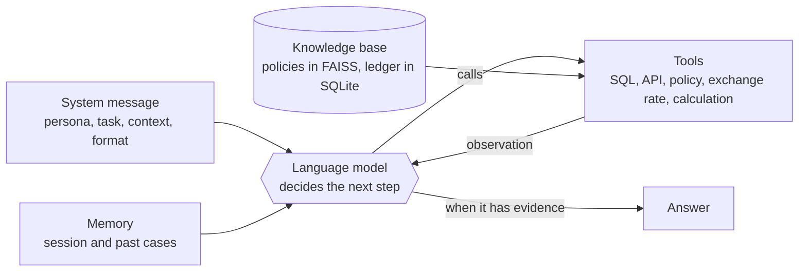

Around them sit triage (structured input), the verifier (output with verdicts) and callbacks (a record of every event). The component diagram shows the links.

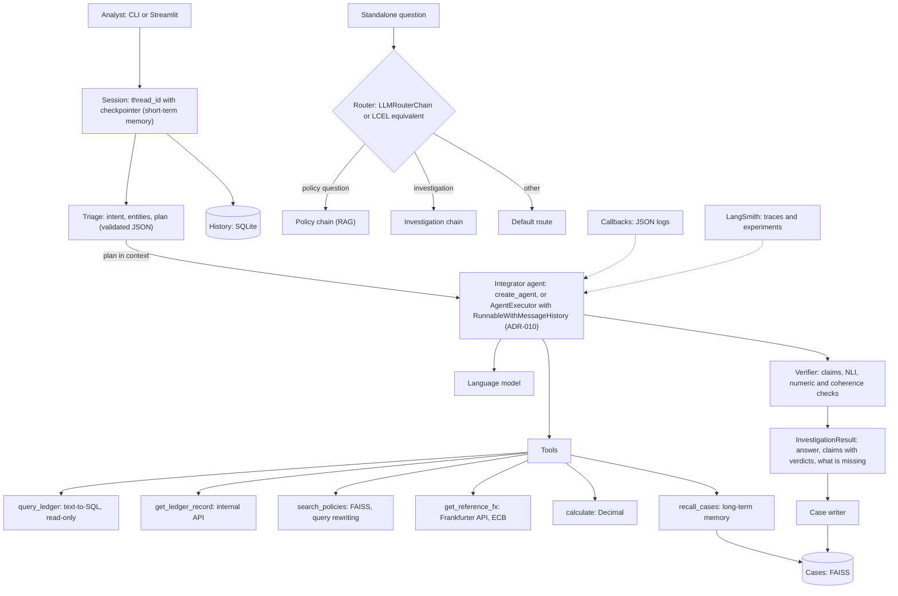

### The demo app

`app/streamlit_app.py` puts the integrator behind a small payments portal. The person signs in as one customer or merchant, reads that account's activity and asks the Help assistant about a line. Two things reach the agent besides the question:

- a context message (`investigate(..., context=...)`), a system message right before the question that names the signed-in account and the line picked; triage still reads only the question;
- a ledger scoped to the account (`ledgerlens/api/accounts.py`, `scoped_ledger`): a copy that keeps only the account's transactions, refunds, chargebacks, applied FX and, for a merchant, its settlements. The tools and the verifier read that copy, so a query cannot return another customer's rows, whatever SQL the model writes.

The statement itself comes from read-only, parameterized queries in the same module (`account_statement`). What the page shows about each turn (lines read, verdict counts) and the offline scripts of the planted questions, including a scripted triage (`offline_triage`), are in `ledgerlens/demo.py`.

**The agent trace in each answer.** While the agent works, the assistant's message shows the investigation's run tree, like LangSmith's, drawn live in an `st.status`. It comes from `investigate(..., on_event=...)`: `ledgerlens/observability/trace.py` knows nothing about the screen and emits a `Span` when each run starts and again when it ends (`run_id`, `parent_run_id`, `name`, `run_type`, `start_time`, `end_time`, `latency_ms`, `inputs`, `outputs`, `error`, `metadata` with the model and the tokens). A `BaseCallbackHandler` passed in the config of the triage and agent calls turns LangChain runs into spans; LangGraph's internal runs, tagged `langsmith:hidden`, are left out. The integrator opens spans of its own for what is not a LangChain run: the root `investigate`, the plan's single follow-up (`plan_followup`), verification with one child per claim, escalation and saving the case. Without `on_event` no callback is added and the result is the same; `investigate_with_executor` emits the same tree. Inputs and outputs go through `compact`, which cuts long lists and texts and erases API keys.

Each node shows `run_type · name · latency · tokens`, the generated SQL in view and the span's JSON collapsed; an error shows in red. At the end the block collapses into a one-line summary ("Checked 4 sources in 6.2 s: 3 claims supported, 1 without evidence"), and the spans are stored with the message, so the trace still opens from the history. The tools run in the graph executor's threads and Streamlit only draws on the page's thread, so the investigation runs in a thread of its own and the page draws the spans that arrive on a queue. The answer does not stream token by token, because the verifier reads the whole answer and may rewrite it; it appears finished, below the trace. With LangChain tracing on in the process, links to the runs in LangSmith appear under the summary. The switch **Show the agent trace** (on by default) hides the trace and the citations, so the answer reads as a support reply.

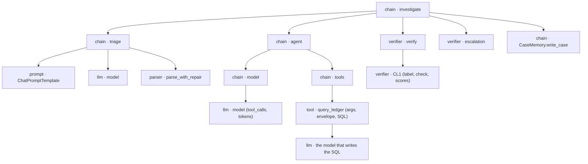

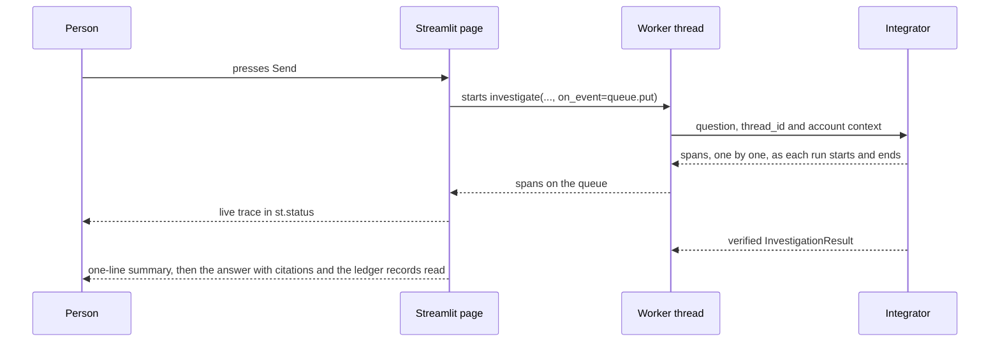

## 2. Agent type and maturity level

### Type: hybrid, deliberative and reactive

| Part | Nature | Why |
|---|---|---|
| Triage and plan | deliberative | before acting, the system classifies the intent and writes a plan with steps and the expected tool for each |
| Agent loop (ReAct) | reactive | at each step the agent looks at the last result and picks the next action; it can drop or revise the plan |
| Verification | deliberative | only after the answer, and with explicit rules |

Triage plans and executes nothing; the reactive loop executes. A purely reactive agent would pick tools with no stated goal and get lost in multi-step cases. A purely deliberative one would run the whole plan even when an observation (for example, "the currency has no quote") invalidates it.

### Agentic maturity level

There is no standard scale that everyone accepts. This project uses its own five-level scale, defined here so it can say where the agent stands:

| Level | Description |
|---|---|
| 1 | Direct model answer, no tools |
| 2 | Fixed chain: steps decided by the programmer, structured output |
| 3 | Agent that decides which tools to use and in what order (ReAct), with session memory |
| 4 | Level 3 plus an explicit plan, long-term memory, verification of its own answers and measured evaluation |
| 5 | Level 4 plus actions with effect on the world and continuous learning with minimal supervision |

| Component | Level |
|---|---|
| Triage alone, measured below | 2 |
| Agent with tools | 3 |
| Integrator with memory, verification and evaluation | 4 |
| Out of scope | 5: the agent never changes data and never decides to pay or refuse on its own; it only recommends and asks for human review |

### Measured on triage

These numbers come from runs and tests, not from a plan. The reason for level 2 is the last item: the chain has fixed steps chosen by the programmer and no tool runs.

| Fact | Value | Where to check it |
|---|---|---|
| Versions used | `langchain` 1.4.9 and `langchain-core` 1.7.6 | `pyproject.toml` |
| Fixed triage cases | 10: scenarios S01 to S06, S08 and S10, one vague request and one prompt injection | `data/eval/triage_cases.jsonl` |
| Triage compositions | 2 (`@chain` and LCEL), with equal results on the 10 cases and the same prompt sent to the model | `tests/chains/test_triage.py` |
| Answer repair | at most 1 call per answer; after that a `TriageError` comes back | `tests/chains/test_triage_parser.py` |
| Triage tests | 94 (prompts, parser and chain) | `uv run pytest -q tests/chains/test_triage.py tests/chains/test_triage_parser.py tests/test_prompts.py` |
| Tools run by triage | 0: the plan only describes the steps | level 2 of the scale above |

## 3. Planning design

The plan is a hierarchical decomposition: one goal, sub-goals and steps, each step with the expected tool and its dependencies.

```text
Goal: explain why the BRL refund for TX-2048 was lower than the EUR payment
├─ S1  fetch the transaction and the refund               -> query_ledger
├─ S2  fetch the cross-currency refund policy             -> search_policies      (depends on S1)
├─ S3  fetch the reference rate on the date               -> get_reference_fx     (depends on S1)
├─ S4  separate market movement from markup               -> calculate            (depends on S1, S3)
└─ S5  build the answer with evidence                     -> (no tool)            (depends on S2, S4)
```

Planning rules:

1. Triage produces the plan as part of the `Triage` object (the `plan` field, a list of `PlanStep`). The plan goes into the agent's context.
2. The agent runs the ReAct loop. If an observation invalidates a step (a currency with no quote, a missing row), it records the deviation and revises the plan instead of following it blindly.
3. A lookup that requires a missing identifier (for example, "the money did not arrive") produces `needs_clarification` and a question back, with no tool calls. If a first-turn mixed request also has an independent policy search, the investigator answers the policy question and asks for the identifier needed for the lookup. A request with an identifier that matches two transactions (scenario S05) shows the ambiguity only after the ledger query: triage plans the query and the agent asks afterward.
4. Steps S2 and S3 do not depend on each other and can run in parallel (a parallel chain).
5. The plan is an intention, not a proof. The evaluation compares the tools actually called (the trajectory) with the expected ones.

How the code applies these rules in both integrators (`ledgerlens/agents/integrator.py` and `executor_integrator.py`):

- Triage runs before the agent, with the configured model or the `triage_model` given to the constructor. The plan goes in as a system message with a warning that it may be revised. In the legacy executor it stays out of the stored history and is repeated on every turn of the loop.
- The `Triage` is kept in `InvestigationResult.triage`. The `plan_deviations` field records, by code, the step with a tool that did not run and the tool called outside the plan: it is the measure of deviation, and the agent does not have to remember to record it.
- A step with a tool that did not run is requested once, in code: at the end of the turn, the integrator asks the agent to call the tool or say in one sentence why it is not needed, and builds the result from what came after (the calls and the new answer). There is never a second request. The request goes into `plan_deviations` with the step, the tool and whether the agent called it; if the request call fails, the existing answer stays and `plan_deviations` says the request failed. In the legacy executor the request is a second entry in the same session, with the plan (if any) repeated as context.
- The same single request covers the exchange rate of a date with no source: if the agent queried the ledger, asked `get_reference_fx` for a day that no ledger date column carries and the question does not cite, and did not ask for any ledger date, the request names the day, tells the agent to read the payment or refund date from the ledger and redo the calculation with that date's rate. A plan step and such a date in the same turn share one request, recorded in `plan_deviations`. The verifier then checks the exchange rate the final answer uses (the coherence rule `fx_date_origin`, [ADR-007](decisions/ADR-007-nli-verification.md)).
- `needs_clarification` returns the question without calling the agent or the tools, but only on the first message of the conversation. Triage reads only the current question; in a later turn ("and the refund?") it would find the request vague, so there it simply gives no plan and the agent, which sees the history, answers. The question back and the user's reply go into the session history.
- If triage fails (network, quota, unreadable response), the agent answers without a plan and the failure goes to the log.

Sequence of a full investigation (scenario S01):

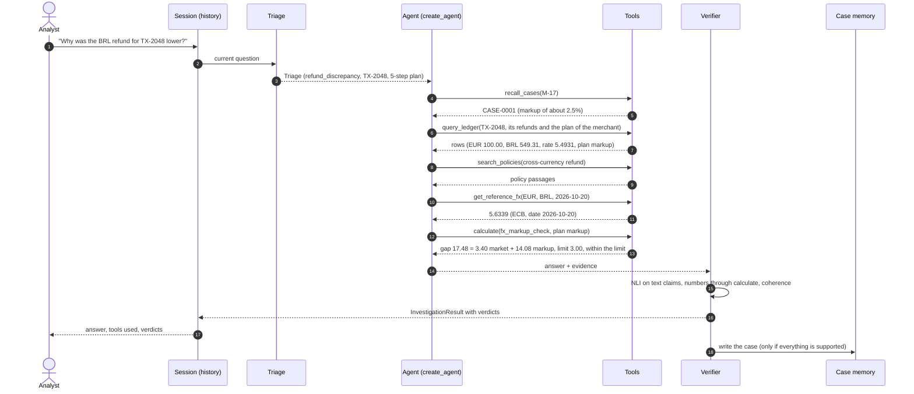

## 4. Memory in brief (CoALA)

One line per type:

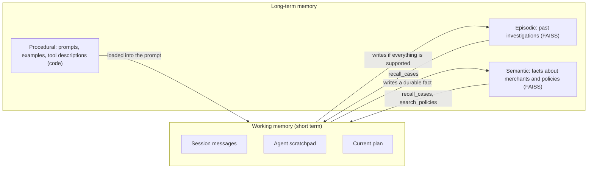

## 5. Triage and parser flow

Triage turns free text into a validated object. The path of a complaint:

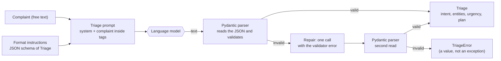

The repair runs at most once. The state of an answer moves through these points:

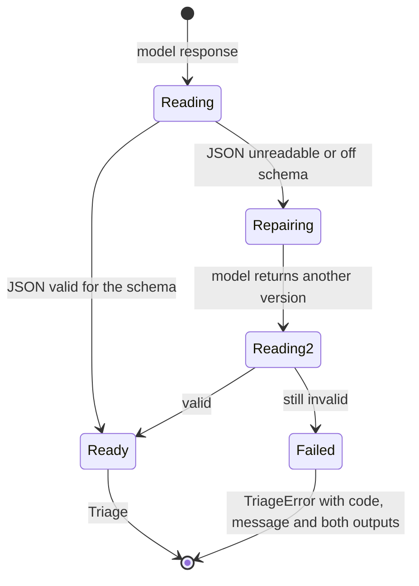

A failure of the model call itself (network, quota) does not go through here: it raises an exception, because hiding that defect as a parse error would mask an infrastructure problem.

## 6. Imperative or declarative

Triage exists in both forms, with the same prompts and the same parser: one with `@chain` (plain Python code that calls runnables) and one with LCEL (composition with `|`). A test requires equal results on the 10 fixed cases.

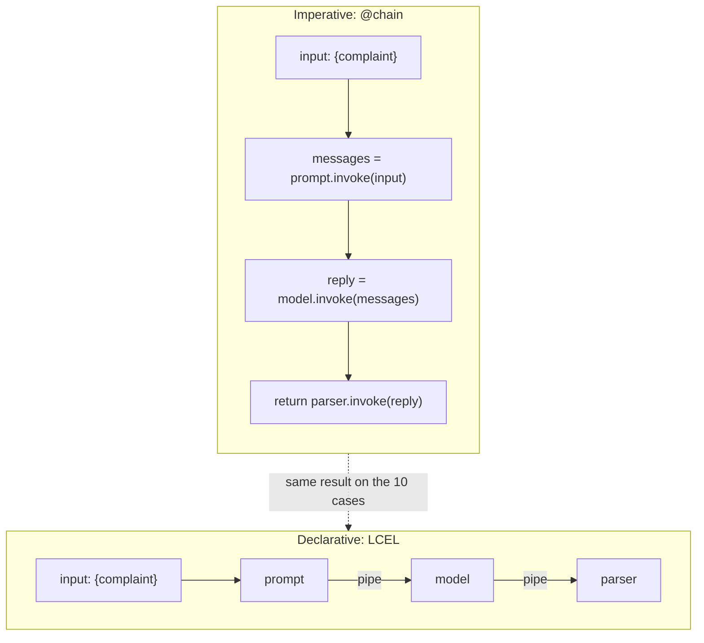

Measured in the tests (`tests/chains/test_triage.py`):

| Criterion | `@chain` (imperative) | LCEL (declarative) |
|---|---|---|
| Result on the 10 cases | equal to the reference | equal to the reference |
| Flow with branches (retry, choose a path) | natural: `if`, `try`, loops | needs `RunnableBranch`, `RunnableLambda` or `with_retry` |
| Reading a linear sequence | you have to read the code | reads left to right |
| `invoke` | works | works |
| `batch` | one item at a time, from prompt to parser | step by step: all items pass through the model before any repair |
| `stream` of the whole chain | one chunk: the validated `Triage` | one chunk: the validated `Triage` |
| `stream` before the parser | not applicable (the function only returns at the end) | text in chunks, which together form the JSON |

Two practical consequences came out of this measurement. First, the validated object exists only with the complete JSON, so `stream` delivers the result all at once; chunked output is useful for showing the text arriving. Second, the scripted model answers in the order of the calls, and that order changes between the styles in `batch`, so its tests use one item at a time (`max_concurrency=1`).

Time and cost were not measured: the model is scripted. The debugging argument (each step shows up as a separate run in traces) comes from reading the documentation and was not measured.

**Decision:** LCEL for linear sequences (prompt, model, parser), because the flow is visible on one line and `batch` and `stream` come from the composition itself. `@chain` where there is flow control: the repair with a single retry (it is in `make_repairing_parser`), the choice between verifying with NLI or with code, and the assembly of the `InvestigationResult`. The full imperative version of triage stays for comparison; the rest of the code reuses the declarative one. The legacy agent and the integrator use each one's own API and are not rewritten in LCEL.

## 7. The live mode: bring your own key

The demo runs with no key at all: the model is scripted, the data comes from the sample and the replay works offline. The live mode is the opt-in branch of it, where a visitor runs a real case with a key of their own provider. In this milestone the branch is server side: the facade and the coordinator exist, and the pages that consume them were delivered with them in R3 ([ADR-035](decisions/ADR-035-the-facade-of-the-live-mode.md), superseded by [ADR-066](decisions/ADR-066-the-pages-of-the-live-mode-exist-and-the-readme-was-the-one-that-was-wrong.md)).

Three things hold that branch together: the lifecycle of the credential, the enforcement of the budget and the ledger of the visitor. The vault holds the secret, the coordinator holds the run, the branch layer holds the ledger, and none of them reads a global setting.

### 7.1 The routes

The live mode is a facade of its own (`ledgerlens/api/byok.py`, `create_app`), with a router of its own and a session issuer of its own, and it answers eleven routes:

| Route | What it answers |
|---|---|
| `POST /v1/sessions` | a session of the live flow, with the capability `live_agent` |
| `DELETE /v1/sessions/current` | the end of the session: it drops the credentials of that session |
| `POST /v1/credentials` | the handle of the accepted key, with the provider and the expiry |
| `POST /v1/credentials/forget` | whether there was a key to forget |
| `GET /v1/models` | the catalogue of the models the visitor may pick |
| `GET /v1/models/{profile_id}` | the price of a model, with its provenance and the day it was verified |
| `POST /v1/live-runs` | the identifier of a run that starts |
| `GET /v1/live-runs/{run_id}` | the state of a run, its answer and the reason it ended |
| `GET /v1/live-runs/{run_id}/events` | the trace of a run, as a stream of server sent events |
| `POST /v1/live-runs/{run_id}/cancel` | the end of a run, and whether the cancellation was a best effort |
| `GET /v1/live-runs/{run_id}/cost` | what the run consumed, with the two costs apart |

The route of the run never accepts a raw key: its body carries the handle of a credential and nothing else, and it is checked against the published contract `specs/003-r3-bring-your-own-key/contracts/live-run-request.schema.json` before the route reads anything. A run of another session is refused with the answer of a run that does not exist (`_own_run`), and a handle of another session is refused with the answer of a handle that never existed.

The repository serves the demo with the wired application of the demo (`ledgerlens/api/wiring.py`, `build_wired_app`) and the console script `ledgerlens-demo`, and the command is one: `uv run ledgerlens-demo --port 8010`. The wired application mounts the two routers of the demo in one application over one session issuer, one store of branches, one base resolver, one branch layer, one vault of the credentials and one runtime folder, so the visitor is one visitor over the two facades (the section [the wired application](#75-the-wired-application-of-the-demo) says how).

### 7.2 The lifecycle of the credential

| Link | What happens | Where it is held |
|---|---|---|
| The key arrives | The visitor posts the provider and the key. The key lives in the memory of the process and nowhere else: no file, no database, no log, no trace, no URL, and it never travels back to the client | `accept_credential` in `ledgerlens/api/byok.py`; `CredentialVault.accept` in `ledgerlens/byok/vault.py` |
| The handle | The vault answers with a handle that is opaque and random, never derived from the secret, and bound to the session of the visitor. It carries the provider, the creation and the expiry, and never the secret | `CredentialVault._new_handle` and `CredentialHandle.to_public_dict` in `ledgerlens/byok/vault.py` |
| A handle of another session | It is refused with the same message as a handle that never existed, so a visitor cannot learn that the handle of another session exists | `CredentialVault.resolve`; `CredentialUnknown` in `ledgerlens/byok/errors.py` |
| The death of the credential | The visitor forgets it, the session ends, the time to live passes, the vault is full, the server restarts, or the provider refuses the key too many times | `CredentialVault.forget`, `forget_session`, `_sweep_locked`, `_make_room_locked` and `record_failure` in `ledgerlens/byok/vault.py` |
| The time to live | It is the smaller of the life of the vault and the life the session has left, and never less than a second, so a credential never outlives the session that holds it | `_the_time_to_live_of_a_credential` in `ledgerlens/api/byok.py` |
| The secret of a credential that is gone | The vault does not keep it. While a run lives, the coordinator holds the secret of that run in the memory of the process, scrubs everything it writes with it at every depth of a payload, and releases it when the run ends | `LiveRunCoordinator._run_the_case` and `_RunSecret` in `ledgerlens/api/live_run.py` |
| The endpoint of the provider | It is an allowlist of published endpoints, and a link-local or a loopback address is refused in public mode | `ALLOWED_ENDPOINTS` and `endpoint_verdict` in `ledgerlens/byok/adapter.py` |

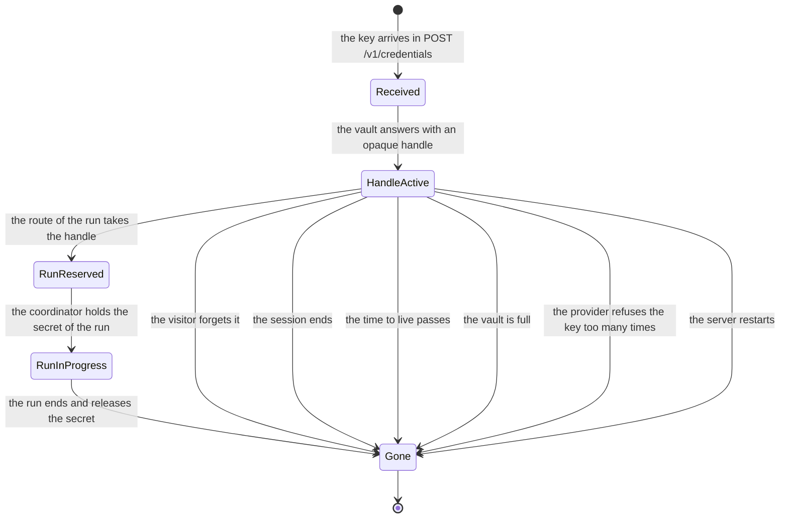

The vault is bounded and it forgets on its own: it holds at most 64 credentials, the oldest one is dropped when it is full, a credential lives at most an hour by default, and a sweeper thread drops the expired ones of a vault that nobody touches. The vault lives in the memory of the process, so a restart of the server empties it. A provider that refuses the key is the only failure that counts against the credential: a rate limit or an upstream failure is a bad day of the provider and never drops a key that works.

The disclosure travels in headers and not in the body, because the published contract of the handle accepts no other field:

| Header | What it says |
|---|---|
| `X-LedgerLens-Key-Storage` | the key is not stored: it lives in the memory of the server and the credential is dropped when the session ends |
| `X-LedgerLens-Billing-Disclosure` | your provider may charge you for the calls of this run |
| `X-LedgerLens-Key-Erasure` | the memory of the machine cannot be guaranteed to be erased: the server drops the key when the credential ends, but no runtime can promise that no copy of the text of the key survives in the memory of the interpreter or in a swap of the operating system |

The answer of the session, the answer of the credential and the answer of the start of the run carry `Cache-Control: no-store` with `Pragma: no-cache` and `Expires: 0`, because an answer that holds a handle is not to be kept anywhere. The stream of the events carries `Cache-Control: no-store` alone. The other answers of a run, which are the state, the cancellation and the cost, carry none of the three, and neither do the answers that hold no key and spend nothing, which are the catalogue of the models, the price of a model, the forgetting of a key and the end of the session. The header of the erasure is on every answer that describes a run.

The live mode is refused while the product runs offline: the routes that take a key or make a provider call answer `503` with the code `LIVE_MODE_OFFLINE` and a message that names the reason, and the replay and the sandbox keep working exactly as before (`_refuse_when_offline` in `ledgerlens/api/byok.py`).

### 7.3 The enforcement of the budget

The caps of the request are the budget of the run. `RunLimits` reads them, `_budget_of` turns them into the `RunBudget` of the `RunContext` of the run (`ledgerlens/run_context.py`), and the coordinator is the only thing that enforces them (`BudgetCoordinator` in `ledgerlens/byok/budget.py`). The interface can ask for a budget; it cannot raise it.

| Cap | What it holds |
|---|---|
| `max_model_calls` | the calls of the models of the run, whatever the model is |
| `max_tool_calls` | the calls of the tools |
| `max_input_tokens` | the tokens of the input, on the plan of the run |
| `max_output_tokens` | the tokens of the output, on what the provider reported |
| `max_wall_seconds` | the wall clock of the run |
| `max_estimated_usd` | the money |

One run, with the facade (`ledgerlens/api/byok.py`), the coordinator (`ledgerlens/api/live_run.py`), the budget (`ledgerlens/byok/budget.py`) and the provider:

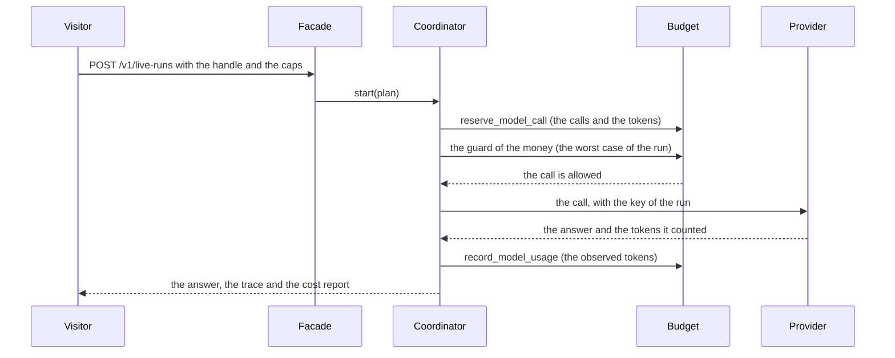

Four rules hold the budget:

1. **Six caps can stop a run, and the plan of the output of a call never stops it early.** The plan of the output tokens of a call is never more than the headroom that the cap of the output tokens leaves (`_planned_output_of_the_next_call` in `ledgerlens/api/live_run.py`), so the run reaches the last call the visitor asked for. The caps that stop a run are the cap of the calls of the models, the cap of the calls of the tools, the cap of the input tokens, the cap of the output tokens, the cap of the wall clock and the cap of the money. A run that would break one of them stops at once, and the answer names the cap that stopped it: `BudgetExceededError.cap` becomes the `cut_by` of the report.
2. **The money is checked before the call, against the worst case that the caps allow.** `_guard_the_money_of_the_run` prices the call that is about to happen with the cap of the output tokens of the run, multiplies it by the calls that the cap of the calls still allows, adds what the run has already committed, and refuses the run when that passes the cap. The check does not trust the plan of the call, because the plan is clamped by the headroom and a clamp makes the money of the call look small. A run without a cap of the calls stops before the provider is called, because a cap of the money bounds a run only when the number of the calls is bounded.
3. **The observed cost and the estimated cost are two numbers.** The observed cost is what the provider counted and the estimated cost is what the run planned, and the report carries them apart (`CostReport` in `ledgerlens/byok/budget.py`). When the registry has no verified price for a model of the run, neither of them is a number, the report says that the price is unknown and no amount appears anywhere. A run that called no model shows no amount either, because a zero would read as "the model was free".
4. **A call of a tool reserves one call of the budget of the run, exactly like a call of the model.** `ModelCaller.call_tool` reserves it, and the run stops when the cap of the tools is reached.

A call whose model differs from the model of the run is refused before anything is reserved, because a run that compared two models under one identifier would make its own trace lie. The cancellation stops the calls that have not started: the caller of the provider reads the flag before every call and raises `RunCancelled`. A call that is already at the provider cannot be stopped, and the run says so: the answer of the route of the cancellation calls it a best effort, and the flag travels with the run and with the trace.

Every run carries the mode `live_agent`, and a replay is never labelled live. Whatever happens, the run ends with exactly one terminal event, `run.completed`, `run.failed` or `run.cancelled`, and the trace of the run lives in the memory of the process: no file, no log, no telemetry, and therefore no place where the key could land.

### 7.4 The ledger of the visitor

The run reads the ledger of the visitor and never the ledger of the configuration. The branch is forked in the sandbox, the branch layer materializes its state in a file of the run, and the tools of the agent read that file. The file holds the rows of the account of the visitor and the counterparties of the transactions of that account, and no row of another account, so the name of a third party is on the disk of the server for the length of the run and the file goes away when the run ends. The ledger of the configuration, which holds the rows of every account of the repository, is never read by the live path ([ADR-038](decisions/ADR-038-the-live-run-reads-the-ledger-of-the-branch-of-the-visitor.md)).

| Step | What happens | Where it is held |
|---|---|---|
| The request names the branch | The body carries the id of the branch, the revision it is at and the account of the branch, and the route reads them before the run starts | `LiveRunRequest` in `ledgerlens/api/byok.py` |
| The branch layer resolves it | The ownership of the branch, its expiry, the account, the revision and the proof of its own state, in that order. No provider is called before every one of them passed, so a refused run spends no money of the visitor | `BranchLayer.ledger_view` in `ledgerlens/sandbox/branch.py` |
| The state is materialized | A copy of the projected connection of the branch, in a file of the run. The file holds the rows of the account of the branch and the counterparties of the transactions of that account, and no row of another account. The file is written only when every check passed, so a refused branch leaves no file behind | `materialize` in `ledgerlens/sandbox/ledger_view.py` |
| The agent reads that file | The case of the demo takes the path of the view of the plan and gives it to the tools of the agent. A run with no ledger of the visitor is a refusal and never a fallback | `DemoCase._options_of_the_run` in `ledgerlens/api/live_case.py` |
| The file goes away | The run removes the file of the ledger and the folder that holds it when it ends, on every path | `_remove_the_ledger_of_the_run` in `ledgerlens/api/live_run.py` |
| The trace names the ledger | The first event of the run carries the branch, the revision and the canonical hash of the state that was read | the payload of `run.started` in `ledgerlens/api/live_run.py` |

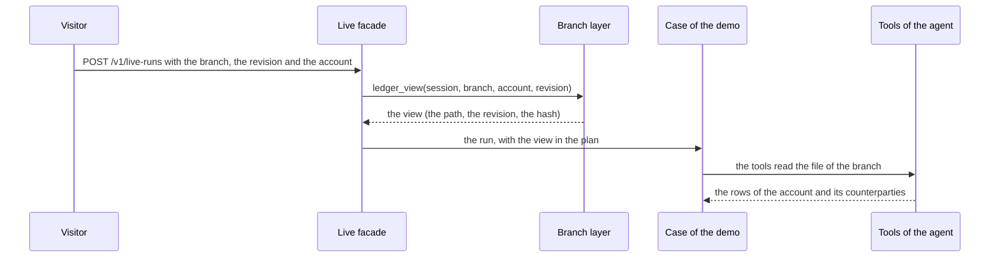

The refusals of the branch keep the codes of the contract of the sandbox, so the two facades cannot disagree about what a branch holds, and the visitor reads the same answers in the sandbox and in the live mode. None of them repeats a value the visitor sent.

| Refusal | Status | Code |
|---|---|---|
| The deployment has no branch layer | 503 | `BRANCH_LAYER_MISSING` |
| The id is not a branch of this session, and a branch of another session is the same answer | 404 | `NOT_FOUND` |
| The branch outlived its time to live | 409 | `BRANCH_EXPIRED` |
| The branch cannot prove its own state | 409 | `HASH_MISMATCH` |
| The account of the request is not the account of the branch | 422 | `ACCOUNT_MISMATCH` |
| The branch is at another revision than the one the request expected | 409 | `REVISION_MOVED` |

The live facade takes the branch layer as a dependency, exactly like the vault and the session issuer, and it never goes looking for one. An application built without a branch layer refuses every run that names a branch with the code `BRANCH_LAYER_MISSING`, and it never answers with the ledger of the configuration, because that fallback would hand the model the rows of every account of the repository.

The deployment wires one session issuer, one store of branches and one branch layer for the two facades, so the branch that the sandbox forks is the branch that the live run reads. ADR-035 is not changed by that: the two facades keep their own issuer by default and the wiring stays a decision of the deployment. The repository writes that deployment down, and [the quickstart of the live mode](../specs/003-r3-bring-your-own-key/quickstart.md) shows the one command that serves it.

### 7.5 The wired application of the demo

The demo has two facades: the sandbox of the visitor (`ledgerlens/api/sandbox.py`) and the live mode (`ledgerlens/api/byok.py`). A live run reads the ledger of the branch of the visitor, so the two facades have to be the same visitor for a live case to mean anything (ADR-038). The repository wires them in one application, and the wiring is a deployment written down in the code, not a program the reader of the quickstart has to copy (ADR-039).

| Piece | What it is |
|---|---|
| The factory | `build_wired_app` in `ledgerlens/api/wiring.py`: it builds one issuer, one store of branches, one base resolver, one branch layer, one vault of the credentials and one runtime folder, and it mounts the two routers of the demo in one application |
| The command | `ledgerlens-demo` in `pyproject.toml`, and it is `uv run ledgerlens-demo --port 8010`. It takes `--host` and `--port`, the way `ledgerlens-api` takes them |
| The session | `POST /v1/sessions` is the route of the live mode, because that answer is the superset: the same three fields, the capability of the live mode, the disclosure of the storage, the disclosure of the erasure and the no-store headers |
| The end of the session | `DELETE /v1/sessions/current` is the route of the sandbox, because that one is complete: it deletes the branches of the session, it purges the memory of the case and it drops the credentials of the session, the sandbox being given the shared vault |
| The refusals | The wired application installs the handlers of the refusals on itself, because an included router brings its routes and its lifespan and nothing else. A refusal is the resource `Error` of the contract and never a `500`, and the message is scrubbed with the vault |

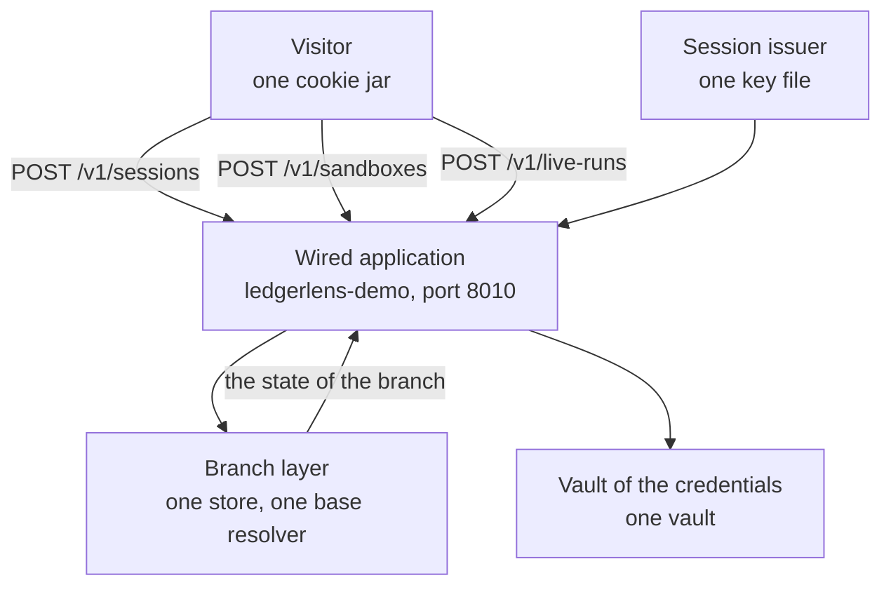

The two facades alone are still two visitors, each one with its own issuer, and the plain factory of uvicorn is not touched either: it still serves a live mode without a branch layer and it still refuses every run with `503 BRANCH_LAYER_MISSING` and a readable reason. The wired application is one visitor because the factory gives the two facades the same issuer, and that is a decision of the deployment that ADR-035 allows.

## 8. The published recordings

The public site plays recorded investigations, and it publishes two catalogues of the same ten scenarios.

| | The catalogue of the sandbox | The catalogue of a real model |
|---|---|---|
| The mode of the recordings | `deterministic_sandbox` | `live_agent` |
| The kind of the capture | `scripted_fixture` | `real_model_recorded` |
| The model | the scripted model of the repository | a real model, named in the provenance of each bundle |
| The reference rate | the recorded one | the live source |
| The verdict of a claim | the deterministic verifier of the repository | the same deterministic verifier |
| Reproducible byte for byte | yes | no |

A catalogue is one mode: the export refuses a bundle whose mode does not match its kind and refuses a set that mixes two modes, and the browser refuses a bundle of the mode of the other catalogue ([ADR-075](decisions/ADR-075-the-site-publishes-two-catalogs-and-each-bundle-declares-the-one-it-belongs-to.md)).

The judge of the verdicts is the same in the two catalogues, the deterministic verifier that runs offline with the stand-in of the NLI model. The reason is that the verifier of the published bundle has to run offline with no key and no network: a bundle whose verdicts only a model can give is a bundle that the code of the repository cannot stand behind.

Two rules of the trace keep a published bundle checkable. The answer of the run is published whole, because the claims of the run are extracted from it and a cut answer takes the claims away ([ADR-076](decisions/ADR-076-the-answer-of-the-run-is-published-whole-because-the-claims-are-extracted-from-it.md)). And the bundle is verified against the answer the run verified, which is the answer of the span of the verifier, because the escalation may add a notice to the answer after the verification ([ADR-077](decisions/ADR-077-the-published-bundle-is-verified-against-the-answer-the-run-verified.md)).

The capture of the catalogue of a real model is `scripts/capture_live_replay.py`. It needs a key, it refuses to run offline and it refuses to run on a dirty tracked tree, and the key never reaches the bundle: the redaction of the trace is the last wall before the file is written.

## Terms used

- **Agent**: a language model in a loop that picks actions, runs tools and observes the results.
- **ReAct**: a pattern where the model alternates thought, action and observation.
- **Deliberative and reactive**: deliberative plans before acting; reactive picks each action using only what it just saw.
- **PTCF**: Persona, Task, Context and Format, a prompt structure.
- **LCEL**: LangChain Expression Language, composing steps with `|`.
- **CoALA**: a framework that splits agent memory into working, episodic, semantic and procedural.
- **NLI**: natural language inference; says whether a text supports, contradicts or leaves open another text.
- **Chain**: a sequence of steps (prompt, model, parser) treated as one component.
- **Runnable**: any LangChain component with `invoke`, `batch` and `stream`.
- **Output parser**: a component that reads the model's text and turns it into a validated object.
- **Prompt injection**: input text that tries to give orders to the model; the defense is to treat it as data.
- **Span**: one run in a trace (a chain, a model call, a tool call or a check), with its inputs, outputs and latency.
- **Run tree**: the spans of one request, nested by which run started which.
- **Live mode**: the branch of the demo in which a visitor runs a real case with a key of their own provider; its mode label is `live_agent`.
- **Credential handle**: the opaque and random token that stands for a key in the vault; it carries the provider and the expiry and never the secret.
- **Credential vault**: the in-process memory that maps a handle to a secret; bounded, expiring, and bound to the session that owns the handle.
- **Budget of a run**: the caps a run carries: the calls of the models, the calls of the tools, the tokens, the wall clock and the money. A run that would break one of them stops at once and names the cap that stopped it.
- **Branch of the visitor**: a private copy of a published case, owned by one session, that holds the rows of one account, the counterparties of the transactions of that account and the mutations of that visitor. It is the only truth of the visitor, and the live run reads it and never the ledger of the configuration.
- **View of the ledger**: the state of one branch materialized in a file the tools of the agent can read, with the branch, the revision and the canonical hash of that state. The file holds the rows of the account of the visitor and the counterparties of the transactions of that account. It lives in the plan of the run and the file goes away when the run ends.
