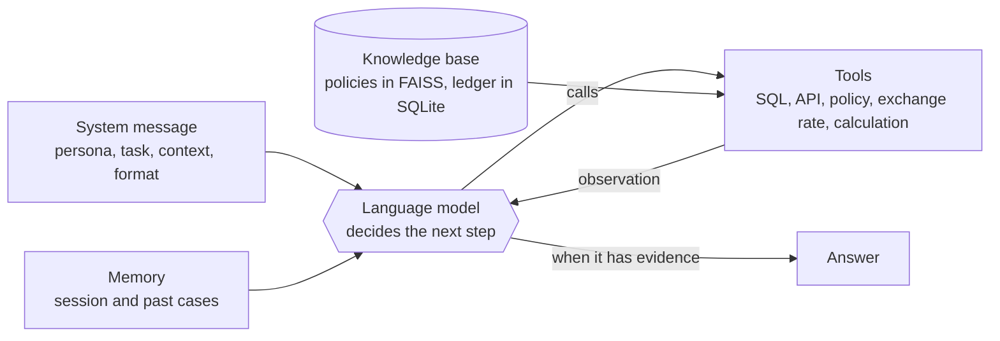
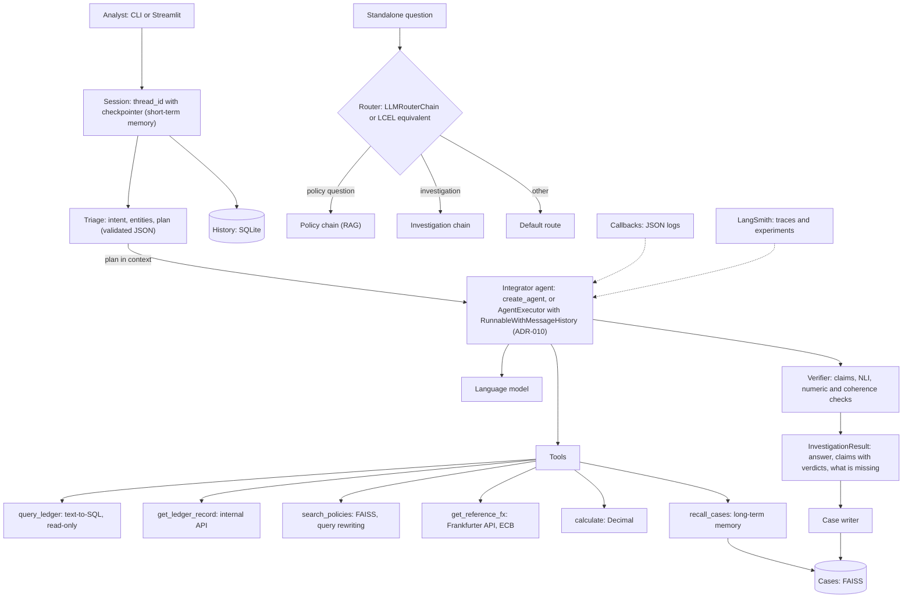
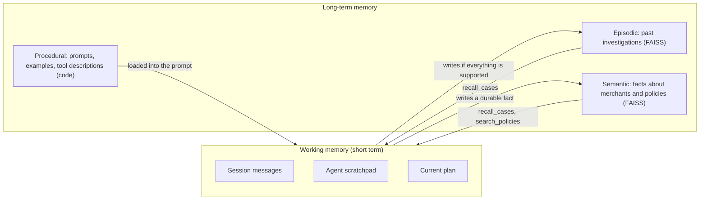
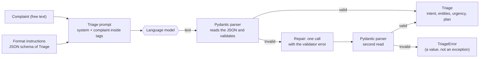
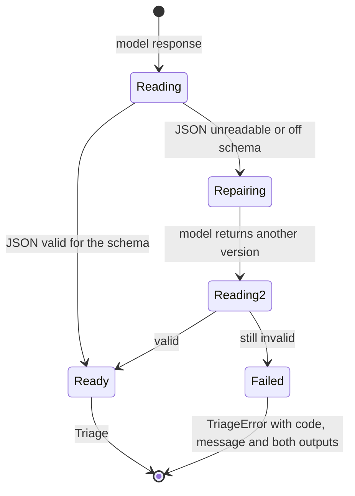
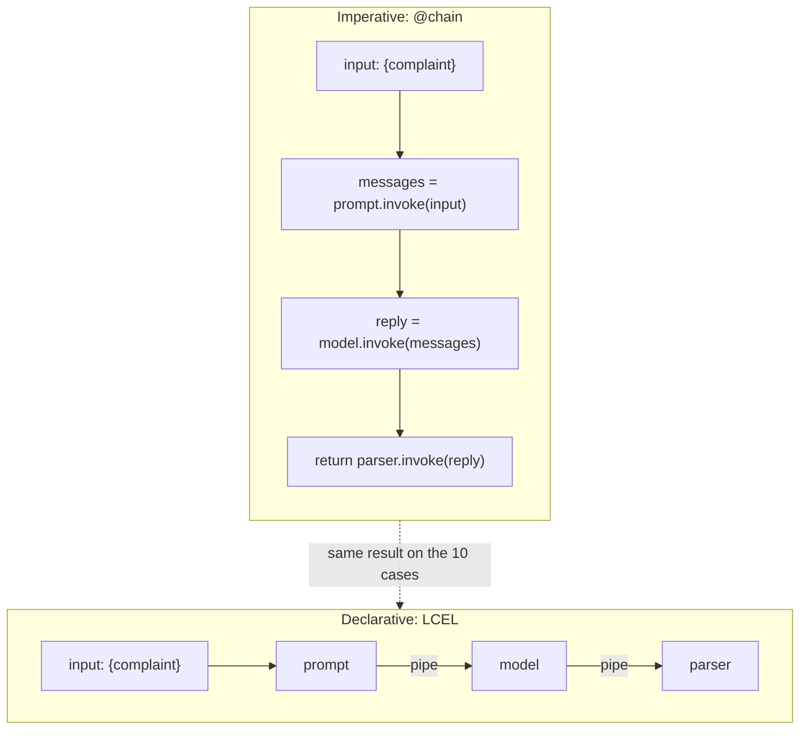

# LedgerLens cognitive architecture

This document covers the anatomy of the agent, its type and maturity level, the planning design, and the choice between imperative and declarative composition. The tools are in `docs/tools.md`.

## 1. Anatomy of the agent

An agent here is a language model inside a loop that decides, observes and decides again. The five blocks:

| Block | What it is in LedgerLens | Where it is in the code |
|---|---|---|
| Language model | any chat model with tool calling, created by `init_chat_model`; OpenAI by default online; a scripted model offline | `ledgerlens/config.py`, `ledgerlens/offline.py` |
| System message | a prompt in the PTCF format (Persona, Task, Context, Format), with examples and the plan format | `ledgerlens/prompts/system.py` |
| Memory | short term (session messages, with trimming and summary) and long term (past cases in FAISS) | `ledgerlens/memory/` |
| Tools | `query_ledger`, `get_ledger_record`, `search_policies`, `get_reference_fx`, `calculate`, `recall_cases` | `ledgerlens/tools/` |
| Knowledge base | eight policy documents, indexed once in FAISS, and the transaction database | `data/policies/`, `data/index/`, `data/ledger.db` |

The five blocks form a loop: the model reads the system message and the memory, picks a tool, receives the result and decides again, until it can answer.



Around them sit triage (structured input), the verifier (output with verdicts) and callbacks (a record of every event). The component diagram shows the links.



### The demo app

`app/streamlit_app.py` puts the integrator behind a small payments portal. The person signs in as one customer or merchant, reads that account's activity and asks the Help assistant about a line. Two things reach the agent besides the question:

- a context message (`investigate(..., context=...)`), a system message right before the question that names the signed-in account and the line picked; triage still reads only the question;
- a ledger scoped to the account (`ledgerlens/api/accounts.py`, `scoped_ledger`): a copy that keeps only the account's transactions, refunds, chargebacks, applied FX and, for a merchant, its settlements. The tools and the verifier read that copy, so a query cannot return another customer's rows, whatever SQL the model writes.

The statement itself comes from read-only, parameterized queries in the same module (`account_statement`). What the page shows about each turn (lines read, verdict counts, short tool results) and the offline scripts of the planted questions are in `ledgerlens/demo.py`.

## 2. Agent type and maturity level

### Type: hybrid, deliberative and reactive

| Part | Nature | Why |
|---|---|---|
| Triage and plan | deliberative | before acting, the system classifies the intent and writes a plan with steps and the expected tool for each |
| Agent loop (ReAct) | reactive | at each step the agent looks at the last result and picks the next action; it can drop or revise the plan |
| Verification | deliberative | only after the answer, and with explicit rules |

Triage plans and executes nothing; the reactive loop executes. A purely reactive agent would pick tools with no stated goal and get lost in multi-step cases. A purely deliberative one would run the whole plan even when an observation (for example, "the currency has no quote") invalidates it.

### Agentic maturity level

There is no standard scale that everyone accepts. This project uses its own five-level scale, defined here so it can say where the agent stands:

| Level | Description |
|---|---|
| 1 | Direct model answer, no tools |
| 2 | Fixed chain: steps decided by the programmer, structured output |
| 3 | Agent that decides which tools to use and in what order (ReAct), with session memory |
| 4 | Level 3 plus an explicit plan, long-term memory, verification of its own answers and measured evaluation |
| 5 | Level 4 plus actions with effect on the world and continuous learning with minimal supervision |

| Component | Level |
|---|---|
| Triage alone, measured below | 2 |
| Agent with tools | 3 |
| Integrator with memory, verification and evaluation | 4 |
| Out of scope | 5: the agent never changes data and never decides to pay or refuse on its own; it only recommends and asks for human review |

### Measured on triage

These numbers come from runs and tests, not from a plan. The reason for level 2 is the last item: the chain has fixed steps chosen by the programmer and no tool runs.

| Fact | Value | Where to check it |
|---|---|---|
| Versions used | `langchain` 1.4.9 and `langchain-core` 1.7.6 | `pyproject.toml` |
| Fixed triage cases | 10: scenarios S01 to S06, S08 and S10, one vague request and one prompt injection | `data/eval/triage_cases.jsonl` |
| Triage compositions | 2 (`@chain` and LCEL), with equal results on the 10 cases and the same prompt sent to the model | `tests/chains/test_triage.py` |
| Answer repair | at most 1 call per answer; after that a `TriageError` comes back | `tests/chains/test_triage_parser.py` |
| Triage tests | 94 (prompts, parser and chain) | `uv run pytest -q tests/chains/test_triage.py tests/chains/test_triage_parser.py tests/test_prompts.py` |
| Tools run by triage | 0: the plan only describes the steps | level 2 of the scale above |

## 3. Planning design

The plan is a hierarchical decomposition: one goal, sub-goals and steps, each step with the expected tool and its dependencies.

```text
Goal: explain why the BRL refund for TX-2048 was lower than the EUR payment
├─ S1  fetch the transaction and the refund               -> query_ledger
├─ S2  fetch the cross-currency refund policy             -> search_policies      (depends on S1)
├─ S3  fetch the reference rate on the date               -> get_reference_fx     (depends on S1)
├─ S4  separate market movement from markup               -> calculate            (depends on S1, S3)
└─ S5  build the answer with evidence                     -> (no tool)            (depends on S2, S4)
```

Planning rules:

1. Triage produces the plan as part of the `Triage` object (the `plan` field, a list of `PlanStep`). The plan goes into the agent's context.
2. The agent runs the ReAct loop. If an observation invalidates a step (a currency with no quote, a missing row), it records the deviation and revises the plan instead of following it blindly.
3. A request with no identifier at all (for example, "the money did not arrive") produces `needs_clarification` and a question back, with no tool calls. A request with an identifier that matches two transactions (scenario S05) shows the ambiguity only after the ledger query: triage plans the query and the agent asks afterward.
4. Steps S2 and S3 do not depend on each other and can run in parallel (a parallel chain).
5. The plan is an intention, not a proof. The evaluation compares the tools actually called (the trajectory) with the expected ones.

How the code applies these rules in both integrators (`ledgerlens/agents/integrator.py` and `executor_integrator.py`):

- Triage runs before the agent, with the configured model or the `triage_model` given to the constructor. The plan goes in as a system message with a warning that it may be revised. In the legacy executor it stays out of the stored history and is repeated on every turn of the loop.
- The `Triage` is kept in `InvestigationResult.triage`. The `plan_deviations` field records, by code, the step with a tool that did not run and the tool called outside the plan: it is the measure of deviation, and the agent does not have to remember to record it.
- A step with a tool that did not run is requested once, in code: at the end of the turn, the integrator asks the agent to call the tool or say in one sentence why it is not needed, and builds the result from what came after (the calls and the new answer). There is never a second request. The request goes into `plan_deviations` with the step, the tool and whether the agent called it; if the request call fails, the existing answer stays and `plan_deviations` says the request failed. In the legacy executor the request is a second entry in the same session, with the plan (if any) repeated as context.
- The same single request covers the exchange rate of a date with no source: if the agent queried the ledger, asked `get_reference_fx` for a day that no ledger date column carries and the question does not cite, and did not ask for any ledger date, the request names the day, tells the agent to read the payment or refund date from the ledger and redo the calculation with that date's rate. A plan step and such a date in the same turn share one request, recorded in `plan_deviations`. The verifier then checks the exchange rate the final answer uses (the coherence rule `fx_date_origin`, [ADR-007](decisions/ADR-007-nli-verification.md)).
- `needs_clarification` returns the question without calling the agent or the tools, but only on the first message of the conversation. Triage reads only the current question; in a later turn ("and the refund?") it would find the request vague, so there it simply gives no plan and the agent, which sees the history, answers. The question back and the user's reply go into the session history.
- If triage fails (network, quota, unreadable response), the agent answers without a plan and the failure goes to the log.

Sequence of a full investigation (scenario S01):

```mermaid
sequenceDiagram
  autonumber
  actor A as Analyst
  participant S as Session (history)
  participant T as Triage
  participant G as Agent (create_agent)
  participant L as Tools
  participant V as Verifier
  participant C as Case memory
  A->>S: "Why was the BRL refund for TX-2048 lower?"
  S->>T: question + history
  T-->>G: Triage (refund_discrepancy, TX-2048, 5-step plan)
  G->>L: recall_cases(M-17)
  L-->>G: CASE-0001 (markup of about 2.5%)
  G->>L: query_ledger(TX-2048 and refunds)
  L-->>G: rows (EUR 100.00; BRL 549.31; rate 5.4931)
  G->>L: search_policies(cross-currency refund)
  L-->>G: policy passages
  G->>L: get_reference_fx(EUR, BRL, 2026-10-20)
  L-->>G: 5.6339 (ECB, date 2026-10-20)
  G->>L: calculate(fx_gap_breakdown)
  L-->>G: gap 17.48 = 3.40 market + 14.08 markup
  G-->>V: answer + evidence
  V->>V: NLI on text claims; numbers through calculate; coherence
  V-->>S: InvestigationResult with verdicts
  S-->>A: answer, tools used, verdicts
  V->>C: write the case (only if everything is supported)
```

## 4. Memory in brief (CoALA)

One line per type:



## 5. Triage and parser flow

Triage turns free text into a validated object. The path of a complaint:



The repair runs at most once. The state of an answer moves through these points:



A failure of the model call itself (network, quota) does not go through here: it raises an exception, because hiding that defect as a parse error would mask an infrastructure problem.

## 6. Imperative or declarative

Triage exists in both forms, with the same prompts and the same parser: one with `@chain` (plain Python code that calls runnables) and one with LCEL (composition with `|`). A test requires equal results on the 10 fixed cases.



Measured in the tests (`tests/chains/test_triage.py`):

| Criterion | `@chain` (imperative) | LCEL (declarative) |
|---|---|---|
| Result on the 10 cases | equal to the reference | equal to the reference |
| Flow with branches (retry, choose a path) | natural: `if`, `try`, loops | needs `RunnableBranch`, `RunnableLambda` or `with_retry` |
| Reading a linear sequence | you have to read the code | reads left to right |
| `invoke` | works | works |
| `batch` | one item at a time, from prompt to parser | step by step: all items pass through the model before any repair |
| `stream` of the whole chain | one chunk: the validated `Triage` | one chunk: the validated `Triage` |
| `stream` before the parser | not applicable (the function only returns at the end) | text in chunks, which together form the JSON |

Two practical consequences came out of this measurement. First, the validated object exists only with the complete JSON, so `stream` delivers the result all at once; chunked output is useful for showing the text arriving. Second, the scripted model answers in the order of the calls, and that order changes between the styles in `batch`, so its tests use one item at a time (`max_concurrency=1`).

Time and cost were not measured: the model is scripted. The debugging argument (each step shows up as a separate run in traces) comes from reading the documentation and was not measured.

**Decision:** LCEL for linear sequences (prompt, model, parser), because the flow is visible on one line and `batch` and `stream` come from the composition itself. `@chain` where there is flow control: the repair with a single retry (it is in `make_repairing_parser`), the choice between verifying with NLI or with code, and the assembly of the `InvestigationResult`. The full imperative version of triage stays for comparison; the rest of the code reuses the declarative one. The legacy agent and the integrator use each one's own API and are not rewritten in LCEL.

## Terms used

- **Agent**: a language model in a loop that picks actions, runs tools and observes the results.
- **ReAct**: a pattern where the model alternates thought, action and observation.
- **Deliberative and reactive**: deliberative plans before acting; reactive picks each action using only what it just saw.
- **PTCF**: Persona, Task, Context and Format, a prompt structure.
- **LCEL**: LangChain Expression Language, composing steps with `|`.
- **CoALA**: a framework that splits agent memory into working, episodic, semantic and procedural.
- **NLI**: natural language inference; says whether a text supports, contradicts or leaves open another text.
- **Chain**: a sequence of steps (prompt, model, parser) treated as one component.
- **Runnable**: any LangChain component with `invoke`, `batch` and `stream`.
- **Output parser**: a component that reads the model's text and turns it into a validated object.
- **Prompt injection**: input text that tries to give orders to the model; the defense is to treat it as data.
