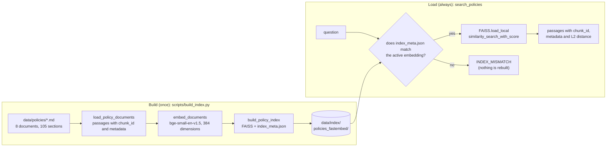

# ADR-006: Embeddings, FAISS index and metadata

Status: accepted. Date: 2026-11-07.

## Context

The project needs semantic search with FAISS and a retrieval agent that works over an index that already exists, without rebuilding it. Offline mode cannot depend on the embeddings API. `sentence-transformers` pulls in `torch`, which is heavy. `langchain-community` is archived and warns that it will be sunset, but it still ships `FAISS`. The `langchain-faiss` 0.1.1 package exists on PyPI, but once installed it was empty (no exported names, `ImportError`).

The eight policies in `data/policies/` and the 12 questions in `data/eval/policy_questions.jsonl` are in English, so an English embedding model is enough and a small one keeps the offline download short.

## Decision

- **Online:** `text-embedding-3-small` through `langchain-openai`.
- **Offline:** `fastembed` 0.9.1 with `BAAI/bge-small-en-v1.5` (384 dimensions, about 67 MB) inside an `Embeddings` subclass of about 15 lines. The model reads up to 512 tokens per text. The dimension is read at construction and written into the index.
- **Index:** `FAISS` from `langchain_community.vectorstores`, version pinned, behind `ledgerlens/retrieval.py` so a future swap touches a single file. Vectors are normalized (length 1) on input and on query, so L2 distance orders like cosine. Smaller is closer.
- **Build:** `scripts/build_index.py` indexes once. The agent only loads. The offline index is versioned in `data/index/policies_fastembed/` (`index.faiss`, `index.pkl`, `index_meta.json`).
- **Metadata per passage:** `chunk_id` (`document#section`), `document`, `section`, `topic`, `version`, `language`, `order`. The FAISS ids are the `chunk_id`s, so rebuilding with the same vectors gives the same files.
- **Compatibility:** `index_meta.json` stores the embedding name, the dimension, the number of passages, the metric and the build date. The loader refuses an index whose embedding does not match the active one (`INDEX_MISMATCH`), because neighbors from another vector space would be wrong without any warning.
- `load_local` requires `allow_dangerous_deserialization=True`. The index is ours and is only read from `data/index/`, and the single place where the parameter is used (`load_policy_index`) carries a comment saying so.

### Measured model

Recall@3 on the 12 questions in `data/eval/policy_questions.jsonl` (a hit when a ground-truth passage appears among the first 3), over the same passages, with cosine similarity.

| Model (fastembed 0.9.1) | Size | Dimensions | Recall@3 | Easy | Hard |
|---|---|---|---|---|---|
| `BAAI/bge-small-en-v1.5` (chosen) | 0.07 GB | 384 | 0.67 | 5 of 6 | 3 of 6 |

The final index, built with the project code, repeats the recall of the table row.

### Why bge-small-en-v1.5

- **Language.** The policies and the questions are English text, so an English-only model covers them without paying for multilingual weights.
- **Size.** It fits in about 67 MB. The model is downloaded on the first run and stays in the fastembed cache, so a small model downloads faster, takes less space in the CI cache and loads in seconds.
- **Context length.** It reads up to 512 tokens per text, more than the policy passages need, and the section title opens each passage, so the beginning that the model weighs most says what the passage is about.
- **Small index.** 384 dimensions keep the versioned index small (a few hundred KB).
- **The recall on hard questions is the starting point of the retrieval correction.** The correction diagnoses a retrieval failure and fixes it with query rewriting, multiple queries and HyDE. A model that already gets everything right would remove the example. The baseline recall is what these transformations improve, and the model, the passage size and the indexed text are not tuned to hide it.
- **Escape hatch.** If the recall measurement shows that the model leaves no room, switching to a larger model means changing `DEFAULT_FASTEMBED_MODEL` and running `scripts/build_index.py` again, and `INDEX_MISMATCH` prevents using the old index by mistake.

## Alternatives considered

- **`sentence-transformers`.** Pulls `torch` in for search.
- **OpenAI embeddings only.** Breaks offline mode.
- **Chroma or Qdrant.** FAISS is enough for a small, prebuilt index.
- **`langchain-faiss`.** Empty in the current version.
- **Larger fastembed models.** Heavier downloads and slower loads, and they leave less room for query rewriting to improve recall.

## Consequences

- Two indexes (online and offline) do not mix, and the error is explicit.
- Retrieval failure is measured with recall@3 on a set of 12 questions with ground-truth passages.
- The `langchain-community` deprecation warning shows up in the tests and is explained.

## Retrieval correction

The baseline (`transform: none`) misses some questions. On the hard ones, the tool log shows the passages returned and none is the right one: the question does not use the policy's own words, and the index matches by similar vocabulary.

The correction is in `ledgerlens/tools/policies.py`: `rewrite` (rewrites the question with the policy terms), `multi_query` (up to three variations, merged by the best score of each passage) and `hyde` (searches with a hypothetical passage that would answer the question). If the model fails or returns empty text, the tool falls back to `none`. The index and the vector model did not change.

Measured with the versioned index and the real vector model. Since offline there is no language model, the rewrites, variations and hypothetical passages were written by hand, once, in `tests/tools/test_query_transform.py`, and a table model returns them per question. A real model may give different numbers.

| Transform | Easy | Hard | recall@3 |
|---|---|---|---|
| `none` | 5 of 6 | 3 of 6 | 0.67 |
| `rewrite` | 5 of 6 | 6 of 6 | 0.92 |
| `multi_query` | 5 of 6 | 6 of 6 | 0.92 |
| `hyde` | 5 of 6 | 5 of 6 | 0.83 |

The baseline misses three hard questions (PQ-08, PQ-11, PQ-12) and one easy one (PQ-02, the duplicate detection rule, where the top 3 are the duplicate exception of the refund policy and two other duplicate passages). No transform recovers PQ-02, because the rewrites only cover the hard questions. `hyde` loses PQ-10, which the plain question already finds: the hypothetical passage talks about opening a chargeback and pulls the chargeback overview, the refunds-and-chargebacks passage and the fee reference instead of the response deadline. `multi_query` ties `rewrite` here, but merging by best score can let a bad variation push a right passage out of the top. The measurement runs with `uv run pytest -q -m slow tests/tools/test_query_transform.py -s`.
