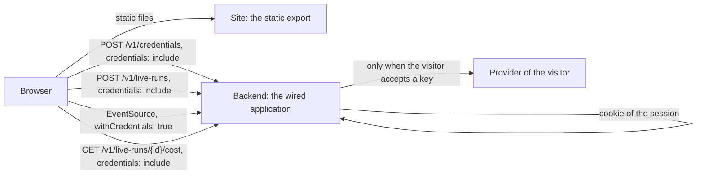

# ADR-040: The live mode of the demo lives on the origin of the backend, and the recorded demo stays a static export

Status: accepted. Date: 2026-11-21.

## Context

The web application of the repository exists as a skeleton. It has the design tokens, the accessible primitives, the
types of the published contracts and the reducer of the recorded events (`apps/web/lib/design/tokens.ts`,
`apps/web/components/ui/`, `apps/web/lib/api/schemas.ts`, `apps/web/lib/replay/`). It has no page, no layout and no
test. The frontend was paused and the backend of R3 was finished first.

Three facts of the repository decide the shape of the milestone.

The first is the static export. `apps/web/next.config.ts:10` declares `output: "export"`, and the comment above it
names the reason: the replay reads published JSON artifacts and nothing else, so the whole site can be a folder of
files served by a content delivery network. That promise is not only a comment. It is written in the R1 specification
(`specs/001-r1-public-replay/spec.md:224`), in the design package (`docs/v3/adrs/ADR-P008-portfolio-deployment.md`:
"CDN/static Next pages and versioned public replay") and in the runbook
(`docs/v3/docs/13-CI-CD-DEPLOYMENT-AND-RUNBOOKS.md:25`: "Deploy CDN/static replay before optional Live backend"). A
static export has no server runtime: there is no route handler, no API route and no middleware. Task T035 of R3 asks
for an SSE bridge at `apps/web/app/api/live/[runId]/route.ts` (`specs/003-r3-bring-your-own-key/tasks.md:91`), and that
file cannot exist in a static export.

The second is the shape of the backend. The live mode of the demo is served by the wired application
(`ledgerlens/api/wiring.py:88`), which mounts the two facades as one visitor (ADR-039). The live facade declares the
session route (`ledgerlens/api/byok.py:554`), the credential route (`:601`), the catalogue (`:650`), the run (`:673`), the
state of a run (`:747`), the stream of the events of a run (`:773`), the cancellation (`:795`) and the cost of a run
(`:831`). The session cookie is `ledgerlens_session` (`ledgerlens/api/sandbox.py:98`), it is `HttpOnly`, it is
`SameSite=Lax` and it is issued by the route of the session of the live mode
(`ledgerlens/api/byok.py:575-582`). The backend has **no CORS at all**: there is no `CORSMiddleware`, no
`allow_credentials` and no `Access-Control` header anywhere in `ledgerlens/`. A browser that calls the backend from
another origin is refused by the browser itself, before any code of the repository answers.

The third is the offline truth. With `LEDGERLENS_OFFLINE=1` the live mode refuses everything that holds or spends a
credential: `POST /v1/credentials` and `POST /v1/live-runs` answer `503` with the code `LIVE_MODE_OFFLINE`
(`ledgerlens/api/byok.py:613`, `:698`, and the refusal itself at `:1217-1229`). The reason is written down and it is
not a bug: the mode of a live run is `live_agent` (`ledgerlens/api/live_run.py:115`), a run that cannot call a provider
would lie about its own mode (FR-024), and the deterministic offline path must stay free of any provider call (FR-029).
The published replay is the other half of the demo: it is a deterministic recording made with the scripted model and
the recorded exchange rate, its mode is `deterministic_sandbox` (`ledgerlens/replay/site_export.py:63-64`,
`apps/web/public/replay/s01/manifest.json`) and its own note says "This is not a live execution and it calls no model".

So the milestone has to answer three things at once: where the browser's call goes, how the credential reaches the
vault without ever touching a URL or a log, and what the interface shows when there is no key and no network at all.

## Decision

**The site stays a static export, and the live mode of the browser talks to the backend directly, on the origin of
the backend, with the credentials of the visitor.**

**T035 is superseded, and the reason is written down.** The file `apps/web/app/api/live/[runId]/route.ts` is **not**
created. The backend already streams the same trace events, with the same framing, on
`GET /v1/live-runs/{run_id}/events` (`ledgerlens/api/byok.py:773-793`), and the browser consumes that stream with
`EventSource`. A bridge in the Next application would add a hop, a second place where the session cookie travels and a
second place where a secret could be put in a path, and it would buy nothing. The requirement of T035 that made sense,
SC-012, is satisfied more strongly without the bridge: the credential handle travels **only** in the body of
`POST /v1/live-runs` and in the body of `POST /v1/credentials/forget`, it never travels in a path, in a header, in a
query string or in a URL, and the run identifier that travels in a path is opaque and is not a secret.

**The backend gains a credentialed CORS, installed by the wired application and active only when the deployment
declares the origins.** The middleware is not installed by default, so a deployment that does not configure the
origins answers exactly as it answers today. The exact change is written down below.

**The deployment rule is the same site.** The API origin must be published on the same site as the site of the
interface (the same registrable domain and the same scheme), so the session cookie, which is `SameSite=Lax`, travels
as a cookie of the site and not as a cookie of a third party. The cookie is **not** changed to `SameSite=None`, and the
ADR says why in the section about the cookie.

**The offline half of the demo is the published replay, and the live half is the backend.** The recorded demo reads the
static artifacts of `apps/web/public/replay/` and makes no request to the backend at all. The live half uses the
credential route and the run route of the backend. Nothing of the live mode changes, and the refusal
`LIVE_MODE_OFFLINE` stays exactly as it is.

### The requests of the browser



Every arrow from the browser to the backend carries `credentials: "include"`, so the browser sends the session cookie
of the backend origin. Every arrow from the backend to a provider happens only after the visitor accepted a key.

### Question 1: where the request goes, and the URL contract

The origin of the backend is a public build variable, because the site is a static export and there is no server to
read a variable at runtime.

- The name is `NEXT_PUBLIC_LEDGERLENS_API_BASE_URL`. The `NEXT_PUBLIC_` prefix is the convention of Next.js for a
  value that is inlined in the bundle of the browser, and it says out loud that the value is public.
- The default is `http://localhost:8010`, the port of `ledgerlens-demo` (`ledgerlens/api/wiring.py:71`).
- The value is an origin without a trailing slash and without a path. The paths are joined as
  `${base}/v1/sessions`, `${base}/v1/models`, `${base}/v1/credentials`, `${base}/v1/live-runs`,
  `${base}/v1/live-runs/{runId}/events`, `${base}/v1/live-runs/{runId}/cost` and `${base}/v1/credentials/forget`.
- When the variable is absent, the default is used. When the origin does not answer, the live section of the page says
  so, in words, with the origin it tried, and the recorded demo keeps working. There is no other fallback and the page
  never guesses.
- The default is `localhost` and not `127.0.0.1` on purpose: the site of `localhost` is `localhost`, so the cookie of
  the session travels between `http://localhost:3000` and `http://localhost:8010`. `127.0.0.1` is another host, and the
  browser would not send the cookie of one to the other.

The variable never holds a secret. No `NEXT_PUBLIC_` variable of the repository may hold a provider key, and the bundle
of the browser carries no secret of any kind.

### Question 2: how the session cookie travels, and the CORS that has to exist

The cookie is `ledgerlens_session`, issued by `POST /v1/sessions` (`ledgerlens/api/byok.py:554-583`) with `HttpOnly`,
`SameSite=Lax`, `Path=/` and a `Max-Age` of the life of the issuer. It is opaque and signed; the browser cannot read it
and cannot forge it. The identity of the visitor, and therefore the right to read a run, is decided by the cookie and
by nothing else (`ledgerlens/api/byok.py:856-866`).

The cookie travels in a cross origin call because the call carries `credentials: "include"` and because the origins
are on the same site. The rule of the deployment is therefore a rule of the promise of the session: **the origin of the
backend must be published on the same site as the site of the interface.** If the origins were on different sites, the
browser would not send a `SameSite=Lax` cookie, and the only way to make it travel would be `SameSite=None; Secure`,
which lets any site of the internet drive the API with the session of the visitor. This ADR refuses that change, and
says that the deployment has to be arranged instead.

The backend has no CORS today. The change is the following, and it is the whole of it.

A new module `ledgerlens/api/cors.py` with two functions:

```python
def build_cors_middleware(*, allowed_origins: Sequence[str]) -> CORSMiddleware:
    """The CORS of the wired application, for the browser of the visitor."""


def install_cors(app: FastAPI, *, allowed_origins: Sequence[str]) -> None:
    """Installs the CORS on the application, when the deployment declares the origins."""
```

The parameters of the middleware are exact:

| parameter | value | why |
| --- | --- | --- |
| `allow_origins` | the exact origins of the setting, never a wildcard | a wildcard with credentials is illegal in the Fetch specification, and it would let any site drive the API with the session of the visitor |
| `allow_credentials` | `True` | the session cookie has to travel |
| `allow_methods` | `["GET", "POST", "DELETE", "OPTIONS"]` | the routes of the demo are a GET, a POST and a DELETE, and the preflight is answered by the middleware |
| `allow_headers` | `["Content-Type", "Accept", "X-LedgerLens-Schema-Version", "Idempotency-Key", "If-Match"]` | the bodies are JSON, the version header is the one the facade publishes, and the two headers of the commit and of the undo of a branch of the sandbox are the ones the browser sends in the preflight of the call (ADR-044) |
| `expose_headers` | `["X-LedgerLens-Schema-Version", "X-LedgerLens-Key-Storage", "X-LedgerLens-Key-Erasure", "X-LedgerLens-Billing-Disclosure", "X-LedgerLens-Branch-Hash", "X-LedgerLens-Branch-State", "Cache-Control", "Pragma", "Expires"]` | the browser may only read the headers the server exposes, and the three disclosures live in headers |
| `max_age` | `600` | the preflight is cached for ten minutes |

The setting is new in `ledgerlens/config.py`:

- the field is `cors_origins: tuple[str, ...] = ()`;
- it is read from `LEDGERLENS_CORS_ORIGINS`, a comma separated list of exact origins;
- the default is empty, and an empty list installs nothing, so the behaviour of the repository does not change;
- the setting **refuses a wildcard** with a readable error, because a wildcard with credentials is not a policy but an
  accident waiting to happen.

The installation is one call in `ledgerlens/api/wiring.py`, inside `build_wired_app`, after the application is built
and before the routers are mounted:

```python
install_cors(app, allowed_origins=the_settings.cors_origins)
```

The plain factories, `ledgerlens/api/byok.py:413` and `ledgerlens/api/sandbox.py:143`, are not touched, and neither is
the router of the live mode. The middleware adds no route, so the list of the routes of the wired application, which
ADR-039 pins, does not change.

The local run declares `LEDGERLENS_CORS_ORIGINS=http://localhost:3000`, because the development server of Next serves
the site on the port 3000.

### Question 3: how the credential arrives, and how the handle travels afterwards

The key is typed by the visitor in the password field of the dialog of the key. The dialog sends it in the body of one
request, to `POST /v1/credentials`, with exactly the two fields the facade declares
(`ledgerlens/api/byok.py:315-326`):

```json
{ "provider": "openai", "api_key": "the text the visitor typed" }
```

The answer is the resource `CredentialHandle` of the published contract
(`specs/003-r3-bring-your-own-key/contracts/credential-handle.schema.json`): the handle, the provider, the creation
and the expiry. The raw key never travels back, in any field and in any header (FR-004). The answer also carries the
three disclosures, in the headers named in the table above.

The handle travels afterwards in the **body** of `POST /v1/live-runs`, as the field `credential_handle` of the
published contract of the request
(`specs/003-r3-bring-your-own-key/contracts/live-run-request.schema.json`), and in the **body** of
`POST /v1/credentials/forget`, as the field `handle`. It never travels in a path, in a header, in a query string or in
the URL, which is what SC-012 asks.

The run identifier does travel in a path, in `GET /v1/live-runs/{run_id}`, in `GET /v1/live-runs/{run_id}/events`, in
`GET /v1/live-runs/{run_id}/cost` and in `POST /v1/live-runs/{run_id}/cancel`. It is opaque, it is the prefix `run_`
followed by sixteen hexadecimal characters (`ledgerlens/api/byok.py:269-270`), and it is not a secret: the right to
read the run is decided by the session cookie and by the owner of the run
(`ledgerlens/api/byok.py:1232-1239`). The frontend keeps the handle in the memory of the page: never in a cookie,
never in `localStorage`, never in `sessionStorage`, never in the URL and never in a log. The field of the key is
cleared, and the key leaves the state of the page, as soon as the answer arrives.

### Question 4: how the stream reaches the browser

The mechanism is `EventSource`, on the route of the backend:

```ts
new EventSource(`${base}/v1/live-runs/${runId}/events`, { withCredentials: true });
```

The `withCredentials` flag is what makes the browser send the cookie of the session, and it is why the CORS of the
backend has to allow the origin with credentials.

The framing of the stream is decided by the backend (`ledgerlens/api/byok.py:1287-1304`): every event is written as
`event: <event_type>` and `data: <the JSON of the trace event>`, and the names are the names of the trace contract
(`span.started`, `span.ended`, `run.status`, `run.completed`, `run.failed`, `run.cancelled`). A named event never
reaches the generic `message` listener of the browser, so the client registers one listener per name it cares about.

Two rules of the client are not optional. The client **closes the source on a terminal event**: the backend closes the
stream when the run ends, and a browser that reconnects would receive the whole stream of the run again, from the
beginning, forever. And the client never sends a header with the `EventSource`, because `EventSource` cannot: the
stream needs no handle, the cookie of the session is the identity.

The file that holds this is `apps/web/lib/api/events.ts`, and the hook that uses it is
`apps/web/features/live/useLiveRun.ts`.

### Question 5: what the panel shows while the run happens

The data comes from **both** the stream and the cost route, and the two never overlap.

The counters, the tokens and the elapsed time come from the stream. The event `run.status` carries the payload
`{model_calls, tool_calls, input_tokens, output_tokens, elapsed_seconds}`
(`ledgerlens/api/live_run.py:592-608`), and the backend emits it after each call of a model. The counters of the tools
therefore move on the next call of a model, and the page shows them as the server reports them: it never interpolates a
number the server did not send.

The money comes from the cost route, `GET /v1/live-runs/{run_id}/cost` (`ledgerlens/api/byok.py:831-851`). The body is
the one of `_cost_body` (`:1261-1284`): the run, the status, the calls, the calls by model, the tokens, the elapsed
time, the observed cost and the estimated cost as decimal **texts** or `null`, the flag `price_known`, the flag
`money_cap_authoritative`, the cap that cut the run and the note of the server. The route answers `409` with the code
`RUN_RUNNING` while the run is going, so the panel keeps the counters of the stream and asks for the money when the
terminal event arrives.

The rule of FR-011 is the rule of the panel: when `price_known` is false, or when both costs are `null`, the panel
says that the price is unknown and shows **no money amount at all**. The frontend never computes a money amount and
never formats one: it renders the decimal texts that the server sent, and it renders nothing where the server sent
`null`. The pre-flight disclosure comes from `GET /v1/models/{profile_id}`, which answers `price_known` and
`price_note` (`ledgerlens/api/byok.py:656-671`), so the visitor reads the price and its provenance before the first
call, and the run panel reads the same thing after the run.

### Question 6: the consent text of T036

Before the key is sent, the page shows three sentences, and the visitor ticks a box before the send is enabled:

1. "Your provider may charge you for the calls of this run. LedgerLens does not pay for them, and the caps of the run
   bound the calls, not the bill of your provider."
2. "Your key is not stored: it lives in the memory of the server of the demo, it is dropped when the session ends, and
   it is never written to a file, a log, a trace or a URL."
3. "The memory of the machine cannot be guaranteed to be erased: the server drops the key when the credential ends,
   but no runtime can promise that no copy of the text of the key survives in the memory of the interpreter or in a
   swap of the operating system."

The third sentence is the promise of the limit of FR-021 and of ADR-036, said out loud. The second sentence is the
promise of FR-003. The first one is the disclosure of the billing of FR-008.

After the credential is accepted, the page shows the **words of the server**, read from the headers of the answer
(`ledgerlens/api/byok.py:211-233`): `X-LedgerLens-Billing-Disclosure`, `X-LedgerLens-Key-Storage` and
`X-LedgerLens-Key-Erasure`. The frontend never invents a disclosure, and it renders these headers only because the
CORS of the backend exposes them.

The consent is a gate of the interface. The contract of `POST /v1/credentials` has exactly two fields, `provider` and
`api_key` (`ledgerlens/api/byok.py:315-326`), and there is no field for a consent in it. The backend is therefore not
changed, and the contract of the request stays as it is.

### Question 7: the offline default, and the refusal to pretend

The repository runs with `LEDGERLENS_OFFLINE=1`, with no key and with no network. In that state the live mode refuses
everything that holds or spends a credential, with `503` and the code `LIVE_MODE_OFFLINE`
(`ledgerlens/api/byok.py:1217-1229`). The backend is not changed, the refusal is not softened, and the tests that
assert it stay as they are.

The offline half of the demo is therefore **the published replay**: the static artifacts under `apps/web/public/replay/`,
whose mode is `deterministic_sandbox` and whose note says "Deterministic execution, with the scripted model and the
recorded exchange rate. This is not a live execution and it calls no model." The page renders that note verbatim. The
recorded section makes **no request to the backend at all**, which keeps the promise of R1: playing a replay asks no
provider, no exchange rate service and no write endpoint.

The folder `apps/web/public/replay/` is the COPY that the build of the site makes of the artifacts the repository
publishes in `site/replay/`. The copy is not tracked by git, and `site/replay/` is the only truth, so a recording can
never go stale in the site. That decision came later and is written down in
[ADR-042](ADR-042-the-site-of-the-demo-serves-the-published-artifacts.md).

How the page knows which one it is looking at: the mode is a property of what the page renders, never an inference.

- The recorded section shows the mode of the manifest it read (`deterministic_sandbox`) and the note of the capture.
- The live section shows the mode of the answer of `POST /v1/live-runs`, which is `live_agent`
  (`ledgerlens/api/byok.py:734-738`), and the badge of the run.
- The two sections are separate, and each one carries its own label. A recorded run is never labelled live, and a live
  run is never labelled recorded.

How the page refuses to pretend:

- The live section is only armed by an explicit act of the visitor: typing a key, ticking the consent and pressing the
  run. The page never starts a run on its own.
- Every refusal of the server is rendered where the action was, with the code and the message of the server, and never
  with an optimistic text. The `503` `LIVE_MODE_OFFLINE` is shown with the message of the server ("the live mode is
  off because the product runs offline (LEDGERLENS_OFFLINE=1); the replay and the sandbox keep working exactly as
  before"), and the live controls are disabled for the rest of the session.
- The frontend can never make the backend call a provider with a key that the visitor did not type. The only source of
  `api_key` is the password field, read once at the moment of the submit. There is no variable of the bundle, no cookie
  and no storage that holds a provider key, and the handle that the frontend sends is the one that the server returned
  in this session. A unit test pins this.

The page cannot know, before the visitor acts, whether the live mode is on: the routes that hold or spend a credential
are the routes that refuse, and a probe with a key would create a credential. The page does not guess and does not
probe: it offers the live flow, and the first live act reveals the state of the server.

## The interface of the milestone

The four sets below have **disjoint files**, so four workers can work at the same time without touching the same file.
Every exported name and every signature is fixed here, so that two workers never guess the same contract.

### Set A: the shell and the transport

Files, all under `apps/web/`:

| file | state | what it holds |
| --- | --- | --- |
| `apps/web/app/layout.tsx` | create | the root layout: the language, the skip link, the fonts, the metadata |
| `apps/web/app/page.tsx` | create | the home page: the two entries, the recorded demo and the live mode |
| `apps/web/next.config.ts` | change | only the comment: the line 6 names ADR-016, which is the translation layer and not the static export; it must name `specs/001-r1-public-replay/spec.md` and ADR-040. The value `output: "export"` does not change |
| `apps/web/package.json` | change | the dependency `zod`, pinned exactly, and the script `gate` |
| `apps/web/package-lock.json` | change | the lock of the dependency above |
| `apps/web/lib/api/live.ts` | create | the types of the three published contracts (task T019) |
| `apps/web/lib/api/config.ts` | create | the URL contract |
| `apps/web/lib/api/client.ts` | create | the transport of the calls, with the credentials |
| `apps/web/lib/api/events.ts` | create | the client of the stream |
| `apps/web/tests/unit/api-config.test.ts` | create | the tests of the URL contract |
| `apps/web/tests/unit/api-client.test.ts` | create | the tests of the transport |
| `apps/web/tests/unit/api-events.test.ts` | create | the tests of the stream |
| `apps/web/tests/unit/api-live-types.test.ts` | create | the test that the types agree with the contracts |

Two facts about the state of the tree are the first work of this set. `apps/web/lib/replay/validate.ts` imports `zod`,
and `zod` is **not** a dependency of `apps/web/package.json`, so the type check and the unit tests cannot pass today.
And there is no `apps/web/app/layout.tsx` and no `apps/web/app/page.tsx`, so `next build` cannot succeed today. The
Node gate is red when the milestone starts, and this set is the one that makes it green.

The signatures of Set A:

```ts
// apps/web/lib/api/live.ts
export type Provider = "openai" | "anthropic" | "google" | "local";
export type ModelStatus = "tested" | "experimental" | "disabled" | "retired";
export type ModelCapability = "chat" | "tool_calling" | "structured_output" | "reasoning";
export type LiveRunMode = "live_agent" | "deterministic_sandbox";
export type RunVariant = "A" | "B" | "C" | "D";

export interface Pricing {
  source: "provider" | "manual" | "unknown";
  last_verified: string | null;
  input_per_1m_usd: string | number | null;
  output_per_1m_usd: string | number | null;
}
export interface ModelProfile {
  profile_id: string;
  provider: Provider;
  model_id: string;
  display_name: string;
  capabilities: ModelCapability[];
  status: ModelStatus;
  enabled_in_public_demo: boolean;
  pricing: Pricing;
}
export interface ModelCatalogueResponse { models: ModelProfile[] }
export interface ModelPriceResponse { model: ModelProfile; price_known: boolean; price_note: string }
export interface CredentialHandle { handle: string; provider: Provider; created_at: string; expires_at: string }
export interface RunLimits {
  max_model_calls: number;
  max_tool_calls: number;
  max_wall_seconds: number;
  max_output_tokens: number;
  max_input_tokens?: number | null;
  max_estimated_usd?: string | number | null;
}
export interface LiveRunRequest {
  mode: "live_agent";
  scenario_id: string;
  sandbox_id: string;
  expected_revision: number;
  account_id: string;
  question: string;
  variant: RunVariant;
  model_profile_id: string;
  credential_handle: string;
  limits: RunLimits;
}
export interface LiveRunAccepted { run_id: string; status: string; mode: "live_agent" }
export interface LiveRunState {
  run_id: string;
  status: string;
  answer: string;
  error: string | null;
  best_effort: boolean;
  cancel_requested: boolean;
  provider: string | null;
  model_profile_id: string | null;
  model_id: string | null;
}
export interface CostReportBody {
  run_id: string;
  status: string;
  model_calls: number;
  tool_calls: number;
  calls_by_model: Record<string, number>;
  input_tokens: number;
  output_tokens: number;
  elapsed_seconds: number;
  observed_cost_usd: string | null;
  estimated_cost_usd: string | null;
  price_known: boolean;
  money_cap_authoritative: boolean;
  cut_by: string | null;
  usage_without_reservation: string[];
  note: string;
}
export interface SandboxBody {
  id: string;
  base_snapshot_id: string;
  snapshot_sha256: string;
  revision: number;
  expires_at: string;
}
export interface SessionBody { id: string; expires_at: string; mode_capabilities: string[] }
export interface ApiErrorBody { code: string; message: string; retryable: boolean; request_id: string }
export interface DisclosureHeaders { billing: string | null; keyStorage: string | null; keyErasure: string | null }
export const TERMINAL_EVENT_TYPES: readonly TraceEventType[];
export const DEFAULT_RUN_LIMITS: RunLimits;

// apps/web/lib/api/config.ts
export const API_BASE_URL_VARIABLE = "NEXT_PUBLIC_LEDGERLENS_API_BASE_URL";
export const DEFAULT_API_BASE_URL = "http://localhost:8010";
export function normalizeBaseUrl(raw: string | undefined | null): string | null;
export function apiBaseUrl(): string;
export function apiUrl(path: string, base?: string): string;

// apps/web/lib/api/client.ts
export class ApiError extends Error {
  readonly status: number;
  readonly code: string;
  readonly retryable: boolean;
  readonly requestId: string;
  readonly body: ApiErrorBody | null;
}
export interface ApiClientOptions { baseUrl?: string; fetchImpl?: typeof fetch }
export interface ApiClient {
  readonly baseUrl: string;
  startSession(): Promise<SessionBody>;
  models(): Promise<ModelCatalogueResponse>;
  priceOfModel(profileId: string): Promise<ModelPriceResponse>;
  acceptCredential(input: { provider: string; apiKey: string }): Promise<{ handle: CredentialHandle; disclosure: DisclosureHeaders }>;
  forgetCredential(handle: string): Promise<{ forgotten: boolean; message: string }>;
  forkSandbox(scenarioId: string): Promise<SandboxBody>;
  startLiveRun(request: LiveRunRequest): Promise<LiveRunAccepted>;
  stateOfRun(runId: string): Promise<LiveRunState>;
  costOfRun(runId: string): Promise<CostReportBody>;
  cancelRun(runId: string): Promise<{ run_id: string; status: string; best_effort: boolean; message: string }>;
}
export function createApiClient(options?: ApiClientOptions): ApiClient;

// apps/web/lib/api/events.ts
export interface LiveStreamOptions {
  baseUrl: string;
  runId: string;
  withCredentials?: boolean;
  eventSourceFactory?: (url: string, init?: EventSourceInit) => EventSource;
  onEvent: (event: TraceEvent) => void;
  onOpen?: () => void;
  onError?: (message: string) => void;
}
export interface LiveStreamHandle { close: () => void }
export function openRunStream(options: LiveStreamOptions): LiveStreamHandle;
```

Two rules of the transport are fixed here and belong to this set. Every call carries `credentials: "include"`. The
transport never reads a provider key from anywhere but the argument of `acceptCredential`.

### Set B: the features and the live page

| file | state | what it holds |
| --- | --- | --- |
| `apps/web/app/(public)/live/page.tsx` | create | the live mode page (task T034) |
| `apps/web/app/(public)/replay/page.tsx` | create | the recorded demo page |
| `apps/web/features/models/ModelSelector.tsx` | create | the picker (task T031) |
| `apps/web/features/models/ApiKeyDialog.tsx` | create | the dialog of the key (task T032) |
| `apps/web/features/models/BudgetForm.tsx` | create | the form of the budget (task T033) |
| `apps/web/features/models/CostReport.tsx` | create | the panel of the cost (task T044) |
| `apps/web/features/live/useLiveRun.ts` | create | the hook that runs the case and reads the stream |
| `apps/web/features/live/RunTimeline.tsx` | create | the panel of the calls, the tokens and the elapsed time |
| `apps/web/features/live/cases.ts` | create | the cases of the demo: the scenario, the account, the question, the variant |
| `apps/web/features/consent/ConsentNotice.tsx` | create | the consent of T036 |
| `apps/web/features/replay/ReplayViewer.tsx` | create | the reader of the recorded run |
| `apps/web/features/replay/loadReplay.ts` | create | the loader of the static artifacts |
| `apps/web/tests/unit/features/model-selector.test.tsx` | create | the test of the picker |
| `apps/web/tests/unit/features/api-key-dialog.test.tsx` | create | the test of the dialog |
| `apps/web/tests/unit/features/budget-form.test.tsx` | create | the test of the form |
| `apps/web/tests/unit/features/cost-report.test.tsx` | create | the test of the panel of the cost |
| `apps/web/tests/unit/features/consent-notice.test.tsx` | create | the test of the consent |
| `apps/web/tests/unit/features/use-live-run.test.tsx` | create | the test of the hook |
| `apps/web/tests/unit/features/replay-viewer.test.tsx` | create | the test of the reader of the recorded run |

The signatures of Set B:

```ts
// apps/web/features/live/cases.ts
export interface DemoCase {
  scenarioId: string;
  accountId: string;
  question: string;
  variant: RunVariant;
}
export const DEMO_CASES: readonly DemoCase[];

// apps/web/features/live/useLiveRun.ts
export type LiveRunStatus = "idle" | "starting" | "running" | "ended" | "failed" | "refused";
export interface RunCounters {
  modelCalls: number;
  toolCalls: number;
  inputTokens: number;
  outputTokens: number;
  elapsedSeconds: number;
}
export interface UseLiveRunResult {
  status: LiveRunStatus;
  runId: string | null;
  events: TraceEvent[];
  counters: RunCounters | null;
  cost: CostReportBody | null;
  error: ApiErrorBody | null;
  start(input: { profile: ModelProfile; credentialHandle: string; limits: RunLimits; demoCase: DemoCase }): Promise<void>;
  cancel(): Promise<void>;
  reset(): void;
}
export function useLiveRun(client: ApiClient, options?: { streamFactory?: typeof openRunStream }): UseLiveRunResult;

// apps/web/features/models/ModelSelector.tsx
export interface ModelSelectorProps {
  profiles: ModelProfile[];
  selectedProfileId: string | null;
  onSelect: (profileId: string) => void;
  priceNote?: string | null;
  priceKnown?: boolean | null;
}

// apps/web/features/models/ApiKeyDialog.tsx
export interface ApiKeyDialogProps {
  open: boolean;
  providers: Provider[];
  busy?: boolean;
  error?: string | null;
  onSubmit: (input: { provider: string; apiKey: string }) => void;
  onClose: () => void;
}

// apps/web/features/models/BudgetForm.tsx
export interface BudgetFormProps {
  limits: RunLimits;
  onChange: (limits: RunLimits) => void;
  disabled?: boolean;
}

// apps/web/features/models/CostReport.tsx
export interface CostReportProps {
  report: CostReportBody | null;
  running: boolean;
}

// apps/web/features/consent/ConsentNotice.tsx
export interface ConsentNoticeProps {
  checked: boolean;
  onCheckedChange: (checked: boolean) => void;
  disclosure?: DisclosureHeaders | null;
}
export const CONSENT_SENTENCES: readonly string[];

// apps/web/features/replay/loadReplay.ts
export interface LoadedReplay { manifest: ReplayBundleManifest; events: TraceEvent[] }
export async function loadReplay(index: ScenarioIndexEntry, fetchImpl?: typeof fetch): Promise<LoadedReplay | { error: string }>;

// apps/web/features/replay/ReplayViewer.tsx
export interface ReplayViewerProps { scenario: ScenarioIndexEntry }
```

The rules of Set B that the ADR fixes: the panel of the cost renders the decimal texts of the server and renders
nothing where the server sent `null`; the reader of the recorded run shows the mode and the note of the capture; the
consent box has to be ticked before the send is enabled; and the field of the key is cleared as soon as the credential
is accepted.

### Set C: the bridge of the backend, the routes it touches, and the tests

| file | state | what it holds |
| --- | --- | --- |
| `ledgerlens/api/cors.py` | create | the CORS of the wired application |
| `ledgerlens/config.py` | change | the setting `cors_origins` |
| `ledgerlens/api/wiring.py` | change | the installation of the CORS in `build_wired_app` |
| `tests/api/test_cors.py` | create | the tests of the CORS |
| `tests/api/test_wiring.py` | change | the test that the wired application answers with the CORS headers, and that its list of routes does not change |

This set owns the only change of the backend of the milestone. It does not touch the live facade, the router of the
live mode, the vault, the budget or the contract of any request.

### Set D: the documentation, the gate and the continuous integration

| file | state | what it holds |
| --- | --- | --- |
| `scripts/gate_web.sh` | create | the Node gate |
| `.github/workflows/gate.yml` | change | the second job, `web` |
| `AGENTS.md` | change | the two gates, named as they are |
| `docs/frontend.md` | create | how to run the site, the two modes, the URL contract, the rules of the deployment |
| `docs/demo.md` | change | the pointer to the new document and the two commands of the local run |
| `specs/003-r3-bring-your-own-key/tasks.md` | change | the tasks the milestone lands are ticked, and T035 is marked as superseded by ADR-040 |
| `apps/web/playwright.config.ts` | change | only if the end to end run needs it; the export is served on the port 3215, the port the suite declared today (see the amendment at the end of this ADR) |
| `apps/web/tests/e2e/recorded-demo.spec.ts` | create | the test of the browser, on the export |

The set does not create a Portuguese translation: `docs/pt-BR/` holds only the roadmap today, and a new document does
not need a translation (ADR-016).

## The tests of the milestone

Every test runs with **no key and no network**. The Python tests use the fake adapter of the domain. The tests of the
frontend use a fake `fetch` and a fake `EventSource`, and they never open a socket.

Set A owes:

- `api-config.test.ts`: the default is `http://localhost:8010`; a value with a trailing slash is normalized; a value
  that is not an origin is refused; the path is joined with exactly one slash.
- `api-client.test.ts`: every call carries `credentials: "include"`; the answer of an error is turned into an
  `ApiError` with the code, the message and the request id of the server; the body of `acceptCredential` carries
  exactly the provider and the key that were given, and nothing else; the client never reads a key from the
  environment.
- `api-events.test.ts`: the URL of the stream is the route of the backend with the run identifier; the source is opened
  with the credentials; the client closes the source on a terminal event; the client registers a listener per name of
  the event.
- `api-live-types.test.ts`: the required fields of the three published contracts are present in the types, field by
  field, read from the JSON Schema files of `specs/003-r3-bring-your-own-key/contracts/`.

Set B owes:

- `model-selector.test.tsx`: only the profiles that are enabled and tested are offered; the status and the
  capabilities are shown.
- `api-key-dialog.test.tsx`: the field is a password field; the value never leaves the dialog except through
  `onSubmit`; the field is cleared after the answer.
- `budget-form.test.tsx`: the four caps and their default values; a value out of the range of the contract is refused
  by the form.
- `cost-report.test.tsx`: with `price_known` false and both costs `null`, the panel says the price is unknown and
  shows no money amount; with a price, the panel shows the decimal text of the server and never a recomputed number.
- `consent-notice.test.tsx`: the three sentences are present; the send is disabled until the box is ticked; the
  disclosure of the server is rendered when it arrives.
- `use-live-run.test.tsx`: the counters come from the `run.status` events; the source is closed on the terminal event;
  the `503` `LIVE_MODE_OFFLINE` is turned into a refusal with the code and the message of the server, and the status
  becomes `refused`.
- `replay-viewer.test.tsx`: the reader shows the mode `deterministic_sandbox` and the note of the capture, and never
  the word live; a refused artifact shows the reason instead of a partial render.

Set C owes:

- `test_cors.py`: the origins of the setting are answered with `Access-Control-Allow-Origin` and
  `Access-Control-Allow-Credentials: true`; an origin that is not in the list is answered without the header of the
  origin; the three disclosures and the version header are in `Access-Control-Expose-Headers`; a wildcard in the
  setting is refused; the preflight of a POST with `Content-Type: application/json` is answered.
- `test_wiring.py`: the wired application answers a request of the browser with the CORS headers when the origins are
  configured; the list of its routes is the same list as before, because a middleware adds no route.

Set D owes:

- `scripts/gate_web.sh` runs, from the root of the repository: `npm ci`, `npm run typecheck`, `npm run lint`,
  `npm test` and `npm run build`, with `NEXT_TELEMETRY_DISABLED=1`.
- `recorded-demo.spec.ts`: the recorded demo plays on the exported site, the mode shown is `deterministic_sandbox`, and
  **no request leaves the browser for the origin of the backend**.

## The checks before the commit

Two gates, two scripts, two jobs.

```bash
LEDGERLENS_OFFLINE=1 bash scripts/gate.sh   # ruff, pytest offline, the check of the export
bash scripts/gate_web.sh                     # npm ci, typecheck, lint, vitest, next build
```

The Node gate is a **separate script** and it is **not** folded into `scripts/gate.sh`. The reasons are these.

- `scripts/gate.sh` is the pre-commit gate of a Python repository, and it is run by contributors and by tools that
  have no Node installed. A gate that fails because a tool is absent is not a gate, and the risk of the Python gate
  breaking in an environment without Node is real.
- The two toolchains have two different contracts. The Node one has its own requirement of version
  (`"node": ">=20.0.0"` in `apps/web/package.json`), its own install step (`npm ci`) and its own cache. None of that
  belongs in the Python gate.
- The image of the continuous integration is `ubuntu-latest` and `actions/setup-node` is available there, so the two
  gates run as two jobs of the same workflow, each with its own failure message and its own cache.

`npm run build` is part of the Node gate, because the shape of this milestone allows it: the site is a static export,
so the build needs no server, no key and no network.

The continuous integration gets a second job, `web`, that runs `scripts/gate_web.sh` with the Node 24 and the cache of
npm. The job of the Python gate keeps running `scripts/gate.sh` exactly as it runs today. The end to end suite of
Playwright stays a local command, `npm run test:e2e`, and is not part of the gate of this milestone: the download of the
browsers is heavy and the four commands above are the gate that the milestone owes.

`AGENTS.md` names the two gates, so that the rule of the repository follows the change.

## What this milestone does not do

- No deployment, no publication, and no change to the way the replay is published.
- No real provider call by default. The tests of the backend use the fake adapter of the domain, and the frontend never
  calls a provider.
- No change to the contract of the request of a run, of the credential route or of any other route. The CORS is a
  middleware and adds no route.
- No change to the offline path. The live mode keeps refusing everything offline with `503` and the code
  `LIVE_MODE_OFFLINE`, and the tests that assert it are not touched.
- No change to the cookie: it stays `HttpOnly`, `SameSite=Lax` and `Path=/`.
- No change to the session issuer, to the vault, to the budget or to the coordinator.
- No interface for the sandbox. The routes of the sandbox keep working for the API, and the branch of the visitor is
  created by the live flow, but the milestone builds no page for the mutations.
- No edit of `docs/v3/`, and no change of the imported design package.
- No new key on the disk and no new dependency in Python.
- No change to `scripts/gate.sh`.

## Alternatives considered

- **(a) The site stops being a static export and becomes a Next.js server application, with the route handlers of T035.**
  It is the shape with the least code: the browser talks to one origin, there is no CORS anywhere, and the backend
  stays on the loopback of the machine that serves the site. It breaks the promise of the static export that R1, the
  design package and the runbook all wrote down, and it asks a folder of files to become a Node host. The key would
  also travel through a second process, the Node one, and the promise of R3 is that the key lives in the memory of one
  server process.
- **(c) A small Node proxy in front of the backend, next to the static export.** It buys the same thing as (a) with
  the same cost, and adds a deployment and a process that sees the key.
- **(b) The static export, and the backend serves the exported folder itself, so the browser and the API share one
  origin.** It has the advantages of (a) without losing the static export, and it is the shape to consider when the
  site is published on a content delivery network and the API on the same site. It is not this milestone: it needs the
  wired application to serve files, which is a bigger change to the backend than the CORS, and the local development
  loop would still need the cross origin call, because a static export has no rewrite that could proxy the server of
  the development. A later decision may take it up, and that decision would be another ADR.
- **(b) with a wildcard origin.** Illegal with credentials, and it would let any site of the internet drive the API
  with the session of the visitor.
- **(b) with `SameSite=None` on the cookie, to forget the rule of the same site.** It would make the demo work across
  sites, and it would make any site able to spend the session of the visitor. Refused.
- **The offline half as a live run with the scripted model, labelled `deterministic_sandbox`.** It would change the
  contract of the live route, the refusal `LIVE_MODE_OFFLINE` would disappear, and the tests that assert that refusal
  would have to change. The mode of a route whose contract says `live_agent` would have to change with them. Refused.
- **The offline half as a new route of the sandbox that runs the agent.** The sandbox has no route that runs the agent
  today (`ledgerlens/api/sandbox.py:326-588`): its routes fork a branch, preview a mutation, apply a mutation, reset,
  undo, and read the diff, the history and the ledger. Building a run of the agent for the sandbox is a milestone of
  the backend of its own. Refused for this milestone, and named here as the next thing to build if the deterministic
  half of the demo has to grow.
- **The offline half as the published replay.** Chosen: it exists, it is deterministic, it is made with the scripted
  model and the recorded exchange rate, it is labelled `deterministic_sandbox` by the export itself, it needs no
  backend and no network, and it keeps the promise of R1 that playing a replay asks nobody.

## Consequences

The live mode of the demo needs the backend to be reachable from the browser, and the deployment has to be arranged
accordingly: the origin of the backend is published on the same site as the site of the interface, the origins are
declared in `LEDGERLENS_CORS_ORIGINS`, and the demo server answers the browser with the CORS headers. A deployment that
declares no origins answers exactly as it answers today, so nothing of the repository changes by accident.

The static export is kept, so the replay stays a folder of files that a content delivery network can serve, and the
recorded demo keeps making no request to anybody. The site gains a live page that talks to the backend, and the
backend gains the one middleware that lets a browser of another origin talk to it.

The visitor of the demo sees two things and never confuses them: a recorded run, labelled with the mode
`deterministic_sandbox` and with the note of the capture, and a live run, labelled `live_agent`, that costs the money of
the visitor and that says so before the first call. When the server refuses, the page shows the refusal of the server
instead of pretending, and the recorded demo keeps working.

The price of the decision is the one that ADR-039 accepted before: the identity of the visitor is decided by a cookie
of the origin of the backend, and a deployment that separates the two origins across sites has to solve the cookie of
the session before it serves the live mode. The ADR says where the answer is: same site, or another ADR.

## Amendment of the milestone of the public replay site

The decision of this ADR stands as it was taken: the live mode of the browser lives on the origin of the backend, with
the credentials of the visitor, and the recorded demo stays a static export. One detail of the plan of the milestone
changed later, and this ADR is amended in that detail alone.

The port of the end to end suite of the frontend is no longer 3100. The milestone of the public replay site, the one
that ADR-043 describes, moved the suite to the port 3215, so that a copy of this repository that runs beside another
one does not fight for a port of a generic project. The port is declared today in one place,
`apps/web/tests/e2e/site-origin.ts:26` (`DEFAULT_E2E_PORT`), and the variable that moves it is beside it,
`apps/web/tests/e2e/site-origin.ts:34` (`LEDGERLENS_E2E_PORT`). The configuration of Playwright and the specs of the
network guard read that one module, so the origin the suite serves and the origin the specs assert are the same by
construction.

ADR-043 describes that milestone and does not record the change of the port, so the change is written down here. The
rest of this ADR is untouched: the static export stays, the live mode still talks to the backend directly and the
recorded demo still calls nobody.
