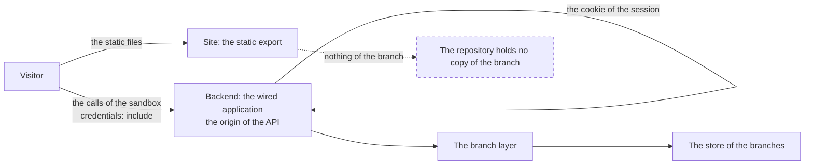

# ADR-044: The interface of the sandbox of the visitor lives in the frontend, on the origin of the backend

Status: accepted. Date: 2026-11-22.

## Context

The backend of the sandbox of the visitor is finished. The facade of `ledgerlens/api/sandbox.py` serves eleven
paths, the branch layer of `ledgerlens/sandbox/` holds the branches, and the tests of `tests/sandbox/` prove the
isolation of two visitors, the determinism of the projection, the expiry and the undo. A visitor of the public
demo can open a session, fork a branch, preview a typed mutation, commit it, read the diff and the history of
the branch, undo the last mutation and reset the branch to the published base.

What does not exist is the front. The site of the demo has four routes today: the home at `/`, the catalog of
the recorded demo at `/replay`, the route of a scenario at `/replay/scenario/<id>` and the live mode at `/live`.
The recorded demo reads the published artifacts of the site and calls nobody. The live mode asks the backend for
a run with the key of the visitor. Between the two there is no way to open a branch, and the whole capability
that the release R2 finished on the server is invisible to a visitor of the site.

The plan of the release names the work that is open: `specs/002-r2-visitor-sandbox/tasks.md` asks for the types
of the branch (T051), the view of the diff (T052), the state of the branch (T066), the client of the branch
(T078), the form of the mutation (T079), the panel of the branch (T080) and the documentation of the API
(T082). This milestone closes those seven tasks and nothing else. The task T082 asks for a decision record of
its own, `docs/decisions/ADR-011-sandbox-branch-store.md`, and that path cannot exist: ADR-011 is the decision of
the roadmap of the v3, and the decisions of the store of the branch are ADR-018 and ADR-020. THIS ADR is the
decision record of the front of the sandbox, and the task is closed by it and by the two decisions of the store.

Four facts of the repository decide the shape of the front.

The first is the static export. `apps/web/next.config.ts` declares `output: "export"`, so the site is a folder of
plain files and there is no server of the repository to answer a request of the browser. The live mode already
solved that problem: the browser calls the origin of the backend directly, with the credentials of the visitor
(ADR-040). The sandbox follows the same rule, and it must follow it in the same way, because the two halves of
the demo are one visitor in one deployment (ADR-039).

The second is the shape of the site. The site was built by ADR-043, and that decision fixed the rules of the
reader of the replay: the state of the visit lives in the URL with a closed allow list, the URL never carries
anything that came from a visitor, the money of the interface is the decimal text of the artifact, the browser
never calculates a value, the outline of the headings never skips a level, the controls are never `disabled` but
carry `aria-disabled` with a reason a screen reader reads, and the state is never only a colour. The front of
the sandbox obeys the same rules, because the sandbox is the third room of the same house.

The third is the contract of the versioned package. `docs/v3/contracts/openapi.yaml` declares eight of the
eleven paths of the facade. It does not declare the diff, the history and the undo, because ADR-023 declared
that the contract of the package cannot be edited: `docs/v3/` is a converted copy of a package that lives outside
the repository and the check of the import refuses any difference. The front therefore writes against the routes
of the code, and this ADR writes the three paths down so that no worker has to guess them.

The fourth is the shape of the answers of the facade. The resource `Sandbox` of the contract has no field for
the current canonical hash of the branch and none for its state, so those two travel in the headers
`X-LedgerLens-Branch-Hash` and `X-LedgerLens-Branch-State`, and the version of the answers travels in the header
`X-LedgerLens-Schema-Version` (FR-042, ADR-032). The CORS of ADR-040 already exposes the two headers of the
branch to the browser, so the front can read them.

## Decision

**The sandbox of the visitor is a third route of the site, at `/sandbox`, and it talks to the origin of the
backend exactly like the live mode does, with the credentials of the visitor.**

**The state of the branch lives in the memory of the page of the visitor and nowhere else. The branch itself
lives on the origin of the backend, and the repository never holds a second copy of it.**

**The browser never calculates a value, a mutation is committed only after a valid preview, a refusal of the
server is shown with the reason of the server, and the identity of the session travels in the cookie and in no
other place.**

This milestone is split in seven sets with disjoint files, so that the workers write at the same time without
touching the same file. This ADR is the contract between them: the file names, the exported names and the exact
signatures are written here, so that no two workers guess the same thing.

### What the milestone delivers

- The route `/sandbox`, with the list of the published scenarios, the panel of the branch, the form of the
  mutation and the view of the diff.
- The client of the branch, with the ten calls of the sandbox, the parsing of the error envelope and the reading
  of the two headers of the branch.
- The types of the branch, transcribed from the code of the facade and of the domain, field for field.
- The state of the branch: its phase, the identifier of the branch, the revision, the expiry, the preview, the
  diff, the history and the refusal, and the clearing of all of it when the session ends.
- The form of the mutation, with the five kinds of the catalog, the preview of the command and the commit that
  happens only after a valid preview.
- The view of the diff, which renders the strings that the server returns and never calculates a value.
- The documentation of the API of the sandbox, in `docs/api/sandbox.md`.

### What the milestone does not deliver, and why

- **The server sent events of the lifecycle of the branch** (the plan T077). The front reads the diff and the
  history when the visitor asks for them, and it never pushes. The debt is written down in the section about
  the debt.
- **The rate limit and the session limit of the facade** (the plan T081). The front does not rate limit, and a
  refusal of `429 RESOURCE_LIMIT_EXCEEDED` is rendered like any other refusal of the server.
- **The origin that is not an origin falls back to the default without saying so.** The helper `apiBaseUrl()` of
  `apps/web/lib/api/config.ts` answers `http://localhost:8010` when the build variable does not hold an origin,
  and the front of the sandbox inherits that answer. The live mode has always inherited it, and changing it would
  change the behaviour of the live mode, so this milestone does not change it. What the debt wants: a helper that
  REFUSES a value that is not an origin and a page that says the origin it could not read, because a front that
  talks to the wrong origin without saying so is a front that guesses.
- **The frontend has two clients and two sets of types for the same routes.** The transport of the live mode,
  `apps/web/lib/api/client.ts` and `apps/web/lib/api/live.ts`, already declares `startSession`, `forkSandbox` and
  the types `SandboxBody` and `SessionBody`, and the client of this milestone declares its own ten calls and its
  own types in `apps/web/features/sandbox/`. The new client uses the shared transport of the repository and
  never copies it, but the two surfaces coexist. What the debt wants: ONE client of the branch, with the live
  mode and the sandbox using it, and one set of types for the resource of the branch.
- **The panel of the ledger of the branch** (the route `GET /v1/sandboxes/{id}/ledger`). The front does not call
  it in this milestone, and the reason is in the section about the debt.
- **The published result of the branch and the claims of the verdict.** The verdict of the sandbox is the label
  of the domain of the sandbox (`within_expected_range`, `below_expected_range`, `above_expected_range` and
  `not_available`), and it is not the verdict of the recorded demo (`supported`, `contradicted` and
  `not_enough_evidence`). The front renders the label of the server and never a label of its own.

### The route of the sandbox, and where it is linked from

**The route of the sandbox is `/sandbox`.**

The reasons are these.

- The sandbox is a THIRD mode of the demo and not a part of one of the two. The recorded demo reads the
  published artifacts of the site and calls nobody. The sandbox calls the origin of the backend, and it needs no
  key and no provider. A route under `/replay` would say that the sandbox belongs to the recorded demo, and the
  prefix `/replay` is worse than that: it is BOTH the page of the catalog of the export (`out/replay.html`) and
  the folder of the published artifacts (`out/replay/`), so a page under that prefix would have to live in a
  namespace that already holds two shapes (ADR-043).
- The route is not under `/live` either. The live mode is the mode that calls a provider with the key of the
  visitor and that spends the money of the visitor. The sandbox needs no key and spends nothing. A route under
  `/live` would say that the branch of the visitor is part of a run that costs money.
- The route carries NO identifier of a scenario in the path. The catalog of the scenarios is read at run time
  from the published catalog of the site, and the visitor picks the case from a list of buttons on the page.
  A dynamic route would need `generateStaticParams` and a list of parameters at build time for a page whose
  content is a branch of the visitor, and the branch of the visitor does not exist at build time at all.
- The page is a client component, so the export writes one file, `out/sandbox.html`, and the file needs no
  parameter.

**The route is linked from the home page `/` and from the sandbox page itself.**

- `apps/web/app/page.tsx` gains a third card, and the section that holds the cards changes its accessible name
  from "The two ways to see the demo" to "The three ways to see the demo". The three cards are the recorded
  demo (`/replay`), the sandbox (`/sandbox`) and the live mode (`/live`), and each one carries the mode it runs
  in. The card of the sandbox carries the badge `mode: visitor_sandbox`, a label that no other mode uses and
  that says that the branch of the visitor is a simulation and not a run of a model.
- The header of the shell does NOT gain a link. ADR-043 decided that the header carries the name of the site
  and the indicator of the mode and nothing else, so that a header never competes with the content of the page
  for the attention of the reader. The pages link to each other in their bodies, the way the live mode already
  links to the recorded demo.
- The sandbox page links back to `/replay` and to `/live` in its header, with the same words the live page uses
  for the recorded demo.

### The origin of the calls

**The calls of the sandbox go to the origin of the backend, with the credentials of the visitor, exactly like
the live mode of ADR-040.**

- The origin is the one of ADR-040 and of `docs/frontend.md`: the public build variable
  `NEXT_PUBLIC_LEDGERLENS_API_BASE_URL`, read by `apps/web/lib/api/config.ts` through `apiBaseUrl()`, with the
  default `http://localhost:8010`. There is NO second variable, NO second origin and NO second rule. The value
  is an origin without a trailing slash and without a path. A value that is NOT an origin is not refused: the
  helper `apiBaseUrl()` of `apps/web/lib/api/config.ts` falls back to the default, and the front of the sandbox
  inherits that fallback. The debt of that fallback is named among the debts of this ADR, because a front that
  talks to the wrong origin without saying so is a front that guesses.
- Every call carries `credentials: "include"`, so the browser sends the cookie `ledgerlens_session` of the
  origin of the backend. The cookie is `HttpOnly`, `SameSite=Lax` and `Path=/`, and the deployment rule of
  ADR-040 holds: the origin of the API is published on the SAME SITE as the site of the interface, with the
  same scheme.
- The rule of the same site is the reason the sandbox cannot be a different site of the internet: the cookie of
  the session is `SameSite=Lax`, so it travels inside its own site and nowhere else.
- **There is NO second copy of the branch in the repository.** The static export holds nothing of the branch of
  the visitor: no snapshot of the branch, no cache of the diff, no fixture of the history in `apps/web/public/`.
  The branch lives on the origin of the backend, in the store of the deployment, and the browser holds the
  identifier of the branch and nothing else.
- **When the origin does not answer, the interface says so in words, with the origin it tried, and it does not
  guess and does not fall back.** The transport raises the error of the transport of the repository, with the
  status `0` and the code `NETWORK_ERROR`, and the message names the origin, the method and the path. The
  recorded demo keeps working exactly as before, because it calls nobody.
- **The session is issued ONLY when the server says there is none.** A call that is refused with `401
  SESSION_REQUIRED` triggers exactly one `POST /v1/sessions` and the call is retried exactly once. THE HOOK OF
  THE STATE OWNS THAT: the client of the branch NEVER retries a call and NEVER asks for a session, and the hook
  is the only place of the frontend that may issue one. The order is fixed: the call fails with 401, the hook
  issues the session, the hook retries the call ONCE, and if the retry fails with 401 again the state is cleared
  and the phase goes back to `idle`. Two places that retry would give two sessions to one visit. The rule
  matters because `POST /v1/sessions` always issues a NEW session: a front that called it on every visit would
  give a visitor a new session every time, and the branch of the previous session would stay on the origin
  with nobody able to reach it. A visitor that already has a session keeps it, and the branch of the visitor
  survives the visit to another route of the site.

The flow of the sandbox, with the two origins:



### The contract of every call

The eleven paths of `ledgerlens/api/sandbox.py` are the contract of the front. Eight of them are paths of the
versioned contract (`docs/v3/contracts/openapi.yaml`) and three of them are the paths that ADR-023 declared
beyond it. The front calls TEN of the eleven: the ledger is not called in this milestone.

Every answer of the facade carries the header `X-LedgerLens-Schema-Version: 1`, and the answers of the branch
carry the two headers of the branch. The CORS of ADR-040 already exposes the three headers to the browser.

Every refusal of the facade is the resource `Error` of the contract, field for field:

```json
{ "code": "REVISION_CONFLICT", "message": "the branch is at revision 2 and the request expected 1", "retryable": false, "request_id": "req_1a2b3c4d5e6f7a8b" }
```

The four fields are always there. The front reads them with the same reader that the transport of the live mode
uses, so the envelope has one reader in the repository and not two.

#### Call 1: the session of the visitor

| | |
| --- | --- |
| Method and path | `POST /v1/sessions` |
| Body | none |
| Statuses | `201` with the session |
| Answer | the resource `Session`: `id`, `expires_at`, `mode_capabilities` |
| Refusals | none of its own; the route answers `201` or nothing |
| Side effect | the answer sets the cookie `ledgerlens_session`, `HttpOnly`, `SameSite=Lax`, `Path=/`, with the life of the issuer |
| File of the front | `apps/web/features/sandbox/api/sandboxClient.ts` |
| Function | `SandboxClient.startSession()` |

The route that answers is the one of the live mode in the wired application, because ADR-039 drops the route of
the sandbox and keeps the one of the live mode, and the answer of the live mode is the superset: the same
resource `Session` plus the two disclosures and the headers of no store. The front of the sandbox reads the
body of the resource and ignores the disclosures, which belong to the live mode.

#### Call 2: the end of the session

| | |
| --- | --- |
| Method and path | `DELETE /v1/sessions/current` |
| Body | none |
| Statuses | `204` with no body |
| Answer | empty |
| Refusals | `401` `SESSION_REQUIRED` when the cookie is not a session of the deployment |
| Side effect | the answer deletes the cookie; the route deletes the branches of the session, purges the memory of the case and drops the credentials of the session |
| File of the front | `apps/web/features/sandbox/api/sandboxClient.ts` |
| Function | `SandboxClient.endSession()` |

The route that answers is the one of the sandbox in the wired application, because ADR-039 keeps the end of the
session of the sandbox: it is the one that deletes the branches.

#### Call 3: the fork of the branch

| | |
| --- | --- |
| Method and path | `POST /v1/sandboxes` |
| Body | `{ "scenario_id": "S01" }` and nothing else: the resource `SandboxRequest` refuses any other field |
| Statuses | `201` when the fork CREATES a branch, `200` when the reuse rule returns the branch that already exists |
| Answer | the resource `Sandbox`: `id`, `base_snapshot_id`, `snapshot_sha256`, `revision`, `expires_at`, plus the header `X-LedgerLens-Branch-Hash` and the header `X-LedgerLens-Branch-State` |
| Refusals | `401` `SESSION_REQUIRED`; `404` `UNKNOWN_SCENARIO`; `422` `INVALID_REQUEST` when the body does not match the contract (the pattern of the identifier is `^S[0-9]{2}$` and the body accepts no other field) |
| File of the front | `apps/web/features/sandbox/api/sandboxClient.ts` |
| Function | `SandboxClient.fork(scenarioId)` |

The difference between `201` and `200` matters to the front and it is the recovery of the branch: the second
fork of the same scenario by the same session returns the branch that already exists, with its CURRENT revision.
The front reads the two answers as one thing and remembers whether the branch was created or found.

#### Call 4: the state of the branch

| | |
| --- | --- |
| Method and path | `GET /v1/sandboxes/{sandbox_id}` |
| Body | none |
| Statuses | `200` with the branch |
| Answer | the resource `Sandbox`, plus the two headers of the branch |
| Refusals | `401` `SESSION_REQUIRED`; `404` `NOT_FOUND` with the generic message "no sandbox is available for this session"; `410` `BRANCH_EXPIRED`; `409` `HASH_MISMATCH` |
| File of the front | `apps/web/features/sandbox/api/sandboxClient.ts` |
| Function | `SandboxClient.status(branchId)` |

The identifier of the branch travels in the path and it is opaque and it is not a secret: it is the prefix `sb_`
followed by twenty four hexadecimal characters. The right to read the branch is decided by the cookie of the
session and by the owner of the branch, and never by the identifier.

#### Call 5: the preview of the mutation

| | |
| --- | --- |
| Method and path | `POST /v1/sandboxes/{sandbox_id}/mutations/preview` |
| Body | `{ "kind": "refund.apply_fx_adjustment", "data": { ... }, "reason": "..." }`: the `data` is an object and the `reason` is optional |
| Statuses | `200` with the preview, whether the command is valid or not |
| Answer | the preview: `valid`, `kind`, `revision`, `current_canonical_hash`, `projected_canonical_hash`, `before`, `after`, `records`, `diff`, `invariants`, `verdict` |
| Refusals | `422` `INVALID_PAYLOAD` when the `data` is not an object; `422` `READ_ONLY_FIELD` when the body carries a field of the domain; the codes of the domain of the mutation (`UNKNOWN_MUTATION_TYPE`, `INVALID_AMOUNT`, `CURRENCY_MISMATCH`, `INVALID_EFFECTIVE_DATE`, `UNKNOWN_RECORD`, `INVALID_STATE`, `INVALID_PAYLOAD`, `NOTE_TOO_LONG`); `401`; `404`; `410`; `409` `HASH_MISMATCH` |
| File of the front | `apps/web/features/sandbox/api/sandboxClient.ts` |
| Function | `SandboxClient.preview(branchId, command)` |

The answer of the preview is the only answer that carries a `valid` flag, and the flag is the truth of the
domain: it is true when every invariant of the domain holds over the state the command WOULD produce. The
preview never writes anything: the revision, the hash and the events of the branch are the same before and
after it (FR-016).

#### Call 6: the commit of the mutation

| | |
| --- | --- |
| Method and path | `POST /v1/sandboxes/{sandbox_id}/mutations` |
| Body | the body of the preview, byte for byte |
| Headers | `Idempotency-Key`, which names the request, and `If-Match`, which carries the revision the visitor believes the branch is at |
| Statuses | `200` with the result of the mutation |
| Answer | the result: `command_id`, `kind`, `revision`, `canonical_hash`, `diff`, `invariants`, `verdict`, `replayed`, `stale`, `stale_against`, `undone`, `undone_event_uid` |
| Refusals | `422` `INVALID_REQUEST` when the `If-Match` does not carry a revision; `409` `REVISION_CONFLICT`, `409` `IDEMPOTENCY_MISMATCH`, `409` `HASH_MISMATCH`; `422` `INVARIANT_VIOLATION` when a rule of the domain does not hold over the state the command would produce, and then NOTHING is written; the codes of the payload; `413` `PAYLOAD_TOO_LARGE`; `429` `RESOURCE_LIMIT_EXCEEDED`; `503` `CONTRACT_UNAVAILABLE`; `401`; `404`; `410` |
| File of the front | `apps/web/features/sandbox/api/sandboxClient.ts` |
| Function | `SandboxClient.commit(branchId, command, { revision, idempotencyKey })` |

The `diff` of the answer of the commit is the difference that THIS mutation made, and it is not the difference
between the base and the branch: that one is the answer of the diff.

#### Call 7: the undo of the last mutation

| | |
| --- | --- |
| Method and path | `POST /v1/sandboxes/{sandbox_id}/undo` |
| Body | empty: the undo does not change a record of the case, it changes the log of the branch |
| Headers | `Idempotency-Key` and `If-Match`, exactly like the commit |
| Statuses | `200` with the result of the undo |
| Answer | the same shape as the answer of the commit |
| Refusals | `409` `NOTHING_TO_UNDO` when the branch holds no mutation left to undo, and then the branch stays untouched; the other refusals of the commit |
| File of the front | `apps/web/features/sandbox/api/sandboxClient.ts` |
| Function | `SandboxClient.undo(branchId, { revision, idempotencyKey })` |

#### Call 8: the reset of the branch

| | |
| --- | --- |
| Method and path | `POST /v1/sandboxes/{sandbox_id}/reset` |
| Body | none |
| Statuses | `200` with the branch |
| Answer | the resource `Sandbox`, plus the two headers of the branch |
| Refusals | `422` `INVALID_REQUEST` when the identifier of the branch does not match the pattern `^sb_[0-9a-f]{24}$`; `401`; `404`; `410`; `409` `HASH_MISMATCH` |
| File of the front | `apps/web/features/sandbox/api/sandboxClient.ts` |
| Function | `SandboxClient.reset(branchId)` |

The reset puts the branch back at the published base: no events, the revision at zero and the canonical hash of
the base. The answers that the branch remembers are marked stale against the hash of the original snapshot.

#### Call 9: the diff of the branch

| | |
| --- | --- |
| Method and path | `GET /v1/sandboxes/{sandbox_id}/diff` |
| Body | none |
| Statuses | `200` with the diff |
| Answer | `revision`, `base_canonical_hash`, `canonical_hash`, `diff`, `invariants`, `verdict` |
| Refusals | `422` `INVALID_REQUEST` when the identifier of the branch does not match the pattern `^sb_[0-9a-f]{24}$`; `401`; `404`; `410`; `409` `HASH_MISMATCH` |
| File of the front | `apps/web/features/sandbox/api/sandboxClient.ts` |
| Function | `SandboxClient.diff(branchId)` |

This path is NOT in the versioned contract. ADR-023 declared it, and the front writes against the route of the
code.

#### Call 10: the history of the branch

| | |
| --- | --- |
| Method and path | `GET /v1/sandboxes/{sandbox_id}/history` |
| Body | none |
| Statuses | `200` with the history |
| Answer | `revision`, `canonical_hash`, `events`, `answers` |
| Refusals | `422` `INVALID_REQUEST` when the identifier of the branch does not match the pattern `^sb_[0-9a-f]{24}$`; `401`; `404`; `410`; `409` `HASH_MISMATCH` |
| File of the front | `apps/web/features/sandbox/api/sandboxClient.ts` |
| Function | `SandboxClient.history(branchId)` |

This path is NOT in the versioned contract. ADR-023 declared it.

#### The call that this milestone does not make

| | |
| --- | --- |
| Method and path | `GET /v1/sandboxes/{sandbox_id}/ledger?account_id=...&cursor=...` |
| Answer | `{ "items": [ ... ], "next_cursor": null }`, the rows of the projection of the branch |
| Status of this milestone | NOT CALLED. The panel of the ledger is a debt, and the reason is in the section about the debt |

### The state of the branch

**The state of the branch lives in the memory of the page of the visitor. It is never written to the URL, to the
`localStorage`, to the `sessionStorage` and to no cookie.**

The state holds the phase of the machine, the identifier of the branch, the revision, the expiry, the state of
the branch, the canonical hash, the preview that is waiting for a commit, the diff, the history and the refusal.

**The phases are `idle`, `opening`, `ready` and `refused`.**

- `idle`: there is no branch in the state. The page shows the list of the published scenarios and the visitor
  opens the branch of the one they pick.
- `opening`: the fork is in flight.
- `ready`: the branch is there. The panel, the form and the view of the diff read the state.
- `refused`: the branch is gone or the server refused the last act and the branch cannot be shown. The state
  carries the refusal and nothing else of the branch.

**How the end of the session is known.** There are three ways, and all three clear the state.

1. The visitor asks for it. The panel carries the action "End the session", which calls
   `DELETE /v1/sessions/current`. Whatever the server answers, the state is cleared: the branch identifier, the
   revision, the expiry, the preview, the diff, the history and the refusal all go, and the phase goes back to
   `idle`. The reason is that a state that keeps a branch the visitor no longer owns is a state that shows a
   branch that is not there.
2. The server refuses with `401 SESSION_REQUIRED`. The cookie is gone, expired or was never issued: the hook
   issues the session once and retries the call once, and the state is cleared the same way when the retry
   fails with 401 again.
3. The server refuses with `410 BRANCH_EXPIRED`. The branch is gone and the session may still be alive: the
   branch of the state is cleared, the refusal is kept, and the panel offers to open the scenario again.

**What happens when the page is reloaded.** The state of the browser is LOST, and the branch of the visitor is
NOT lost: it lives on the origin, with the cookie of the session, and it is RECOVERED by the fork.

The reason is the reuse rule of the fork: the second fork of the same scenario by the same session returns the
branch that already exists, with its current revision, and the answer is `200` instead of `201`. The front does
not need to remember the identifier of the branch to find it, and it does not put the identifier in the URL to
remember it either. The visitor opens the scenario again and the fork brings the branch back.

There is no other way to recover the branch, because the facade has no route that lists the branches of a
session, and this milestone does not add one. The front says the branch was FOUND and not CREATED, so that a
visitor who reloads the page understands that the work of the branch is still there.

**The state is cleared, and the branch of the visitor is gone with the session.** The end of the session deletes
the branches of the session on the origin, purges the memory of the case and drops the credentials of the
session (ADR-030).

### The rules of the browser

Each rule has its reason, and the reason is in the rule.

**Rule 1: the browser NEVER calculates a value.**

- The diff renders the strings that the server returns. The `before` and the `after` of an entry of the diff are
  rendered exactly as they were sent. The front never calls `parseFloat`, never calls `Number`, never builds a
  `BigInt` out of them and never multiplies two of them. It never calls `formatMoney` on them either: the
  formatter of the repository groups the digits of the integer part, and the rule of the sandbox is stricter, the
  value of the diff is the value the server wrote.
- The money is TEXT. The value of an entry of the diff is a decimal text and the currency is a code that the
  same entry carries. The front writes the two side by side and never converts one into the other, and it never
  assumes a currency it did not read. A value that the server sent empty is shown as `Not available`, the
  constant `MONEY_UNAVAILABLE` of `apps/web/lib/format/money.ts`, because a unit written on a missing value would
  be an invention.
- The verdict is the label of the server. The four labels of the domain of the sandbox are
  `within_expected_range`, `below_expected_range`, `above_expected_range` and `not_available`, and the front
  renders the label as it was sent. The front never decides a verdict and never translates one into another: the
  verdict of the sandbox is NOT the verdict of the recorded demo, and the mapping of `lib/format/status.ts` does
  not know these four labels. The tone of the badge is the only thing the front adds, and a label it does not
  know gets the neutral tone.
- The revision is an integer that the server writes, and the front never counts anything itself. The expiry is
  the ISO 8601 text that the server writes, and the front never computes the remaining time from the clock of
  the browser, because the clock of the browser is not the clock of the server (FR-031).

**Rule 2: a mutation is COMMITTED only after a valid preview, and the preview that was shown is the preview
that is committed.**

- The commit is offered only when the state holds a preview whose `valid` is true and whose `revision` is the
  revision the branch is at now. The control of the commit is never `disabled`: it carries `aria-disabled` and
  the reason it points at with `aria-describedby`, and the reason is a sentence of the interface ("preview the
  command first", "the preview is out of date, preview the command again", "the command would break a rule of
  the domain").
- The commit sends the body of the previewed command, byte for byte. The front never rebuilds the body from the
  fields of the form when it commits: it sends the command that was previewed, so that what the visitor read is
  what the server received.
- The commit sends the `If-Match` of the revision the preview was made at, and the `Idempotency-Key` that was
  generated with the preview. The key names the request: a second press of the commit is the SAME request
  delivered twice, and the server answers it with the answer it stored, with the flag `replayed` at true. The
  front never generates a new key for the same preview.
- The server refuses the commit of a command that breaks an invariant, with `422 INVARIANT_VIOLATION`, and then
  NOTHING is written. The preview is the promise of the feature and the front keeps it: the commit is only
  offered after a preview that says the command is valid.

**Rule 3: the refusal of the server is shown with the reason of the server and never with a guess.**

- Every refusal is rendered where the action was, with the code of the server and the message of the server. The
  front never rewrites the message, never replaces it with a sentence of its own and never hides the code.
- A refusal that is ABOUT AN ACT keeps the branch: the preview refused with `422 INVALID_AMOUNT` leaves the
  branch, its revision and its diff exactly where they were, and the form shows the reason.
- A refusal that means the branch is GONE clears the branch of the state: the codes `401 SESSION_REQUIRED`,
  `404 NOT_FOUND` and `410 BRANCH_EXPIRED`. A branch that is not there is never half drawn.
- A refusal of the LOCAL interface is not a refusal of the server and it never wears its clothes: when the front
  refuses a commit because there is no valid preview, it says what the front refused and why, in its own words.

**Rule 4: the identity of the session never travels in the URL, in a header and in a path.**

- The cookie `ledgerlens_session` carries the identity, and it is `HttpOnly`: the browser cannot read it and the
  front never touches it.
- The URL of the sandbox is `/sandbox` and it carries NOTHING: no identifier of a branch, no identifier of a
  session, no revision, no answer, no text of a command and no free text of any kind. The allow list of the URL
  of ADR-043 holds for the replay and the sandbox has no parameter at all.
- The identifier of the branch travels in the path of the calls of the backend, and it is opaque and it is not a
  secret: the right to read a branch is decided by the cookie of the session and by the owner of the branch.
- The `Idempotency-Key` is a name of a request and not a secret, and it travels in a header, which is where the
  contract of the design package puts it.

### The accessibility rules

The rules below are the rules of ADR-043, restated for this front, and they are part of the contract of the
milestone and not a polish of the end of it. The target is WCAG 2.2 level AA.

- **The state is never only a colour.** The phase of the branch, the verdict, the state of a record of the
  diff and the refusal always carry the words too. The badge of the warning tone paints itself with the dark
  tone of the warning, so that the text of the badge reaches the contrast of the normal text.
- **The controls are never `disabled`.** The control the visitor is standing on never goes away under their
  feet: a button that would do nothing says so with `aria-disabled="true"` instead of disappearing from under
  the focus, and it points at the reason with `aria-describedby`, so that a visitor who pressed the control and
  nothing happened gets an answer. The controls of the sandbox are: the fork of a scenario, the preview, the
  commit, the undo, the reset, the read of the diff, the read of the history and the end of the session.
- **The `aria-current` sits on the LINE.** The events of the history carry NO revision: they carry the
  identifier of the event, its kind, the record it touched, the moment and whether it was undone. The row of the
  table of the history that carries `aria-current="true"` is therefore the row of the LAST event that is not
  undone, which is where the branch stands, and the revision of the branch is shown in the panel and not in the
  row. The attribute goes on the row through the optional callback `rowAttributes` of the table of the design
  system, it sits on the row and NOT on a cell of the row, and a table used without the callback gives its rows
  no attribute at all.
- **The outline of the headings never skips a level.** The route carries the `h1` of the page, the panel of the
  branch carries the `h2`, the three sections of the page carry the `h3` ("The mutation", "The difference",
  "The history") and the verdict of the case carries the `h4` inside the section of the difference. From the
  `h1` to the `h4`, one level at a time.
- **The live region announces the change politely.** The page carries ONE region with `role="status"`,
  `aria-live="polite"` and `aria-atomic="true"`, and it carries one sentence at a time: "the branch is at
  revision 2", "the preview is ready", "the command was refused: REVISION_CONFLICT". The region is never
  assertive, and it never carries the whole diff.
- **The diff is a table with a header.** The table of the design system draws it, with the caption "The
  difference between the published base and the branch" as its accessible name, a `th` with `scope="col"` for
  every column and a `th` with `scope="row"` for the FIELD of every row. The identity of a record is NOT a
  column of the diff: it is a value of the first one, and the header of the row is the field, so that a screen
  reader reads the field and the record together. The columns are the record, the field, the value before, the
  value after and the kind of the value.
- **The reason of a control is read by a screen reader.** Every `aria-disabled` control points at its reason
  with `aria-describedby`, and the reason is a sentence, not a word.
- **The refusal is announced by an alert.** The region of a refusal carries `role="alert"`, because a refusal is
  the answer to an act of the visitor and it has to be heard at once. The polite region of the changes and the
  alert of the refusal are two different regions and they never overlap.

### The seven sets

The seven sets have DISJOINT files. A file that is named in two sets is a defect of this ADR.

The tables below list the public surface of every module. Every module that this milestone writes ALSO exports a
constant `__all__` that carries that same list, so that a reader who opens a file sees the whole surface of the
module at once. The file of the seam `apps/web/lib/api/client.ts` is older than this milestone and is EXEMPT
from that convention: it keeps the surface it has and gains only the export of `readErrorBody`. The TWO PAGE
FILES of the framework are exempt as well, and for a reason of the framework and not of taste: a page of the App
Router may only export the fields the framework knows, and an extra export is a type error that stops the build.
The pages are `apps/web/app/(public)/sandbox/page.tsx` and `apps/web/app/page.tsx`, and they carry the docstring
of the module and no `__all__`. Every module of the frontend that this milestone writes carries a docstring in English that says
what it does and why, written for whoever reads the code for the first time.

#### Set A, the types and the client

| File | Status | Content |
| --- | --- | --- |
| `apps/web/features/sandbox/types.ts` | new | `SandboxCommand`, `FxAdjustmentCommand`, `DuplicatePaymentCommand`, `DeadlineCommand`, `FxOutageCommand`, `UntrustedNoteCommand`, `SandboxCommandKind`, `MUTATION_KINDS`, `SandboxResource`, `SandboxStatusAnswer`, `SandboxForkAnswer`, `MoneyValue`, `BranchDiffEntry`, `BranchVerdict`, `BranchInvariant`, `MutationPreviewBody`, `MutationResultBody`, `BranchDiffBody`, `BranchHistoryEvent`, `BranchRecordedAnswer`, `BranchHistoryBody`, `SandboxErrorBody` |
| `apps/web/features/sandbox/api/sandboxClient.ts` | new | `SandboxClientOptions`, `SandboxClient`, `createSandboxClient` |
| `apps/web/lib/api/client.ts` | changed | the reader of the error envelope becomes public: `readErrorBody`, in addition to the surface the file already has |
| `apps/web/tests/unit/features/sandbox-client.test.ts` | new | the client of the branch, with a fetch that is stubbed |

#### Set B, the state of the branch

| File | Status | Content |
| --- | --- | --- |
| `apps/web/features/sandbox/useBranch.ts` | new | `SandboxPhase`, `BranchState`, `BranchAction`, `branchReducer`, `UseBranchOptions`, `UseBranchResult`, `useBranch` |
| `apps/web/tests/unit/features/sandbox-state.test.tsx` | new | the reducer and the hook of the branch |

#### Set C, the components of the branch

| File | Status | Content |
| --- | --- | --- |
| `apps/web/features/sandbox/BranchPanel.tsx` | new | `BranchPanelProps`, `BranchPanel` |
| `apps/web/features/sandbox/DiffView.tsx` | new | `DiffViewProps`, `DiffView` |
| `apps/web/features/sandbox/MutationForm.tsx` | new | `MutationFormProps`, `MutationForm` |
| `apps/web/features/sandbox/sandbox.css` | new | the styles of the sandbox |
| `apps/web/tests/unit/features/sandbox-panel.test.tsx` | new | the panel of the branch |
| `apps/web/tests/unit/features/sandbox-form.test.tsx` | new | the form of the mutation |
| `apps/web/tests/unit/features/sandbox-diff-view.test.tsx` | new | the view of the diff |

#### Set D, the route of the sandbox and the home page

| File | Status | Content |
| --- | --- | --- |
| `apps/web/app/(public)/sandbox/page.tsx` | new | the route of the sandbox |
| `apps/web/app/page.tsx` | changed | the home page gains the third card of the site |
| `apps/web/tests/unit/features/sandbox-page.test.tsx` | new | the route of the sandbox |
| `apps/web/tests/unit/features/sandbox-accessibility.test.tsx` | new | the regression guard of the accessibility of the front |

#### Set E, the documentation of the sandbox

| File | Status | Content |
| --- | --- | --- |
| `docs/api/sandbox.md` | new | the endpoints, the status codes, the error codes and the catalog of the mutations |
| `docs/frontend.md` | changed | the route of the sandbox, the origin of the calls and the state of the branch |

#### Set F, the CORS of the deployment

| File | Status | Content |
| --- | --- | --- |
| `ledgerlens/api/cors.py` | changed | the list `ALLOWED_HEADERS` gains `Idempotency-Key` and `If-Match`, because the commit and the undo send them and the browser sends them in the preflight of the call |
| `tests/api/test_cors.py` | changed | the case that asserts the headers the browser may send asserts the two new ones |
| `docs/decisions/ADR-040-the-live-mode-on-the-origin-of-the-backend.md` | changed | the table of the parameters of the CORS names the two headers of the commit and of the undo, because the table is the contract of the deployment and it would be wrong after the change of `ledgerlens/api/cors.py` |

#### Set G, the fence of the network

| File | Status | Content |
| --- | --- | --- |
| `apps/web/tests/unit/network-fence.test.ts` | changed | the fence names the client of the sandbox in the first case of the file, the one that walks the folder `features/` |

### The public surface, as the code delivers it

The tables above name the surface of every module. This part carries the SURFACE ITSELF, transcribed from the code
that Set A and Set B delivered, so that a reader of this ADR and a reader of the code see the same names with the
same shapes. A name that is not here is not part of the contract, and a name that is here and is not in the code is a
defect of one of the two.

The types of the branch, of `apps/web/features/sandbox/types.ts`. The two aliases that narrow the fields of
the body of the command are module local, so the exported surface of the module does not carry them:

```ts
export type SandboxCommandKind =
export interface FxAdjustmentCommand {
  /** The kind of the command. */
  kind: "refund.apply_fx_adjustment";
  /** The data of the command, the payload the domain reads. */
  data: {
    /** The refund the adjustment is about, in the shape `R` followed by four digits. */
    refund_id: string;
    /** The rate of the adjustment, as a decimal text with at most eight decimals. */
    applied_rate: string;
    /** The moment the adjustment takes effect, as an ISO 8601 text with a time zone. */
    effective_at: string;
    /**
     * The assertion of the visitor about the currency of the record.
     *
     * Why it is optional and why the schema does not declare it: the published schema refuses any
     * other field, and the domain checks this assertion against the record before the shape of the
     * payload is checked. A currency that does not match the record is refused with its own code.
     */
    currency?: string;
  };
  /** The reason of the visitor, the note that travels with the command. */
  reason?: string;
}
export interface DuplicatePaymentCommand {
  /** The kind of the command. */
  kind: "payment.simulate_duplicate";
  /** The data of the command, the payload the domain reads. */
  data: {
    /** The transaction that is charged again, in the shape `TX` followed by four digits. */
    transaction_id: string;
    /**
     * How many seconds passed since the first charge.
     *
     * Why the type names the range of the schema: the published schema declares an integer
     * between 1 and 300, and the type says exactly that, so a body that carries 0 or 301 is a
     * type error of the front and not a refusal of the server.
     */
    elapsed_seconds: ElapsedSeconds;
    /** The assertion of the visitor about the currency of the record. */
    currency?: string;
  };
  /** The reason of the visitor, the note that travels with the command. */
  reason?: string;
}
export interface DeadlineCommand {
  /** The kind of the command. */
  kind: "chargeback.change_deadline";
  /** The data of the command, the payload the domain reads. */
  data: {
    /** The chargeback the deadline belongs to, in the shape `CB` followed by four digits. */
    chargeback_id: string;
    /** The new deadline, as a day of the calendar in the shape `YYYY-MM-DD`. */
    new_deadline: string;
    /** The assertion of the visitor about the currency of the record. */
    currency?: string;
  };
  /** The reason of the visitor, the note that travels with the command. */
  reason?: string;
}
export interface FxOutageCommand {
  /** The kind of the command. */
  kind: "tool.fx_outage";
  /** The data of the command, the payload the domain reads. */
  data: {
    /** Whether the tool goes down or comes back. */
    enabled: boolean;
    /**
     * The error code the tool answers with while it is down.
     *
     * Why the type is the literal of the schema: the published schema declares the enum with one
     * code, `UPSTREAM_UNAVAILABLE`, and a plain text would let the front build a body the
     * contract does not declare.
     */
    error_code: FxOutageErrorCode;
  };
  /** The reason of the visitor, the note that travels with the command. */
  reason?: string;
}
export interface UntrustedNoteCommand {
  /** The kind of the command. */
  kind: "record.inject_untrusted_note";
  /** The data of the command, the payload the domain reads. */
  data: {
    /** The record the note is injected on. */
    record_id: string;
    /** The text of the note. */
    text: string;
  };
  /** The reason of the visitor, the note that travels with the command. */
  reason?: string;
}
export type SandboxCommand =
export interface SandboxResource {
  /** The identifier of the branch, the prefix `sb_` and twenty four hexadecimal characters. */
  id: string;
  /** The identifier of the published snapshot the branch was forked from. */
  base_snapshot_id: string;
  /** The hash of the published snapshot the branch was forked from. */
  snapshot_sha256: string;
  /** The revision the branch is at. */
  revision: number;
  /** The moment the branch dies, as an ISO 8601 text. */
  expires_at: string;
}
export interface SandboxStatusAnswer extends SandboxResource {
  /** The current canonical hash of the branch, read from the header of the answer. */
  branchHash: string | null;
  /**
   * The state of the branch, read from the header of the answer.
   *
   * Why it is a text and not a closed list: the client carries the text of the server as it is, and
   * the domain writes `active` and `expired` today.
   */
  branchState: string | null;
}
export interface SandboxForkAnswer extends SandboxStatusAnswer {
  /** Whether the fork created the branch (`201`) or found the one that already existed (`200`). */
  created: boolean;
}
export interface MoneyValue {
  /** The amount, as a decimal text. */
  value: string;
  /** The currency of the amount, as a code. */
  currency: string;
}
export interface BranchDiffEntry {
  /** The table of the row that changed. */
  record: string;
  /** The identifier of the row that changed. */
  record_id: string;
  /** The column that changed. */
  field: string;
  /** The value before the change, as a text. */
  before: string;
  /** The value after the change, as a text. */
  after: string;
  /** Whether the value is an amount of money (`monetary`) or anything else (`non_monetary`). */
  value_kind: string;
  /** The currency of the value, when the value is an amount of money. */
  currency: string | null;
}
export interface BranchVerdict {
  /** The label of the verdict, one of the four labels of the domain. */
  label: string;
  /** The measure the verdict was computed from. */
  measure: string;
  /** The value of the measure, as a text. */
  value: string | null;
  /** The lower bound of the measure, as a text. */
  low: string | null;
  /** The upper bound of the measure, as a text. */
  high: string | null;
  /** The note of the server about the verdict. */
  detail: string;
}
export interface BranchInvariant {
  /** The name of the rule. */
  identifier: string;
  /** What the rule says, in words. */
  description: string;
  /** Whether the rule holds over the state. */
  passed: boolean;
  /** Why the rule does not hold, empty when it holds. */
  reason: string;
}
export interface MutationPreviewBody {
  /** Whether the command would produce a state the domain accepts. */
  valid: boolean;
  /** The kind of the command that was previewed. */
  kind: string;
  /** The revision the branch is at now. */
  revision: number;
  /** The canonical hash the branch holds now. */
  current_canonical_hash: string;
  /** The canonical hash the branch would hold after the command. */
  projected_canonical_hash: string;
  /** The value before the command. */
  before: MoneyValue;
  /** The value after the command. */
  after: MoneyValue;
  /** The rows the command would write. */
  records: BranchDiffEntry[];
  /** The difference the command would make. */
  diff: BranchDiffEntry[];
  /** The rules of the domain over the state the command would produce. */
  invariants: BranchInvariant[];
  /** The verdict of the case over the state the command would produce. */
  verdict: BranchVerdict;
}
export interface MutationResultBody {
  /** The identifier of the request that produced the answer. */
  command_id: string;
  /** The kind of the command that was committed. */
  kind: string;
  /** The revision the branch is at now. */
  revision: number;
  /** The canonical hash the branch holds now. */
  canonical_hash: string;
  /** The difference THIS mutation made. */
  diff: BranchDiffEntry[];
  /** The rules of the domain over the state the branch holds now. */
  invariants: BranchInvariant[];
  /** The verdict of the case over the state the branch holds now. */
  verdict: BranchVerdict;
  /** Whether the answer was stored before and the request was delivered twice. */
  replayed: boolean;
  /** Whether the answer was produced in a generation that a reset has closed. */
  stale: boolean;
  /** The hash of the original snapshot the answer was computed against. */
  stale_against: string | null;
  /** Whether the mutation this answer describes was undone afterwards. */
  undone: boolean;
  /** The identifier of the event that the request undid. */
  undone_event_uid: string | null;
}
export interface BranchDiffBody {
  /** The revision the branch is at now. */
  revision: number;
  /** The canonical hash of the published base of the branch. */
  base_canonical_hash: string;
  /** The canonical hash the branch holds now. */
  canonical_hash: string;
  /** The entries of the difference. */
  diff: BranchDiffEntry[];
  /** The rules of the domain over the current state of the branch. */
  invariants: BranchInvariant[];
  /** The verdict of the case over the current state of the branch. */
  verdict: BranchVerdict;
}
export interface BranchHistoryEvent {
  /** The identifier of the event. */
  event_uid: string;
  /** The type of the event. */
  event_type: string;
  /** The record the event is about. */
  aggregate_id: string;
  /** The moment the event happened, as an ISO 8601 text. */
  occurred_at: string;
  /** The payload of the event, as the domain wrote it. */
  payload: Record<string, unknown>;
  /** Whether the event was undone afterwards. */
  undone: boolean;
}
export interface BranchRecordedAnswer {
  /** The branch the answer belongs to. */
  branch_id: string;
  /** The key that named the request. */
  idempotency_key: string;
  /** The digest of the payload of the request. */
  payload_digest: string;
  /** The revision the branch was at when the answer was produced. */
  revision: number;
  /** The canonical hash the branch held when the answer was produced. */
  canonical_hash: string;
  /** The difference the request made. */
  response_diff: BranchDiffEntry[];
  /** The verdict the request produced. */
  response_verdict: BranchVerdict;
  /** The rules of the domain the request produced. */
  response_invariants: BranchInvariant[];
  /** The generation of the branch the answer was produced in. */
  generation: number;
  /** Whether the answer was produced in a generation behind the one of the branch. */
  stale: boolean;
  /** The hash of the original snapshot the answer was computed against. */
  stale_against: string | null;
  /** Whether the mutation this answer describes was undone afterwards. */
  undone: boolean;
  /** The identifier of the event that the request undid. */
  undone_event_uid: string | null;
}
export interface BranchHistoryBody {
  /** The revision the branch is at now. */
  revision: number;
  /** The canonical hash the branch holds now. */
  canonical_hash: string;
  /** The events of the log, in the order of the log. */
  events: BranchHistoryEvent[];
  /** The answers the branch remembers. */
  answers: BranchRecordedAnswer[];
}
export interface SandboxErrorBody {
  /** The code of the refusal, for instance `REVISION_CONFLICT`. */
  code: string;
  /** The message of the server, in words a visitor can read. */
  message: string;
  /** Whether the same request may work later. */
  retryable: boolean;
  /** The identifier of the request, the one the logs of the server carry. */
  request_id: string;
}
```

The state of the branch, of `apps/web/features/sandbox/useBranch.ts`:

```ts
export type SandboxPhase = "idle" | "opening" | "ready" | "refused";
export interface BranchState {
  /** Where the machine stands. */
  readonly phase: SandboxPhase;
  /** The identifier of the branch, or `null` when there is none. */
  readonly branchId: string | null;
  /** The revision the branch is at, as the server writes it. */
  readonly revision: number | null;
  /** The moment the branch dies, as the server writes it. */
  readonly expiresAt: string | null;
  /** The canonical hash of the branch, as the server writes it. */
  readonly canonicalHash: string | null;
  /** The state of the branch, as the header of the server carries it. */
  readonly branchState: string | null;
  /** Whether the branch was created by the fork or found by it, or `null` when there is none. */
  readonly created: boolean | null;
  /** The preview that waits for a commit, with the key that the commit carries. */
  readonly preview: {
    /** Whether the command would keep every rule of the domain. */
    readonly valid: boolean;
    /** The revision the preview was made at. */
    readonly revision: number;
    /** The key that names the request of the commit. */
    readonly idempotencyKey: string;
    /** The command that was previewed, sent again byte for byte by the commit. */
    readonly command: SandboxCommand;
    /** The answer of the server to the preview. */
    readonly answer: MutationPreviewBody;
  } | null;
  /** The difference between the published base and the branch. */
  readonly diff: BranchDiffBody | null;
  /** The log of the branch. */
  readonly history: BranchHistoryBody | null;
  /** The refusal of the server, with the code and the message of the server. */
  readonly refusal: SandboxErrorBody | null;
}
export type BranchAction =
export function branchReducer(state: BranchState | undefined, action: BranchAction): BranchState {
export interface UseBranchOptions {
  /** The client of the branch, the one module that reads the origin of the backend. */
  readonly client: SandboxClient;
  /**
   * The function that names a request of the branch.
   *
   * The default names it with the random identifier of the runtime. The name of a request is not a
   * secret: it travels in a header and it says that a second press of the commit is the SAME
   * request delivered twice.
   */
  readonly generateIdempotencyKey?: () => string;
}
export interface UseBranchResult {
  /** The state of the machine. */
  readonly state: BranchState;
  /** Whether the commit may be sent right now. */
  readonly canCommit: boolean;
  /** The sentence that says why the commit may not be sent, or `null` when it may. */
  readonly commitReason: string | null;
  /** Opens the branch of a scenario, the fork of the branch. */
  readonly open: (scenarioId: string) => Promise<void>;
  /** Asks the server what the command WOULD do. */
  readonly preview: (command: SandboxCommand) => Promise<void>;
  /** Sends the command that was previewed, with the key of the preview. */
  readonly commit: () => Promise<void>;
  /** Undoes the last mutation of the branch. */
  readonly undo: () => Promise<void>;
  /** Puts the branch back at the published base. */
  readonly reset: () => Promise<void>;
  /** Reads the difference between the published base and the branch. */
  readonly readDiff: () => Promise<void>;
  /** Reads the log of the branch. */
  readonly readHistory: () => Promise<void>;
  /** Ends the session of the visitor and empties the state. */
  readonly endSession: () => Promise<void>;
}
export function useBranch(options: UseBranchOptions): UseBranchResult {
```

### The props of the components, as the code delivers them

The components of Set C are presentational: they take what they show as props and they give their acts back as
callbacks, and the state of the branch lives in the hook of Set B. The props are the contract between Set C and
Set D, and they are written here so that the two never guess:

```ts
export interface BranchPanelProps {
  readonly state: BranchState;
  readonly onReset: () => void;
  readonly onEndSession: () => void;
}

export interface MutationFormProps {
  readonly state: BranchState;
  readonly canCommit: boolean;
  readonly commitReason: string | null;
  readonly onPreview: (command: SandboxCommand) => void;
  readonly onCommit: () => void;
}

export interface DiffViewProps {
  readonly diff: BranchDiffBody | null;
}
```

The route of Set D renders the THREE `h3` sections "The mutation", "The difference" and "The history", because the
components render the `h2` of the panel and the `h4` of the verdict, and an outline that skips a level is a defect.
The row of the history that carries `aria-current="true"` is the row of the LAST event that is not undone, and the
route renders the table of the history, because no component of Set C owns it.

### The seam between the sets

The files that the milestone changes and that the sets share are named here, with exactly what changes, because
they are the seam and two workers must never touch the same one.

- `apps/web/lib/api/client.ts`: the reader of the error envelope becomes an export of the file, named
  `readErrorBody`, and the private helper of the live mode is renamed with it. The behaviour of the live mode
  does not change and the file gains no other surface. The file is older than this milestone, so it is exempt
  from the convention of the `__all__`.
- `apps/web/app/page.tsx`: the home page keeps its two cards and gains the third one, and the accessible name
  of the section of the cards changes to "The three ways to see the demo".
- `apps/web/tests/unit/network-fence.test.ts`: the fence names the client of the sandbox in the list of the
  modules that may read the network, with the reason it is allowed. The name goes in the FIRST case of the
  file, the one that walks the folder `features/`, because the client of the sandbox lives in
  `apps/web/features/sandbox/api/`. The SECOND case of the file walks the folder `lib/` and keeps its list of
  the three modules of `lib/`, because the client of the sandbox is not one of them.

The files that change OUTSIDE the seam and OUTSIDE the seven sets are none: every file of this milestone belongs to
one of the sets above or to the seam.

With the tables of the sets and the table of the seam, the list of the files of this milestone is complete. Nothing else
that the milestone lands changes. In particular the transport of the live mode, the page of the live mode, the
reader of the replay, the provider of the catalog of the scenarios, the validators of the published artifacts
and the reducer of the replay are NOT edited by this milestone.

### The tests that each set owes

Every test runs with NO key and NO network. The tests of the client stub the fetch with the answers of the real
server, transcribed from the code of the facade, and the tests of the components read the state and never the
network.

Set A owes:

- `sandbox-client.test.ts`: the fork answers `201` when it creates the branch and `200` when it finds it, and
  the answer carries the two headers of the branch; the status answers the resource `Sandbox`; the preview
  answers the eleven fields of the preview and the flag `valid` at false when an invariant does not hold; the
  commit sends the headers `Idempotency-Key` and `If-Match` and the body of the preview; the undo sends an
  empty body and the two headers; the reset answers the resource `Sandbox`; the diff and the history answer
  their shapes; the refusal is an `ApiError` with the code, the message, the status, the flag of the retry and
  the identifier of the request of the envelope; a body that is not the resource `Error` is an `ApiError` with
  the code `HTTP_ERROR`; an origin that does not answer is an `ApiError` with the status `0` and the code
  `NETWORK_ERROR`; and every call carries `credentials: "include"`.

Set B owes:

- `sandbox-state.test.tsx`: the reducer goes from `idle` to `opening` to `ready`; a commit moves the revision
  and clears the preview, the diff and the history; a reset moves the revision to zero; a refusal keeps the
  branch; a lost refusal empties the branch; the end of the session empties everything and returns to `idle`;
  the hook asks for the session ONLY when the server refuses with `401 SESSION_REQUIRED` and retries the call
  exactly once; the client of the branch never retries and never asks for a session; the hook refuses a commit when there is no valid preview and when the preview is out of date;
  the commit sends the key of the preview; and the hook clears the state when the session ends whatever the
  server answers.

Set C owes:

- `sandbox-panel.test.tsx`: the panel shows the identifier of the branch, the revision, the expiry, the label of
  the simulation and the reset; it says whether the branch was created or found; and it shows the reason of a
  refusal.
- `sandbox-form.test.tsx`: the form builds the body of the five kinds with their fields; it refuses to send a
  command with an empty required field and it names the empty field; it shows the preview with the values before
  and after as the strings of the server; and the commit is offered only after a valid preview.
- `sandbox-diff-view.test.tsx`: the view renders the values before and after exactly as they were sent, it
  never rewrites a decimal text, it shows the currency code next to a monetary value, it shows the verdict with
  the label of the server, and it shows the invariants with the reason of the one that does not hold.

Set D owes:

- `sandbox-page.test.tsx`: the route shows the scenarios of the published catalog, the fork opens the branch of
  the scenario the visitor picked, and the URL of the page carries nothing.

- `sandbox-accessibility.test.tsx`: the outline of the headings never skips a level; the controls are never
  `disabled` and the blocked ones carry `aria-disabled` with the reason they point at; the `aria-current` sits
  on the row of the history and on no cell; the change is announced in a polite region and the refusal in an
  alert; the diff is a table with a caption and a header for every column; and the state is never only a colour.

Set E owes:

- `docs/api/sandbox.md`: the eleven paths of the facade with their methods, their bodies, their headers, their
  status codes, the codes of the refusals and the five kinds of the catalog of the mutations with the fields of
  each one, and the note that the diff, the history and the undo are the paths that ADR-023 declared beyond the
  contract of the package.
- `docs/frontend.md`: the route of the sandbox, the origin of the calls and the state of the branch, with the
  diagram of the flow of the front of the sandbox.

Set F owes:

- `tests/api/test_cors.py`: the case that asserts the headers the browser may send asserts the two new ones, and
  the case that fails when the list of the headers loses one of them.

Set G owes:

- `network-fence.test.ts`: the client of the sandbox is named in the list of the modules that may read the
  network, in the case of the file that walks the folder `features/`, and no other module of the frontend reads
  it.

### The checks before the commit

- `bash scripts/gate.sh`, the Python gate of the repository: ruff, the tests offline and the check of the
  export.
- `bash scripts/gate_web.sh`, the Node gate of the frontend: the locked install, the type check, the lint, the
  unit tests and the static export.
- The change of the CORS is a change of the Python and it needs the Python gate, because a preflight that is
  refused is a failure that no test of the frontend can see.

## Alternatives considered

- **(a) Put the sandbox under `/replay/scenario/<id>`.** The prefix `/replay` is BOTH the page of the catalog
  of the export and the folder of the published artifacts, and the sandbox is not a recording: it calls the
  backend. A route under `/replay` would put a page that talks to the backend inside the namespace of the
  half of the demo that talks to nobody.
- **(b) Put the sandbox under `/live`.** The live mode is the mode that spends the money of the visitor and
  calls a provider. The sandbox spends nothing and calls no provider, and a visitor who lands on `/live` expects
  to type a key.
- **(c) Make the sandbox a dynamic route, `/sandbox/scenario/<id>`.** The route would need
  `generateStaticParams` and a list of parameters at build time, and the content of the page is a branch of the
  visitor, which does not exist at build time at all. The scenario is picked on the page.
- **(d) Keep the state of the branch in the URL.** The URL would carry the identifier of the branch, and the
  branch of the visitor would travel in a link that anybody could open. The identifier is not a secret, but the
  allow list of the URL of ADR-043 says that the URL carries nothing that came from a visitor, and the branch is
  exactly that. The recovery after a reload does not need the URL: the fork brings the branch back.
- **(e) Keep the state of the branch in the `localStorage` of the origin of the site.** The storage of the site
  is the storage of the PREFERENCES of the view, and the recorded demo must never touch the cookie of the
  session. A branch in the storage of the site would outlive the session that owns it and would be read by a
  visitor whose cookie is a different one.
- **(f) Ask the backend for the list of the branches of the session, so that a reload recovers the branch
  without a fork.** The facade has no such route and this milestone does not add one: a route that lists the
  branches of a visitor is a route about the visitor, and the fork already answers the same question for the
  scenario the visitor is looking at.
- **(g) Fork the branch automatically when the page opens.** The fork is harmless, but it creates a branch for a
  visitor who only opened the page, and the visitor of a case has to choose the case. The fork is an act of the
  visitor, and the act is also the recovery of the branch after a reload.
- **(h) Commit the command without a preview.** The preview is the safety promise of the feature and the task
  T079 asks for it by name. A commit without a preview writes before it explains.
- **(i) Write the client of the sandbox in `apps/web/lib/api/sandbox.ts`, beside the transport of the live
  mode.** The two clients would read the same origin with the same rules, and the fence of the network would
  name one more module of `lib/api`. The plan of the release names the path
  `apps/web/features/sandbox/api/sandboxClient.ts` and this milestone keeps it, because the types of the branch
  live in `features/sandbox/types.ts` and a client in `lib/api` would have to import them from `features/`, which
  breaks the direction of the layers of the repository.
- **(j) Let the browser compute the money of the diff.** The difference of the two sides of an entry is a
  subtraction of two decimal texts, and a subtraction of decimal texts in the browser is a subtraction of binary
  floats. The front renders the two texts and the server says what changed.
- **(k) Translate the verdict of the sandbox into the verdict of the recorded demo.** The four labels of the
  sandbox are not the three labels of the replay, and a translation would be a decision of the browser about the
  state of a case. The front shows the label of the server.

## Consequences

The visitor of the site can open a case, fork a branch of it, build a typed mutation, read what the mutation
WOULD do, commit it, read the difference between the published base and the branch, read the log of the branch,
undo the last mutation, put the branch back at the base and end the session. The whole of that happens against
the origin of the backend, with the cookie of the session, and the site stays a static export.

The interface of the sandbox invents nothing. The money is the decimal text of the server, the verdict is the
label of the server, the revision is the integer of the server, the expiry is the ISO 8601 text of the server,
the refusal is the code and the message of the server, and a branch that is gone is never half drawn.

The seven sets are independent. The contract between the workers is this ADR: the file names, the exported
names and the signatures are written down, so that a worker can write against the code of another set before it
exists.

The repository gains one ADR and one document of the API, the frontend gains the types of the branch, the client
of the branch, the state of the branch, the panel, the form, the view of the diff and the route, and the
deployment of the demo gains two headers that the browser may send.

## The debt

Each debt says what it is, why it is not in this milestone, and what it wants.

- **The server sent events of the lifecycle of the branch** (the plan T077). The front reads the diff and the
  history when the visitor asks for them, and it never pushes. A branch that expires while the page is open is
  discovered by the next call of the visitor, and that call answers `410 BRANCH_EXPIRED`. What the debt wants:
  a stream on the origin with a sequence that grows, a heartbeat and a resume by the last identifier of the
  event, and a client that opens it with the credentials of the session, the way the client of the live mode
  opens the stream of a run (ADR-040). Until then, the front is a poll by hand.
- **The rate limit and the session limit of the facade** (the plan T081). The facade ALREADY refuses with `429
  RESOURCE_LIMIT_EXCEEDED` when a branch passes the limits of the domain, twenty mutations and two hundred
  events. What is missing is the cap of the branches of ONE session and a rate per request. A refusal of `429
  RESOURCE_LIMIT_EXCEEDED` is rendered like any other refusal of the server, with its code and its message. What
  the debt wants: the two checks in the facade, and a front that says how many branches a session may hold
  before it opens the sixth one.
- **The panel of the ledger of the branch** (the route `GET /v1/sandboxes/{id}/ledger`). The route exists and
  the front does not call it: the ledger of a branch is a table of a thousand rows, and the milestone of the
  published ledger of the replay showed that a table that long needs its own artifact and its own account
  switcher (ADR-043). What the debt wants: a component that reads the ledger through the same client, with the
  cursor of the next page, and the account switcher that goes with it.
- **The contract of the package does not name three of the paths the front calls.** The diff, the history and
  the undo are the paths that ADR-023 declared beyond the contract, because the package cannot be edited. The
  types of the front are transcribed from the code and not from the package, so the front and the package can
  drift apart without anybody noticing. What the debt wants: a new version of the design package that declares
  the three paths, and a check that compares the types of the front with the contract of the package.
- **The answer of the preview and the answer of the commit are declared by the package as `type: object` with
  no property.** The front knows their eleven fields because they are transcribed from the code of the domain.
  What the debt wants: the shapes of the two answers in the schema of the package, so that the check of the
  import can compare them with the types of the front.
- **The CORS of the deployment had to grow two headers for this milestone.** The commit and the undo travel
  with `Idempotency-Key` and `If-Match`, and the browser sends them in the preflight of the call. The change of
  `ledgerlens/api/cors.py` is a change of the Python, so it belongs to the gate of the Python and not to the
  gate of the frontend. What the debt wants: a list of the headers that the deployment grows with every call
  that travels with a header of its own, and a check that refuses a header that the CORS does not name, so that
  the next call that travels with a header never dies in the browser again.
