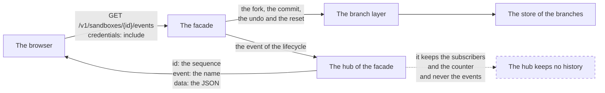

# ADR-047: The lifecycle of the branch travels as a stream, and the limits of the branch answer with a code

Status: accepted. Date: 2026-11-22.

## Context

The milestone thirteen of the release R2 closes the two tasks that the plan of the feature
(`specs/002-r2-visitor-sandbox/tasks.md`) left open in its last phase:

- **T077**, at line 250: "Publish the branch lifecycle over server sent events in
  `ledgerlens/api/sandbox.py` with a monotonically increasing sequence, a heartbeat and a resume by the last
  event id".
- **T081**, at line 254: "Add the rate limit and the session limit checks to the facade in
  `ledgerlens/api/sandbox.py`, so that a branch cannot be created beyond the per session cap and a request over
  the limit answers `429`".

The specification of the feature asks for the first one in FR-035, with a "SHOULD": "The system SHOULD publish
the branch lifecycle events over a server sent event stream with a monotonically increasing sequence, so that the
interface can follow a long running projection without polling". The second one is not a requirement of the
specification: the specification names the limits of ONE branch in FR-025 (at most twenty committed mutations and
at most two hundred events) and says nothing about a cap of branches per session nor about a rate per request.
The cap and the rate are therefore decided here, and this ADR says so.

ADR-044, the decision record of the front of the sandbox, named both of them as debts. The text of the debt of
the server sent events says that the front "reads the diff and the history when the visitor asks for them, and it
never pushes", that "a branch that expires while the page is open is discovered by the next call of the visitor",
and that the debt wants "a stream on the origin with a sequence that grows, a heartbeat and a resume by the last
identifier of the event, and a client that opens it with the credentials of the session, the way the client of the
live mode opens the stream of a run". The text of the debt of the limits says that the facade "ALREADY refuses
with `429 RESOURCE_LIMIT_EXCEEDED` when a branch passes the limits of the domain, twenty mutations and two hundred
events. What is missing is the cap of the branches of ONE session and a rate per request", and that the debt wants
"the two checks in the facade, and a front that says how many branches a session may hold before it opens the sixth
one".

Seven facts of the repository decide the shape of the two answers, and every one of them was measured in the code
before this record was written.

**The first is the facade.** `ledgerlens/api/sandbox.py` serves eleven paths today, and the docstring of
`_the_routes_of_the_sandbox` says so: "The eleven routes of the contract of the sandbox, registered on the
target". They are, with the line that registers them:

| Line | Method and path | Status of the success |
| --- | --- | --- |
| 326 | `POST /v1/sessions` | `201`, and the answer sets the cookie `ledgerlens_session` |
| 346 | `DELETE /v1/sessions/current` | `204`, and the answer deletes the cookie |
| 376 | `POST /v1/sandboxes` | `201` when the fork creates a branch, `200` when the reuse rule returns one |
| 395 | `GET /v1/sandboxes/{sandbox_id}` | `200` with the resource `Sandbox` |
| 414 | `POST /v1/sandboxes/{sandbox_id}/mutations/preview` | `200` with the preview |
| 441 | `POST /v1/sandboxes/{sandbox_id}/mutations` | `200` with the result of the mutation |
| 470 | `POST /v1/sandboxes/{sandbox_id}/reset` | `200` with the resource `Sandbox` |
| 494 | `POST /v1/sandboxes/{sandbox_id}/undo` | `200` with the result of the undo |
| 533 | `GET /v1/sandboxes/{sandbox_id}/diff` | `200` with the diff of the branch |
| 561 | `GET /v1/sandboxes/{sandbox_id}/history` | `200` with the log of the branch |
| 588 | `GET /v1/sandboxes/{sandbox_id}/ledger` | `200` with the rows of the projection |

Three of them are beyond the contract of the design package, and ADR-023 declared them: the diff, the history and
the undo. The contract of the package cannot be edited, because `docs/v3/` is a converted copy of material that
lives outside the repository, and the guard of the paths of the facade enumerates the difference in
`tests/sandbox/test_sandbox_api.py`, in the constant `PATHS_BEYOND_THE_CONTRACT` at line 513.

**The second is the way a refusal is written.** Every refusal of the facade is the resource `Error` of the
contract, and the exception that carries it is `ContractError` at line 123 of `ledgerlens/api/sandbox.py`. It
holds a status, a code, a message and the flag `retryable`, and `body()` writes the four fields of the contract,
the last of them a fresh `request_id`. The handler of the exception lives on the application and not on the
router (ADR-039), and it is the only place that writes a refusal. It scrubs the message with the vault of the
credentials when the deployment gave one, so no value of the visitor leaves the process (FR-018, SC-001). The
handler writes no header but the version of the schema today.

**The third is the branch layer.** `ledgerlens/sandbox/branch.py` holds the dataclass `SandboxBranch` at line 194
and the layer `BranchLayer` at line 356. The dataclass carries the identifier, the owner, the scenario, the base
snapshot, the two hashes, the revision, the three moments, the state and the two counters of the resources of the
branch. The file holds the DEFAULTS of the limits of one branch at its lines 107 and 108:
`MAX_COMMITTED_MUTATIONS = 20` and `MAX_EVENTS = 200`. Those two numbers are the defaults of the settings
`sandbox_max_committed_mutations` and `sandbox_max_events` of `ledgerlens/config.py`, and the layer receives them
as arguments, so a deployment changes the limits of the resources of a branch with the settings of the
configuration and not with a change of the code. The file of the task of the plan that names the dataclass exists,
and the dataclass is there.

**The fourth is the rule of the time to live.** `ledgerlens/sandbox/ttl.py` holds the two deadlines, the idle one
of sixty minutes and the absolute one of four hours, the computation of the expiry, the check `is_expired` and the
cleanup job. The job is a daemon thread of the lifespan of the application and it sweeps every thirty seconds,
and the same sweep runs from the command line (ADR-029). The rule of the expiry has one home, and this ADR uses
that home instead of computing a deadline of its own.

**The fifth is the store.** `ledgerlens/sandbox/store.py` holds the protocol `BranchStore` at line 125 and the
exception `BranchNotFound` at line 32. The protocol has one method per operation and it holds no domain rule.
Two implementations exist and both pass the same contract suite: `FileBranchStore`, over a folder of files, and
`PostgresBranchStore`, over the database of the deployment. The choice between them is the setting
`sandbox_database_url` of the configuration, and `ledgerlens/sandbox/factory.py` turns the setting into the store.
The row of a branch carries `scenario_id`, `expires_at` and `state` (`ledgerlens/sandbox/store.py`, lines 62 to
77), and the protocol can list the branches of one owner with `list_branches(owner_session)`. There is NO SQLite in
the store of the branches: the projector uses `sqlite3` in the memory of the process to replay the events, and the
store of the branches is a folder of files or Postgres.

**The sixth is the configuration.** `ledgerlens/config.py` holds `sandbox_branch_idle_ttl_seconds` (3600),
`sandbox_branch_absolute_ttl_seconds` (14400), `sandbox_database_url` (empty, and an empty url means the file
backed store) and `cors_origins`. It holds NO cap of branches per session, NO rate per request, and NO setting for
the maximum of the committed mutations of a branch: that maximum is a module constant of the branch layer, not a
setting of the configuration. The three settings that T081 needs do not exist and this ADR asks for them.

**The seventh is what the browser already has.** The live mode already publishes a stream: the route
`GET /v1/live-runs/{run_id}/events` of `ledgerlens/api/byok.py`, at line 773, answers a `StreamingResponse` with
the media type `text/event-stream` and the headers of the version of the schema, of the erasure of the key and of
the no store. The generator `_events_of` at line 1287 writes `event: {event_type}\ndata: {event.to_json()}\n\n` and
nothing else: the stream of the live mode carries NO `id:` line, NO heartbeat and NO resume, and it always starts
from the beginning. The design package asks for more than the code delivers: `docs/v3/specs/LL-R0-03-trace-event-transport.md`
says that each event carries `id=<seq>`, `event=<event_type>` and `data=<JSON>`, that the idle heartbeat is every
fifteen seconds, and that the reconnection uses `Last-Event-ID` and answers with the catch-up when it is available
or with an explicit resync when the buffer evicted it. The browser side has a client of the stream in
`apps/web/lib/api/events.ts`, and it is typed to the `TraceEvent` of the run and to `TRACE_EVENT_TYPES` of
`apps/web/lib/api/schemas.ts`. The client of the branch of the visitor is `apps/web/features/sandbox/api/sandboxClient.ts`,
and it has ten calls and no stream. The client of the stream of the branch,
`apps/web/features/sandbox/api/branchStream.ts`, arrived with this milestone, it is named in the fence of the network
and nothing calls it yet.

## Decision

**The lifecycle of a branch is published as a stream of named events, on a route of the facade, and the sequence
of the stream is a counter of the process and not a log. A client that loses an event re-reads the branch, because
the truth of a branch is the answer of `GET /v1/sandboxes/{sandbox_id}` and never the stream.**

**The limits of the facade are refusals of the family that already exists: `429` with the code
`RESOURCE_LIMIT_EXCEEDED`, and the flag `retryable` tells the two limits apart.**

The eight decisions below are the contract of the milestone. Each of them is fixed here, and each of them is
measured against the code that exists today.

### Decision 1: the format of the stream

**The route is `GET /v1/sandboxes/{sandbox_id}/events`, and it is one of the paths beyond the contract of the
design package.** The path is a path of the facade and NOT a path of `docs/v3/contracts/openapi.yaml`, so ADR-023
declares it, exactly as it declares the diff, the history and the undo, and the constant
`PATHS_BEYOND_THE_CONTRACT` of `tests/sandbox/test_sandbox_api.py` has to name it. A route that nobody decided
cannot appear in the facade, and that guard is the reason this paragraph exists.

**The answer is `text/event-stream`, and it carries the header `X-LedgerLens-Schema-Version: 1` and the headers
of the no store.** Every answer of the facade carries the version of the schema (FR-042), and the answer holds the
state of a branch of a visitor, so it is not to be kept anywhere. The two headers of the branch
(`X-LedgerLens-Branch-Hash` and `X-LedgerLens-Branch-State`) are NOT headers of the stream: a header of a stream
is read once, at the opening, and the state of the branch travels in the payload of the first event, where it can
be read at the moment it is true.

**The shape of an event is the shape of the server sent events and the shape the design package names for the
trace transport:** an `id:` line with the sequence, an `event:` line with the name, and a `data:` line with the
JSON of the payload. The three lines are always there for an event of the lifecycle, and the `id:` is always the
sequence.

**There are eight names, and each one means exactly one thing.**

| Name | When it is sent | What the payload carries |
| --- | --- | --- |
| `branch.opened` | first event of a stream that opens for the first time | `branch_id`, `scenario_id`, `base_snapshot_id`, `base_canonical_hash`, `current_canonical_hash`, `revision`, `created_at`, `expires_at`, `state` |
| `branch.mutation.committed` | after a commit | `branch_id`, `revision`, `canonical_hash`, `command_id`, `kind` |
| `branch.undone` | after an undo | `branch_id`, `revision`, `canonical_hash`, `command_id`, `kind`, `undone_event_uid` |
| `branch.reset` | after a reset | `branch_id`, `revision` (zero), `canonical_hash`, `base_canonical_hash` |
| `branch.expired` | the branch outlived its time to live | `branch_id`, `expires_at`, `state` (the text `expired`) |
| `stream.resync` | first event of a reconnection that cannot be proven, for the connection that reconnected | `last_event_id`, `reason` |
| `stream.closed` | the end of the connection that the server ended | `reason` |
| `stream.heartbeat` | every fifteen seconds, for the connection that is silent | `at`, `last_seq` |

**The payload of the three events of the stream carries the four common fields like every other payload, and its
`seq` is the sequence of the LAST event of the lifecycle that the server published for the branch, which is the
current value of the counter.**

**The creation of the branch is carried by `branch.opened`.** The facade publishes it, and the stream that opens for
the first time on the branch sends it as its first event. The name is `branch.opened` and not `branch.created` for a
reason that is measured: a stream that opens on a branch that was created a minute ago did not witness the creation,
and a stream that pretends it did would publish a moment it never saw. The payload therefore carries the facts of the
creation (`created_at`, `base_snapshot_id`, `base_canonical_hash`) AND the state of the branch at the moment of
the opening (`revision`, `current_canonical_hash`, `expires_at`, `state`), so the event is true about the branch
as it stands and not only about the branch as it was born.

**The payload of every event carries the same four fields,** so that a client reads one shape: `schema_version`
(the text `1`), `branch_id`, `seq` (the sequence, the same number the `id:` line carries) and `at` (the moment in
ISO 8601 with a time zone, taken from the clock of the server, FR-031). The fields of the event itself come
after those four.

**What NEVER goes in the stream, and why.**

- **Never the secret of the visitor.** Not the cookie, not the session identifier, not the key of a provider, not
  the memory of the case. The payload of an event is scrubbed with the vault of the credentials exactly like the
  message of a refusal is scrubbed, because the payload is written by the same facade and the same rule of
  ADR-035 holds for it.
- **Never the state of another branch.** The stream is bound to one branch identifier and to the session that
  owns it. A branch of another session is refused with the generic `404 NOT_FOUND` and the message that does not
  disclose that the branch exists, before the stream opens, exactly like every other route of the facade.
- **Never the diff, the history, the rows of the ledger, and never a money value.** Those are reads: the diff is
  `GET /v1/sandboxes/{sandbox_id}/diff`, the history is `GET /v1/sandboxes/{sandbox_id}/history` and the ledger
  is `GET /v1/sandboxes/{sandbox_id}/ledger`. A stream that carried the diff would carry a thousand rows of money
  for every commit, and the rule of the browser that never calculates a value has nothing to do with a payload
  that is not there.
- **Never a substitute for the status of the branch.** `GET /v1/sandboxes/{sandbox_id}` is the truth of the
  branch and stays the truth. The stream says that something happened; the status says where the branch stands. A
  client that lost an event reads the status, and a client that trusts the stream instead of the status believes
  a state it cannot prove.

### Decision 2: the sequence and the resume

The flow of the stream, with the two halves of the rule: the facade writes the branch and publishes the event,
and the hub keeps the counter and never the event.

**The `id:` of an event is its sequence: an integer that starts at one for the first event of the lifecycle of a
branch and grows by one for every event of the lifecycle after it.** The sequence is PER BRANCH, it is held in the
memory of the process, and the payload carries it next to the revision so that the two are never confused.

**The sequence is NOT the revision of the branch.** The revision moves only on a commit (FR-036), it does not move
on an opening, on a reset or on the end of the stream, and the undo moves it BACK. A number that goes back is not
a sequence, and a `Last-Event-ID` that goes back is not a resume.

**The counter of the sequence lives in a hub of the facade, and the hub holds the subscribers and the counter and
NEVER the events.** The hub is the place where the facade publishes the events of the lifecycle, and it is built
like the cleanup worker of ADR-029: it belongs to the process, it is started with the application, and it holds
nothing that the branch store holds.

**The format of the header `Last-Event-ID` is the bare decimal integer of the sequence.** No prefix, no quotes,
no branch identifier: the text is exactly the text of the `id:` line, because the browser sends the header by
itself on a reconnection of the `EventSource` and it must be the same text the server wrote.

**The resume has three answers, and the hub can answer two of them without keeping a history.**

1. **The header is absent.** It is the first connection of the client. The stream opens with `branch.opened` and
   the sequence of that branch starts at one.
2. **The header carries the last sequence the hub gave to that branch.** The client holds the last event and
   nothing is missing. The stream continues with the next sequence, there is NO `stream.resync`, and it does NOT
   receive `branch.opened` again: the client proved that it missed nothing and it still holds the state.
3. **The header carries anything else.** It is behind the counter of the hub, so the client missed events, or the
   hub does not know it at all, because the counter was lost at the restart of the process or because the client
   is talking to another instance of the deployment. The stream sends `stream.resync` as its FIRST event, with the
   identifier the client sent echoed back in `last_event_id` and the reason in `reason`: the text `not_current`
   when the identifier is behind the counter and the text `unknown` when the hub does not know it. The client
   then re-reads the branch with `GET /v1/sandboxes/{sandbox_id}`, and with
   `GET /v1/sandboxes/{sandbox_id}/history` when it needs the log.

**The resume NEVER repeats the events that were lost.** The hub keeps no history, so it has nothing to repeat.
This is the honest resume, and the rule of the repository asks for it: an interface that invents what it did not
receive is an interface that lies (ADR-043, ADR-044). The cost of the honesty is one read of the branch per
reconnection that cannot be proven, and the price is worth it: the alternative is a second copy of the log of the
branch in the memory of the process, which dies at the restart and is not shared between the processes of a
deployment with more than one worker.

**A second stream on the same branch shares the counter of the branch, and the resync is conservative.** When
two tabs follow the same branch, the events go to both of them and the counter of the branch moves for both, so a
tab that reconnects while the other one received events is behind the counter and receives a `stream.resync`. The
resync is not wrong: the tab really did not receive those events, and the only honest answer is to read the
branch again.

### Decision 3: the counter of the branch and the three events of the stream

**The counter of the branch counts the events of the LIFECYCLE of the branch, and the lifecycle has FIVE names:**
`branch.opened`, `branch.mutation.committed`, `branch.undone`, `branch.reset` and `branch.expired`. The STREAM has
three other names: `stream.resync`, `stream.closed` and `stream.heartbeat`, and:

1. **They do NOT move the counter of the branch.**
2. **They carry NO `id:` line**, so the `Last-Event-ID` of the browser never moves because of them.
3. **They belong to the CONNECTION that concerns them**, and they are NOT given to the other connections of the same
   branch: a `stream.resync` is for the client that reconnected, a `stream.closed` is for the connection that the
   server ended, and the heartbeat is for the connection that is silent.
4. **Their payload carries the `seq` of the LAST sequence of the lifecycle that the server published for the branch**,
   which is the current value of the counter.
5. **`branch.opened` is the first event of a stream that opens FOR THE FIRST TIME.** A resume that is proven continues
   with the next sequence and does NOT receive `branch.opened` again: the client proved that it missed nothing and it
   still holds the state.
6. **The disconnect of a client is NOT an event.** The client that left is gone and the other connections of the branch
   are not affected by it. The `stream.closed` exists only for the two reasons the SERVER ends a connection: the row
   of the branch disappeared (`branch_gone`) and the branch died (`branch_expired`).

**The reason.** The counter exists so that a client can PROVE that it missed nothing. An event of the stream that
moved the counter would make every reconnection look stale, because the event that moved it was never received by the
client that disconnected. Before this decision the second answer of the resume, the one that continues without a
resync, was unreachable in the real flow.

**What this decision forbids.** An event of the stream that moves the counter of the branch. A `stream.closed` that
is given to the other connections of the branch. A `branch.opened` that is repeated on a resume that is proven.

**Where it lives.** The counter of the branch lives in the hub of the events (`ledgerlens/sandbox/events.py`), and
the hub builds the three events of the stream with the methods `resync`, `closed` and `heartbeat`. Those three
methods RETURN the event and they never publish it, because a published event moves the counter and carries an `id:`
line. The route of the stream puts them in the queue of THAT connection (`ledgerlens/api/sandbox.py`).

**The expiry is an event of the lifecycle, and the close that follows it is not.** The branch died, so every
connection of the branch has to know it, and the event of the expiry moves the counter of the branch. The close that
follows it belongs to the connection alone, it moves no counter, and it carries no `id:` line. The route yields the
event of the expiry and then the close of the connection, in that order, because the hub hands an event to the
subscribers of the branch with `call_soon_threadsafe`: the copy of the expiry that comes back to the connection lands
in the queue one turn of the loop later, and a close that was put in the queue at once would be handed first.

### Decision 4: the heartbeat

**The heartbeat is every fifteen seconds, and the number is the one the design package names for the idle
heartbeat of the trace transport** (`docs/v3/specs/LL-R0-03-trace-event-transport.md`). One number for the two
streams of the deployment is better than two numbers that nobody compares.

**The heartbeat keeps the connection alive and lets the client detect a dead one.** The intermediaries of a
deployment close a connection that is silent, and the `EventSource` of the browser reconnects on its own when the
network fails, but a process that dies without closing the socket is not always a failure the browser sees. The
client therefore measures the silence itself.

**The heartbeat is the named event `stream.heartbeat` and it is NOT a comment.** The standard way of keeping a
connection alive is a comment line, and it is refused here for a reason that is measured in the code of the
browser: a comment line is invisible to the JavaScript of the `EventSource`, and the client has to be able to
COUNT the heartbeats to detect the silence. A comment would keep the connection alive and would tell the client
nothing.

**The heartbeat cannot be confused with an event of the lifecycle, in three ways.** It carries another name. It
carries NO `id:` line, so the `Last-Event-ID` of the browser never moves because of a heartbeat and the counter
of the hub never moves either. And its payload carries no change of the branch: it carries the moment `at` and
`last_seq`, the sequence of the last event of the lifecycle the server sent on that stream. A client that acts on
the five names of the lifecycle and ignores `stream.heartbeat` cannot be confused, and a client that acts on every
name can tell them apart by the payload.

**The client counts the silence and closes the source when the silence is too long.** Two heartbeats that do not
arrive mean thirty seconds of silence, and the client treats the connection as dead: it closes the source, it
opens it again (the browser sends the `Last-Event-ID` of the last event of the lifecycle that it holds) and, when
the answer is a `stream.resync`, it re-reads the branch with a `GET`. The client never changes the state of the
branch on its own: a heartbeat that arrives says that the connection is alive and NOTHING else.

### Decision 5: the limit of a session

**The cap is five LIVE branches per session.** The number is the one the repository already named: the debt of
ADR-044 asks for "a front that says how many branches a session may hold before it opens the sixth one". The
specification of the feature names no number for it, because the specification names the limits of ONE branch
(FR-025: twenty committed mutations and two hundred events) and says nothing about the branches of a session.
Five is more than the scenarios a visitor works on at once and it bounds the rows that one session can hold.

**The cap lives in the configuration, in the setting `LEDGERLENS_SANDBOX_SESSION_BRANCH_CAP`, with the default
five.** The setting does not exist today: `ledgerlens/config.py` holds the two deadlines of the branch, the url of
the database and the origins of the CORS, and nothing else of the sandbox. A deployment that wants another cap
changes it in the environment.

**The cap counts the branches of the session that are ALIVE.** A branch whose expiry has passed is dead and does
not count, even before the sweep of the cleanup deletes its rows, because the sweep runs every thirty seconds
(ADR-029) and a visitor must not be refused for branches that are already dead. The check of the life reuses
`is_expired` of `ledgerlens/sandbox/ttl.py` with the clock of the server, so there is ONE rule of the time to
live in the repository and not two (ADR-029, FR-031).

**The reuse rule comes BEFORE the cap.** A fork of a scenario that the session already holds a live branch for is
a reuse and not a creation: it answers `200` with the branch that exists, and it is NEVER refused by the cap,
because no branch is created. The cap refuses only a fork that would CREATE a branch. The facade knows the
scenario of every row because `SandboxBranchRow` carries `scenario_id`, and it knows the live rows because the
protocol of the store lists the branches of one owner with `list_branches(owner_session)`, the method that the
route of the end of the session already uses.

**The refusal is `429` with the code `RESOURCE_LIMIT_EXCEEDED` and the flag `retryable` at false.** The code is
the one that already exists: `CODE_RESOURCE_LIMIT` in `ledgerlens/sandbox/mutation.py`, at line 97, mapped to `429`
in `STATUS_BY_CODE`. The meaning is the same, that the resources of the server for this visitor are exhausted, and
ADR-031 already declared that the code is reused when a second reason reaches it. The flag is false because a
retry does not help: the branches of the session are alive and the retry would be refused again. The message names
the count and the cap, and it never names a value of the visitor.

**The check lives in the facade, in `ledgerlens/api/sandbox.py`, before the fork.** It reads the store and it
never writes: a refusal of the cap happens before the branch is created, so the refusal leaves nothing behind.

**The cap of the branches is GLOBAL across the processes of a deployment,** because the count is read from the
store and the store is shared. This is the difference with the rate of the requests, and the difference matters.

### Decision 6: the limit per request

**What is measured is the requests of ONE session, in a sliding window of sixty seconds.** Not the address of the
client: the facade has no trusted address of the visitor, because the repository has no policy of the headers of
a proxy, and the session is the only identity the facade can trust, since the cookie is signed with the key of
the deployment (`ledgerlens/sandbox/session.py`). The route that issues the session is NOT counted, because a
visitor that asks for a session has no session yet. The opening of a stream counts as ONE request and the
heartbeats of that stream do not count at all.

**The ceiling is 120 requests per session per minute.** The front of the sandbox makes about seven calls to open
a branch and to read it, and a visitor who works for twenty minutes makes a few dozen calls. Two requests per
second, sustained, does not stop a human and stops a script that wants the resources of the server. The number is
a decision of this ADR and a deployment changes it.

**The two numbers live in the configuration: `LEDGERLENS_SANDBOX_RATE_LIMIT_REQUESTS` with the default 120, and
`LEDGERLENS_SANDBOX_RATE_LIMIT_WINDOW_SECONDS` with the default 60.** Neither exists today: the setting of the
configuration that concerns the sandbox is the idle deadline, the absolute deadline and the url of the database.

**The window slides.** The resources of the server are spent at the moment of the request, so the counter holds
the moments of the requests of the session and drops the ones that fell out of the window. A fixed window would
let a visitor spend the whole quota at the last second of one window and at the first second of the next, and the
limit exists to bound the work of the server.

**The counter lives in the memory of the process, and THE LIMIT IS PER PROCESS.** This is the truth that has to
be said in words: the repository has two implementations of the store of the branches, Postgres and the file
backed one, and a deployment that runs the facade with more than one worker allows that many times the quota.
The documentation of the API says so, and the number of workers is a decision of the deployment. The counter of the
rate of the requests lives in a module of its own, `ledgerlens/sandbox/rate_limit.py`, in the shape of a moment list
per session. The hub of the events holds the subscribers of a branch and the counter of the sequence of a branch, and
it holds NO moment of any request.

**The answer is `429` with the code `RESOURCE_LIMIT_EXCEEDED` and the flag `retryable` at TRUE,** because a
`429` is retryable by definition: the same request, later, is expected to answer. The header `Retry-After`
carries the number of seconds until the oldest request of the window falls out of it, which is the shortest wait
that can work, as an integer of seconds.

**Two changes of the code that exists are needed for that header.** `ContractError` holds no header today
(`ledgerlens/api/sandbox.py`, line 126), so it gains an optional mapping of headers and the handler of the
refusals merges it into the answer. And `Retry-After` has to be named in `EXPOSED_HEADERS` of
`ledgerlens/api/cors.py`, because the browser cannot read a header that the CORS does not expose. The list of the
exposed headers names seven headers today and `Retry-After` is not one of them.

**The handler of the refusals merges the headers of the error into the answer, and it does it in BOTH the isolated
facade and the wired application.** The handler of the facade is `install_refusal_handlers` of
`ledgerlens/api/sandbox.py`, and the handler of the wired application is in `ledgerlens/api/wiring.py`: the wired
application used to drop the headers of the refusal, and it does not any more. The test that proves it is
`test_a_refusal_of_the_rate_of_the_wired_application_carries_the_wait` of `tests/api/test_wiring.py`, and it proves
that the `Retry-After` reaches the answer of the wired application, not only the answer of the facade alone. A
visitor who talks to the wired application of the demo has to see the same wait that the facade writes.

### Decision 7: the limits and the state of the frontend

**The parsing of the refusal needs NO new line.** The reader of the envelope, `readErrorBody` of
`apps/web/lib/api/client.ts`, is generic: it reads `code`, `message`, `retryable` and `request_id` and it
enumerates no code at all. The client of the branch reads the envelope with that reader, so a `429` arrives in the
front exactly like every other refusal.

**The state of the branch needs NO new line either.** `apps/web/features/sandbox/useBranch.ts` knows two families
of refusal: `isSessionRequired`, which is the status `401` or the code `SESSION_REQUIRED`, and `isLostBranch`,
which is the code `NOT_FOUND` or the code `BRANCH_EXPIRED`. A `429` is in neither family, so the branch of the
state SURVIVES the refusal and the panel renders the code and the message of the server where the action was.
That is the behaviour ADR-044 already declared: "a refusal of `429 RESOURCE_LIMIT_EXCEEDED` is rendered like any
other refusal of the server".

**The ONE thing that is new is the wait of the server.** The client of the branch reads the headers of the
answer of the branch today, and it has to read `Retry-After` when the answer is a `429`, and carry it in the
`ApiError`, so that the panel can show the wait. The front NEVER computes the wait with the clock of the
browser: it shows the number of seconds the server wrote, for the same reason it never computes the time that is
left of the expiry (FR-031).

**The front never counts the branches of the session.** The server names the count and the cap in the message of
the refusal, and the front shows that message as it is. A front that counted the branches itself would count the
branches it knows about and not the ones it does not, and it would show a number the server never wrote.

**The two limits of the facade are told apart by the flag, and not by the code.** Both answer `429` with the code
`RESOURCE_LIMIT_EXCEEDED`, and the flag `retryable` is the difference: the rate of the requests is retryable and
the cap of the branches is not. The front reads the flag when it decides whether to offer the action again.

### Decision 8: what this milestone does not do

- **The browser does not open the stream yet.** The backend publishes the lifecycle and the front keeps polling
  by hand, exactly as ADR-044 said it would until this milestone. The wiring of the stream into the route
  `/sandbox` is a milestone of its own, and the state of the branch of the front does not grow a new phase for it.
- **The client of the stream of the branch EXISTS, and NOTHING calls it yet.** The client is the file
  `apps/web/features/sandbox/api/branchStream.ts`, beside the client of the branch. It is named in the fence of the
  network (`apps/web/tests/unit/network-fence.test.ts`), because a stream IS the network and an exception is always
  a name and never a silence, and it is typed to the eight names of the branch stream. The function that opens the
  connection, `openBranchStream`, has no caller today: the browser does not open the stream yet. The client of the
  live mode, `apps/web/lib/api/events.ts`, is typed to the `TraceEvent` of the run and it closes the source on
  `TERMINAL_EVENT_TYPES`. It CANNOT be reused as it is: the names of the events of the branch and their payload are
  another vocabulary, and a client of a stream of another vocabulary that reuses it would carry the vocabulary of the
  run into the branch. The generalization of the two clients into one client of any named stream is a debt, and
  ADR-044 already named the debt of the two clients of the same routes.
- **The events of the lifecycle are not persisted.** They live in the memory of the process and they are lost at
  the restart of it. The branch itself is not lost: it lives in the store.
- **The rate of the requests is not global.** It is per process, and the documentation of the API says so.
- **The resume does not repeat the events that were lost.** A client that reconnects behind the counter re-reads
  the branch, every time.
- **The notice of the expiry can be late by up to fifteen seconds.** The stream checks the life of the branch on
  every heartbeat, and the heartbeat is every fifteen seconds. The expiry itself is not the business of the
  stream: the layer refuses the branch with `410 BRANCH_EXPIRED` the moment it is expired (ADR-029, FR-023), and
  that refusal is the truth.
- **The events of the stream are not the history of the branch.** The history is a read and it is append only
  (ADR-024, ADR-028).

## Alternatives considered

- **Keep the poll by hand and close nothing.** The front polls today and it works, and FR-035 is a "SHOULD". It
  is refused because a branch that expires while the page is open is discovered only at the next call of the
  visitor, and the task of the plan asks for the stream by name.
- **A ring buffer of the last N events of a branch, like the trace transport of the design package.** It would
  give a real catch-up, and the design package names the two answers of a ring buffer: the catch-up when it is
  available, and the explicit resync when the buffer evicted the event. It is refused for now because it is a
  SECOND copy of the log of the branch in the memory of the process: it dies at the restart, it is not shared
  between the workers of a deployment, and the repository has a rule that the branch has one home (ADR-018) and
  that the front holds no second copy of the branch (ADR-044). This ADR takes the second answer of the design
  package for the whole domain, and the ring buffer is the debt it opens.
- **The sequence is the revision of the branch.** The revision moves only on a commit, it does not move on an
  opening or on a reset, and the undo moves it BACK. A number that goes back is not a sequence, and a
  `Last-Event-ID` that goes back is not a resume.
- **The heartbeat is a comment line.** It is the standard way of keeping a connection alive. It is refused
  because a comment is invisible to the JavaScript of the `EventSource`, and the client has to count the silence
  to detect a dead connection.
- **A new code for the two limits, for example `RATE_LIMITED` and `SESSION_BRANCH_LIMIT`.** It would let a
  client tell the two apart by the code. It is refused because the code `RESOURCE_LIMIT_EXCEEDED` already exists
  with the status `429` and with the same meaning, and because the envelope already carries the flag `retryable`,
  which is exactly what tells the two apart: the rate of the requests is retryable and the cap of the branches of
  the session is not.
- **The counter of the requests in the store of the branches, so that the limit is global.** It would make the
  limit a property of the data and not of the process. It is refused for now because the store has TWO
  implementations and the file backed one has no place to hold a counter, and because a rule of the facade inside
  the persistence is what ADR-018 forbids. The limit is per process and this ADR says so.
- **The limit of the requests is per address of the client.** A limit per address stops a script that opens many
  sessions. It is refused because the facade has no trusted address: the address it sees is the one of the proxy,
  and the repository has no policy of the headers of a proxy, so a limit per address would be a limit that a
  visitor could escape by asking for a new session.
- **The stream is per session and not per branch.** Then the creation of a branch would be visible on the stream
  of the session. It is refused because the branch is the scope of the isolation, and a stream that carries the
  events of every branch of a session carries more than the lifecycle of one branch and more than the state that
  the client may hold.
- **The three events of the stream move the counter of the branch, like the events of the lifecycle.** It would give
  one counter for everything the server sends on the branch, and it is refused because the counter exists so that a
  client can PROVE that it missed nothing. An event that a client never received, the resync of another connection,
  the close of another connection or a heartbeat, would move the counter and would make the next reconnection of that
  client look stale for ever. Before this decision the second answer of the resume, the one that continues without a
  resync, was unreachable in the real flow.
- **The `stream.closed` is published to the branch, so that every connection of the branch hears it.** The expiry is
  published to the branch for exactly that reason, and the close is refused because the close is about ONE connection:
  the connection that the server ended. A close that was published to the branch would move the counter of the branch
  and would make the reconnection of the other connections look stale.
- **The disconnect of a client publishes a `stream.closed` to the branch.** It would tell the other connections that
  something happened. It is refused because the disconnect is not an event: the client that left is gone, the other
  connections of the branch are not affected by it, and the event that moved the counter was never received by
  anybody.

## Consequences

- The facade serves a twelfth path, `GET /v1/sandboxes/{sandbox_id}/events`, and it is declared here as a path
  beyond the contract of the design package, so ADR-023 widens and the constant `PATHS_BEYOND_THE_CONTRACT` of
  `tests/sandbox/test_sandbox_api.py` has to name it.
- The facade gains a hub that holds the subscribers of a branch and the counter of the sequence of a branch. The hub
  holds NO event of the lifecycle and NO state of a branch, and it holds NO moment of any request: the counter of the
  rate of the requests lives in the module of its own, `ledgerlens/sandbox/rate_limit.py`.
- The configuration gains three settings: `LEDGERLENS_SANDBOX_SESSION_BRANCH_CAP`,
  `LEDGERLENS_SANDBOX_RATE_LIMIT_REQUESTS` and `LEDGERLENS_SANDBOX_RATE_LIMIT_WINDOW_SECONDS`. The first
  defaults to five, the second to 120 and the third to 60.
- The exception of a refusal gains an optional mapping of headers, and the CORS gains `Retry-After` among the
  headers that the browser may read.
- The documentation of the API, `docs/api/sandbox.md`, gains the twelfth path, the names of the events, the
  format of the `Last-Event-ID` and the two new limits, and it says in words that the rate is per process.
- The tests promise the following, and each promise is a test that fails when the decision is broken:
  - the events path is named in the guard of the paths, so a route that nobody decided cannot appear;
  - the stream answers `text/event-stream` and carries the header of the version of the schema;
  - the five names of the lifecycle arrive with their payloads, and the payload of the first event of a stream that
    opens for the first time carries the facts of the creation and the state of the opening;
  - the sequence grows by one for every event of the lifecycle, and the `id:` line carries the same number as
    the field `seq` of the payload;
  - the heartbeat arrives every fifteen seconds, carries no `id:` line, and does not move the counter;
  - the three events of the stream do not move the counter of the branch and carry no `id:` line, and their payload
    carries the `seq` of the last event of the lifecycle;
  - the `stream.closed` of one connection is not received by the other connections of the same branch, and the
    disconnect of a client publishes nothing;
  - a reconnection with the last identifier of the hub receives NO `stream.resync` and NO `branch.opened` again, and
    a reconnection with any other identifier receives a `stream.resync`, as the FIRST event, with the identifier
    echoed back;
  - a branch that expired answers `410` with the code `BRANCH_EXPIRED` at the route of the stream, and the opening of
    a stream counts ONE request of the rate;
  - the stream of a branch that dies says that the branch died and then says that the stream closed, in that order;
  - the answer of the stream carries the three headers of the no store;
  - the stream of a branch of another session answers `404` with the generic message and never opens;
  - the payload of an event carries no value of the visitor and no money;
  - the fork above the cap answers `429` with the code `RESOURCE_LIMIT_EXCEEDED` and the flag `retryable` at
    false, and the fork of a scenario that the session already holds answers `200` and is not refused by the cap;
  - the request above the rate answers `429` with the code `RESOURCE_LIMIT_EXCEEDED`, the flag `retryable` at
    true and the header `Retry-After` with an integer of seconds.

## The debt

- **The wiring of the stream in the page.** The client of the stream of the branch exists, it is named in the fence
  of the network and it is tested, but the page does not open it: until the front opens the stream the visitor keeps
  polling by hand.
- **The generalisation of the two clients of a stream.** The client of the live mode and the client of the branch
  are two files that do the same thing with two vocabularies, and ADR-044 already named the debt of the two
  clients of the same routes.
- **A global rate.** The limit is per process, and a deployment with several workers multiplies it. What the debt
  wants: a counter in the store of the branches, with the two implementations of the protocol behind it.
- **A catch-up that repeats the lost events.** What the debt wants: a ring buffer of the last N events of a
  branch, with the resync only when the buffer evicted the event.
- **The `Last-Event-ID` in the CORS.** The header that the browser sends on a reconnection is not among the
  headers that `ALLOWED_HEADERS` of `ledgerlens/api/cors.py` names today, and a browser that reconnects across
  origins may need it named there, the way `Idempotency-Key` and `If-Match` were named for the commit and the
  undo (ADR-044).
- **The three settings of the configuration.** They do not exist today, and the setting of the maximum of the
  committed mutations of a branch is a module constant of the branch layer and not a setting, so a deployment
  cannot change the twenty mutations of a branch of FR-025 without touching the code.
