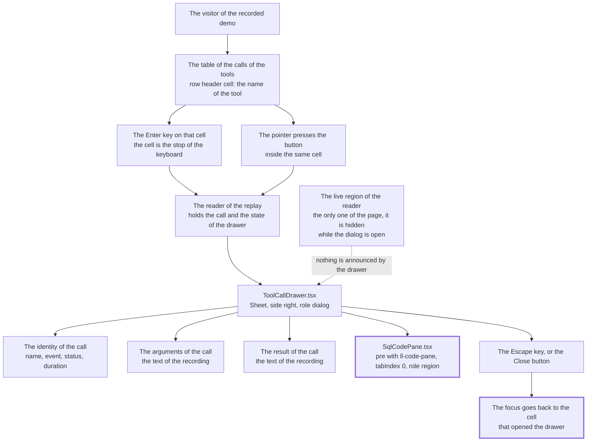

# ADR-048: The drawer of the tool call and the pane of the SQL

Status: accepted. Date: 2026-11-22.

## Context

The release R1 plays a recorded investigation to any visitor, with no key and no call to a model provider
(ADR-040, ADR-042, ADR-043). The user story 2 of the plan says that the visitor reads the trace step by
step and that "each step opens the tool arguments and the sanitized outputs" (`specs/001-r1-public-replay/spec.md`,
line 33). The task T048 of the plan asks for the drawer of a tool call, the task T049 asks for the pane of the
SQL, and the task T084 asks for the focus management on that drawer and on the status region of the controls of
the replay. All three are open, and T084 is marked as partially delivered.

Every fact below was measured in the tree of the repository, not assumed.

**The drawer of the tool call was never built.** The folder `apps/web/features/agent-trace/` holds
`TraceTimeline.tsx` and `TraceTree.tsx` and nothing else. The drawer of the engineering tour exists
(`apps/web/features/architecture/EngineeringDrawer.tsx`) and it is built on the primitive of the design system,
`apps/web/components/ui/Sheet.tsx`, which wraps the dialog of Radix. That drawer explains three subsystems of
the architecture and it is not about a call of the recording (ADR-046, decision 4).

**The recorded event of a tool call carries exactly these fields.** The adapter of the span writes the payload
of the event (`ledgerlens/observability/trace_event.py`, lines 225 and 235 to 243):

- the event `span.started` of a tool carries `name` (the name of the tool), `run_type` (the string `tool`) and
  `inputs` (the arguments the tool received);
- the event `span.ended` of the same span carries `name`, `run_type`, `outputs` (the envelope the tool
  returned), `error`, `latency_ms`, `status` and `metadata`.

The arguments of the call are the `inputs` of the span, written by `TraceCallback.on_tool_start`
(`ledgerlens/observability/trace.py`, lines 505 and 506): a dictionary of arguments when LangChain gives one, and
`{"input": <text>}` otherwise. The result of the call is the envelope of the tool, written by `on_tool_end`
(lines 508 to 511) and read from the tool with `envelope_of` (line 122). The published bundle of the scenario
`S01` shows it: the event 16 carries `{"inputs": {"question": "FX rates applied to TX-2048"}, "name":
"query_ledger", "run_type": "tool"}` and the event 19 carries the envelope of the same call
(`site/replay/s01/events.jsonl`).

**The SQL of the call arrives in the result of the call, and it arrives with its literals.** The tool
`query_ledger` writes the statement it ran inside the envelope, under `data.sql`
(`ledgerlens/tools/sql.py`, line 258), and the statement it writes is the one the guard produced
(`ledgerlens/tools/sql.py`, line 240). The guard regenerates the statement from the tree it parsed and it keeps
the literals of the model exactly as they were written (`ledgerlens/tools/sql_guard.py`, lines 161 and 162). The
published bundle carries it, at the event 19 of `site/replay/s01/events.jsonl`:

```
SELECT * FROM (SELECT kind, applied_rate, applied_at FROM fx_applied WHERE transaction_id = 'TX-2048' ORDER BY applied_at) LIMIT 50
```

**The backend does not sanitise the literals of a SQL.** The three defences that exist today do not touch them.
`redact` (`ledgerlens/observability/callbacks.py`, lines 44 to 46) removes the text that looks like a key.
`_sanitize` (`ledgerlens/observability/trace_event.py`, lines 112 to 123) drops the forbidden keys of the
payload and passes the strings through `redact`. `compact`
(`ledgerlens/observability/trace.py`, lines 100 to 119) cuts the long texts and the long lists and passes the
strings through `redact`. A literal of a statement is none of these three: it is a value of the ledger, and it
travels to the published artifact as it was written.

**The frontend already knows where the SQL of a call is.** The projection of the evidence reads it at
`outputs.data.sql` (`apps/web/lib/replay/selectors.ts`, lines 306 and 307), and the state of a call already
carries the arguments, the result, the error, the duration, the status and the identifiers of the evidence
(`ToolCallState` of `apps/web/lib/replay/reducer.ts`, lines 103 to 122), assembled when a span of the kind
`tool` ends (lines 399 to 412).

**The plan asks for a long statement to scroll alone.** The acceptance scenario 5 of the user story 2 says that
the SQL scrolls horizontally inside the code pane and that the page does not scroll sideways, and the edge case
"Long SQL" says that the statement is displayed with the literals sanitized
(`specs/001-r1-public-replay/spec.md`, lines 45 and 128). The design system already has the rule of the pane:
the class `ll-code-pane` is the only area of the page that scrolls sideways
(`apps/web/app/globals.css`, lines 159 to 163), and the body of the page never scrolls sideways (lines 120 to
122).

**The site is a static export.** There is no server at run time, no route handler and no middleware
(ADR-042, ADR-043). The drawer reads the state of the reader and calls nobody.

**The focus and the announcement are already decided by the plan.** FR-032 says that after the playback starts
the focus moves once to the status region, and that after a drawer closes the focus returns to the control that
opened it. FR-033 says that the live region announces at most a step summary. The reader has exactly one polite
region today (`apps/web/features/replay/ReplayViewer.tsx`, lines 558 to 567), and the focus moves to it once,
when the playback starts (lines 301 to 308). The controls of the replay have no live region: they carry the
reasons of the controls that cannot act, as paragraphs that `aria-describedby` points at
(`apps/web/features/replay/ReplayControls.tsx`, lines 282 to 304).

## Decision

The drawer of a tool call is a component of the frontend, built on the primitive of the sheet, it shows one call
of the recording, and it holds the SQL of that call in a pane of text that scrolls alone. The ten decisions below
are the whole of it.

### 1. The drawer of a call is a component of its own, and it is built on the sheet

**The drawer lives in `apps/web/features/agent-trace/ToolCallDrawer.tsx` and it is built on the `Sheet` of
`apps/web/components/ui/Sheet.tsx`, with the side `right`, exactly like the drawer of the engineering tour.**
The sheet is the dialog of Radix, so the drawer carries `role="dialog"` and `aria-modal="true"`, the focus is
trapped while it is open, the Escape key closes it and the focus goes back to the control that opened it
(`Sheet.tsx`, lines 75 to 78 and 91).

**The reasons, in the order that they decided the matter:**

- **A drawer written by hand is that dialog again, and it is that dialog worse.** The trap of the focus, the
  Escape key, the portal and the overlay are four rules that the primitive already holds. The tour of the
  architecture paid for that decision once (ADR-046, decision 4) and this drawer inherits it.
- **The drawer of a call is not the drawer of the tour.** The drawer of the tour explains three subsystems and
  links to their modules; the drawer of a call shows the arguments, the result and the statement of one call.
  ADR-046 already said that the two meet only when the drawer of a call opens the drawer of the tour, and that
  the meeting is not a reason to wait. The drawer of a call does not open the drawer of the tour in this
  milestone.
- **The side is the same on purpose.** A visitor that opens a drawer from the tour and a drawer from the calls
  sees the same panel arrive at the same edge of the screen.

**What it forbids:** the drawer of a call must not be a second dialog written by hand, must not render its own
overlay, and must not own the state of the visit: the reader owns it, exactly like the reader owns the state of
the engineering drawer.

### 2. The trigger is the row header of the calls table, and it is only there

**The control that opens the drawer is a real `button` in the row header cell of the table of the calls of the
tools, the cell that holds the name of the tool.** The button carries `aria-haspopup="dialog"`, its visible text
is the name of the tool and it carries the number of the event in a visually hidden span, so the accessible name
is the name of the tool followed by the number of the event, and the name contains the visible text
(WCAG 2.5.3). The button is not a stop of the keyboard (`tabIndex={-1}`), because the cells of the table are the
navigation group of the table (`apps/web/components/ui/Table.tsx`, lines 107 to 116 and 239 to 249).

**The cell of the tool name is the stop of the keyboard, and the Enter key on that cell opens the drawer.** This
is the precedent of the timeline, where the cell of the event number is the stop and the Enter key on it moves
the recording (`apps/web/features/agent-trace/TraceTimeline.tsx`, lines 71 to 105 and 115 to 130). The reader
handles that key on the wrapper of the table, the way the timeline does, and the handler refuses to answer when
the target is the button inside the cell and not the cell itself.

**The tree of the investigation never opens the drawer.** The tree is one navigation group with a single
meaning: it selects a span and it moves the recording to that span
(`apps/web/features/agent-trace/TraceTree.tsx`, lines 153 to 219 and
`apps/web/features/replay/ReplayViewer.tsx`, lines 310 to 324). A second control inside a row of a tree breaks
the model of the tree, puts a control inside a `treeitem` and gives the visitor two meanings for one key.

**The reasons, in the order that they decided the matter:**

- **The calls table is the place where the calls are.** The drawer is about one call, and the table of the calls
  is the list of the calls of the recording (`apps/web/features/replay/ReplayViewer.tsx`, lines 440 to 445). A
  trigger anywhere else would make the visitor hunt for the call he wants to read.
- **A button inside a cell is the shape the repository already uses.** The timeline puts a button in the cell of
  the event number and keeps the cell as the stop of the keyboard. The calls table does the same thing with the
  name of the tool.
- **The tree cannot carry a second control.** The arrow keys of the tree move from one row to the next one, and a
  button inside a row would answer the same keys with another meaning.

**What it forbids:** the tree must never open the drawer, the timeline must never open the drawer, and the
drawer must never be opened by a hover, a double click or a gesture that the keyboard cannot reach.

### 3. What the drawer shows

**The drawer shows five things about one call, and nothing else: the identity of the call, the arguments, the
result, the statement when the call carries one, and the error when the call ended with one.**

- **The identity of the call** is the name of the tool, the number of the event, the status and the duration the
  capture measured. The status is written by `formatToolStatus` of `apps/web/lib/format/status.ts` (line 100),
  the same formatter the table of the calls uses, so the drawer and the table cannot disagree about the state of
  a call.
- **The arguments and the result** are the values of the recorded call, shown as the text of the recording. The
  result is the JSON of the recorded value, indented, as it was written.
- **The statement** is the one the recording carries at `outputs.data.sql`, and the pane of the SQL shows it.
- **The error** is the text the recording carries at the field `error`, shown when it is not empty.

**The drawer holds the call it was opened with, and it never follows the recording.** The call is a fact of the
recording and a fact does not change, and a drawer whose content changes under the eyes of the reader is a
drawer that lies.

**The drawer never dispatches an action.** It reads the state of the reader and it writes nothing: opening it
does not move the recording, does not pause it and does not change the position of the visitor. The calls of the
table are the calls that already happened, because the table shows the calls up to the position of the
recording, so opening the drawer about one of them changes nothing.

**The result the drawer shows may be cut by the recorder, and the drawer shows the cut as it was written.** The
recorder cuts a long text at six hundred characters and a long list at eight items, and it writes the marker of
the cut (`ledgerlens/observability/trace.py`, lines 62, 63 and 100 to 119). The drawer never asks for more than
the recording carries and never repairs what the recorder cut.

**What it forbids:** the drawer must never invent a sentence about the call, must never compute a value, must
never move the recording, and must never show a call that the recording does not carry.

### 4. The statement is rendered as text, in a pane that scrolls alone

**The pane of the SQL lives in `apps/web/features/agent-trace/SqlCodePane.tsx` and it renders the statement as
text: a `pre` with the class `ll-code-pane`, a `tabIndex` of zero, a `role` of `region` and an accessible name,
and a `code` inside it that holds the statement as a text node.** The pane is chosen and not a highlighter, and
the reason is the shape of the data:

- **A highlighter needs a parser of untrusted text.** A highlighter either reads the statement with a grammar of
  SQL, which is a parser of text that came from a recording, or it writes the statement into the markup of the
  page with tags of its own. The first adds a dependency and a parser to a static export; the second is the
  shape of an injection.
- **The statement of the recording is one wrapped statement, not a file to read.** It is the text of the guard
  (`SELECT * FROM (...) LIMIT n`), it is one line in the bundle of the published scenario, and the visitor reads
  it to know what the agent asked the ledger. Colouring the keywords of one statement buys nothing that the
  monospace of the design system does not already give.
- **React escapes a text node.** The statement is written as a text node and never as markup, so a literal that
  carries a tag is a literal that shows the tag and never becomes an element.

**The pane scrolls sideways alone.** The class `ll-code-pane` gives it `overflow-x: auto` and
`overscroll-behavior-x: contain` (`apps/web/app/globals.css`, lines 159 to 163), and the body of the page
never scrolls sideways (lines 120 to 122). The pane carries `min-w-0`, because the body of the drawer is a column
of a flex box and a pane without it would stretch the drawer instead of scrolling.

**The pane is focusable and it has a name.** A region that scrolls and cannot be reached with the keyboard is a
region that a keyboard visitor cannot read, so the pane is a stop of the keyboard of the dialog
(`tabIndex={0}`), and it carries `role="region"` with an accessible name, because the name of a region is what a
reader of a screen reader announces. The role is also what makes the attribute of the name legal: a `pre` with
no role is a generic element, and a name on a generic element is an attribute that the accessibility engine
refuses.

**The arguments and the result are text that wraps.** They are shown in a `pre` with `whitespace-pre-wrap` and
`break-words`, so they never push the drawer sideways. Only the statement scrolls, because the plan asks for the
statement to scroll and asks for nothing else to scroll.

**The arguments and the result are not in the pane of the SQL.** The pane of the SQL is the pane of a statement,
and a component that shows everything is a component that says nothing about what it shows.

**What it forbids:** the pane must never use `dangerouslySetInnerHTML`, must never add a highlighter of SQL, must
never run the statement, must never parse it, and must never let the statement escape the `pre`.

### 5. The literals are not sanitised by the browser, and the sanitising belongs to the Python core

**The pane shows the statement exactly as the recording carries it. It does not mask a literal, does not shorten
it, does not repair it and does not decide that a literal is dangerous.** The reasons:

- **A browser that hides a literal shows a statement that was never run.** The visitor of the recorded demo is
  reading what the agent asked the ledger, and a statement with a masked literal is a statement that no ledger
  ever received.
- **The rule about what a published recording may carry is a rule of the Python core.** FR-043 forbids the
  browser from reimplementing any domain rule, and FR-044 keeps the Python core the authority for the values.
  Which literal a recording may publish is such a rule.
- **The backend does not do it today, and this ADR does not pretend that it does.** The guard regenerates the
  statement and keeps the literals (`ledgerlens/tools/sql_guard.py`, lines 161 and 162), `redact` removes the
  text that looks like a key (`ledgerlens/observability/callbacks.py`, lines 44 to 46), and `_sanitize` drops
  the forbidden keys (`ledgerlens/observability/trace_event.py`, lines 112 to 123). The literal of the published
  bundle is at the event 19 of `site/replay/s01/events.jsonl`: `'TX-2048'`.

**The sanitising of the literals belongs in `ledgerlens/tools/sql.py`, in the function that builds the payload of
the tool.** That is the only place where the statement that enters the recording is decided: the tool writes
`shown` into the envelope (`ledgerlens/tools/sql.py`, line 258) and `shown` is the statement of the guard
(line 240). A rule that replaces the literals of a statement with a placeholder belongs there, or in the recorder
that carries every statement of every span (`ledgerlens/observability/trace.py`, the function `compact`), so that
a trace that comes from another producer is covered by the same rule.

**That change belongs to the Python core, and it is not the work of this milestone.** It changes the published
artifact, and the artifact carries the digests of the bundle (`site/replay/s01/manifest.json`), so it comes with
a re-recording of the bundle (`scripts/record_fixtures.py`), with a new export
(`scripts/export_replay_site.py`) and with the check of the export (`scripts/gate.sh`). When it lands, the pane
of the SQL does not change: it shows whatever the recording carries.

**The drawer says out loud that the statement is the one the capture recorded.** The drawer never claims that the
statement was sanitised, because it does not know it, and a drawer that promises a sanitising that nobody did is
a drawer that lies.

**What it forbids:** the frontend must never mask a literal of a statement, must never implement a sanitiser of
SQL, must never drop a line of the statement, and must never say that a statement is sanitised. The Python core
must never be changed to accommodate the interface of the drawer: the change of the core goes with its own
record, its own test and its own re-recording.

### 6. The money of the drawer is text, and it is never a number

**The drawer performs no arithmetic and converts no value into a number.** Every value of the drawer is shown as
the text the recording wrote:

- **The amounts of the recording are decimal text.** The calculator works with `Decimal` and never with a float
  (`ledgerlens/tools/calculator.py`, line 38 and the functions after it), and the column of the ledger in major
  units is written with `Decimal` and returns a text (`ledgerlens/tools/sql.py`, lines 110 to 118). The bundle
  of the published scenario carries the amounts as text: `"566.79"`, `"549.31"`, `"5.6679"`.
- **The browser never multiplies an amount and never rounds one.** The rule of the money of the recorded demo
  lives in `apps/web/lib/format/money.ts`, which groups the digits of the integer part and does nothing else.
  The drawer shows the recorded text of the result as it is, so it never has to format an amount of its own, and
  the amounts of the answer are already formatted by the panel of the amounts
  (`apps/web/features/replay/ReplayViewer.tsx`, lines 498 to 500).

**The drawer never sums, never compares and never rounds.** A drawer that computes a number of money in the
browser writes a number that the Python core did not write, and a binary float of a financial amount is a
different amount.

**What it forbids:** the drawer must never call `Number`, `parseFloat` or `parseInt` on a value of the
recording, must never multiply an amount, and must never show an amount that the recording did not write.

### 7. The focus comes back to the cell that opened the drawer

**The drawer returns the focus to the cell that opened it, and the cell is the stop of the keyboard of the
table.** The reference of the trigger is kept by the reader, it is read at the moment the drawer opens, and the
primitive of the sheet gives the focus back to it when the drawer closes (`Sheet.tsx`, lines 75 to 78).

**The cell is the target of the focus and not the button inside it.** The cell is the stop of the navigation
group of the table, and a focus that lands on the button inside the cell would take the visitor out of the
group: the next Tab would leave the table instead of walking it. The button is the pointer affordance and the
visible label; the cell is the place of the keyboard.

**The drawer adds no stop of the keyboard to the page.** While the drawer is open, the primitive of the dialog
traps the focus inside it, and the only new stop inside the dialog is the pane of the SQL, which has to be
reachable because it scrolls.

**The drawer never moves the focus to the status region.** The status region receives the focus once, when the
playback starts (FR-032), and the drawer is not that moment. A drawer that pulls the focus to the region of the
recording would take the reader out of the window he is reading.

**If the element that opened the drawer has left the page when the drawer closes, the focus goes to the body of
the page.** The controls of the replay are behind the modal, so the visitor cannot reset the recording while
the drawer is open, and the calls of the table only grow, so the cell is still there. The case is rare, and
guessing another control to receive the focus would be worse than the body.

**What it forbids:** the drawer must never leave the focus on the body when it closes, must never move the focus
to another control of its own, and must never add a stop of the keyboard to the page outside the dialog.

### 8. The outline of the headings and the landmark of the drawer

**The title of the drawer is the title of the sheet, and the primitive renders it as an `h2`.** The primitive
builds the title with `RadixDialog.Title` (`Sheet.tsx`, line 91), and the primitive of Radix renders that title
as an `h2`. The drawer does not change it: the drawer is a window at the top of the outline of the page, so its
title sits under the `h1` of the page.

**The sections inside the drawer are `h3`.** They are the arguments, the result, the statement and the error, and
they sit under the title of the drawer. The outline never skips a level: `h1` of the page, `h2` of the drawer,
`h3` of its sections.

**The body of the drawer is a `section` with an accessible name, so the content of the drawer is inside a
region.** The sheet renders its children in a portal at the end of the document, outside the `main` of the
page, and a content that is outside every landmark is a content that the accessibility engine reports. The
section of the drawer carries the name of the call it shows, and the pane of the SQL is a region with its own
name inside it.

**The drawer adds no landmark to the page outside itself.** A window that is open is a window of its own, and
the landmarks of the page are the landmarks of the page.

**What it forbids:** the drawer must never skip a level of the outline, must never carry a heading of a level
deeper than `h3`, and must never leave its content outside a region.

### 9. Nothing new is announced, and the controls of the replay do not get a live region

**The drawer and the pane of the SQL announce nothing.** They carry no `aria-live` and no `role` of `status`,
and they never write into the region of the reader. The reasons:

- **The dialog announces itself.** The primitive of the dialog carries `role="dialog"` and `aria-modal="true"`,
  and a reader of a screen reader announces the title of the window and its content when the window opens.
  A region inside the dialog would say the same thing twice.
- **The rest of the page is hidden while the dialog is open.** The primitive of Radix marks the content outside
  the dialog as `aria-hidden`, so the polite region of the reader cannot announce anything while the drawer is
  open. The drawer therefore has nothing to silence and nothing to add.
- **The pane of the SQL is static text.** It is read when the reader reaches it with the keyboard, and a region
  that announces a statement that does not change is noise.

**The one polite region of the replay stays where it is, in the reader, and it carries the step alone**
(`apps/web/features/replay/ReplayViewer.tsx`, lines 558 to 567). It is the region that FR-032 and FR-033 name.

**The controls of the replay keep the reasons they have and they do not become a live region.** The reasons of
the controls that cannot act stay the paragraphs that `aria-describedby` points at
(`apps/web/features/replay/ReplayControls.tsx`, lines 282 to 304). A reason that changed with the position of
the recording, inside a live region, would interrupt the reader on every event of the recording, and the region
of the reader already announces the step.

**`apps/web/features/replay/ReplayControls.tsx` is not changed by this milestone.** This is a decision and not
an omission: the file already holds the rules of the controls, and the rules of the announcement belong to the
region of the reader.

**What T084 closes with.** The task T084 asks for the focus management on the drawer and on the status region.
The drawer is built with the rule of the decision 7, the region of the reader is the only live region of the
page and the controls never steal the focus. The task stays open until the tests of the section below exist and
pass.

**What it forbids:** the drawer and the pane must never carry a live region, the controls of the replay must
never become a live region, the page must never carry two polite regions, and the focus must never move to the
status region for any reason other than the start of the playback.

### 10. The drawer reads the state of the reader and calls nobody

**The drawer is a client component of the static export, and it reads the call it was given in its props.** It
calls no `fetch`, it reads no file and it opens no connection. The data of the call comes from the state of the
reader, and the state of the reader comes from the reducer of the published events
(`apps/web/lib/replay/reducer.ts`, `reduceToIndex`), which is the only source of the truth of the view
(ADR-043).

**The drawer holds no state of the visit.** The reader owns the call that is open and the state of the drawer,
the way it owns the state of the engineering drawer (`apps/web/features/replay/ReplayViewer.tsx`, lines 185 to
193).

**The drawer never imports the transport of the backend.** The only module of the frontend that talks to the
backend is `apps/web/lib/api/client.ts`, and the drawer is part of the recorded demo, which calls nobody
(ADR-042, ADR-043).

**What it forbids:** the drawer must never import `apps/web/lib/api/client.ts` nor `apps/web/lib/api/live.ts`,
must never call `fetch`, and must never read the disk.

## The flow of the drawer



## The interface of the milestone

The files of the milestone, with the names they export:

| file | what it is |
| --- | --- |
| `apps/web/features/agent-trace/ToolCallDrawer.tsx` | new: the drawer of a call, `ToolCallDrawerProps`, `ToolCallDrawer` |
| `apps/web/features/agent-trace/SqlCodePane.tsx` | new: the pane of the statement, `SqlCodePaneProps`, `SqlCodePane` |
| `apps/web/features/replay/ReplayViewer.tsx` | changed: the trigger in the calls table, the state of the drawer, the mount of the drawer, the Enter key on the cell |
| `apps/web/tests/unit/features/tool-call-drawer.test.tsx` | new: the focus, the content and the silence of the drawer |
| `apps/web/tests/unit/features/sql-code-pane.test.tsx` | new: the text, the name and the scroll of the pane |
| `apps/web/tests/unit/features/replay-viewer.test.tsx` | changed: the calls table opens the drawer about the call of the row |
| `apps/web/tests/e2e/tool-call-drawer.spec.ts` | new: the keyboard path, the scroll path, the scan of axe and the fence of the network |
| `apps/web/tests/e2e/a11y.spec.ts` | changed: a case that scans the replay page with the drawer of a call open |

**The shape of the drawer:**

```ts
export interface ToolCallDrawerProps {
  /** Whether the drawer is open. */
  readonly open: boolean;
  /** The function that is called with the state the visitor asked for. */
  readonly onOpenChange: (open: boolean) => void;
  /** The call the drawer shows, when it shows one. */
  readonly call: ToolCallState | null;
  /** The control that opened the drawer, so that the focus goes back to it. */
  readonly returnFocusTo?: RefObject<HTMLElement | null>;
}
```

**The shape of the pane:**

```ts
export interface SqlCodePaneProps {
  /** The statement, exactly as the recording carries it. */
  readonly sql: string;
  /** The name of the region of the pane. */
  readonly label?: string;
}
```

**The rules of the shapes:**

- **`call` is the state of the reducer, and it is never rebuilt by the drawer.** The drawer reads
  `ToolCallState` of `apps/web/lib/replay/reducer.ts` and it never builds a call of its own.
- **`sql` is the string of the recording, and the pane never changes it.** The pane writes the string in a text
  node and nothing else.
- **`label` has a default, and the default names the statement.** The default is "The SQL of the call".
- **Every module starts with a docstring in English that says what it does and why, and every exported symbol
  carries one.** The rule is the rule of `AGENTS.md` and the style is the style of
  `apps/web/features/architecture/EngineeringDrawer.tsx`: the docstring says why the file exists and not only
  what it does, and the non obvious lines carry a short comment with the why.


## The tests that will prove it

**The unit tests are plain React tests, with the library of testing, and they run with no key and no network.**
They follow the style of `apps/web/tests/unit/features/engineering-drawer.test.tsx`.

- `apps/web/tests/unit/features/tool-call-drawer.test.tsx` proves that the drawer shows the name of the tool,
  the number of the event, the arguments and the result of the call it was given; that the Escape key closes it;
  that the focus goes back to the cell that opened it; that the drawer carries no live region and no region of
  the role `status`; and that a call with no statement says in words that it carries none.
- `apps/web/tests/unit/features/sql-code-pane.test.tsx` proves that the statement is a text node and never an
  element, by rendering a statement whose literal carries a tag and by asserting that no element was created and
  that the text is exactly the string; that the pane is focusable and carries its name; and that the pane does
  not change one character of the statement.
- `apps/web/tests/unit/features/replay-viewer.test.tsx` proves that the calls table opens the drawer about the
  call of the row, and that the drawer of the engineering tour still opens as it did.

**The end to end tests walk the export as plain files, in the two engines and the two viewports of the design
package.**

- `apps/web/tests/e2e/tool-call-drawer.spec.ts` proves that the visitor reaches the cell of the name of the tool
  with the Tab key and the arrow keys, that the Enter key opens the drawer about the call of that row, that the
  drawer shows the statement of the recording, that the Escape key closes it and that the focus is back on the
  cell. It proves that the pane scrolls sideways and that the page does not, by comparing the width of the pane
  with the width of the document. It proves that the drawer of the call does not change the position of the
  recording. And it proves that no request leaves the origin of the site, the way
  `apps/web/tests/e2e/network.spec.ts` proves it for the page.
- `apps/web/tests/e2e/a11y.spec.ts` gains a case that opens the drawer of a call and scans the page with it
  open, with no rule switched off, the way every other case of that suite is written.

**The test of the sanitising of the literals belongs to the Python core and comes with it.** When the rule that
replaces the literals of a statement lands in `ledgerlens/tools/sql.py`, it comes with a test of the repository
that writes a statement with a literal and reads the recording back, and with the re-recording of the bundle
and the new export of the artifacts.

## What this milestone does not have

- **No change of the Python core.** The recorder, the guard, the tool of the SQL and the format of the bundle
  stay exactly as they are. The sanitising of the literals is named here as the work of the core, not done here.
- **No new artifact and no new bundle.** The published artifacts stay the ones of `site/replay/`, and their
  digests do not move.
- **No dependency.** The frontend gains no package, and the lock file does not move.
- **No server.** The drawer is a client component of a static export: no route handler, no middleware, no
  request.
- **No live region.** The page keeps the one polite region of the reader, and the drawer adds none.
- **No change of the tree, of the timeline, of the tabs and of the controls of the replay.** Each of them keeps what it does today.
- **No change of the drawer of the engineering tour.** The drawer of a call does not open the drawer of the tour
  in this milestone, and the drawer of the tour does not open the drawer of a call.
- **No copy of the statement in the drawer of the tour.** The statement lives in the drawer of the call and in
  the pane of the evidence, and nowhere else.

## Alternatives considered

- **(a) Write the drawer of a call by hand, without the primitive of the sheet.** It is the dialog of Radix
  again, and it is that dialog worse: the trap of the focus, the Escape key, the overlay and the portal would be
  four rules to keep by hand. ADR-046 refused this for the drawer of the tour.
- **(b) Open the drawer of a call from the tree of the investigation.** The tree is a navigation group with a
  single meaning, and a second control inside a row of a tree breaks the model of the tree and puts a control
  inside a `treeitem`.
- **(c) Put the trigger in a column of its own, outside the row header.** The row header is the identity of the
  row, and a cell that is not the identity of the row is a cell that a reader of a screen reader walks without
  knowing what row it is in.
- **(d) Make the button of the trigger a stop of the keyboard and return the focus to it.** The cells of the
  table are the navigation group, and a focus inside a cell that is not the cell takes the visitor out of the
  group when the next Tab leaves the table.
- **(e) Return the focus to the body of the page when the drawer closes.** It is what the primitive of the
  dialog does when it does not know the control that opened the drawer, and it sends a visitor who opened a
  window with the keyboard hunting for the control from scratch.
- **(f) Highlight the statement with a library of SQL.** It adds a dependency to a static export, it reads a
  text that came from a recording with a parser, and it buys colour on one wrapped statement. The monospace of
  the design system is enough.
- **(g) Write the statement into the markup of the page with tags of its own.** That is the shape of an
  injection, and the recording is attacker shaped data in the general case.
- **(h) Mask the literals of the statement in the browser.** It hides the statement that ran, it moves a rule of
  the core into the browser against FR-043, and it makes the drawer show something that never reached the
  ledger.
- **(i) Write the sanitiser of the literals in the frontend and keep the core untouched.** Same objection as
  (h), and it would put the rule of the published recording in the module that draws it.
- **(j) Give the drawer and the pane a live region of their own.** The dialog announces its title and its
  content when it opens, and a second polite region on the same page produces two announcements for one
  action.
- **(k) Move the region of the reader into the controls of the replay.** The region announces the step, and the
  step is the state of the reader and not the state of a control. Moving it would put the announcement of the
  recording in the module that moves it.
- **(l) Pause the recording when the drawer opens.** The drawer is a reading of a recorded fact, and the
  recording does not need the permission of the drawer to keep playing. The visitor closes the drawer and finds
  the recording where it is.

## Consequences

A visitor of the recorded demo can open any call of the recording, read the arguments the tool received, the
result it returned and the statement it ran, and close the drawer with the Escape key and find the focus where
it was. The statement is shown as it was recorded, as text, in a pane that scrolls alone while the page does
not, and the browser never hides a literal of a statement, because the rule about what a published recording may
carry is the rule of the Python core and that rule is named here with the place where it belongs.

The page keeps exactly one polite region, the region of the reader, and the drawer adds none. The controls of
the replay are not touched, and T084 closes with the tests of this record.

The cost that is not a number is that the shipped site shows the literals of the statement of the published
scenario until the core rule lands and the bundle is recorded again. The literals of the published scenario are
identifiers of a simulated ledger, and the pane escapes them as text, so the cost is a promise that the drawer
does not make and the bundle has to keep.

## What this forbids

- No drawer of a tool call outside `apps/web/features/agent-trace/ToolCallDrawer.tsx`, and no dialog written by
  hand in the place of the primitive of the sheet.
- No drawer of a tool call opened from the tree, from the timeline, from a gesture or from a hover.
- No trigger that is not a real button with a visible name that contains the name of the tool, and no trigger
  that is a second stop of the keyboard inside the navigation group of the table.
- No focus that does not go back to the cell that opened the drawer, and no focus that moves to the status
  region for any reason other than the start of the playback.
- No live region in the drawer, none in the pane of the SQL, and a second one in the controls of the replay.
- No statement written into the markup of the page, no highlighter of SQL, no parser of the statement, and no
  statement ever run by the browser.
- No literal of a statement masked, shortened, repaired or dropped in the browser, and no sentence that claims
  that a statement was sanitised.
- No arithmetic in the drawer, and no value of the recording ever turned into a binary float.
- No new dependency, no new artifact, no new bundle, no server, and no request that leaves the origin of the
  site.
