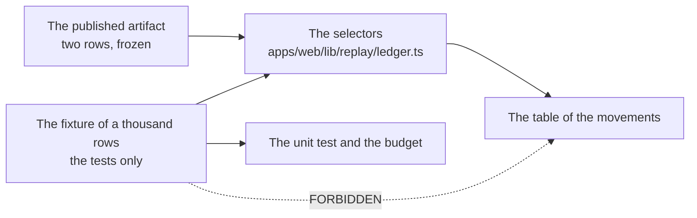
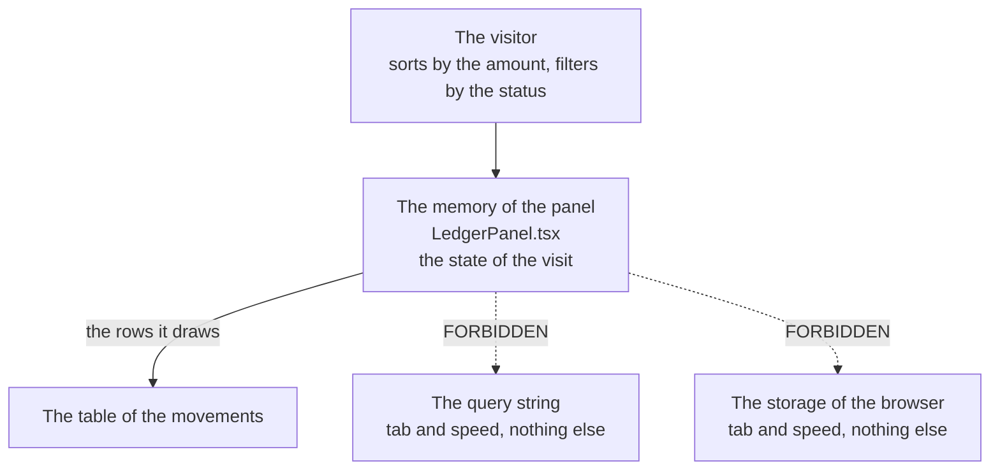

---
type: adr
status: accepted date: 2026-11-22 ---

# ADR-049: The ledger of the full account

Status: accepted. Date: 2026-11-22.

## Context

The tab of the ledger of the recorded demo exists and works: it shows the two movements of the
account `C-0412`, marks the movement the run read, opens a detail and says in words how many rows
the recording read. ADR-045 decided it completely, and it decided the opposite of what three open
tasks of the release R1 ask for:

- **T064** asks for a fixture of a thousand ledger rows in `apps/web/tests/fixtures/ledger.ts`,
  **T066** for a payment table in `apps/web/features/ledger/PaymentTable.tsx` with the controlled
  sorting and the filtering and the bounded rendering, and **T067** for a record detail in
  `apps/web/features/ledger/RecordDetail.tsx` with the transaction, the refund, the rate and the
  policy trigger.

The plan of the tasks says how the table is exercised: "Open the ledger panel of the S01 replay,
sort by amount, filter by status and assert that the marked rows are exactly the rows whose
identifiers appear in the tool responses of the bundle"
(`specs/001-r1-public-replay/tasks.md`, user story 4). So the plan wants the RECORDED ledger to be
sorted and filtered, and ADR-045 forbade the reordering.

Every fact below was measured, not assumed.

**The published artifact of the recorded demo is small and it is frozen.** `site/replay/s01/ledger.json`
carries the version of the shape `1`, the scenario `S01`, the digest of the ledger the recording
read (`26849ada6f60c63fa30a0b085fd1ff473508d18a5892498cade13b7dc436ee2f`), a page size of `50`, and
ONE account: `C-0412`, of the kind `customer`, named `Mariana Albuquerque Costa`. That account holds
TWO movements: the transaction `TX-2048` with the decimal text `100.00` EUR at
`2026-10-15T09:12:00Z` in the state `refunded`, and the refund `R-0731` with the decimal text
`549.31` BRL at `2026-10-20T14:05:00Z` in the state `paid`. The account also carries ONE read: the
citation `sql:1`, the sequence number `19`, the tool `query_ledger`, the statement
`SELECT * FROM (SELECT kind, applied_rate, applied_at FROM fx_applied WHERE transaction_id = 'TX-2048' ORDER BY applied_at) LIMIT 50`,
the three columns `kind`, `applied_rate` and `applied_at`, `row_count` 2, the flag `truncated` `false`,
the records `["TX-2048"]` and the two rows of the read, the charge with the rate `5.6679` at
`2026-10-15T09:12:04Z` and the refund with the rate `5.4931` at `2026-10-20T14:30:00Z`.

**The artifact carries NO policy.** There is no policy, no policy identifier and no link between a
policy and a movement anywhere in `site/replay/s01/ledger.json`. The policy of the recording exists,
but it exists in the RECORDING and not in the artifact: the 57 events of
`data/eval/replay/s01/events.jsonl` hold the call of the tool `search_policies` of the sequence
number `26`, whose output carries the chunks `policy:cross-currency-refunds#overview`,
`policy:cross-currency-refunds#what-is-cross-currency`,
`policy:duplicate-charges#duplicates-with-fx` and `policy:cross-currency-refunds#payout-currency`.
Those chunks are evidence, and the evidence lives in the tab of the evidence (ADR-043).

**The selectors of the library exist and they keep the order of the artifact.**
`apps/web/lib/replay/ledger.ts` exports `LEDGER_UNAVAILABLE`, `selectLedgerAccounts` (the accounts
in the order the artifact declares), `selectLedgerRows` (the movements of an account in the order
the artifact declares), `selectLedgerReads` (the reads in the order of the recording),
`selectReadsForRecord` (the reads whose `records` name the identifier), `ledgerRowIsRead` and
`paginateLedgerRows` (one page, clamped, at most `page_size` rows). Every one of them is a
projection: none calculates and none reorders. There is ONE implementation of the rules of the ledger.

**The table of the movements draws seven columns and it says that it never reorders.**
`apps/web/features/ledger/LedgerTable.tsx` draws the columns "The identifier of the movement", "The
kind of the movement", "The moment of the movement", "The amount the ledger carries", "The state of
the movement", "The reading of the run" and "The state of the visit", and its docstring says: "Why
the table never reorders the rows: the order the visitor sees is the order the artifact declares,
and the artifact is the truth of the recording". The panel owns the state of the visitor in its
memory (`apps/web/features/ledger/LedgerPanel.tsx:92-96`): the account that is chosen, the row that
is open and the page that is on the screen. **The storage of the preferences has no slot for a sort
or a filter**: `apps/web/lib/state/viewPreferences.ts` stores exactly two fields under the key
`ledgerlens.view-preferences.v1`, `tab` and `speed`.

**Twelve behaviours of the panel and seven of the table are proved today, and a new table must not
contradict them.** In `apps/web/tests/unit/features/ledger-panel.test.tsx`: the movements with the
amount and the currency of the artifact (`:107-118`); no total of the column (`:120-128`); the words
"Read by the run" (`:130-137`); the detail that opens and closes (`:139-152`); the reads that name
the row with the rate and without a currency (`:154-175`); the sentence "The recording read no
record of this movement." (`:177-187`); the switcher and the sentence of the one account
(`:189-199`); the number of rows read (`:201-207`); the change of the account (`:209-249`); the
reason and nothing else (`:251-260`); the six fields, one by one (`:262-282`); the header of every
column of a read in words (`:284-296`); the integrity that was not checked (`:298-311`). In
`apps/web/tests/unit/features/ledger-accessibility.test.tsx`: the caption and the EXACT list of the
seven headers (`:92-108`); the `aria-current` on the row (`:110-126`); the state never only in a
colour (`:128-142`); the controls never `disabled` (`:144-163`); the page holds at most `page_size`
rows (`:165-180`); the outline never skips a level (`:182-199`); the state never reaches the URL
nor the storage (`:201-213`).

**THE DECISIVE MEASUREMENT: no account of the public data holds a thousand movements, and the
whole ledger of the public data holds 2483 of them.** The repository builds the ledger of the
simulator with `build_ledger` of `ledgerlens/sim/pipeline.py` and `SimConfig(source="sample")`, and
the sample is committed: `data/sample/invoices_sample.jsonl` holds 2457 invoices (2100 sales and 357
cancellations) derived from the public dataset UCI Online Retail II with the seed 42. The ledger
that comes out of it, built offline and measured, holds 1418 customers, 24 merchants, 2114
transactions, 359 refunds, 10 chargebacks, 1934 rates (`fx_applied`), 286 settlements and 8911
events. The movements of the ledger of a branch are the transactions, the refunds and the chargebacks
(`_ledger_items` of `ledgerlens/sandbox/branch.py:108-149`), so there are 2483 movements, and each
one of them belongs to a customer and to a merchant, which makes 4966 rows when both sides are
counted, over 1442 accounts. And the distribution is the answer to the question of this milestone:
**the biggest customer holds 27 transactions, 9 refunds and 2 chargebacks at the same time**, so at
most 38 movements; **the biggest merchant is `M-13`, with 165 transactions and 25 refunds, so 190
movements**, and no merchant holds more; **no account of the public data holds a thousand
movements**, and the whole ledger of the public data holds 2483.

A published artifact of a thousand rows FOR ONE ACCOUNT would therefore have to be SYNTHETIC, and
the repository has one rule about that: the site publishes what the recordings read and what the
public data carries, and every published byte is pinned by a digest. A published row that no
recording read and no public invoice carries would be an invention in the place where the site
promises the truth of the ledger (FR-043, FR-045 of the specification, ADR-043 and ADR-045). For the
record, the size of the alternatives was measured too: an artifact of the WHOLE ledger of the public
data, in the six fields of the row, is 1220254 bytes raw and 74150 bytes compressed, and the biggest
account alone is 40230 bytes raw and 2941 bytes compressed.

**The gate of the repository checks the digests and the payload of the published artifacts.**
`scripts/verify_replay_digests.py` compares the published files with the canonical bundle, checks
the digest of the file of the ledger against the digest the provenance publishes and the digest the
card of the catalog publishes, and refuses a published folder that holds a file nobody accounts
for. `scripts/measure_replay_budget.py` measures the compressed payload of every published file
against the budget of SC-004 (400 kibibytes per scenario), `scripts/gate.sh` runs both, and
`scripts/gate_web.sh` runs the type check, the lint, the unit tests of the frontend with `vitest`
and the static export. **The Node gate does NOT run the end to end suite of Playwright.**

## Decision

**The milestone closes T064, T066 and T067 with the artifact of the recorded demo UNCHANGED, with
the sorting and the filtering in the library and in the table of the movements, and with the
fixture of a thousand rows in the tests and NOWHERE else. No new published artifact is created: the
digests of the published bundle DO NOT MOVE, the export does not change, the producer does not
change, and the two scripts of the gate of the Python do not change.**

**The one rule of ADR-045 that this record amends is the rule of the order** ("it never reorders
them: the order the visitor sees is the order the artifact declares", ADR-045:532-534). The
amendment is written in words below, and the implementation writes it into ADR-045.

### The ten decisions

1. **The table of a thousand rows reads a FIXTURE that only the tests use**, and no new artifact is published.
2. **The recorded ledger MAY be sorted and filtered**, and the default order stays the order of the artifact.
3. **The state of the sort and of the filter lives in the memory of the panel**, never in the URL nor in the storage.
4. **The bounded rendering is the pagination of 50 rows, kept**; virtualisation is rejected.
5. **The fixture lives in `apps/web/tests/fixtures/ledger.ts`**, deterministic, with the six fields of ADR-045.
6. **SC-010 is measured in a unit test of the frontend**, over the fixture, with the thresholds of 200 ms and 1 s.
7. **The detail of a row shows the six fields and the reads that name it**; the policy trigger is NOT AVAILABLE.
8. **The rate may NOT be shown next to the refund**; the prohibition of ADR-045:851-855 STAYS.
9. **The shape of the row does NOT grow**; the six fields of ADR-045 stay.
10. **The sorting and the filtering live in `apps/web/lib/replay/ledger.ts`**, with the other selectors.

Every one of them says what it forbids, and the forbids are in the section of the decision.

### Decision 1, in full: the fixture, and NOT a new published artifact

**The table of a thousand rows reads the fixture of the tests. The site publishes no artifact of a
thousand rows.** The reason is the measurement of the context: the biggest account of the public
data holds 190 movements and the biggest customer holds at most 38. There is no thousand-row account
to publish, and an artifact that carried one would carry rows that no recording read and no public
invoice carries.

**A synthetic artifact may NOT be published, and this is a rule, not a preference.** The site of
the demo is a promise of evidence: the home page says that LedgerLens shows the ledger rows it
read, the policy it applied and the arithmetic it did. A published row of the ledger that no run
read and no public dataset carries is a claim the site cannot prove, in the very tab whose purpose
is to show what can be proved. The repository already refuses this kind of thing everywhere else:
the browser never invents a number (FR-044), the interface renders only what the published
artifacts carry (FR-043), and ADR-045 refused to publish the result of the recording because the
recording did not carry it.

**Because nothing new is published, the digests of the published bundle do not move.** The digest
of the bundle is the sha256 of the manifest, the manifest is not touched, the frozen file
`data/eval/replay/ledger/s01.json` is not touched, the published file `site/replay/s01/ledger.json`
is not touched, the provenance of the scenario does not gain a key and the card of the catalog does
not gain a key. `scripts/verify_replay_digests.py` needs no change and
`scripts/measure_replay_budget.py` needs no change, and the step of the gate that checks the export
stays green without a new file.

**What this costs, said out loud: the sorting and the filtering are PROVED against data that no
visitor ever sees.** The proof of the behaviour and of the performance of a thousand rows lives in
the unit tests, over the fixture, and the visitor of the site exercises the same controls on the
two rows of the recorded ledger. This is acceptable, and it is acceptable for three reasons, each
of which is a decision below: the controls are REACHABLE for the visitor of the recorded ledger
(decision 2), so the feature is not dead code and not a mock; the thousand rows are the ALGORITHM
under test (decisions 5, 6 and 10), and the algorithm is the one the visitor runs; and the way to
publish a thousand rows for real is written down in the debt of this record, with the measurement
that makes it possible.

**What it forbids**: a new published file of the ledger; a second producer; a change of the
manifest of the bundle; a change of the schema version of the artifact; a synthetic row anywhere in
`site/`; a fixture imported by a file of `apps/web/features/`.



### Decision 2, in full: the sorting and the filtering of the recorded ledger

**The recorded ledger MAY be sorted and filtered. The rule of ADR-045 that is amended is the rule
of the order, and only that rule.** The rule that KEEPS: **the default order of the rows is the
order of the artifact.** The artifact of the recorded demo declares its rows in the order of the
ledger, which is the order of `_ledger_items` of `ledgerlens/sandbox/branch.py:148`, the order by
the moment, then by the kind, then by the identifier. The table shows that order when the visitor
asks for nothing.

The rule that is AMENDED, written in words so that the implementation can paste it into ADR-045:

> ADR-045, in the section "The components and their props", in the rules of `LedgerTable`: the
> sentence "it never reorders them: the order the visitor sees is the order the artifact declares"
> becomes "the order it shows is the order the artifact declares, until the visitor asks for
> another one: when the visitor sorts or filters, the table shows that order AND says in words that
> the order on the screen is the order the visitor chose and not the order of the artifact".
>
> ADR-045, in the rules of the browser, gains one rule: "a sort is a departure from the order of
> the artifact, and a departure that the visitor cannot see is a lie: the table always says in
> words which order is on the screen".
>
> ADR-045, in the section "What the milestone does not deliver", the debt of the search (`:845-847`)
> is amended: the search over the ledger is not a search over a published artifact yet, and this
> record says what it is instead (the sorting and the filtering of the artifact that is published,
> proved over a thousand rows in the tests).

The rule applies to the recorded ledger AND to every other ledger that the same table draws,
because the table and the selectors are ONE implementation.

**What it forbids**:

- **A silent reorder and a rewritten artifact.** The sentence that names the order on the screen is
  always there when the order is not the order of the artifact, and it is never there when it is;
  the sort and the filter live in the memory of the panel and change nothing on the disk.
- **A sort by a field the row does not carry.** The sorts are the kind, the moment, the amount and
  the status: the four fields of the row that have an order. The identifier is the identity of the
  row and the tie breaker, never a sort of its own.
- **A sort of money as a float.** The amount is the decimal text of the artifact, and the
  comparator compares the decimal TEXT: the integer part by its length and then by its digits, the
  fraction digit by digit. The comparator never calls `Number`, never calls `parseFloat` and never
  builds a `BigInt` out of an amount (the same rule as `formatMoney` of ADR-043). A text that does
  not match the decimal grammar keeps the place of the artifact and is never sorted by a guess.
- **A total, and a row that disappears without a word.** There is no total row, no total in the
  caption and no total in the detail, before a sort and after a sort, because a sort by the amount
  does not produce a sum; and the table says how many rows the filter kept and how many the
  artifact holds, in words.

**Why not the alternatives.** The prohibition kept as it was was rejected because the plan of the
release asks the visitor of `S01` to sort by the amount and to filter by the status (the
independent test of the user story 4), and a feature the visitor cannot reach does not exist. A
silent reorder was rejected because the order of the artifact is the truth of the recording, and a
reader who cannot tell a reorder from the truth is reading a lie.

### Decision 3, in full: where the state of the sort and of the filter lives

**In the memory of the panel, and in nowhere else.** The panel owns the account that is chosen, the
row that is open, the page that is on the screen, and now the sort and the filter
(`apps/web/features/ledger/LedgerPanel.tsx:92-96`). **What it forbids**:

- **The URL.** The allow list of the query string stays exactly as it is: `tab` and `speed`
  (ADR-043:344-351, ADR-045:633-637). A parameter that carries a sort, a filter, an account or a
  row is ignored, exactly like every other parameter the list does not name, and the panel never
  touches the history of the browser. The reason is FR-037 and the rule of the repository: the URL
  never carries anything that came from a visitor.
- **The storage.** `apps/web/lib/state/viewPreferences.ts` keeps its two fields, `tab` and
  `speed`, and its key `ledgerlens.view-preferences.v1`. **This record forbids that store from
  growing a slot for a sort or a filter**, and the existing unit test of the storage
  (`apps/web/tests/unit/view-preferences.test.ts`) keeps proving that the stored payload holds
  those two fields and nothing else. The reason is the same as the reason of the account and of the
  open row: the state of a table is the state of a session and not a preference of the visitor.



### Decision 4, in full: what the bounded rendering means for a thousand rows

**The pagination of 50 rows is kept, and it IS the bounded rendering.** The page size is the number
the artifact declares (50), the DOM of the table never holds more than one page, and the visitor
walks the pages with the control of the pagination, which is never `disabled`.

**Virtualisation is rejected**, and the reason is that it does not answer the problem it pretends to
answer. The debt of ADR-045 is that "the table of the ledger reads the whole artifact into the
memory of the browser" (ADR-045:995-999), and a virtualised table still parses the whole file: the
window only decides what the DOM holds, not what the browser read. On top of that, a virtualised
table adds a window state that the rules of the state would have to govern (where is the window
when the visitor sorts? what happens to the row that is open?), it breaks the invariant that the
tests prove today ("the page holds at most `page_size` rows",
`apps/web/tests/unit/features/ledger-accessibility.test.tsx:165-180`), and it makes the
`aria-current` of the open row a property of a window instead of a property of the row.

**What it forbids**: a DOM of a thousand rows; a second mechanism of paging next to the pagination;
a change of the meaning of `page_size`; a table that renders the rows of the whole artifact in one
page. **The debt stays a debt and is named**: the whole artifact is read into the memory of the
browser, and what the debt wants is a page of the artifact read from the file itself, the way the
ledger of the branch is read with its cursor, which needs an artifact split into pages.

### Decision 5, in full: the fixture

**The fixture lives in `apps/web/tests/fixtures/ledger.ts`, the path the plan names (T064).** The
folder does not exist today and the milestone creates it. **The generator is deterministic and it
is a pure function.** It takes the number of rows it builds and returns them, with no clock, no
`Math.random`, no network and no file. The rows are built by a rule that is written once and
applied in order, so that the thousandth row of the fixture is the same row in every machine and in
every run. The amounts are decimal TEXTS built by a rule of the fixture (never a float), the
currencies are from a fixed list, the moments are ISO 8601 texts built from a fixed origin, and the
kinds and the states are from the closed lists of the ledger (`transaction`, `refund`,
`chargeback`). **The rows of the fixture carry the SIX fields of ADR-045**, the same fields and the
same meaning as `_ledger_items` of `ledgerlens/sandbox/branch.py`: `kind`, `id`, `at`, `amount`,
`currency` and `status`. They do NOT carry the ten fields of the entity of the specification
(`specs/001-r1-public-replay/spec.md:195`), because the shape of the row does not grow (decision 9)
and a fixture with fields the artifact does not carry would prove a table that the artifact cannot
render. The fixture is imported with the alias of the repository, `@/tests/fixtures/ledger`, and the
tests that consume it are named in the section of the tests below.

**What it forbids**: a fixture imported by a file of `apps/web/features/` (a component that reads
a fixture draws data that no artifact of the site carries); a fixture published in `site/`; a
fixture whose rows carry a field the artifact does not carry; a fixture that reads the clock or a
random source that is not seeded, because a test that depends on the machine is not a test.

### Decision 6, in full: how SC-010 is measured

**SC-010 is measured in a unit test of the frontend, over the fixture of a thousand rows, with the
thresholds of the specification.** The measurement lives in
`apps/web/tests/unit/features/ledger-sort.test.ts`, which the gate of the Node runs (`npm test`).
The measurement has three parts and each part has its own threshold: the sort of a thousand rows,
timed with `performance.now()`, under 200 ms; the filter of a thousand rows, timed the same way,
under 200 ms; and the render of the panel with the thousand rows, timed the same way, under 1 s.

**Why a unit test and not a script of the Python, and why not only a browser test.**
`scripts/measure_replay_budget.py` measures the SIZE of the published payload against the budget of
SC-004, and the size of a payload is not the time of an interaction; a new Python script would have
to measure a browser that Python does not run, and a measurement that lives outside the gate of the
frontend is a measurement nobody runs. The gate of the Node (`scripts/gate_web.sh`) runs the type
check, the lint, the unit tests and the static export, and it does NOT run the end to end suite of
Playwright, so a threshold that lives only in `apps/web/tests/e2e/ledger.spec.ts` is a threshold
that the gate does not enforce.

**And the honest clause, because the specification asks for a mid-range laptop.** The unit test
runs in jsdom, and jsdom is not a mid-range laptop. What the unit test proves is the ALGORITHM:
that the sort and the filter of a thousand rows are pure, that they do not touch the DOM, and that
they finish in a fraction of the budget, with a margin wide enough that a slow machine does not turn
the gate red. The confirmation in a real browser is the end to end journey, which is not part
of the gate, and this record says so instead of pretending that the two are the same thing.

**What it forbids**: a threshold that lives only in the end to end suite; a measurement that reads
the clock of the wall and fails the gate because the machine was busy; a measurement that is taken
over the two rows of the published artifact and called the measurement of a thousand rows.

### Decision 7, in full: what the detail of a row shows

**The detail of a row shows the six fields of the movement, the reads that name it with the rows
they returned, and NOTHING ELSE.** The measurement of the context is the whole truth of it: **the
transaction** is the row `TX-2048` itself, with the six fields and the amount as the decimal text
`100.00` with the currency `EUR`; **the refund** is the row `R-0731`, which is ANOTHER row of the
table and not a field of the transaction, because the artifact carries no link between them (the
read `sql:1` named `TX-2048` and nothing else); **the rate** is a row of a READ, shown inside the
read that produced it, with the citation, the sequence number of the event, the statement and the
rows, exactly as the artifact carries them, and a rate carries no currency, is written with the text
of the artifact and is never written with `formatMoney` (ADR-045:624-627); **the policy trigger** is
NOWHERE, because the artifact carries no policy, no policy identifier and no link between a policy
and a movement.

**What the interface shows when the artifact carries none: the sentence, and nothing else.** The
detail says in words that the recording published no policy trigger for this movement, in the same
way it says in words that the recording read no record of a movement that no read names. A field
that does not exist is never invented, and a field that the artifact does not carry is never
guessed, never filled with a placeholder that looks like a value, and never taken from another
panel.

**Where a policy trigger would come from, if one day it exists.** The recording carries the policy
as EVIDENCE (the call of `search_policies` of the sequence number `26` and its chunks), and the
evidence is drawn in the tab of the evidence. For the detail of a row to show a policy trigger, the
ARTIFACT would have to carry it: a new field, a new version of the shape of the artifact, a
rebuilt frozen file, new digests, and above all a RECORDED link between a movement and a policy
chunk, because a policy about cross-currency refunds is not a link to a movement.

**What it forbids**: a policy, a rule, a threshold, a verdict or a score that no artifact carries; a
column of the detail that is always empty; a link between a rate and a movement that no statement
named; a total.

### Decision 8, in full: the rate next to the refund

**The prohibition of ADR-045:851-855 STAYS. The rate may NOT be shown next to the refund.** The
reason is unchanged and it is measured: the statement of the read named the transaction and nothing
else, so the artifact cannot say that the rate `5.4931` is the rate of the refund `R-0731`. A link
that the recording did not make is an invention, and the invention would be in the panel that says
which rows the run read. **The link may be published ONLY when a recording reads the refund.** The
producer already knows how to publish it: the `records` of a read are the identifiers the statement
named, and the rule of the artifact is that a read that named nothing publishes an empty list and
never an invented one. So the recipe is a new capture whose statement names the refund, and not a
new interface.

**What it forbids**: a rate next to a movement that no read names; a rate written with the
currency of the run; a rate computed by the browser from an amount and a rate.

### Decision 9, in full: the shape of the row

**The shape of the row does NOT grow. The six fields of ADR-045 stay: `kind`, `id`, `at`,
`amount`, `currency` and `status`.** The specification asks for more
(`specs/001-r1-public-replay/spec.md:195`): the counterparty, the provider and the identifiers of
the related refund and of the related dispute. **The data for them exists**, and it is worth saying
where, because the next milestone will need it: the transactions carry `merchant_id`, the refunds
carry `transaction_id`, the chargebacks carry `transaction_id`, and the builder of the statements of
an account already reads the counterparty and the related identifiers
(`ledgerlens/api/accounts.py:108-186`).

**The reason to wait is the CONTRACT, not the absence of data.** The shape of the row is the shape
of the branch ledger: `_ledger_items` of `ledgerlens/sandbox/branch.py:108-149` writes exactly
these six fields, and ADR-045 made that the contract between the ledger of the recorded demo and
the ledger of the branch of the sandbox ("the shape of the row of the ledger is now written in one
place and it is the shape of the branch ledger", ADR-045:906-908). Growing the shape of the row of
the artifact without growing the shape of the branch would break that contract in the middle, and
the panel of the branch of the sandbox (the debt of ADR-044) is written against it. Growing the
shape is therefore ONE decision of its own, and it touches: `_ledger_items`, the version of the shape
of the artifact (from `1` to `2`), the producer and the frozen file, the digests of the published
file, the validator of the frontend, the table and the detail, and the shape of the branch.

**What it forbids**: a column of the table that is always empty (a column that is empty for every
row is a column that lies about the shape of the data); a detail that shows a counterparty, a
provider or a related identifier that the artifact does not carry; a change of `_ledger_items` that
is not part of that decision. ### Decision 10, in full: where the sorting and the filtering live

**In `apps/web/lib/replay/ledger.ts`, with the other selectors.** One implementation, one set of
selectors, and the components own no rule. The surface that this milestone adds to that module is
named here, so that a worker can write against it before it exists:

```ts
export type LedgerSortField = "at" | "amount" | "kind" | "status";
export type LedgerSortDirection = "asc" | "desc";
export interface LedgerSort { readonly field: LedgerSortField; readonly direction: LedgerSortDirection; }
export interface LedgerFilter {
  /** The text the identifier, the kind, the status or the currency carries, or empty. */
  readonly text: string;
  /** The kind of the movement kept, or null when every kind is kept. */
  readonly kind: string | null;
  /** The state of the movement kept, or null when every state is kept. */
  readonly status: string | null;
}
export function sortLedgerRows(rows: readonly LedgerRow[], sort: LedgerSort): LedgerRow[];
export function filterLedgerRows(rows: readonly LedgerRow[], filter: LedgerFilter): LedgerRow[];
```

`selectLedgerRows` keeps its signature and its promise (the movements of an account in the order the
artifact declares) and stays the DEFAULT: the panel asks for the rows of the artifact first and
applies the sort and the filter of the visitor afterwards.

**What it forbids**: a second implementation of a rule of the ledger anywhere else; a component
that calls `Array.prototype.sort` on the rows of the artifact; a comparator that turns the decimal
text of an amount into a number; the library that imports a component.

## The tests that will prove this record

Every test runs with no key and no network.

**`apps/web/tests/fixtures/ledger.ts` (new).** The deterministic generator of a thousand rows. The
test of the generator itself: two calls with the same count return the same rows, the rows carry
the six fields and nothing else, the amount is a decimal text and never a number, and the kinds and
the states come from the closed lists of the ledger.

**`apps/web/tests/unit/features/ledger-sort.test.ts` (new).** The behaviour and the budget:

1. the default order of the rows is the order of the artifact, and `sortLedgerRows` with the
   default sort returns the same order;
2. the sort by the amount compares the decimal TEXT: `9.90` comes before `10.00`, and `100.00` comes
   after `99.99`;
3. the sort never calls `Number` on an amount: the case goes red when the comparator is replaced by
   one that parses the amount as a float, because the order of two rows that differ only by a
   leading zero changes;
4. the sort is stable: two rows with the same value of the field keep the order of the artifact;
5. the filter by the text keeps the rows whose identifier, kind, state or currency carries the text,
   the filter by the kind and by the state keeps the rows that carry them, and no row is ever
   dropped silently: the panel says how many rows it kept;
6. the sort and the filter compose: the filter first, then the sort, and the result is the same as
   the sort of the filtered rows;
7. **the budget of SC-010**: the sort of a thousand rows finishes under 200 ms, the filter of a
   thousand rows finishes under 200 ms, and the render of the panel with the thousand rows finishes
   under 1 s, each measured with `performance.now()` and each failing the test when the budget is
   broken.

**`apps/web/tests/unit/replay-ledger.test.ts` (changed).** The cases of ADR-045 stay exactly as
they are, and the cases of the new selectors are added next to them. **`ledger-panel.test.tsx`
(changed).** The twelve behaviours stay exactly as they are, and the new cases are: the table sorts
by the amount when the visitor asks, it filters by the status when the visitor asks, it says in
words that the order on the screen is the order the visitor chose when it is not the order of the
artifact, it says the order of the artifact when the visitor asks for the default, and the detail
says in words that the recording published no policy trigger for a movement.

**`apps/web/tests/unit/features/ledger-accessibility.test.tsx` (changed).** The seven behaviours
stay exactly as they are, and the new cases are: the controls of the sorting and of the filtering
are never `disabled` and the ones that would do nothing carry `aria-disabled` and a reason, the
state of the sort and of the filter never reaches the URL nor the storage, and the list of the
seven headers of the table does not change (the sort is a control above the table and NOT a
column). **`apps/web/tests/unit/view-preferences.test.ts` (unchanged, and watched).** The stored
payload holds `tab` and `speed` and nothing else, and this record forbids that store from growing.
**`apps/web/tests/e2e/ledger.spec.ts` (changed).** The journey gains the sort and the filter of the
visitor over the recorded ledger. It is NOT part of the gate of the Node, and the ADR says so.

## The files this milestone touches

| File | Status | What changed and why |
| --- | --- | --- |
| `docs/decisions/ADR-049-the-ledger-of-the-full-account.md` | new | this record |
| `docs/decisions/ADR-045-the-ledger-of-the-recorded-demo.md` | changed | the amendment of the rule of the order, written in words in the decision 2 |
| `apps/web/tests/fixtures/ledger.ts` | new | the deterministic fixture of a thousand rows (T064) |
| `apps/web/lib/replay/ledger.ts` | changed | the selectors of the sorting and of the filtering, and the comparator of the decimal text |
| `apps/web/features/ledger/LedgerTable.tsx` | changed | the controls of the sorting and of the filtering, and the sentence of the order on the screen |
| `apps/web/features/ledger/LedgerPanel.tsx` | changed | the state of the sort and of the filter, in the memory of the panel |
| `apps/web/features/ledger/LedgerRowDetail.tsx` | changed | the sentence of the policy trigger that the artifact does not carry |
| `apps/web/features/ledger/ledger.css` | changed | the rules of the new controls and of the sentence of the order |
| `apps/web/tests/unit/features/ledger-sort.test.ts` | new | the behaviour of the sorting and of the filtering, and the budget of SC-010 |
| `apps/web/tests/unit/replay-ledger.test.ts` | changed | the cases of the new selectors |
| `apps/web/tests/unit/features/ledger-panel.test.tsx` | changed | the new cases of the panel |
| `apps/web/tests/unit/features/ledger-accessibility.test.tsx` | changed | the new cases of the accessibility of the new controls |
| `apps/web/tests/e2e/ledger.spec.ts` | changed | the journey of the sorting and of the filtering |
| `docs/frontend.md` | changed | the section "The ledger of the recorded demo" gains the sorting, the filtering, the fixture and the debt |
| `specs/001-r1-public-replay/tasks.md` | changed | T064, T066 and T067 are closed, with the file names that carry them |

**The files this milestone does NOT touch, and why.** `ledgerlens/replay/site_export.py`,
`ledgerlens/replay/ledger_artifact.py`, `scripts/build_ledger_artifact.py`,
`scripts/verify_replay_digests.py`, `scripts/measure_replay_budget.py`, `scripts/gate.sh`,
`data/eval/replay/ledger/s01.json`, `site/replay/s01/ledger.json`, `site/replay/index.json`,
`apps/web/lib/api/replay.ts`, `apps/web/lib/api/schemas.ts`, `apps/web/lib/replay/validate.ts` and
`apps/web/lib/state/viewPreferences.ts` are all UNCHANGED, because no artifact is published, no
shape grows and no state is stored. **T066 and T067 are closed in the files that already exist.**
The plan names `apps/web/features/ledger/PaymentTable.tsx` and
`apps/web/features/ledger/RecordDetail.tsx`, and ADR-045 named `LedgerTable.tsx` and
`LedgerRowDetail.tsx`. Two tables and two details would break the contract with the branch ledger,
double the surface of the accessibility and let the two drift apart. The milestone therefore grows
the components that exist, and the tasks are closed with the same wording the plan already uses for
T069 and T070 ("DELIVERED in `apps/web/features/ledger/LedgerTable.tsx`").

## Alternatives considered

- **(a) Publish a NEW artifact of a thousand synthetic rows, or the artifact of the biggest
  account** (`M-13`, 190 movements). Rejected: the public data has no account with a thousand
  movements, so the rows would be invented, and a published row that no recording read is a claim
  the site cannot prove in the tab whose purpose is to show what can be proved.
- **(b) Publish ONE artifact of the whole ledger of the public data** (2483 movements over 1442
  accounts, 74150 bytes compressed, measured). Rejected for this milestone, and it is the debt of
  this record. The account switcher of ADR-045 is a group of buttons, and 1442 buttons is a DOM a
  keyboard reader walks row by row, so the artifact would force the switcher to become a filter;
  the artifact belongs to no scenario, so the chain of the digests would have to gain a second chain
  with its own budget and its own reader; and a site-level artifact of rows no recording read would
  sit beside the rows a recording did read in the same tab, which is the confusion ADR-045 refused.
- **(c) Keep the prohibition of the reorder and deliver the sorting only over the fixture.**
  Rejected: the independent test of the user story 4 asks the visitor of `S01` to sort by the
  amount and to filter by the status, and a feature the visitor cannot reach does not exist.
- **(d) Let the visitor reorder silently.** Rejected: the order of the artifact is the truth of the
  recording, and a reader who cannot tell a reorder from the truth is reading a lie.
- **(e) Put the sort and the filter in the URL, or in the storage of the browser.** Rejected:
  FR-037 and the allow list of ADR-043 for the URL, and the rule of the panel for the storage.
- **(f) Virtualise the table.** Rejected: it does not answer the debt of the memory of the browser,
  it adds a window state, and it breaks the invariant of the page.
- **(g) Measure SC-010 in a new Python script.** Rejected: the script of the budget measures the
  size of a payload, and the time of an interaction is not a size.
- **(h) Measure SC-010 only in the end to end suite.** Rejected: the gate of the Node does not run
  it, and a threshold that the gate does not run is a threshold that decays.
- **(i) Grow the row of the fixture to the ten fields of the specification.** Rejected: the shape
  of the row does not grow, and a fixture of fields the artifact does not carry proves a table that
  the artifact cannot render.
- **(j) Create a second table, `PaymentTable.tsx`, beside `LedgerTable.tsx`.** Rejected: two tables
  of the ledger are two contracts with the branch ledger and two surfaces of the accessibility.

## Consequences

The visitor of the recorded demo opens the tab of the ledger, sorts the movements by the amount or
filters them by the status, and the table says in words that the order on the screen is the order
the visitor chose. The default order is still the order of the artifact, and the visitor can get it
back. The state of that choice lives in the memory of the panel: it is gone when the tab is closed,
it is never in the address of the page and it is never in the storage of the browser. The detail of
a row shows the six fields of the movement and the reads that name it with the rates they returned,
and it says in words that the recording published no policy trigger for the movement, because the
artifact carries none.

The published site is untouched: the same four files per scenario, the same digests, the same chain,
the same budget. The gate of the Python runs exactly as it ran. The table of a thousand rows is a
fixture of the tests, and this record says so out loud: the behaviour and the performance of a
thousand rows are PROVED, and a visitor of the site today sees two rows. The recipe for publishing
a thousand rows for real is the debt below.

## The debt

- **The thousand rows of the fixture are not published.** The proof of the behaviour and of the
  budget lives in the tests, and the visitor exercises the controls on two rows. What the debt
  wants: the artifact of the whole ledger of the public data (2483 movements over 1442 accounts,
  74150 bytes compressed), a new producer for it, its own chain of digests, its own budget, a
  switcher that is a filter and not 1442 buttons, and a tab of its own so that the rows no
  recording read never sit beside the rows a recording read.
- **The whole artifact is read into the memory of the browser** (the debt of ADR-045:995-999, still
  open). What the debt wants: a page of the artifact read from the file itself, the way the ledger
  of the branch is read with its cursor, which needs an artifact split into pages.
- **The shape of the row does not carry the counterparty, the provider and the related
  identifiers** (the entity of the specification, `spec.md:195`). What the debt wants: one decision
  that grows `_ledger_items`, the version of the shape of the artifact, the producer, the digests,
  the validator, the table, the detail and the branch together.
- **The detail carries no policy trigger.** What the debt wants: a recording that links a movement
  to a policy chunk, a new field of the artifact that carries the link, a new version of the shape
  and the rebuild of the frozen file with its digests. **The rate is never shown next to the
  refund** (the debt of ADR-045:851-855, still closed). What that debt wants: a capture whose
  statement names the refund, so that the producer publishes the link the way it publishes the
  `records` of a read.
