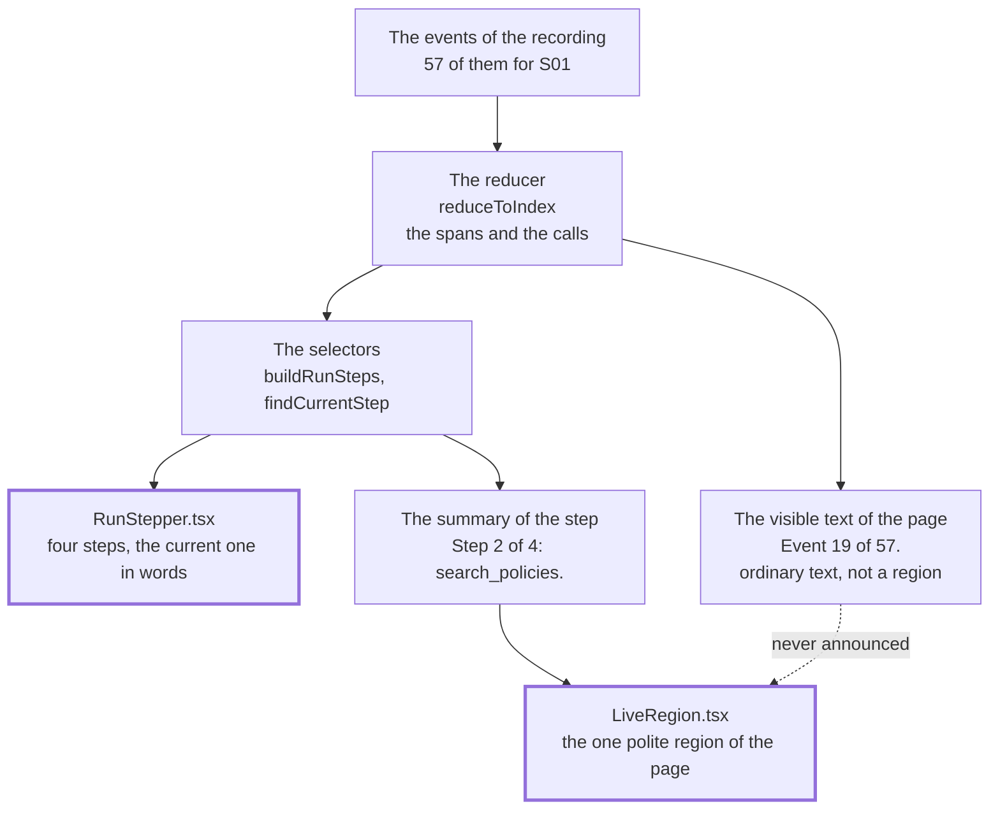

# ADR-050: The stepper of the run and the live region

Status: accepted. Date: 2026-11-22.

## Context

The release R1 plays a recorded investigation to any visitor, with no key, no account and no call to a model provider (ADR-040, ADR-042, ADR-043). Two
tasks of the plan of the release were marked as delivered while their files were never built, and ADR-046 says so out loud: "Two more tasks of the
plan are marked as delivered and their files are not in the tree either: the stepper of T047 (`RunStepper.tsx`) and the live region of T050
(`LiveRegion.tsx`)." (ADR-046, lines 36 to 40). The two tasks are open today: **T047** asks for the stepper of the run in
`apps/web/features/agent-trace/RunStepper.tsx`, **T050** asks for the announcement of the summary of the step in
`apps/web/components/ui/LiveRegion.tsx`, "without announcing every token", and **T022** names `LiveRegion.tsx` among the primitives of the design
system, with a note that says that the primitive was never built.

Every fact below was measured in the tree of the repository, not assumed.

### What the trace of the run shows today

**The tree of the investigation shows the nesting of the spans.** `apps/web/features/agent-trace/TraceTree.tsx` is a `role="tree"` with one `treeitem`
per span, each one carrying its `aria-level` and, when it has children, its `aria-expanded` (lines 239 to 292). The tree is ONE navigation group: only
the row that holds the focus is in the tab order, and the arrow keys, the Home key and the End key walk it (lines 178 to 219). A row of the tree is a
`button`, and clicking it moves the recording to the span that was selected (`apps/web/features/replay/ReplayViewer.tsx`, lines 381 to 395). The tree
answers ONE question: which span opened which span.

**The timeline shows every event of the recording.** `apps/web/features/agent-trace/TraceTimeline.tsx` is a table with one row per event, in the order
of the recording, and it carries the type of the event, the moment it was recorded, the duration the capture measured and the error it ended with
(lines 107 to 155). The row the visitor stands at carries `aria-current` (line 177), and the number of the event moves the recording to that event:
the visitor clicks the button of the cell, or puts the focus on the cell and presses the Enter key (lines 71 to 105). The timeline answers ONE
question: what happened, event by event, in the order it happened. **The calls of the tools are in a table of their own** (`ReplayViewer.tsx`, lines
429 to 481 and 545 to 552), and the name of the tool is the trigger that opens the drawer of the call (ADR-048, decisions 2 and 3).

**Nothing of the trace shows the steps of the run as a sequence.** For the recording of `S01` the tree shows a nest of 26 spans, the timeline shows 57
rows and the calls table shows 4 rows. A visitor who wants to know "how far along the run am I, and which call is the current one" has to read the
tree, count the rows and find the current one by the border it wears. The stepper is the piece that answers that question, and it is the piece the
plan asks for.

### The one polite region of the page today

**The reader holds exactly one live region.** `apps/web/features/replay/ReplayViewer.tsx`, lines 660 to 681, holds a single `p` with `role="status"`,
`aria-live="polite"`, `aria-atomic="true"` and `tabIndex={-1}`, whose whole content is `Event {step} of {total}.` The focus moves to that region ONCE,
when the playback starts, and never again while the recording runs (lines 369 to 379), because a reader that is pulled back to the region on every
event of the recording never hears the recording at all (FR-032).

**The region announces the counter of the events, and it changes on every event of the recording.** The text of the region is the sequence number of
the last event applied and the total of the events of the bundle. The recording of `S01` carries 57 events, so the playback of `S01` rewrites the
region 57 times. A polite region that is rewritten on every event is a region that talks over the reader, and FR-033 asks for "at most a step summary"
and forbids announcing "every token or every rendered frame".

**The controls of the replay hold no live region.** `apps/web/features/replay/ReplayControls.tsx` carries the reasons of the controls that cannot act
as paragraphs that `aria-describedby` points at (lines 282 to 304), and nothing else. ADR-048, decision 9, decided that the drawer and the pane of the
SQL announce nothing, that the one polite region stays in the reader, and that `ReplayControls.tsx` is NOT changed by that milestone. The task T084
was closed with that decision and says so: "the status region of the page lives in `apps/web/features/replay/ReplayViewer.tsx` and not in
`apps/web/features/replay/ReplayControls.tsx`, because ADR-048 decision 9 keeps the controls of the replay free of a live region and does not change
that file". **The unit test and the end to end test already prove the shape of the region:**
`apps/web/tests/unit/features/replay-accessibility.test.tsx`, lines 534 to 555, proves that the page carries exactly one polite region, that it
carries `role="status"` and `aria-atomic="true"`, and that the page carries no assertive region, no `role="alert"` and no `role="log"`, and
`apps/web/tests/e2e/tool-call-drawer.spec.ts`, lines 341 to 352, proves the same on the export, with the drawer of a call open.

### The primitives of the interface and the features of the product

**There is NO `LiveRegion.tsx` today.** The folder `apps/web/components/ui/` holds nine files: `Badge.tsx`, `Button.tsx`, `Card.tsx`, `Dialog.tsx`,
`Sheet.tsx`, `Skeleton.tsx`, `StatusPill.tsx`, `Table.tsx` and `Tabs.tsx`. The plan names eight of them in T022, and `LiveRegion.tsx` is the ninth
that was never built.

**A primitive of the interface is a piece of the design system, and a feature is a piece of the product.** A primitive renders markup and carries the
roles and the attributes of that markup; it knows nothing about the domain, it holds no state of the visit, it reads no artifact and it writes no
sentence of the product. `Badge.tsx`, for instance, says in its own docstring: "A badge never carries a meaning on its own. The colour only repeats
what the text already says." A feature of `apps/web/features/` knows the domain: it reads the state of the reader, it draws the facts of the
recording, and it writes the sentences the visitor reads. `TraceTree.tsx` knows what a span is; `ReplayViewer.tsx` knows what a step of the recording
is. **The difference matters here because the region is a rule of the mechanics and the sentence is a rule of the domain.** The markup of a live
region (`role="status"`, `aria-live="polite"`, `aria-atomic="true"`, `tabIndex={-1}`) is the same on every page of the site that announces a state,
and it is a rule of the design system. The sentence that is announced inside it is about the steps of a run of the replay, and it belongs to the
replay. So the primitive renders the region and the feature writes the sentence.

### The state of the reader and what is already derivable

**The reducer already knows the spans and the calls.** `apps/web/lib/replay/reducer.ts` builds the state of the recording at a position with
`reduceToIndex`, and the state holds the spans (lines 35 to 58), the tool calls (lines 103 to 122) and the sequence number of the last event applied
(`lastSeq`, line 149). A span of the kind `tool` is assembled into a call when it closes (lines 399 to 413), with the name of the tool, the arguments,
the result, the error, the duration, the status and the identifiers of the evidence. **The selectors already project the tree and the timeline.**
`buildTraceTree` of `apps/web/lib/replay/selectors.ts` (lines 189 to 250) nests the spans, and `buildTimeline` (lines 258 to 273) builds one row per
event. Every function of that file is a projection and never a decision: it reads what the artifact published and returns it. **The stepper must not
compute anything the state already holds:** the steps of the run are the spans of the kind `tool`, in the order the reducer opened them, and the
reducer already holds them. The stepper is therefore given the steps, and it draws them.

### The eleven event types, and the ones that are steps

The contract of the trace names eleven event types (`apps/web/lib/api/schemas.ts`, lines 25 to 37), and the validator of the runtime refuses any event
whose type is not one of them (`apps/web/lib/replay/validate.ts`, lines 53 to 64 and 244 to 250).

| event type | what it means | is it a step of the run |
| --- | --- | --- |
| `run.started` | the run began | no: it is the life of the run, not a step of it |
| `plan.created` | the agent wrote the plan of the run | no: the plan is the intention, not the execution |
| `span.started` | a span opened | yes, when the span is of the kind `tool` |
| `span.ended` | a span closed, with its status, its duration and its outputs | yes, when the span is of the kind `tool` |
| `evidence.added` | a piece of evidence entered the run | no: it is a fact of the answer |
| `claim.verdict` | the verifier decided about a claim | no: it is a fact of the answer |
| `run.status` | the run reported a state | no |
| `run.completed` | the run finished | no: it is the end of the run |
| `run.failed` | the run failed | no |
| `run.cancelled` | the run was cancelled | no |
| `heartbeat` | the recorder kept the connection alive | no |

**The recording of `S01` carries 57 events, and 57 of them are spans.** Measured on `site/replay/s01/events.jsonl`: 26 events are `span.started` and
31 are `span.ended`. The bundle carries NO `run.started`, NO `run.completed`, NO `run.status`, NO `plan.created`, NO `evidence.added`, NO
`claim.verdict` and NO `heartbeat`. Two consequences follow, and both are facts of the recording, not of the interface:

- **The steps of the run of `S01` are the FOUR calls of the tools, and their names are `query_ledger`, `search_policies`, `get_reference_fx` and
  `calculate`.** They are opened by the events 16, 26, 34 and 42, and they close with the events 19, 27, 35 and 43. All four ended with the status
  `ok`, and the durations the capture measured were 12 ms, 714 ms, 11 ms and 1 ms.
- **The status of the run stays `Idle` for the whole playback of `S01`.** The reducer only changes the status on `run.status`, `run.completed`,
  `run.failed` and `run.cancelled`, and `S01` carries none of them. A status that never changes is not an announcement, and the reader shows it as the
  text of the page, the way it does today.

### What the tests already prove, and what must not break

- `apps/web/tests/unit/features/agent-trace.test.tsx` proves that the row of the timeline the visitor stands at wears a mark that is not a tint of the
  background, that the row carries `aria-current`, that the tree indents every level with the steps of the spacing scale, and that the chosen span
  wears a heavier name.
- `apps/web/tests/unit/features/replay-accessibility.test.tsx` proves that the tree is a tree with its levels and its expanded state, that it is ONE
  tab stop, that the timeline keeps the number of the event out of the tab order, that the outline of the headings never skips a level, that the
  controls of the playback are never `disabled`, that the page has one banner, one main and one content information, that the state is never only a
  colour, and that the page carries exactly one polite region and no assertive region.
- `apps/web/tests/e2e/a11y.spec.ts` scans the five sections of the replay of `S01` and the replay with the drawer of a call open, with no rule of axe
  switched off.

## Decision

**The stepper of the run shows the steps of the run as a flat ordered list, and the live region announces the step of the run once per step. The ten
decisions below are the whole of it.**

### 1. A step of the run is one call of a tool, and the stepper shows the calls of the recording

**The steps of the run are the spans of the kind `tool`, in the order the reducer opened them, and the stepper shows them as an ordered list.** The
stepper lives in `apps/web/features/agent-trace/RunStepper.tsx`, next to the tree and the timeline, and it is a FEATURE and not a primitive: it knows
what a step of a run is, and the design system does not.

**The steps come from the state, and the stepper computes nothing.** The projection lives in the library, in `apps/web/lib/replay/selectors.ts`, next
to `buildTraceTree` and `buildTimeline`:

```ts
export interface RunStep {
  /** The number of the step, counted from one. */
  readonly number: number;
  /** The name of the tool, as the capture recorded it. */
  readonly name: string;
  /** The sequence number of the event that opened the call. */
  readonly startedSeq: number;
  /** The sequence number of the event that closed the call, null while it is open. */
  readonly endedSeq: number | null;
  /** The status the call ended with, when it has ended. */
  readonly status: string | null;
}

export function buildRunSteps(spans: readonly SpanState[]): RunStep[];
export function findCurrentStep(steps: readonly RunStep[], lastSeq: number | null): RunStep | null;
```

`buildRunSteps` keeps the spans of the kind `tool` and numbers them in the order the reducer opened them. `findCurrentStep` returns the step the
recording stands at, and it is the last step whose opening event has already happened, or null when the recording stands before the first call.

**The number of the steps of the recording of `S01` is FOUR, and the names are `query_ledger`, `search_policies`, `get_reference_fx` and
`calculate`.** The stepper shows four steps for the recording of `S01`, and never a number that is written by hand.

**The reasons, in the order that they decided the matter:**

- **The calls are the steps the visitor walks.** The user story 2 of the plan says that the visitor presses play and the recorded trace advances step
  by step, and that "each step opens the tool arguments and the sanitized outputs" (`specs/001-r1-public-replay/spec.md`, line 33). The steps of a run
  of LedgerLens are the calls its tools made.
- **The recording carries them already.** The reducer assembles a call when the span of the kind `tool` closes, with the name, the status, the
  duration and the outputs (ADR-048, decision 3). A stepper that read the events by itself would be a second implementation of a rule the reducer
  already holds (ADR-043, FR-043).
- **A step of the plan is not a step of the run.** The reducer also holds the plan of the agent (`PlanState`, lines 61 to 66), and the recording of
  `S01` carries no `plan.created` event, so the plan of `S01` is empty. The plan is the intention of the agent and the steps of the run are what it
  did.

**What it forbids:** the stepper must never build a step out of an event of its own, must never show a step that the recording does not carry, and
must never show a number of steps that is not the number of the calls of the recording.

### 2. The stepper is not the tree and not the timeline, and it adds no navigation group

**The three panels answer three different questions, and the stepper answers the third one.**

| panel | the question it answers | the shape | the keyboard |
| --- | --- | --- | --- |
| the tree | which span opened which span | a nest of 26 spans for `S01` | one navigation group, the arrow keys with Home and End |
| the timeline | what happened, event by event | 57 rows, one per event | one navigation group, the Enter key on the cell of the event number |
| the stepper | how far along the run am I, and which call is the current one | 4 steps, the calls of the recording | no stop of the keyboard at all |

**The stepper is an INDICATOR and never a control.** It never seeks, it never opens the drawer of a call, it holds no button and no link, and it adds
no stop of the keyboard. The visitor who wants to move the recording uses the slider, the buttons of the playback, the tree or the timeline, exactly
as today.

**The reasons, in the order that they decided the matter:**

- **A second control inside the tree is forbidden already.** ADR-048, decision 2, says that the tree never opens the drawer and that a control inside
  a row of a tree gives the visitor two meanings for one key. A stepper of buttons would put a control in every row of a third panel.
- **The tree and the timeline already seek.** The tree moves the recording to the span the visitor selected (`ReplayViewer.tsx`, lines 381 to 395) and
  the timeline moves it to the event of the cell (lines 71 to 105 of `TraceTimeline.tsx`). A third place that seeks is three keyboard models for the
  same action.
- **A stepper that navigates would be a `nav` and it would not navigate.** The stepper reads where the recording stands. It changes nothing.

**The cost is named here:** a visitor who reads only the stepper cannot jump from it to a step, and the stepper adds nothing to the tab order of the
page. The price is paid because the four steps of the run are already reachable through the tree, the timeline and the slider, and because a stepper
that seeks would compete with the tree.

**What it forbids:** the stepper must never seek, must never dispatch an action, must never open the drawer of a call, must never carry a `button`, an
`a` or a `tabIndex` of zero, and must never be a `nav`.

### 3. The stepper is a region of the page, with a heading of level four

**The stepper is a `section` with the accessible name "The steps of the run", and it carries an `h4` with the same words.** It lives in the tab of the
execution, before the tree, and the outline of the headings never skips a level: the `h1` of the route, the `h2` of the scenario, the `h3` of the
section of the replay, and then the `h4` of the stepper, of the tree, of the timeline and of the calls.

**The landmark it adds is ONE region, and the name is unique.** The tree and the timeline are regions with their names today ("The tree of the
investigation" and "The timeline of the recording"), and the stepper is a region in the same way, because a visitor who navigates by landmarks must be
able to jump to the steps of the run. The name is unique in the page, so the rule of axe about the landmarks of the same name is kept. The stepper
adds no `banner`, no `main`, no `contentinfo` and no `navigation`: the landmarks of the page are the landmarks of the page.

**The reasons, in the order that they decided the matter:**

- **A `section` without a name is a generic element.** The accessibility engine does not report a generic element and does not let the visitor
  navigate to it, so a panel that is meant to be found carries a name.
- **The heading of level four is the level of the panels of the section.** The section of the execution is an `h3`, and every panel inside it is an
  `h4`. The stepper is a panel of the section and not a section of the replay, so it is an `h4`. The unit test of the outline of the headings
  (`apps/web/tests/unit/features/replay-accessibility.test.tsx`, lines 349 to 371) fails the day the stepper skips a level.

**What it forbids:** the stepper must never carry a heading of a level other than four, must never be a `nav`, must never add a second landmark of the
same name, and must never sit outside the tab of the execution.

### 4. The current step is said in words, and never only in colour

**The step of the recording that the visitor stands at wears THREE marks, and the third one is a sentence.**

- **`aria-current="step"`** on the item of the list, so that a reader of a screen reader knows which step the recording is at.
- **The visible words "The current step."** in the item itself.
- **The mark that the tree and the timeline already wear**: a border on the left and a heavier name. A tint of the background is a mark a reader with
  low vision cannot see, and a tint that a hovered row also wears tells the reader nothing.

**The three states of a step are said in words, and the words are the same for everybody:**

| state of the step | what the item says |
| --- | --- |
| the step the recording stands at | "Step 2 of 4: search_policies. The current step." |
| a step the recording is over | "Step 1 of 4: query_ledger. Finished. Succeeded." |
| a step the recording has not reached | "Step 3 of 4: get_reference_fx. Not started yet." |

**The status of a step is written by `formatToolStatus` of `apps/web/lib/format/status.ts`**, the same formatter the table of the calls uses, so the
stepper and the table cannot disagree about the state of a call. A step that is still open carries no status, because it has not ended yet.

**The reasons, in the order that they decided the matter:** the state is never only a colour, and the rule is already proved by the tests of the tree
and of the timeline; the words of the status come from one place, because a component that invents a tone and a word of its own says something the
rest of the site does not say; and `aria-current="step"` is the value of the attribute that means "the current item of a sequence".

**What it forbids:** the stepper must never mark the current step with a colour alone, must never invent a word for the status of a call, must never
leave a step without a word of its state, and must never say "current" only in the markup and not in the text.

### 5. The live region is ONE region of the page, and it stays in the reader

**The region is mounted ONCE, by the reader, next to the slider, and it is the only live region of the page.**
`apps/web/features/replay/ReplayViewer.tsx` keeps the ownership of the region, exactly as it keeps it today, and the markup of the region comes from
the new primitive.

**`apps/web/components/ui/LiveRegion.tsx` is a primitive of the design system**, and it renders exactly this:

```tsx
<p ref={ref} role="status" aria-live="polite" aria-atomic="true" tabIndex={-1}>
  {children}
</p>
```

**The primitive knows NOTHING about steps, about tools and about the recording.** It renders the children it is given and the attributes of a polite
region. The sentence that is announced is written by the reader, because the sentence is about the domain and the region is not.

**The controls of the replay keep no region, and ADR-048 decision 9 stands.** `apps/web/features/replay/ReplayControls.tsx` is NOT changed by this
milestone, for the same reason ADR-048 gave: the step is the state of the reader and not the state of a control, and a reason that changed with the
position of the recording inside a live region would interrupt the reader on every event of the recording. The reasons of the controls that cannot act
stay the paragraphs that `aria-describedby` points at.

**The reasons, in the order that they decided the matter:**

- **Two polite regions on one page are two announcements for one action.** ADR-048 decision 9 forbids it, and the unit test of the live region already
  proves that the page carries exactly one.
- **The region must be on the page whatever tab the visitor opens.** The content of a tab that is closed is not in the page, so a region that lived
  inside the tab of the execution would leave the DOM the moment the visitor opened the tab of the evidence, and a live region that leaves the DOM
  loses its announcement.
- **The drawer and the pane of the SQL keep announcing nothing**, and the empty state and the failure state are early returns of the reader
  (`ReplayViewer.tsx`, lines 397 to 419), so the page never carries the region of the reader and the `role="status"` of the empty state at the same
  time.

**What it forbids:** the page must never carry a second polite region, the controls of the replay must never become a live region, the stepper must
never carry a region of its own, and the drawer and the pane of the SQL must never announce anything.

### 6. What the region announces is the summary of the step, and nothing else

**The region holds ONE sentence, and the sentence is about the step of the run.** There are three sentences, and no fourth:

| state of the recording | the sentence of the region |
| --- | --- |
| the recording stands before its first call, and the playback has not started | the region is EMPTY |
| the recording stands before its first call, and the playback has started or the visitor has moved the recording | "The recording has not called a tool yet. It makes 4 calls." |
| the recording stands at a call | "Step 2 of 4: search_policies." |
| the run is over | "The recording is over. It made 4 calls." |

**The number of the steps of the recording is the number of the calls of the recording**, so the sentence says "of 4" for the recording of `S01`, and
it says 4 because the recording carries four calls and not because a sentence says 4. **The name of the tool is the name the capture recorded.** It is
written as it was written, `query_ledger`, `search_policies`, `get_reference_fx` and `calculate`, and the interface never translates it, because a
name that the capture wrote is the name the visitor wants to read.

**What the region NEVER announces:**

- **The number of the event.** The counter stays visible in the page as ordinary text, "Event 19 of 57.", exactly the sentence the page shows today,
  and it is not inside the region.
- **The status of the run.** It stays `Idle` for the whole playback of `S01`, and a status that never changes is not an announcement.
- **The arguments, the result and the statement of a call.** They are read when the visitor opens the drawer of the call, and the drawer announces its
  own title (ADR-048, decision 9).
- **The evidence, the verdicts, the claims, the amounts and the duration of a step.** The first four are the content of the other tabs of the replay,
  and the duration is in the timeline and in the table of the calls.
- **A token, a frame, a word of the state of the run, or a sentence that no recording wrote.** FR-033 forbids announcing every token and every
  rendered frame, and the interface never writes a sentence that no artifact carries.

**The reasons, in the order that they decided the matter:** FR-032 asks for the current step to be announced, and the step is the call the recording
stands at, while the counter of the events is a position and the position is on the slider and in the text of the page; a summary that carries the
counter is not a summary, because "Event 19 of 57." says where the recording is inside the list of the events and says nothing about what the
recording DID; and the region is the only place the visitor hears the state of the run without moving the focus.

**What it forbids:** the region must never carry the counter of the events, the status of the run, the content of a call or a sentence that the
recording does not carry, and it must never be more than one sentence.

### 7. The region speaks once per step, and a region that talks over the reader is a broken region

**The text of the region changes only when the STEP the recording stands at changes, plus the start of the playback and the end of the run.** The
recording of `S01` crosses four steps, at the events 16, 26, 34 and 42, so the playback of `S01` announces SIX sentences: the start, the four steps
and the end. Today it rewrites the region 57 times.

**A polite region that is updated too often is a region that talks over the reader.** The politeness of a region says that the region never
interrupts, and it does not say that the region may be rewritten as often as the page redraws. A region that is rewritten on every event of a
recording is a region the reader hears over the panel they are reading, and the reader of a screen reader cannot follow the recording at all.

**The region is EMPTY while the recording stands at its first event and the playback has not started.** A live region that holds a sentence when the
page loads is announced by some readers as soon as it appears, and the visitor hears the state of the recording before he asked for it. The region
stays empty until the playback starts or until the visitor moves the recording. **The focus still moves to the region ONCE, when the playback starts**
(FR-032), and the reader moves it to the region that now holds the sentence of the start, so the visitor hears the summary and the place at the same
time.

**The reasons, in the order that they decided the matter:** FR-033 asks for "at most a step summary" and forbids "every token or every rendered
frame", and the counter of the events is rewritten on every frame of the playback; six sentences are six sentences, and the number of the
announcements goes from 57 to 6 by measurement and not by estimate; and the region must not be a log, because a `role="log"` or an assertive region
would interrupt the visitor.

**What it forbids:** the region must never be rewritten on an event that does not change the step, must never be assertive, must never be a
`role="log"`, and the focus must never move to it for any reason other than the start of the playback.

### 8. The stepper shows no money, and the durations of the recording are not money

**The stepper shows three things: the number of the step, the name of the tool and the state of the step in words.** It shows no duration, no amount
and no date.

**The durations of the recording MAY be floats, and the money of the recording is NEVER a float.** The duration the capture measured is a number of
milliseconds, and `formatOriginalDuration` of `apps/web/lib/format/duration.ts` rounds it for the display and never reads the clock of the browser.
The amount of money is the decimal TEXT of the artifact ("566.79", "549.31", "5.6679"), the browser never multiplies it and never rounds it, and the
panel of the amounts is the only place that writes it (ADR-043, ADR-048 decision 6). The stepper writes neither, and it never calls `Number`,
`parseFloat` or `parseInt` on a value of the recording.

**The reasons, in the order that they decided the matter:** a binary float of a financial amount is a different amount, and a panel that repeats a
number of money is a panel that can be wrong; and the stepper is an indicator of the progress of the run, while the durations are in the timeline and
in the table of the calls, where the capture measured them and where the visitor reads them next to the event they belong to.

**What it forbids:** the stepper must never show an amount, must never turn a value of the recording into a number, and must never call `Number`,
`parseFloat` or `parseInt` on a value of the recording.

### 9. Both files are client components of the static export, and they call nobody

**The stepper and the region are client components of the static export.** There is no server at run time, no route handler, no middleware and no
request (ADR-040, ADR-042, ADR-043). The stepper reads the steps it is given, and the region reads the sentence it is given.

**The stepper imports nothing of the transport of the backend.** It must never import `apps/web/lib/api/client.ts` nor `apps/web/lib/api/live.ts`,
must never call `fetch` and must never read the disk. The steps come from the state of the reader, and the state of the reader comes from the reducer
of the published events. **The state of the visit stays in the reader:** the stepper holds no state of its own, the way the tree holds none, and it
receives the steps and the current step and draws them.

**What it forbids:** the stepper and the region must never call the network, must never import the transport of the backend, must never read the disk,
and must never hold the state of the visit.

### 10. The tests of the milestone, and the two assertions that change

**The unit tests are plain React tests, with the library of testing, and they run with no key and no network.** They follow the style of
`apps/web/tests/unit/features/agent-trace.test.tsx` and of `apps/web/tests/unit/features/tool-call-drawer.test.tsx`.

- `apps/web/tests/unit/features/run-stepper.test.tsx` (new) proves that the stepper shows the four steps of the recording of `S01`, in the order of
  the recording, with the names `query_ledger`, `search_policies`, `get_reference_fx` and `calculate`; that the current step carries
  `aria-current="step"` and the words "The current step."; that a step the recording is over says "Finished." and the status of the call; that a step
  the recording has not reached says "Not started yet."; that the state is never only a colour, by the border and the weight of the name of the
  current step; that the stepper holds no button, no link and no stop of the keyboard; and that it shows no amount of money.
- `apps/web/tests/unit/live-region.test.tsx` (new) proves that the primitive renders `role="status"`, `aria-live="polite"`, `aria-atomic="true"` and a
  `tabIndex` of minus one; that it renders the children as they are, with no word of its own; that it takes the focus when the page asks for it; and
  that it never renders a second region.
- `apps/web/tests/unit/replay-selectors.test.ts` (changed) proves that `buildRunSteps` keeps the spans of the kind `tool` in the order the reducer
  opened them, that it leaves the other spans out, and that `findCurrentStep` returns the step the recording stands at, and null before the first
  call.
- `apps/web/tests/unit/features/replay-accessibility.test.tsx` (changed) keeps every rule it proves today and CHANGES the two assertions of the text
  of the region, at the lines 450 and 548. The region does not carry the counter of the events any more, so the assertion becomes the summary of the
  step, and the case of the region gains three new assertions: the region announces the step of the run and not the event; the text of the region does
  NOT change when the recording moves inside a step, which is the proof of the granularity of decision 7; and the page still carries exactly one
  polite region and no assertive region, no `role="alert"` and no `role="log"`.
- `apps/web/tests/unit/features/replay-viewer.test.tsx` (changed) keeps its assertion of the visible text "Event N of M." and gains a case that proves
  that the stepper is in the tab of the execution with the four steps of the recording.

**The end to end tests walk the export as plain files, in the two engines and the two viewports of the design package.**

- `apps/web/tests/e2e/run-stepper.spec.ts` (new) proves the KEYBOARD path: the stepper adds NO stop of the keyboard, the order of the stops of the
  page is the order of today, the tree is still walked with the arrow keys and with Home and End, and the Enter key on the cell of the event number
  still moves the recording. It proves the ANNOUNCEMENT path: the focus moves once to the region when the playback starts, the text of the region
  changes when the recording crosses a step and does NOT change when the recording moves inside a step, and the recording of `S01` crosses four steps.
  And it proves that no request leaves the origin of the site, the way `apps/web/tests/e2e/network.spec.ts` proves it for the page.
- `apps/web/tests/e2e/a11y.spec.ts` (changed) is the AXE path. The stepper is in the tab of the execution, and that section is already scanned with no
  rule switched off, so the milestone adds NO new rule, NO new page and NO new exception. The case of the section of the Execution gains the assertion
  that the region named "The steps of the run" is on the page with its four steps.
- `apps/web/tests/e2e/playback.spec.ts` is NOT changed: the visible text "Event N of M." stays in the page as ordinary text, outside the region, so
  the assertions of that suite keep passing.

**The gate of the frontend proves the export.** `scripts/gate_web.sh` runs the type check, the lint, the unit tests of the frontend with `vitest` and
the static export, and the scan of axe is the end to end suite of the repository.

## The flow of the announcement



## The interface of the milestone

The files of the milestone, with the names they export:

| file | what it is |
| --- | --- |
| `apps/web/components/ui/LiveRegion.tsx` | new: the primitive of the polite region, `LiveRegionProps`, `LiveRegion` |
| `apps/web/features/agent-trace/RunStepper.tsx` | new: the stepper of the run, `RunStepperProps`, `RunStepper` |
| `apps/web/lib/replay/selectors.ts` | changed: `RunStep`, `buildRunSteps`, `findCurrentStep` |
| `apps/web/features/replay/ReplayViewer.tsx` | changed: the mount of the stepper, the mount of the primitive of the region, the summary of the step, the sentence of the start and the sentence of the end |
| `apps/web/tests/unit/live-region.test.tsx` | new: the primitive of the region |
| `apps/web/tests/unit/features/run-stepper.test.tsx` | new: the stepper of the run |
| `apps/web/tests/unit/replay-selectors.test.ts` | changed: the two projections of the steps |
| `apps/web/tests/unit/features/replay-accessibility.test.tsx` | changed: the two assertions of the text of the region, and the three new assertions of the granularity |
| `apps/web/tests/unit/features/replay-viewer.test.tsx` | changed: the stepper is in the page of the execution |
| `apps/web/tests/e2e/run-stepper.spec.ts` | new: the keyboard path and the announcement path |
| `apps/web/tests/e2e/a11y.spec.ts` | changed: the case of the section of the Execution carries the stepper |
| `specs/001-r1-public-replay/tasks.md` | changed: T047, T050 and the note of T022 are marked as delivered, with the path of the proof |

**The shape of the primitive and the shape of the stepper:**

```ts
export interface LiveRegionProps {
  /** The announcement. It is the whole content of the region. */
  readonly children: ReactNode;
  /** The element that takes the focus when the page asks the region to take it. */
  readonly ref?: Ref<HTMLParagraphElement>;
}

export interface RunStepperProps {
  /** The steps of the run, in the order the recording made them. */
  readonly steps: readonly RunStep[];
  /** The step the recording stands at, or null when it stands before the first call. */
  readonly current: RunStep | null;
}
```

**The rules of the shapes:** `children` is the whole announcement, and the primitive writes no word of its own; `ref` is the standard ref of React 19,
and the reader keeps it and moves the focus to it once, when the playback starts (FR-032); `steps` and `current` come from the library, and the
stepper builds no step and finds no step; and every module starts with a docstring in English that says what it does and why, and every exported
symbol carries one. The rule is the rule of `AGENTS.md` and the style is the style of `apps/web/features/architecture/EngineeringDrawer.tsx`.

## What this milestone does not have

- **No second live region.** The page keeps exactly one polite region, and the drawer, the pane of the SQL, the stepper and the controls of the replay
  keep none.
- **No change of the controls of the replay.** `apps/web/features/replay/ReplayControls.tsx` is not touched, and ADR-048 decision 9 stands.
- **No change of the tree, of the timeline and of the table of the calls.** Each of them keeps what it does today.
- **No change of the drawer of the tool call and of the drawer of the engineering tour.** They announce nothing and they keep their focus rules.
- **No change of the Python core, no new artifact and no new bundle.** The published artifacts stay the ones of `site/replay/`, and their digests do
  not move.
- **No dependency, no server, no request.** The frontend gains no package, and the export gains no route handler and no middleware.
- **No announcement of every event.** The region speaks once per step, the counter of the events stays visible text, and the amounts of the recording
  stay decimal text, in the panel of the amounts.

## Alternatives considered

- **(a) Say that the tree IS the stepper and close T047 without a new file.** The cheapest answer, and it is wrong: the tree answers which span opened
  which span, it has 26 rows for the recording of `S01`, and the plan asks for the stepper.
- **(b) Make the stepper a second timeline with a different style.** The timeline has one row per EVENT and the rule of SC-013 is that no event ever
  disappears silently; a stepper of 57 rows is not a stepper.
- **(c) Make the stepper a second tree of the spans.** Two trees of the same data, two navigation groups with the same meaning, and two places to seek
  to the same span.
- **(d) Make the stepper a control that seeks to the step.** The tree and the timeline already seek, ADR-048 decision 2 forbids a second meaning
  inside a row of a trace panel, and it is a third navigation group for a page with two.
- **(e) Make the stepper a `nav` landmark.** It does not navigate, and a landmark that does not navigate lies to the visitor who navigates by
  landmarks.
- **(f) Keep the announcement of every event of today.** It rewrites the polite region 57 times in the playback of `S01`, and it is exactly what
  FR-033 forbids: announcing every rendered frame.
- **(g) Announce the step in an assertive region.** It interrupts the visitor, and the unit test of the live region proves that the page carries no
  assertive region.
- **(h) Move the region into `apps/web/features/replay/ReplayControls.tsx`.** ADR-048 already refused it: the step is the state of the reader and not
  the state of a control.
- **(i) Put the region inside the stepper, in the tab of the execution.** The content of a tab that is closed is not in the page, so the region would
  leave the DOM the moment the visitor opened another tab, and it loses its announcement.
- **(j) Keep two regions, one for the step and one for the position.** Two polite regions on one page are two announcements for one action, and
  ADR-048 decision 9 forbids it.
- **(k) Write the markup of the region inline in the reader and never build the primitive.** The markup of a polite region is the same on every page
  of the site, T022 and T050 both name the primitive, and a rule of the design system that lives in one feature is a rule the next feature writes
  again.
- **(l) Let the stepper build the steps out of the events by itself.** It would be a second implementation of a rule the reducer already holds, and
  the repository has ONE implementation of every rule (FR-043, ADR-043).
- **(m) Put the duration of the step in the announcement.** A duration is not a summary of a step, it is a measurement the capture made, and it is in
  the timeline and in the table of the calls.
## Consequences

A visitor of the recorded demo opens the replay of `S01` and sees four steps at the top of the tab of the execution: `query_ledger`,
`search_policies`, `get_reference_fx` and `calculate`. The step the recording stands at wears a border, a heavier name and the words "The current
step.", the steps that are over say "Finished." with the status the capture wrote, and the steps that are ahead say "Not started yet.".

A visitor who reads with a screen reader hears the summary of the step, once per step: six sentences in the whole playback of `S01`, against the 57
rewrites of the region of today. The counter of the events stays in the page as ordinary text, and the reader who wants it reads it where the slider
is.

The cost that is not a number is that the stepper says nothing about the phases of the run that are not calls, and the verification and the answer of
`S01` are not calls. The tree and the timeline show them, the tab of the evidence and the tab of the decision show what they produced, and the stepper
does not pretend to be the whole narrative of the run. That is the price of a stepper whose number is a real number and whose names are the names of
the tools. The cost that is a number is that the region of the reader no longer carries the counter of the events, so two assertions of the unit suite
of the accessibility of the replay change. The ADR says which ones, and the reasons.

## What this forbids

- No stepper outside `apps/web/features/agent-trace/RunStepper.tsx`, and no step that is not a call of a tool that the recording made.
- No stepper that computes a step, a number of steps or a current step by itself: the rules live in `apps/web/lib/replay/selectors.ts`.
- No stepper that seeks, that dispatches an action, that opens the drawer of a call, that holds a button or a link, that adds a stop of the keyboard,
  or that marks the current step with a colour alone.
- No heading of a level other than four in the stepper, no `nav` in the stepper, and no second landmark of the name "The steps of the run".
- No live region outside `apps/web/components/ui/LiveRegion.tsx`, no second polite region on the page, no assertive region, no `role="alert"`, no
  `role="log"`, and no live region in the controls of the replay.
- No announcement of the counter of the events, of the status of the run, of the content of a call, of the evidence, of the verdicts or of the
  amounts, and no announcement on an event that does not change the step of the run.
- No change of `apps/web/features/replay/ReplayControls.tsx`.
- No money in the stepper, and no value of the recording turned into a binary float.
- No server, no route handler, no middleware, no request, no new dependency, and no change of the published artifacts.
