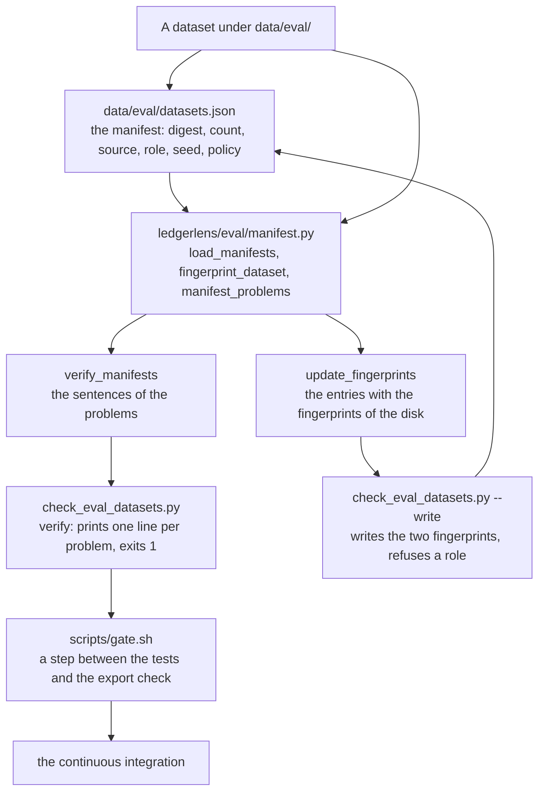

# ADR-052: The manifest of the eval datasets

Status: accepted. Date: 2026-11-22.

## Context

The repository holds five JSONL datasets under `data/eval/` and, until this record, no file that said what they
were, how many records each one had, or what may be done with them. Every number the verifier and the evaluation
publish is computed over one of these files, and every one of them is a file that can move.

| dataset_id | path | records |
| --- | --- | --- |
| `verification_set` | `data/eval/verification_set.jsonl` | 43 |
| `verification_live` | `data/eval/verification_live.jsonl` | 40 |
| `eval_cases` | `data/eval/eval_cases.jsonl` | 30 |
| `policy_questions` | `data/eval/policy_questions.jsonl` | 12 |
| `triage_cases` | `data/eval/triage_cases.jsonl` | 10 |

The counts were measured on the disk, counting a record as a nonblank line that parses as a JSON object. The
breakdown of the verification set is 30 text cases, 7 numeric cases and 6 coherence cases; the breakdown of the live
set is 19 `supported`, 12 `contradicted` and 9 `not_enough_evidence`.

### The 43 against 30 discrepancy is a symptom, not a mistake of the arithmetic

The calibration metadata of `ledgerlens/verify/thresholds.json` publishes an accuracy of 1.0 over the 30 text cases
of the verification set, 0.625 over the 40 live sentences, and a combined 0.786 over 70 NLI cases. The verification
set has 43 records. The two numbers are both right and they measure different things: the accuracy of the NLI is
measured over the 70 cases that reach the NLI, and the 13 cases the code decides never reach it. The
discrepancy is not a bug of a count. It is what happens when a report is computed over a file that nobody pinned,
and the published number is then read as a generalization to data the thresholds never saw.

`docs/verification_sets.md` already reconciled the denominators for the numbers that were written down. What was
missing is the thing that makes the reconciliation durable: a file that says which bytes each number was measured
over, and a check that refuses when a dataset moves without that file moving with it.

### The roles of the datasets are decided by evidence, and the evidence exists in the history of the repository

The role of a dataset is not a label anybody chooses. It is a claim about what the repository did with it, and the
history of the repository is what proves it.

- **`verification_set` is `tuning`.** The sweep of [ADR-007](ADR-007-nli-verification.md) chose
  `entailment_min` 0.81 and `contradiction_min` 0.91 over the 30 text cases of this set, with the rule "no false
  `supported` and no false `contradicted` on both sets, then the highest accuracy, and on a tie the middle of the
  plateau". The thresholds of the verifier were chosen against these cases.
- **`verification_live` is `tuning`.** The same sweep used it, with the same rule, and the choice of the plateau
  is a choice made over both sets together: the live column of the table of the sweep is one of the four columns
  that decided the thresholds.
- **`policy_questions` is `tuning`.** [ADR-006](ADR-006-embeddings-and-index.md) chose the embedding
  model `BAAI/bge-small-en-v1.5` with the Recall@3 over these 12 questions. The model and the index are
  hyperparameters and they were chosen against these questions. And the question PQ-09 of this file is the fifth
  example of `FEW_SHOT_EXAMPLES` in `ledgerlens/prompts/system.py`, so the prompt of the agent was written over it
  as well.
- **`triage_cases` is `tuning`.** The complaints of T01, T02, T04 and T08 are four of the five few-shot examples of
  the system prompt of the agent: `FEW_SHOT_EXAMPLES` in `ledgerlens/prompts/system.py` holds five examples, and four
  of them are the text of these cases, while the fifth is the question PQ-09 of the policy questions. The docstring of
  that module names `data/eval/triage_cases.jsonl` as one of the two sources of that text. The prompt of the agent
  was written over these cases.
- **`eval_cases` is `tuning`, and the reason is that the evidence is not clean.** These 30 cases are the ones the
  online evaluation runs the three variants of the agent over, and the report reads the decisions of the agent
  against them in two ways. First, `data/eval/report_online.json` carries an `expectation_changes` entry in which
  the expected tool trajectory of EC-19 to EC-24 was moved from `query_ledger, calculate` to `query_ledger`: the
  answer key of the set moved once, after the agent had been run over it. Second, the questions of EC-02, EC-04 and
  EC-10 are the few-shot examples of the system prompt of the agent, with their tool plans, so the prompt was tuned
  over these cases as well. The history of the repository cannot show the opposite either: `data/eval/eval_cases.jsonl`
  has only ever appeared in one commit, the squashed `182a30d`, which holds the dataset, the report that reads it and
  the code that produced it at the same time, so no commit separates the decisions from the reading of them. When the
  evidence is not clean, the conservative role wins.

That last point is the rule and not a detail of this milestone: **a dataset is `tuning` unless the repository can
prove it was never read against.** The alternative, the role that makes a number look better, is never the one that
wins.

### Nothing is held out today

Not one of the five datasets carries the role `held_out`. Every number the repository publishes was produced over a
set that the thresholds, the prompts or the hyperparameters were chosen against, or over a set whose key was moved
after the agent was run on it. There is no number in this repository that measures the behavior of the agent on
data that none of its decisions were taken against.

### The check has to be part of the gate, or it is a note

A manifest that is only read by hand is a document, and a document does not break a build. The value of pinning a
dataset is that the pin is enforced: when a dataset moves without the manifest moving, the build fails with a
sentence that names the dataset, the file and the two values that disagree. The gate of the Python side is the one
that runs everywhere, including in GitHub Actions (`.github/workflows/gate.yml`), so that is where the check
belongs.

## Decision

**The manifest file is the single source of what the datasets of the repository are, the check that reads it is a
step of the gate, and the role of a dataset is decided by evidence with the conservative role winning when the
evidence is not clean. The nine decisions below are the whole of it.**

### 1. `data/eval/datasets.json` is the manifest, and it is the single source

The file holds one object with the key `datasets` and one entry per dataset. Every entry carries every field but
one: `dataset_id`, `path` (relative to the project root, with forward slashes), `sha256` (the
sha256 of the file, 64 lowercase hexadecimal characters), `records_count` (the number of records, counted as
nonblank JSONL lines), `source`, `labeling_version`, `split_role`, `scenario_seed` (null when the records do not
come from a scenario) and `contamination_policy` are all required. The `notes` of an entry may be left out, and then
it is the empty string; the note says the honest caveat of that dataset, and an empty note is allowed only when
there is genuinely nothing to say. The loader raises `ManifestError` naming the file and the problem instead of
filling a gap with a default, and the one gap it accepts is the note.

The module that reads it is `ledgerlens/eval/manifest.py`, with the record `EvalDatasetManifest` and the functions
`fingerprint_dataset`, `load_manifests`, `verify_manifests`, `render_manifests` and `update_fingerprints`.
`update_fingerprints` returns the frozen record `FingerprintUpdate`, with the entries that carry the fingerprints of the
disk in `entries` and the sentences that say what moved in `messages`. The rule that decides what is wrong between the
manifest and the disk lives in `manifest_problems`, which answers with the records `ManifestProblem`: each one carries
the kind of the problem and the sentence that says it. `verify_manifests` is the sentence view of that same rule, so
the check and the module can never disagree about what is wrong. The module also has `safe_text`, the one helper that
renders a value that comes from a file before it enters a sentence.

**What "the single source" means, and what it does not.** The manifest is the single source of what the DATASETS are:
their digest, their count, their origin, their role and the rule that applies to them. It is not the single source of
every denominator of the repository: the calibration metadata of `ledgerlens/verify/thresholds.json` keeps its own
denominators, because they belong to the calibration and not to a dataset. The two declarations are tied to the same
files by two different checks, and the milestone that pins the calibration to the bytes it was measured over is the one
that joins them. Until that milestone, a reader who wants to know whether the two agree has to compare them.

**Why a file and not a table in a document.** A table in a document is a claim about a file; a file with a sha256 is
the file. The number of records and the digest are recomputed from the bytes on the disk, so the two can be
compared instead of believed.

**Why every field is required.** A manifest entry with a field missing is an entry that says something the reader
does not know, and the reader is the one who has to decide what may be done with the dataset. The loader raises
`ManifestError` naming the file and the problem instead of filling a gap with a default.

### 2. The roles are `tuning`, `validation` and `held_out`, and the three mean what they say

A dataset with the role `tuning` is the one the thresholds, the prompts and the hyperparameters were chosen
against. A dataset with the role `validation` may be scored but never tuned against. A dataset with the role
`held_out` may be read only by the final scoring step, and a tuning script that reads it has to fail.

**The roles of the repository today are all `tuning`.** The evidence for each one is named in the context above, and
the notes of each entry of the manifest carry the sentence that a reader of the manifest can check against the
history of the repository. `eval_cases` is `tuning` and not `validation` because the answer key of six of its cases
was moved after the agent was run over the set, because three of its questions are the few-shot examples of the
prompt of the agent, and because the file has only ever appeared in one squashed commit and cannot prove that the
decisions of the agent were never read against it.

**Why the conservative role wins.** A role that is too strict costs a future milestone the ability to score a set
it already knows. A role that is too loose lets a number that was produced over a set the model was fitted on be
published as if it were a number over data the model never saw. The first cost is a document to change; the second
is a claim that cannot be taken back.

**What it forbids:** the role of a dataset is never chosen to make a number look better, and never changed because
a number would look better under the other role.

### 3. The contamination policy is one sentence, and it is the same in every entry

Every entry carries the same policy, and the sentence says this:

> Thresholds, prompts and hyperparameters are tuned only against the datasets whose split_role is `tuning`. A dataset
> with the role `validation` may be scored but never tuned against. A dataset with the role `held_out` may be read
> only by the final scoring step, and a tuning script that reads it has to fail. No dataset of this repository
> carries the role `held_out` today, so no result of this repository may be presented as a generalization to unseen
> data.

**Why the sentence is the same in every entry.** A policy that differs per dataset is a policy nobody can quote, and
a policy that cannot be quoted is not obeyed. The role of the entry says what this dataset is; the policy says what
may be done with it, and it says it once for the whole repository.

### 4. No dataset of the repository carries the role `held_out` today, and no number may be presented as a generalization

This is the sentence of this record that other documents quote:

> No dataset of this repository carries the role `held_out` today, so no result of this repository may be presented
> as a generalization to unseen data.

Every number the repository publishes was produced over a set that a decision of the repository was taken against.
The accuracy of 1.0 over the 30 text cases of the verification set is a number over the tuning set of the sweep of
ADR-007. The 0.625 over the 40 live sentences is a number over the other half of the same sweep. The 0.786 over the
70 NLI cases is the weighted mean of those two numbers over the two tuning sets. The 30 cases of the online
evaluation are a tuning set as well, since the key of six of them moved after the agent was run over them and three
of their questions are the few-shot examples of the prompt.

**What this does not say.** It does not say the numbers are wrong. It says what they are: a measurement over the
sets the decisions were taken against, which is a measurement of the fit, and not a measurement of the behavior on
data that was never seen. A repository that wants the second number needs a held out set, and that set is the work
of the next milestone.

### 5. `scripts/check_eval_datasets.py` is the check, and it has two modes

Without arguments it **verifies**: it asks the module `verify_manifests` what the disk has against the manifest, prints
one line per problem and exits with a non zero code when there is a problem, and prints a single line when everything
matches. It writes nothing.

With `--write` it **updates** the sha256 and the record count of the entries whose file moved, prints what moved
and writes the canonical text of the manifest. It never changes the role, the source, the labeling version, the seed,
the policy or the notes of an entry: those are hand edits of the manifest file, and a script that made them would
decide, without a reader, which dataset is a tuning set and which one is not. When the committed manifest exists and a
role on the disk differs from the role of the commit, the write refuses and says so. When there is no committed
manifest to compare against, the write says, in as many words, that the roles were not compared.

The problems it reports, in this order: a declared file that does not exist, a declared file whose sha256 does not
match, a declared file whose record count does not match, a declared file that exists and cannot be read, and a JSONL
file of `data/eval/` that no entry declares. There is a sixth kind, and it is the only one of its list: a manifest
that cannot be read at all comes back as the single sentence that says so, because there is nothing to compare it
against. The rule that decides them lives in the module and only there, and the script prints the sentences the module
returns, so there is one definition of the order and not two. The message of a failure names the dataset, the file and
the two values that disagree. A data problem is a line of plain English and never a traceback.

**A value that comes from a file cannot lie in the log.** Every path, id and file name that enters a sentence goes
through `safe_text`, which renders the characters that can end a line or repaint a terminal as the two characters that
name them. A file name with a newline in it therefore prints as ONE line, and a pull request that adds a file with a
crafted name cannot forge the success line of a check that is failing. The exit code is the verdict, and the log is
the explanation of it, and the explanation cannot be rewritten by the input it explains.

**The scan of the undeclared files is not recursive.** It looks at the JSONL files that sit directly in `data/eval/`.
The recording of the replay bundle lives in `data/eval/replay/s01/` and is a different family of artifact with its own
manifest under ADR-014, so a recursive scan would make the gate fail forever over a file that is not a dataset of
this manifest.

**What the check protects and what it does not.** The check protects the two fingerprints and the presence of the
datasets: it refuses when a dataset moved, when its count moved, when it is missing, and when a dataset of the folder
is not declared. The hand written fields of an entry, the role above all, are NOT protected by the check. A role
changed by hand is a line of the diff of the manifest, and the protection of that line is the review of the diff and
this record, not the gate. The gate would stay green over a manifest whose role changed in a commit nobody read, and
the honest sentence about it is this one. The milestone that wants the gate to refuse that too has to add a rule that
can be checked by a machine, and a rule about a judgment needs a source of truth the machine can read.

### 6. The check is a step of `scripts/gate.sh`

The gate of the Python side runs the check after the tests and before the export check, in the same style as the
other steps: a comment that says why the step exists, the command and the `uv run python` prefix. The gate of the
Python side is the one that runs everywhere, including in the first job of the continuous integration.

**Why the check is not a separate script that nobody runs.** A check that is not part of a gate is a note for the
next person, and the next person is not there. A dataset that moves without the manifest moving has to break the
build, and the build is `scripts/gate.sh`.

### 7. A record is a nonblank line that parses as a JSON object, and a line that does not parse is a failure

The count of the manifest and the count of the disk are computed by the same rule, so they can be compared. A line
that does not parse is not a record and is not silently skipped: the fingerprint raises `ManifestError` naming the
file and the line.

**Why the rule is the same on both sides.** A count of "lines that are not empty" and a count of "records that
parse" differ on the first broken line, and a difference of one record is enough to make a gate red for a reason
nobody can find.

### 8. The canonical text of the manifest is what `--write` writes, so the file does not churn

The canonical text is JSON with two spaces of indentation, keys sorted, one entry per dataset sorted by
`dataset_id`, and a trailing newline. The file of the repository is the canonical text, so writing it again does not
change it, and the diff of the manifest is the diff of the datasets and not the diff of a formatter.

**Why the fingerprints are the only thing `--write` touches.** The sha256 and the record count are facts about the
bytes on the disk, and a script can read them. The source, the labeling version, the role, the seed, the policy and
the notes are judgments, and a judgment is written by a person.

### 9. The numbers of the documentation name the dataset they come from and the restriction that applies

`docs/verification_sets.md` is the canonical place of the numbers of the verifier, and every number it states names
the dataset it comes from and the restriction that applies to that dataset. The line that says the verifier is
right on the 30 text cases says, in the same sentence, that those 30 cases are the tuning set of the sweep of
ADR-007 and that an accuracy over the tuning set is not a measure of generalization. The line that says the live
set is right on 25 of 40 names `data/eval/verification_live.jsonl` and says it was part of the same sweep. The line
that says the combined accuracy is 0.786 names the denominator of the 70 NLI cases and says that the 43 records of
the verification set include 7 numeric and 6 coherence cases that the NLI never sees.

**Why the numbers do not change.** The numbers of the calibration are what they are, and they are not moved by this
milestone. What changes is that they can no longer be read as more than they are. A number that cannot be read as
more than it is is worth exactly as much as the measurement behind it, and the measurement behind these numbers is
sound.

### What this milestone covers and what it does not

This milestone is release R4 of the design package, and it covers the following items of
[`docs/v3/specs/LL-R4-03-verifier-eval-reconciliation.md`](../v3/specs/LL-R4-03-verifier-eval-reconciliation.md):

- **Item 1**, the immutable `EvalDatasetManifest` with the sha256, the record count, the source, the labeling
  version, the split role, the scenario seed and the contamination policy.
- **Item 2, the pinning part only.** The manifest is the pin: the bytes every number was measured over are now
  named and enforced. The part of the item that pins the threshold selection to the manifest hash, to the version
  of the NLI model and to the sweep log does not land here.
- **Item 6**, the check in the continuous integration that refuses when a stored count or a stored sha256 does not
  match the file, when a declared dataset is missing, or when a dataset of the folder is not declared.
- **Item 5, the naming part only.** The numbers of the DOCUMENTATION of the repository, the README and
  `docs/verification_sets.md`, name the dataset they come from and the restriction that applies. The saved reports of
  the online runs, `data/eval/report_online.md` and `data/eval/report_offline.md`, still publish their numbers over
  their sets without naming the role of those sets, and they are the work of the milestone that recomputes the
  calibration and writes the per case report: a saved report is the record of a run, and the run is not redone by a
  document. The rest of the item, which asks for the confidence and the uncertainty, for the protocol and for the
  distinction between the correctness of the agent and the accuracy of the verifier in the interface and in the
  results, does not land here.

**This milestone does NOT cover:**

- **Item 3**, the independent held out verification cases with different templates, different text and different
  source structures. No dataset of the repository carries the role `held_out` today, and this milestone does not
  create one.
- **Item 2, the rest of it**: the threshold selection pinned to the tuning manifest hash, the NLI model version and
  the sweep log, and the guard that makes a tuning script refuse to read a dataset whose role is not `tuning`.
- **Item 4**, the recomputation of the current calibration, the per case confusion matrices and the historical
  reports preserved under versioned ids.
- **The rest of item 5**: the confidence and the uncertainty, the protocol, the negative controls, the paired case
  deltas and the Eval Lab that shows which cases failed.
- **The `verification_status=unavailable` rule** of the additional requirements of the spec, where a missing NLI
  model is not a pass.

**The next milestones that own them.** The held out set and the pin of the calibration to the bytes it was measured
over are the work of the milestone that follows this one, the step 2 of R4. The recomputation of the calibration, the
confusion matrices, the versioned report ids, the protocol of the reports and the Eval Lab are the work of the
milestone after that, the step 3 of R4. The naming of this record, the manifest and the check are what make those
two possible: a held out set that is not declared is a set that a tuning script can read, and a report that does not
name its dataset is a report nobody can check.

## Alternatives considered

- **(a) A table of the datasets in `docs/verification_sets.md`, without a sha256.** The cheapest answer, and it is a
  claim about a file instead of the file. The day a dataset moves, the table is a number that describes a file that
  is not on the disk anymore, and nothing notices.
- **(b) A manifest without the check in the gate.** The manifest would still tell a careful reader what a dataset
  was. It would not stop the number from being published over the wrong bytes, and the moment nobody is looking is
  exactly the moment a dataset changes.
- **(c) The check outside the gate, as a separate script in `scripts/`.** A script that is not a step of the gate is
  run by the person who knows it exists, which is the person who wrote it.
- **(d) A manifest that computes the role from the file, for example by looking at what the file names.** The role is
  a claim about what the repository did, and what the repository did is in the history, not in the name of a file.
  `eval_cases` would look like an evaluation set and would be the set whose key was moved after the agent ran over
  it.
- **(e) Let the role of a dataset be chosen for the story it tells.** The role `validation` for `eval_cases` would
  let the correctness of the three variants be published as a validation number. It would also be false, and the
  record that says it is false would be the manifest itself.
- **(f) Leave the roles for a later milestone and ship the manifest with the roles empty.** The roles are the part
  of the manifest that decides what may be done with a dataset, and a manifest that does not say it decides nothing.
- **(g) Pin the thresholds to the manifest hash in this milestone.** It is the other half of item 2, and it needs the
  sweep to exist as a script, because a hash that points at a sweep nobody can reproduce pins nothing. That is the
  work of the milestone that follows this one.
- **(h) Create the held out set in this milestone.** A held out set is only held out if it is declared, checked and
  labelled before anything is tuned on it. Creating it in the same milestone that publishes the numbers of the
  tuning sets is the wrong order: the set and the numbers arrive together, and the reader cannot tell which one
  was there first.
- **(i) Write the numbers of the verifier in the report and the README with the denominators they already have.**
  The denominators are right. What is missing is the restriction that applies to the set, and the restriction is
  what a number means.

## Consequences

The five datasets of the repository now have a declared sha256, a declared record count, a declared source, a
declared labeling version, a declared role, a declared scenario seed and a declared policy. The check reads the
disk on every gate run and fails with a sentence that names what moved. A dataset that moves without the manifest
moving breaks the build, and the fix is a `--write` that updates the two fingerprints and a review of the diff.

The numbers of the verifier do not change: the accuracy of 1.0 over the 30 text cases of the verification set, the
0.625 over the 40 live sentences, the combined 0.786 over the 70 NLI cases and the 43 records of the verification
set are exactly what they were. What changes is that each of them now names the dataset it comes from and the
restriction that applies to it, and that the roles of the five datasets are written down where a reader of the
repository can check them against the history.

The cost that is named here is that the repository has no dataset it may present a generalization over. Every number
it publishes today is a number over a set a decision was taken against. That is the honest state of the repository,
and it was true before this milestone; the difference is that the number no longer pretends otherwise. The price of
the fix is one more file to keep in step with the datasets, and the gate is what keeps it in step.

The debt of this record is the held out set. Until it exists, the repository can report fit and not generalization,
and the milestone that creates it has to write the ADR that says how the cases are written, who labels them and
what a tuning script is allowed to read.

## What this forbids

- No dataset of `data/eval/` without an entry in `data/eval/datasets.json`, and no entry without every field.
- No tuning, and no choice of a threshold, a prompt or a hyperparameter, against a dataset whose `split_role` is not
  `tuning`.
- No role of a dataset chosen, changed or kept because a number looks better under it, and no role decided by a
  script. The gate does not enforce this one: the review of the diff does, and the check says so out loud instead of
  pretending it does not.
- No edit of the `sha256` or of the `records_count` of an entry by hand to make the check pass. The two are
  recomputed from the bytes of the file.
- No verifier accuracy, no calibration accuracy and no correctness of the agent published without naming the dataset
  it comes from and the restriction that applies to that dataset.
- No result of this repository presented as a generalization to unseen data, because no dataset of this repository
  carries the role `held_out`.
- No check of the datasets outside the gate that leaves the gate green when a dataset moved.
- No change of the numbers of the calibration by this milestone, and no change of the numbers of the calibration by
  any other means than a recalibration that says what it was measured over.
