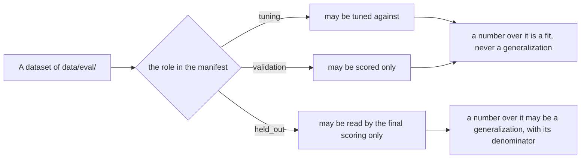

# The evaluation of this repository, and what each number is allowed to claim

This page answers one question, for a reader who did not read the code: **is any number published by this repository
a generalization, or is it a fit?** The short answer is written down in the manifest of the datasets and it is checked
by the gate, but the answer is easy to miss when it lives in a JSON file, and this repository would rather say it
twice than have a reader infer it.

The long answer is here.

## The one rule

> Every number names the dataset it was measured over, and the restriction that applies to that dataset.

A number without its dataset is a claim about nothing in particular. A number without its restriction is a claim
about more than the measurement supports. The canonical place where every number of this repository is written with
its dataset and its restriction is [the sets of the verifier](verification_sets.md). This page is the map that says
where the truth lives and why it lives there.

## Three roles, and what each one allows

The datasets of `data/eval/` do not all have the same status. The manifest gives each one a **split role**, and the
role decides what may be done with it. The decision that defines the roles is
[ADR-052](decisions/ADR-052-the-manifest-of-the-eval-datasets.md).

| Role | What it is | What may be done with it | What may NOT be done with it |
|---|---|---|---|
| `tuning` | A set a decision of this repository was taken against | It may be read, and a threshold, a prompt or a hyperparameter may be chosen against it | Its number may not be published as a generalization to unseen data |
| `validation` | A set that may be scored but never tuned against | It may be scored | It may not be used to choose anything |
| `held_out` | A set that no decision of this repository was taken against | It may be read by the final scoring step, and only by it | A tuning script that reads it has to fail, and it does |

The guard that enforces the third row is code, not a convention. `ledgerlens/eval/manifest.py` refuses a dataset
whose role is not `tuning` to a tuning script, and it refuses with a sentence that names the dataset, the role it
has and the role that is allowed. `scripts/sweep_nli_thresholds.py` refuses to run when the manifest of the disk is
not the manifest the calibration was measured over, and it refuses to read a held out dataset. The refusal has a
non zero exit code, so a script that tries cannot pass by accident.

## The manifest, and what it pins

[`data/eval/datasets.json`](../data/eval/datasets.json) is the single source of what the datasets of this repository
are. Every entry pins:

- the **sha256** of the bytes of the file, so that a number can be checked against the file it came from;
- the **record count**, so that a number with a denominator has a denominator that is written down;
- the **source**, the story of how the cases were made, in words;
- the **labeling version**, the pass of labelling the set went through;
- the **split role**, and therefore what the numbers over it may claim;
- the **scenario seed**, when the cases come from a generated world;
- the **contamination policy**, the sentence that says what is forbidden.

The check is `scripts/check_eval_datasets.py`, and it is a step of `scripts/gate.sh` and of the first job of the
continuous integration. It reads the disk, recomputes the fingerprints, and refuses with a readable reason when a
dataset moved without the manifest moving with it, when a declared dataset is missing, or when a dataset of the
folder is not declared. A dataset that moves breaks the build, and the fix is a write of the two fingerprints
followed by a review of the diff.

The notes of each entry carry the evidence for the role, and they are written against the interest of the number.
The entry of the online evaluation says that the answer key of six of its cases was changed after a run, that the
trajectory equivalence that lets one tool count as another was added so that the tool the agent chose would count,
and that three of its questions are the few shot examples of the system prompt of the agent. The entry of the live
sentences says that the sweep of ADR-007 used those very sentences to choose the thresholds, so the 0.625 over them
is a tuning number. A reader who wants to know whether a number is a generalization can read those notes and find
out without trusting the headline.

## The calibration, and the pin that holds it

The NLI thresholds live in `ledgerlens/verify/thresholds.json`. They were chosen by the rule of
[ADR-007](decisions/ADR-007-nli-verification.md) over the seventy NLI cases of the two tuning sets, so they are a
fit to those cases and not a generalization.

The calibration now names the bytes it was measured over. The pin holds the sha256 of the manifest it was measured
against, the datasets that took part in the sweep, the version of the NLI model and the log of the sweep. When the
manifest moves, the pin stops agreeing with it, and `scripts/pin_calibration.py` is the script that re-pins it. The
pin is what stops a quiet change of a dataset from turning the numbers of the past into numbers about something
else.

## The held out set, and the number over it

The held out set of the verification is the set of forty eight cases that no decision of this repository was taken
against. It was written by a generator over a synthetic ledger of a seed that the rest of the repository does not
use, in six templates that the two tuning sets do not have, and it carries the three negative controls the roadmap
asks for: a claim with no evidence at all, a claim whose evidence contradicts itself, and a benign claim that the
evidence does not support.

Its labels come from **two independent blind machine readings with an adjudication of the divergences**. The recipe of
the generator was written in a file that the two readers were forbidden to open, that file is not published now, the
id of a case does not encode its template, and the templates are not grouped in the file. The labels show that the
readings are not a copy of the key: each of the two readings disagrees with it in two of the forty eight cases. The
generator that writes the recipes is public and deterministic, so anybody can rebuild the key: the blindness of the
reading is a procedure and not a secret. The provenance of the reading, with the digests of its files and the limit
of what they prove, is in [data/eval/heldout/provenance.md](../data/eval/heldout/provenance.md). The label of the
adjudication wins over the label of the generator, and every disagreement between the two is on the record, with the
count of them. The decisions are
[ADR-053](decisions/ADR-053-the-held-out-set-and-the-blind-labelling.md),
[ADR-059](decisions/ADR-059-the-held-out-set-is-read-by-two-blind-machines-and-adjudicated.md) and
[ADR-062](decisions/ADR-062-the-role-held-out-exists-and-the-sentence-of-adr-052-is-superseded.md).

**The role is declared and the number is published.** The manifest declares the file with the role `held_out`, and
the accuracy over it is 24 of the 48 cases, 0.500, with 23 of the 47 cases that go through the NLI model and one case
that the code decides because the claim cites no evidence at all. The false `supported` is 4 and the false
`contradicted` is 0. The report is [`data/eval/report_heldout.md`](../data/eval/report_heldout.md) and the canonical
reading of every number is in [the sets of the verifier](verification_sets.md).

**The same verifier scores 25 of the 48 cases when it is scored against the recipes of the generator instead of the
adjudicated labels.** The one case of the difference is `ho-002`: the verifier answers `not_enough_evidence` for it,
the recipe expects `not_enough_evidence` and the adjudicated reading answers `supported`. That one case is the whole
distance between reproducing the generator and generalising, so the number this repository publishes is 24 of the 48
cases, 0.500, the one measured against the adjudicated labels. The recipes themselves are not published, and the
number of 25 of 48 is published here because a reader who decides whether to trust 0.500 needs to see how close the
two numbers are.

This is the first number of this repository that is not a fit. Every other accuracy was measured over the very
sentences the thresholds were chosen against. This one was measured over cases that no decision of this repository
was taken against, so it says what the verifier does with data it has never seen, which is a harder and less
flattering answer than the tuning sets gave.

### The counts of the reading

| Count | What it is |
|---|---|
| 2 of 48 | the cases where the two readings diverge from each other |
| 2 of 48 | the cases where the first reading and the recipe of the generator disagree |
| 2 of 48 | the cases where the second reading and the recipe of the generator disagree |
| 46 of 48 | the cases where the adjudicated reading and the recipe of the generator agree, 95.8 % of the set |

The divergence between the two readers is a measurement of the noise of the rule, and it is the only one of those
three divergences that was made with no answer key anywhere near it. The divergence of each reader against the recipe
measures the distance between a blind reading and the expectation of the writer of the generator.

**What these counts may not claim.** The readers are language models, so a reading may share a blind spot with the
model the set measures, and the number cannot rule that out. The agreement of the adjudicated reading with the key,
46 of the 48 cases, is a measurement of the set and not of the independence of the reader: the reading landed where
the writer of the cases landed, so it is not independent evidence of the quality of the labels. The divergence
between the two readers is a lower bound on the noise of a label, and not an upper bound. The labels are not the
labels a human would have given, and no sentence of this repository may say that they are.

## What the held out set does not measure

It measures the NLI path over six templates of claims against rendered evidence of one generated world. It does not
measure the sentences the agent writes at run time, the rate of the human review, the numeric path, the coherence
path, or any generalization to traffic outside the sample ledger. A number over it guides a decision and does not
measure a rate.

It does not measure the blind spot of the reader either: the labels came from two language models reading the same
evidence, so the number over the set says what the verifier does with the labels of two careful machine readers, and
not what it would do with the labels of a person.

## Retrieval evaluation

The twelve policy questions used to choose the embedding and query transform are a tuning set.
The independent retrieval set has sixteen questions with an adjudicated target passage. Two machine
readers initially disagreed on four. This set measures retrieval on answerable questions. Measuring
abstention requires questions for which the corpus has no supporting passage.
[Dataset roles and adjudication](../data/eval/datasets.json)

## Reading paired and repeated experiments

A paired comparison requires one observation per case and variant. Each stratum counts all observed
cases for coverage. Its mean difference requires the declared minimum number of cases with scores for
both variants.

For error analysis on the public orchestration cohort, use 0.80 as a per-case diagnostic cutoff.
The experiment's registered goal applies to the variant mean. In six of 31 pairs, both scores fell
below the diagnostic cutoff. Four had equal scores and consequently do not appear in the disagreement
gallery. Inspect those alongside the two disagreements before selecting a tool or retrieval change.
[Recorded paired differences](../data/eval/experiments/cf6ab097fe4ac420946391c66c2bb3b3b91b105d9cfe67edab29da36564ddb3f/result.json)

| Both variants below 0.80 | Studio | Single agent |
|---|---:|---:|
| EC-01 | 0.250 | 0.250 |
| EC-04 | 0.000 | 0.500 |
| EC-10 | 0.000 | 0.500 |
| EC-11 | 0.000 | 0.000 |
| EC-28 | 0.000 | 0.000 |
| EC-31 | 0.143 | 0.143 |

The archived online evaluation measures consistency across trials. Recompute the counts offline:

    uv run python scripts/report_repeatability.py --report data/eval/report_online.json

Variant C earned full correctness credit at least once on 24 of 30 cases and on every trial on 20.
For groundedness the corresponding counts were 20 and 16. Each case had three trials. These are
descriptive frequencies on the historical tuning cohort. Each metric has its own denominator of
cases with a numeric score on every trial. The archive producer records zero for missing metric scores,
including failed trials. Those recorded zeros count as misses. [Online measurements](../data/eval/report_online.json)

The distinction between occasional and consistent success follows the repeated-trial evaluation in
[τ-bench](https://arxiv.org/abs/2406.12045). Here, full credit is counted separately for each recorded metric.

## Where the truth lives

| What you want to know | Where it is |
|---|---|
| What every published number means, with its dataset and its restriction | [the sets of the verifier](verification_sets.md) |
| What the datasets are, with their sha256, their count, their role and their story | [`data/eval/datasets.json`](../data/eval/datasets.json) |
| What a role means, and what the repository decided about contamination | [ADR-052](decisions/ADR-052-the-manifest-of-the-eval-datasets.md) |
| How the held out set is written and how it is labelled, and why the reading was blind by procedure | [ADR-053](decisions/ADR-053-the-held-out-set-and-the-blind-labelling.md) and [ADR-059](decisions/ADR-059-the-held-out-set-is-read-by-two-blind-machines-and-adjudicated.md) |
| The number over the held out set, with its denominator and its confusion matrix | [`data/eval/report_heldout.md`](../data/eval/report_heldout.md) |
| What the thresholds are and what they were measured over | [`ledgerlens/verify/thresholds.json`](../ledgerlens/verify/thresholds.json) and [ADR-007](decisions/ADR-007-nli-verification.md) |
| What the verifier decides and what each label means | [ADR-007](decisions/ADR-007-nli-verification.md) |
| Whether the disk still matches the manifest | `scripts/check_eval_datasets.py`, a step of the gate |

## The tests that hold all of this

- `tests/eval/test_dataset_manifest.py` ties the manifest to the disk: every entry matches the file it names, and no
  dataset of the folder is left out.
- `tests/eval/test_dataset_documentation.py` reads the two READMEs and the canonical document, and fails when a
  public number stops naming its dataset, its role and the decision that says what the role means.
- `tests/eval/test_tuning_guard.py` proves that the guard refuses to tune against a set that was not meant for it.
- `tests/verify/test_calibration_pin.py` proves that the pin and the manifest agree.
- `tests/verify/test_verification_sets.py` ties the calibration metadata to the data files, with no model and no
  network.
- `tests/eval/test_heldout_generator.py` proves the properties of the held out set: the six templates, the eight
  instances of each, the exclusion of the ids of the tuning material, the novelty against the two tuning sets and
  the reproducibility of the bytes.
- `tests/eval/test_heldout_reader.py` proves that the case with no evidence reaches the verifier instead of being
  dropped, and that the reader counts the split between the cases that go to the model and the ones that do not.
- `tests/eval/test_label_heldout.py` proves the instrument of the reading: that the mode `compare` never opens the
  recipes, that the build writes the origin of the reading in every line, and that an incomplete reading is refused.
- `tests/verify/test_measure_heldout.py` proves the shape of the report of the measurement, with the denominators and
  the confusion matrix, with the scripted model and no network.

A number of this repository that is not held by a test is a number that is not published.
