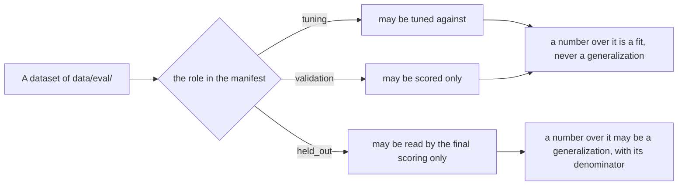

# The evaluation of this repository, and what each number is allowed to claim

This page answers one question, for a reader who did not read the code: **is any number published by this repository
a generalization, or is it a fit?** The short answer is written down in the manifest of the datasets and it is checked
by the gate, but the answer is easy to miss when it lives in a JSON file, and this repository would rather say it
twice than have a reader infer it.

The long answer is here.

## The one rule

> Every number names the dataset it was measured over, and the restriction that applies to that dataset.

A number without its dataset is a claim about nothing in particular. A number without its restriction is a claim
about more than the measurement supports. The canonical place where every number of this repository is written with
its dataset and its restriction is [the sets of the verifier](verification_sets.md). This page is the map that says
where the truth lives and why it lives there.

## Three roles, and what each one allows

The datasets of `data/eval/` do not all have the same status. The manifest gives each one a **split role**, and the
role decides what may be done with it. The decision that defines the roles is
[ADR-052](decisions/ADR-052-the-manifest-of-the-eval-datasets.md).

| Role | What it is | What may be done with it | What may NOT be done with it |
|---|---|---|---|
| `tuning` | A set a decision of this repository was taken against | It may be read, and a threshold, a prompt or a hyperparameter may be chosen against it | Its number may not be published as a generalization to unseen data |
| `validation` | A set that may be scored but never tuned against | It may be scored | It may not be used to choose anything |
| `held_out` | A set that no decision of this repository was taken against | It may be read by the final scoring step, and only by it | A tuning script that reads it has to fail, and it does |

The guard that enforces the third row is code, not a convention. `ledgerlens/eval/manifest.py` refuses a dataset
whose role is not `tuning` to a tuning script, and it refuses with a sentence that names the dataset, the role it
has and the role that is allowed. `scripts/sweep_nli_thresholds.py` refuses to run when the manifest of the disk is
not the manifest the calibration was measured over, and it refuses to read a held out dataset. The refusal has a
non zero exit code, so a script that tries cannot pass by accident.



## The manifest, and what it pins

[`data/eval/datasets.json`](../data/eval/datasets.json) is the single source of what the datasets of this repository
are. Every entry pins:

- the **sha256** of the bytes of the file, so that a number can be checked against the file it came from;
- the **record count**, so that a number with a denominator has a denominator that is written down;
- the **source**, the story of how the cases were made, in words;
- the **labeling version**, the pass of labelling the set went through;
- the **split role**, and therefore what the numbers over it may claim;
- the **scenario seed**, when the cases come from a generated world;
- the **contamination policy**, the sentence that says what is forbidden.

The check is `scripts/check_eval_datasets.py`, and it is a step of `scripts/gate.sh` and of the first job of the
continuous integration. It reads the disk, recomputes the fingerprints, and refuses with a readable reason when a
dataset moved without the manifest moving with it, when a declared dataset is missing, or when a dataset of the
folder is not declared. A dataset that moves breaks the build, and the fix is a write of the two fingerprints
followed by a review of the diff.

The notes of each entry carry the evidence for the role, and they are written against the interest of the number.
The entry of the online evaluation says that the answer key of six of its cases was changed after a run, that the
trajectory equivalence that lets one tool count as another was added so that the tool the agent chose would count,
and that three of its questions are the few shot examples of the system prompt of the agent. The entry of the live
sentences says that the sweep of ADR-007 used those very sentences to choose the thresholds, so the 0.625 over them
is a tuning number. A reader who wants to know whether a number is a generalization can read those notes and find
out without trusting the headline.

## The calibration, and the pin that holds it

The NLI thresholds live in `ledgerlens/verify/thresholds.json`. They were chosen by the rule of
[ADR-007](decisions/ADR-007-nli-verification.md) over the seventy NLI cases of the two tuning sets, so they are a
fit to those cases and not a generalization.

The calibration now names the bytes it was measured over. The pin holds the sha256 of the manifest it was measured
against, the datasets that took part in the sweep, the version of the NLI model and the log of the sweep. When the
manifest moves, the pin stops agreeing with it, and `scripts/pin_calibration.py` is the script that re-pins it. The
pin is what stops a quiet change of a dataset from turning the numbers of the past into numbers about something
else.

## The held out set, and the number over it

The held out set of the verification is the set of forty eight cases that no decision of this repository was taken
against. It was written by a generator over a synthetic ledger of a seed that the rest of the repository does not
use, in six templates that the two tuning sets do not have, and it carries the three negative controls the roadmap
asks for: a claim with no evidence at all, a claim whose evidence contradicts itself, and a benign claim that the
evidence does not support.

Its labels come from **two independent blind machine readings with an adjudication of the divergences**. The recipe of
the generator was written in a file that the two readers were forbidden to open, that file is not published now, the
id of a case does not encode its template, and the templates are not grouped in the file. The labels show that the
readings are not a copy of the key: each of the two readings disagrees with it in two of the forty eight cases. The
generator that writes the recipes is public and deterministic, so anybody can rebuild the key: the blindness of the
reading is a procedure and not a secret. The provenance of the reading, with the digests of its files and the limit
of what they prove, is in [data/eval/heldout/provenance.md](../data/eval/heldout/provenance.md). The label of the
adjudication wins over the label of the generator, and every disagreement between the two is on the record, with the
count of them. The decisions are
[ADR-053](decisions/ADR-053-the-held-out-set-and-the-blind-labelling.md),
[ADR-059](decisions/ADR-059-the-held-out-set-is-read-by-two-blind-machines-and-adjudicated.md) and
[ADR-062](decisions/ADR-062-the-role-held-out-exists-and-the-sentence-of-adr-052-is-superseded.md).

**The role is declared and the number is published.** The manifest declares the file with the role `held_out`, and
the accuracy over it is 24 of the 48 cases, 0.500, with 23 of the 47 cases that go through the NLI model and one case
that the code decides because the claim cites no evidence at all. The false `supported` is 4 and the false
`contradicted` is 0. The report is [`data/eval/report_heldout.md`](../data/eval/report_heldout.md) and the canonical
reading of every number is in [the sets of the verifier](verification_sets.md).

**The same verifier scores 25 of the 48 cases when it is scored against the recipes of the generator instead of the
adjudicated labels.** The one case of the difference is `ho-002`: the verifier answers `not_enough_evidence` for it,
the recipe expects `not_enough_evidence` and the adjudicated reading answers `supported`. That one case is the whole
distance between reproducing the generator and generalising, so the number this repository publishes is 24 of the 48
cases, 0.500, the one measured against the adjudicated labels. The recipes themselves are not published, and the
number of 25 of 48 is published here because a reader who decides whether to trust 0.500 needs to see how close the
two numbers are.

This is the first number of this repository that is not a fit. Every other accuracy was measured over the very
sentences the thresholds were chosen against. This one was measured over cases that no decision of this repository
was taken against, so it says what the verifier does with data it has never seen, which is a harder and less
flattering answer than the tuning sets gave.

### The counts of the reading

| Count | What it is |
|---|---|
| 2 of 48 | the cases where the two readings diverge from each other |
| 2 of 48 | the cases where the first reading and the recipe of the generator disagree |
| 2 of 48 | the cases where the second reading and the recipe of the generator disagree |
| 46 of 48 | the cases where the adjudicated reading and the recipe of the generator agree, 95.8 % of the set |

The divergence between the two readers is a measurement of the noise of the rule, and it is the only one of those
three divergences that was made with no answer key anywhere near it. The divergence of each reader against the recipe
measures the distance between a blind reading and the expectation of the writer of the generator.

**What these counts may not claim.** The readers are language models, so a reading may share a blind spot with the
model the set measures, and the number cannot rule that out. The agreement of the adjudicated reading with the key,
46 of the 48 cases, is a measurement of the set and not of the independence of the reader: the reading landed where
the writer of the cases landed, so it is not independent evidence of the quality of the labels. The divergence
between the two readers is a lower bound on the noise of a label, and not an upper bound. The labels are not the
labels a human would have given, and no sentence of this repository may say that they are.

## What the held out set does not measure

It measures the NLI path over six templates of claims against rendered evidence of one generated world. It does not
measure the sentences the agent writes at run time, the rate of the human review, the numeric path, the coherence
path, or any generalization to traffic outside the sample ledger. A number over it guides a decision and does not
measure a rate.

It does not measure the blind spot of the reader either: the labels came from two language models reading the same
evidence, so the number over the set says what the verifier does with the labels of two careful machine readers, and
not what it would do with the labels of a person.

## Retrieval evaluation

The twelve policy questions used to choose the embedding and query transform are a tuning set.
The independent retrieval set has sixteen questions with an adjudicated target passage. Two machine
readers initially disagreed on four. This set measures retrieval on answerable questions. Measuring
abstention requires questions for which the corpus has no supporting passage.
[Dataset roles and adjudication](../data/eval/datasets.json)

## Reading paired and repeated experiments

A paired comparison requires one observation per case and variant. Each stratum counts all observed
cases for coverage. Its mean difference requires the declared minimum number of cases with scores for
both variants.

For error analysis on the public orchestration cohort, use 0.80 as a per-case diagnostic cutoff.
The experiment's registered goal applies to the variant mean. In six of 31 pairs, both scores fell
below the diagnostic cutoff. Four had equal scores and consequently do not appear in the disagreement
gallery. Inspect those alongside the two disagreements before selecting a tool or retrieval change.
[Recorded paired differences](../data/eval/experiments/cf6ab097fe4ac420946391c66c2bb3b3b91b105d9cfe67edab29da36564ddb3f/result.json)

| Both variants below 0.80 | Studio | Single agent |
|---|---:|---:|
| EC-01 | 0.250 | 0.250 |
| EC-04 | 0.000 | 0.500 |
| EC-10 | 0.000 | 0.500 |
| EC-11 | 0.000 | 0.000 |
| EC-28 | 0.000 | 0.000 |
| EC-31 | 0.143 | 0.143 |

The archived online evaluation measures consistency across trials. Recompute the counts offline:

    uv run python scripts/report_repeatability.py --report data/eval/report_online.json

Variant C earned full correctness credit at least once on 24 of 30 cases and on every trial on 20.
For groundedness the corresponding counts were 20 and 16. Each case had three trials. These are
descriptive frequencies on the historical tuning cohort. Each metric has its own denominator of
cases with a numeric score on every trial. The archive producer records zero for missing metric scores,
including failed trials. Those recorded zeros count as misses. [Online measurements](../data/eval/report_online.json)

The distinction between occasional and consistent success follows the repeated-trial evaluation in
[τ-bench](https://arxiv.org/abs/2406.12045). Here, full credit is counted separately for each recorded metric.

## Transaction lookup controls

Run `uv run python -m scripts.report_lookup_arguments` to compare the existing trajectory scores
with the transaction kind and identifier in each structured lookup. The expected transaction and
the swapped transaction each score 1 for the strict trajectory. Argument credit falls from 1 to 0
when the identifier changes.

Of six synthetic traces, four are eligible for argument scoring. One is correct, one uses the wrong
identifier, one omits the lookup and one mixes correct and incorrect lookups. The remaining controls
cover an absent trace and an equivalent free-text query whose arguments cannot prove which record it
read. Across the five structured calls, two match the expected transaction. No tool is executed.

## Passage IDs in the replay catalogs

Run `uv run python -m scripts.report_evidence_stages` to inspect the policy tool results, tool
messages in the final model input, and citations in the published answer. A complete record allows
the report to establish that an ID is absent. A partial record can establish that an ID is present.

| Catalog | Runs | Complete candidate records | Complete model inputs for passage IDs | Complete answers for citations |
|---|---:|---:|---:|---:|
| Scripted | 10 | 5 | 8 | 10 |
| Real model | 10 | 0 | 7 | 10 |

In scripted runs S02, S03 and S08, all eight candidate IDs were visible to the final model. Each
answer cited one. An uncited passage may be irrelevant. Deciding whether the omission was an error
requires an independently labeled target for the case. For the ten real-model replays, candidate
coverage is unknown, so these recordings cannot establish a retrieval failure. The distinction
between retrieval, context assembly and generation follows
[Seven Failure Points When Engineering a Retrieval Augmented Generation System](https://arxiv.org/abs/2401.05856).

## Synthetic evidence controls

The claim-support experiment gives the textual entailment model a fixed passage and a proposed claim. It
uses the chargeback response deadline as an answerable control and applies it to a refund as a
neighboring-policy error. A pet insurance claim tests an unrelated topic. The final two controls use
the same refund record to check a supported amount and an unsupported promise of delivery within two days.

With the pinned entailment model and its calibrated thresholds, both supported claims received support
and none of the three unsupported claims did. The two-day promise received the verdict
`not_enough_evidence`. These five development controls score individual claims against supplied evidence.
They bypass claim extraction and the separate numeric and coherence checks.
Measuring whether the agent retrieves the passage and abstains in its final answer requires a separate run.

Run from the repository root with the verification dependencies and cached model weights:

    HF_HUB_OFFLINE=1 LEDGERLENS_OFFLINE=0 uv run python -m scripts.report_policy_support

With `LEDGERLENS_OFFLINE=1` the report counts five cases without a verdict and zero eligible cases
for both metrics. The distinction between support for individual claims and support for an entire
answer follows [RAGAS](https://arxiv.org/abs/2309.15217).

## Final answers with OpenAI

Run `uv run python -m scripts.report_policy_journeys` to exercise the investigator on three
synthetic policy questions. The command uses the configured OpenAI key for GPT-4.1 and the
policy embeddings. OpenAI receives the public policy passages and the synthetic investigation
messages. Each case gets its own empty ledger and memory. The offline verification stub supplies
no independent semantic verdict. The JSON includes each final answer, the observed candidate IDs
and the text of cited passages when available. Join each verdict to its claim using `claim_id`
and the claim's `id`. The report includes the verifier method, evidence IDs and recorded review reasons.
Each case includes `review_conditions` from the verifier and escalation decision. A share-based trigger
records the numerator, denominator and configured threshold. `review_reasons` contains the messages shown to the operator.

Use `--all` for all controls or `--case ID` for one. `--repeat N` runs each selected case N times
with a fresh ledger and memory. Use `--checkpoint PATH` to create a new JSONL file with a flushed
record per completed case. An existing file is refused. `--strict` signals operational failures
after writing the report. A content mistake still requires a judgment.

The runner validates and reuses the delivered OpenAI index. Reports identify the source revision,
source digests, index metadata and model. HTTP usage covers chat input, cached input, output and
query embeddings. The estimate applies the standard per-million-token rates for
[GPT-4.1](https://developers.openai.com/api/docs/models/gpt-4.1) and
[text-embedding-3-small](https://developers.openai.com/api/docs/models/text-embedding-3-small).
It measures the marginal online cost with an existing index. The original index build, review
labor and any account-specific discount are outside that estimate.

The [recorded 17-case run](../data/eval/reports/policy-journeys-openai.json) includes the original
questions, paraphrases, neighboring topics and a status lookup without an identifier.
For June 1, 2026 in USD, the agent called the calculator and returned May 29.
When the settlement currency was missing it asked for the currency. The actual-status control
requested the dispute ID. The deadline paraphrase called for same-day review and distinguished
automatic loss after the response deadline.

An independent model-assisted review scored one response per synthetic development case. The reviewer compared the answers with retrieved passages, calculator receipts and the recorded actions. These controls informed development, so the figures describe this run and cannot estimate production accuracy. [Scoring rules and per-case judgments](../data/eval/policy_journey_review.json)

| Measure | Result |
|---|---|
| Required policy evidence retrieved | 15 of 15 applicable cases. The insurance and missing-ID cases had no target passage. |
| Citations supported material claims | 13 of 16 applicable cases. The missing-ID clarification needed no citation. |
| Substantive answer correct | 16 of 17 cases. The missed-cutoff answer added unsupported claims about refusing late evidence and possible exceptions. |
| Operational action appropriate | 10 of 17 passed. Six escalations were unnecessary. The handbook did not establish how to route the insurance inquiry. |
| Original question resolved | 7 of 17 received a definitive, supported answer and an appropriate action. Clarification and abstention can be correct responses while the original question remains open. |

The three dated cutoff answers agreed with the calculator, but all three escalated after the offline verifier flagged the computed dates. The 17 investigations cost an estimated $0.16595268 in provider usage. Dividing that total by the seven resolved questions gives $0.02370753 per resolution. [Recorded answers, tool calls and token usage](../data/eval/reports/policy-journeys-openai.json)

In a separate paired search, the original and revised rewrites put the refund threshold and
delayed-payout passages first and the chargeback-fee passage second. Each prompt ran once per
topic with eight candidates. These ranks describe the three selected queries. [Queries, candidates and ranks](../data/eval/reports/policy-rewrite-comparison.json)

The recorded Monday answers illustrate why the evidence warning and review action can differ.
The offline stub gave the conditional Friday sentence 0.20 entailment in both answers. One
answer had one unsupported claim out of three, below the 0.34 review threshold. The other
had one out of two, above the threshold. The claim added the currency qualification from
the question to the earlier handbook passage. This replay characterizes the deterministic stub.

The optional `july-cutoff-usd` and `july-cutoff-eur` questions share a July 7, 2025 deadline.
The calendar gives July 3 for USD and July 4 for EUR. The handbook contains this worked example,
so these cases check retrieval and reporting. They do not measure calendar reasoning on unseen dates.

| Question | First OpenAI run |
|---|---|
| When does Acme require merchant evidence for a chargeback? | The answer described when a dispute opens and omitted the one-business-day cutoff. None of the four retrieved passages was the response-deadline passage. |
| Must a refund request be submitted before the chargeback response deadline? | The answer distinguished the two rules and cited the passage explaining how an open dispute affects a refund. |
| How much pet insurance coverage does Acme provide? | The answer declined to give an amount. Its broader claim about the entire handbook exceeded what the four retrieved passages established. |

The first question can also mean “what triggers the evidence request?” The opt-in case
`--case explicit-chargeback-deadline` asks how far before the response deadline evidence is due.
Its first run cited the one-business-day cutoff correctly but attributed automatic loss to missing
that cutoff. The [chargeback policy](../data/policies/chargeback-handling.md) ties automatic loss to the final deadline.

With instructions to match each consequence to its stated condition, a second run gave the cutoff
and correctly cited [same-day human review](../data/policies/escalation-and-review.md) after it passes.
A further run again attributed automatic loss to the internal cutoff despite citing the correct passage.
The instruction alone did not consistently preserve the distinction. After restricting an interval question
to the requested timing, three runs gave the correct interval and citation. Two still volunteered a consequence,
but both tied automatic loss to the response deadline.
One repeat of the pet insurance question limited its conclusion to the retrieved passages.
Each observation describes one response to that wording. A repeat of the ambiguous baseline question again described what triggers the request and omitted the interval.

Three more runs with instructions to address both readings still omitted the interval.
The search traces showed that the original query and its rewrite both asked about the trigger.
After the rewrite prompt directed the second query toward the deadline, all three repeats of the
same question described the trigger, gave the one-business-day interval, and cited the deadline passage.
One answer used “this deadline” for automatic loss after mentioning both dates. A correct citation
and interval therefore do not establish that every claim in the answer is clear.

Three optional deadline cases exercise different decisions with an empty ledger:

| CLI case | Observed policy answer |
|---|---|
| `cutoff-passed` | With the response deadline tomorrow, the final run recommended same-day human review and distinguished automatic loss after the response deadline. |
| `monday-deadline` | Both runs identified Friday as the cutoff when Friday is a business day for the settlement currency. |
| `response-late` | The agent cited automatic loss for a merchant response sent after the response deadline. |

The first runs of the cutoff-passed and late-response cases asked for a dispute ID without searching.
Triage now requests a policy search when the supplied facts support conditional guidance.
Verifying a particular dispute's status still needs a record. The scored cutoff-passed answer incorrectly inferred that new evidence could no longer be submitted.

A completed answer remains available for judgment when any search succeeded, even if a later
search failed. The report keeps each search error and the passages cited by the final answer.

## Where the truth lives

| What you want to know | Where it is |
|---|---|
| What every published number means, with its dataset and its restriction | [the sets of the verifier](verification_sets.md) |
| What the datasets are, with their sha256, their count, their role and their story | [`data/eval/datasets.json`](../data/eval/datasets.json) |
| What a role means, and what the repository decided about contamination | [ADR-052](decisions/ADR-052-the-manifest-of-the-eval-datasets.md) |
| How the held out set is written and how it is labelled, and why the reading was blind by procedure | [ADR-053](decisions/ADR-053-the-held-out-set-and-the-blind-labelling.md) and [ADR-059](decisions/ADR-059-the-held-out-set-is-read-by-two-blind-machines-and-adjudicated.md) |
| The number over the held out set, with its denominator and its confusion matrix | [`data/eval/report_heldout.md`](../data/eval/report_heldout.md) |
| What the thresholds are and what they were measured over | [`ledgerlens/verify/thresholds.json`](../ledgerlens/verify/thresholds.json) and [ADR-007](decisions/ADR-007-nli-verification.md) |
| What the verifier decides and what each label means | [ADR-007](decisions/ADR-007-nli-verification.md) |
| Whether the disk still matches the manifest | `scripts/check_eval_datasets.py`, a step of the gate |

## The tests that hold all of this

- `tests/eval/test_dataset_manifest.py` ties the manifest to the disk: every entry matches the file it names, and no
  dataset of the folder is left out.
- `tests/eval/test_dataset_documentation.py` reads the two READMEs and the canonical document, and fails when a
  public number stops naming its dataset, its role and the decision that says what the role means.
- `tests/eval/test_tuning_guard.py` proves that the guard refuses to tune against a set that was not meant for it.
- `tests/verify/test_calibration_pin.py` proves that the pin and the manifest agree.
- `tests/verify/test_verification_sets.py` ties the calibration metadata to the data files, with no model and no
  network.
- `tests/eval/test_heldout_generator.py` proves the properties of the held out set: the six templates, the eight
  instances of each, the exclusion of the ids of the tuning material, the novelty against the two tuning sets and
  the reproducibility of the bytes.
- `tests/eval/test_heldout_reader.py` proves that the case with no evidence reaches the verifier instead of being
  dropped, and that the reader counts the split between the cases that go to the model and the ones that do not.
- `tests/eval/test_label_heldout.py` proves the instrument of the reading: that the mode `compare` never opens the
  recipes, that the build writes the origin of the reading in every line, and that an incomplete reading is refused.
- `tests/verify/test_measure_heldout.py` proves the shape of the report of the measurement, with the denominators and
  the confusion matrix, with the scripted model and no network.

A number of this repository that is not held by a test is a number that is not published.

## Visitor experiment rehearsal

Use the A/A audit before assigning different treatments. Both arms must serve the same experience during A/A. Export one record per eligible, consenting visitor from the assignment ledger, including visitors with no exposure or adjudication. Use an opaque visitor token and the first eligible live investigation only. Scripted demos, recordings and internal probes are outside this denominator. The audit processes an offline JSON array and emits only aggregate counts.

```json
[
  {"visitor":"synthetic-one","arm":"A","exposed":true,"resolved":true},
  {"visitor":"synthetic-two","arm":"B","exposed":false,"resolved":null}
]
```

    uv run python scripts/report_aa_readiness.py assignments.json --baseline 0.50 --improvement 0.05

The example flags the missing exposure and outcome in B. Audit the assignment export against the enrollment source: an entirely omitted visitor cannot be detected from this file. Duplicate assignments, extra fields and recorded outcomes without exposure are rejected. Missing outcomes stay in the primary denominator. Inspect the arm counts, exposure gaps and resolution rates before interpreting the statistical checks.

The allocation check assumes 1:1 randomization. The outcome check compares two completed A/A arms. Both flag a two-sided p-value below 0.01 for investigation. With at most 100 assignments the allocation check uses the binomial distribution and the outcome check uses Fisher's exact test. Larger samples use normal approximations. The outcome test withholds its approximation for sparse expected counts. A clean rehearsal alone cannot establish equivalence or qualify a live launch.

The planning calculation assumes independent visitors, complete binary adjudication, equal allocation, two-sided significance of 0.05, 80% power and one fixed analysis horizon. Moving from 50% to 55% requires approximately 1,565 eligible visitors per arm under these assumptions. Those rates are illustrative. Estimate the baseline, consent rate, eligible traffic and adjudication coverage before scheduling a live experiment. Freeze the stopping rule and safety limits before observing comparative outcomes. [Trustworthy Online Controlled Experiments](https://experimentguide.com/)

## Blinded comparisons across scenario families

Freeze the case definitions, adjudication criteria, variant configurations and split seed before collecting results. Assign paraphrases of one transaction or policy example to the same family. The manifest below illustrates two development or holdout families. A real comparison needs enough independently authored families to support its intended decision.

```json
{"variants":["current","candidate"],"cases":{"r1":"refund","r2":"refund","s1":"settlement"},"holdout_families":1,"repeats":3,"split_seed":"registered-v1"}
```

    uv run python scripts/report_holdout_comparison.py plan --manifest manifest.json --blind-seed "$BLIND_SEED" > private-plan.json
    uv run python scripts/report_holdout_comparison.py report --manifest manifest.json --blind-seed "$BLIND_SEED" --results results.json

Keep the private plan and its random seed with the coordinator. Give reviewers the question, blinded transcript, expected evidence and opaque trial ID. Remove model names, arm labels and other identifying metadata. Two reviewers label independently, then adjudicate disagreements before the coordinator unmasks results.

The result file is an array of adjudicated trials. Each row contains the opaque `id`, an `outcome` of `resolved`, `clarified`, `failed`, `error` or `timeout`, and optional decimal-string `cost_usd`. Use `success` to score an appropriate clarification against the frozen criteria. Declare the treatment of clarifications before reviewing answers. All scheduled trials count in the denominator. Missing trials count as unsuccessful, while missing costs remain unknown.

The report separates per-trial success from success on every repetition of a case. Its paired difference gives equal weight to each family. The 95% percentile interval resamples whole families, preserving their trials and paraphrases. An interval requires observed trial pairs in at least two families. With a handful of families treat the interval as descriptive. A repeated deterministic replay measures regression coverage only. [τ-bench](https://arxiv.org/abs/2406.12045)

## Receipt-backed cutoff verification

    uv run python -m scripts.report_cutoff_receipts
    uv run python -m scripts.report_cutoff_controls

The first command reconstructs three archived dated answers and compares the default verifier with an opt-in candidate. The candidate recomputes the cutoff from the cited tool call and checks its operation, deadline, currency, output, policy passage and wording. An independent review flag still applies. This comparison measures the verifier decision on the recorded answer. The original end-to-end policy score remains 7/17.

The second command runs [fixed controls](../data/eval/cutoff_receipt_controls.json) across four deadline families and two currencies. In the eight valid cases, the baseline requested review eight times and the candidate zero times. Both kept all 40 mandatory reviews. These include a changed date, a valid receipt for the wrong currency, an absent receipt, a false promise and an independent review flag.

All eight additional paraphrases still required review. The candidate recognizes two question forms and three answer forms. These tests support reuse of a receipt in those forms; they provide no estimate of coverage for open-ended visitor questions. The live investigator continues to use the default verifier. Promotion requires an independently authored and adjudicated holdout with both supported and unsupported answers. Report coverage alongside unsafe releases and unnecessary reviews.

## OpenAI verifier comparison

The pinned GPT-4.1 mini classifier accepts a claim and its evidence. The three possible decisions are supported, contradicted and insufficient evidence. Run `uv run python -m scripts.measure_openai_verifier` with an OpenAI key to score the frozen set. The classifier and the historical verifier share the deterministic checks. One of the 48 claims was decided by code in both runs.

| Frozen 48-case benchmark | Historical verifier | OpenAI classifier |
|---|---:|---:|
| Correct verdicts | 24 | 43 |
| Incorrectly supported | 4 | 2 |
| Incorrectly contradicted | 0 | 1 |
| Precision among supported verdicts | 10/14 | 18/20 |

The [per-case predictions](../data/eval/report_openai_verifier.json) include the prompt, model snapshot and dataset digest. The labels were adjudicated from two blind model readings. Further model selection needs fresh cases for an independent estimate.

For end-to-end investigation, `uv run python -m scripts.report_policy_journeys --case unseen-usd --openai-verifier` sends the synthetic question to GPT-4.1 and each evidence pair to the pinned classifier. The public scripted demo runs offline. In live OpenAI mode, the visitor's selected model also checks claims against cited text. Verification uses the same key and run limits as the investigation. The 43/48 benchmark applies to the pinned classifier above. The optional `--use-cutoff-receipts` flag tests a separate calendar rule.

A fresh investigation for each of the original 17 development questions resolved 10. The historical run resolved seven. The [recorded answers](../data/eval/reports/policy-openai-verifier-answers.json) and [independent assessment](../data/eval/reports/policy-openai-verifier-review.json) include the evidence and structured actions. One response recommended escalation in prose while recording no action. Another supplied a USD date without a settlement currency. The missing-ID clarification and the out-of-scope insurance answer also remain in the denominator. Each question ran once. Differences between investigator revisions and variation between runs prevent attributing the entire gain to the verifier.

The evaluation combines exact calendar and action checks with judgment of open-ended answers. See chapters 3 and 4 of [AI Engineering by Chip Huyen](https://www.oreilly.com/library/view/ai-engineering/9781098166298/).

For a standalone first-turn policy question about a dated evidence cutoff, the investigator can request the missing settlement currency before returning a date. The payment currency can differ from the settlement currency. The clarification still passes through the normal verifier and escalation checks. Account investigations and follow-up questions retain their existing context.

### Policy resolution on repeated runs

With the same models and original questions, the baseline resolved 9/17 on a fresh run. The candidate resolved 12/17 on its first run and 14/17 on a repeat. Three questions lack a definitive first-turn answer in the supplied data: the dispute ID is missing, the settlement currency is missing, or the handbook does not cover the product. All three remain in each denominator. The first run also escalated a supported USD date and cited an insufficient passage for a late-response consequence. The repeat resolved all 14 answerable questions.

The investigator can make one follow-up request within its turn budget if a policy answer omits the triggering event or submission interval, or cites only one side of a refund and dispute timing question. A user report of a missed internal evidence cutoff, together with a retrieved escalation rule, can trigger the structured human-review action. A hypothetical question alone does not trigger it.

A reviewer scored shuffled answers against their citations, calendar receipts and structured actions without seeing which version produced them. Four additional phrasings yielded three complete answers. The remaining answer cited the responsibility for submitting evidence as support for the event that triggers submission. These are synthetic development measurements. [Answers, judgments, run costs and source digests](../data/eval/reports/policy-resolution-comparison.json)
