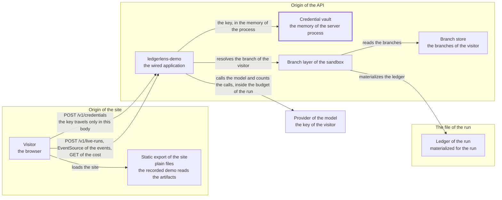

# The frontend of LedgerLens

The site of the demo has two halves, and they live on two origins.

The **recorded demo** is a static export: a folder of plain files, published on the origin of the site, that any content
delivery network can serve. It reads the published artifacts of the replay and makes no request to anybody. The artifacts
of the repository live in `site/replay/`, and the build of the site copies them into `apps/web/public/replay/`, which is
where the static export picks them up. The copy is not tracked by git, so there is one truth and no second copy that can
go stale: the decision is
[ADR-042](decisions/ADR-042-the-site-of-the-demo-serves-the-published-artifacts.md).

The **live mode** is the backend. The browser calls the wired application of the demo (`ledgerlens-demo`) on the origin
of the API, with the cookie of the session, and the backend answers with the catalogue, the credential, the run, the
stream of the events and the cost. The two origins are different, so the backend answers the browser with the CORS
headers.

The decision that fixed this shape is
[ADR-040](decisions/ADR-040-the-live-mode-on-the-origin-of-the-backend.md), and the architecture of the live mode is
drawn below.

## The two modes

| mode | label | what it calls | what it costs |
| --- | --- | --- | --- |
| the recorded demo | `deterministic_sandbox` | nothing, the artifacts are on the origin of the site | nothing |
| the live mode | `live_agent` | the backend, and the provider of the visitor | the money of the visitor, inside the caps of the run |

The two are separate sections of the page, and each one carries its own label. A recorded run is never labelled live,
and a live run is never labelled recorded. The recorded demo keeps working when the backend is down, when the product
runs offline and when no key exists.

## How to run the site

The site needs Node 20 or newer (`apps/web/package.json`). The local run of the live mode needs the backend too, so
there are two commands, in two terminals.

The backend, with the origin of the site declared so that the browser may call it:

```bash
LEDGERLENS_CORS_ORIGINS=http://localhost:3000 uv run ledgerlens-demo --port 8010
```

The site:

```bash
cd apps/web && npm run dev
```

The site is then on `http://localhost:3000` and the backend is on `http://localhost:8010`.

To serve the export exactly as it is published, build it and serve the folder:

```bash
cd apps/web && npm run build && npm run preview
```

The export lands in `apps/web/out/`.

## The URL contract

The origin of the backend is a public build variable, because the site is a static export and there is no server that
could read a variable at runtime.

- The name is `NEXT_PUBLIC_LEDGERLENS_API_BASE_URL`. The `NEXT_PUBLIC_` prefix is the convention of Next.js for a value
  that is inlined in the bundle of the browser, and it says out loud that the value is public.
- The default is `http://localhost:8010`, the port of `ledgerlens-demo`.
- The value is an origin without a trailing slash and without a path. The paths are joined as `${base}/v1/sessions`,
  `${base}/v1/models`, `${base}/v1/credentials`, `${base}/v1/live-runs`, `${base}/v1/live-runs/{runId}/events`,
  `${base}/v1/live-runs/{runId}/cost` and `${base}/v1/credentials/forget`.
- The default is `localhost` and not `127.0.0.1` on purpose: the site of `localhost` is `localhost`, so the cookie of
  the session travels between `http://localhost:3000` and `http://localhost:8010`. `127.0.0.1` is another host, and the
  browser would not send the cookie of one to the other.
- The variable never holds a secret. No `NEXT_PUBLIC_` variable of the repository may hold a provider key, and the
  bundle of the browser carries no secret of any kind.

When the origin does not answer, the live section of the page says so, in words, with the origin it tried, and the
recorded demo keeps working. The page never guesses and never falls back to another origin.

## The rule of the same site

The session cookie is `ledgerlens_session`, it is `HttpOnly`, it is `SameSite=Lax` and it is `Path=/`. The cookie of a
`SameSite=Lax` cookie only travels inside its own site.

**The origin of the API must be published on the same site as the site of the interface**: the same registrable domain
and the same scheme. A site is what the cookie sees, not what the address bar shows, so `https://demo.example.com` and
`https://api.example.com` are one site, and `https://demo.example.com` and `https://api.other.com` are two.

The cookie is **not** changed to `SameSite=None`. That change would make the demo work across sites, and it would let
any site of the internet drive the API with the session of the visitor. A deployment that cannot serve the two origins
on the same site has to solve the cookie of the session first, and that answer is another ADR.

## The local run and the CORS origins

The backend answers the browser with the CORS headers only when the deployment declares the origins.

- The setting is `LEDGERLENS_CORS_ORIGINS`, a comma separated list of exact origins.
- The default is empty, and an empty list installs no CORS at all, so a deployment that declares nothing answers
  exactly as it answered before.
- A wildcard is refused with a readable error: a wildcard with credentials is illegal in the Fetch specification, and it
  would let any site drive the API with the session of the visitor.
- The origins that travel with the browser are the origins of the site. The local run declares
  `LEDGERLENS_CORS_ORIGINS=http://localhost:3000`, because the development server of Next serves the site on the port
  3000.
- The middleware adds no route, so the list of the routes of the wired application does not change.

Every call of the browser to the backend carries `credentials: "include"`, and the stream of the events is opened with
`EventSource` and `withCredentials: true`, so the cookie of the session travels with every one of them.

## The architecture of the live mode



The key of the visitor enters the vault in the body of `POST /v1/credentials` and in no other place. It never travels in
a path, in a header, in a query string or in a URL, and it never leaves the memory of the process of the server. The
handle that the server answers travels afterwards in the body of `POST /v1/live-runs` and in the body of
`POST /v1/credentials/forget`, and it is not a secret.

The typed source of the interactive version of this diagram is
[`docs/diagrams/live-mode.architecture.json`](diagrams/live-mode.architecture.json), and the decision that keeps the
rendered HTML out of the repository is
[ADR-041](decisions/ADR-041-the-interactive-diagrams-are-rendered-outside-the-repository.md).

## The two gates

```bash
bash scripts/gate.sh      # ruff, pytest offline, the check of the export
bash scripts/gate_web.sh  # npm ci, typecheck, lint, vitest, next build
```

The Python gate is the one that runs everywhere, including in GitHub Actions. The Node gate is the one of the frontend,
and it runs in the second job of the same workflow, with the Node 24 and the cache of npm. The Node gate is a separate
script and it is not folded into `scripts/gate.sh`, because that one is the gate of a Python repository and it runs in
places where Node is absent. A gate that fails because a tool is missing is not a gate.

The end to end suite of Playwright (`npm run test:e2e`) is a local command and it is not part of the gate: the download
of the browsers is heavy.

## The rules of the deployment

1. The site is published as plain files, on the origin of the site. It is a static export, so a content delivery
   network can serve it with no server of the repository.
2. The origin of the API is published on the **same site** as the site of the interface, with the same scheme, so the
   cookie of the session travels.
3. The origin of the site is declared in `LEDGERLENS_CORS_ORIGINS` of the backend, as an exact origin, never as a
   wildcard.
4. The build of the site receives the origin of the API in `NEXT_PUBLIC_LEDGERLENS_API_BASE_URL`, and the variable
   holds no secret.
5. The live mode stays off by default on the backend: with `LEDGERLENS_OFFLINE=1` the routes that hold or spend a
   credential answer `503` with the code `LIVE_MODE_OFFLINE`, and the recorded demo keeps working.
6. The key lives in the memory of one server process. A deployment with more than one process needs a sticky session
   for the routes of the live mode, or one process for the demo.

The deployment does not change the way the replay is published, and it does not publish the replay from the backend.
