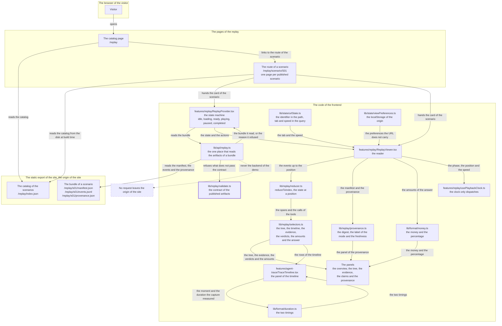
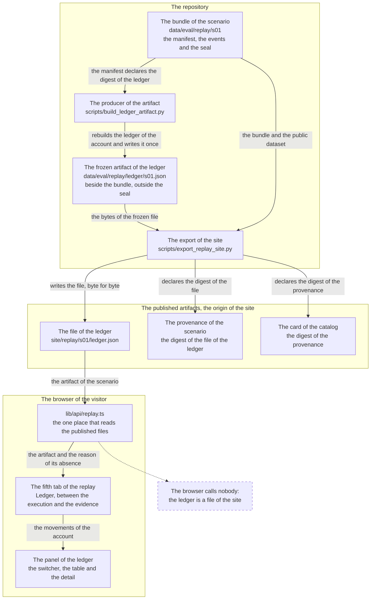
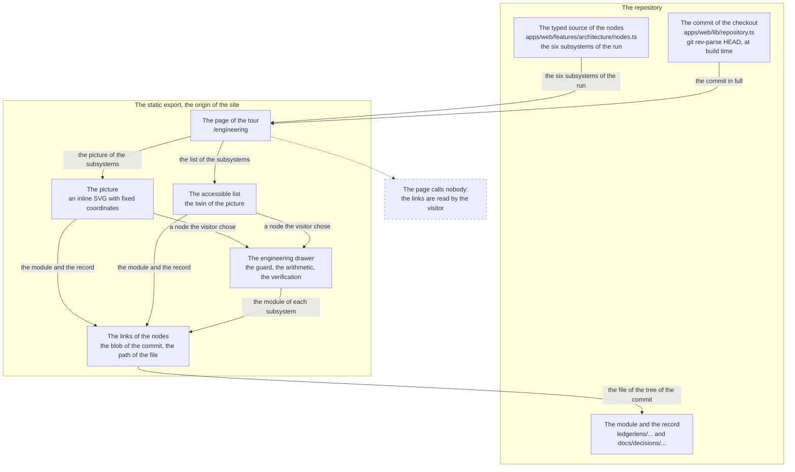
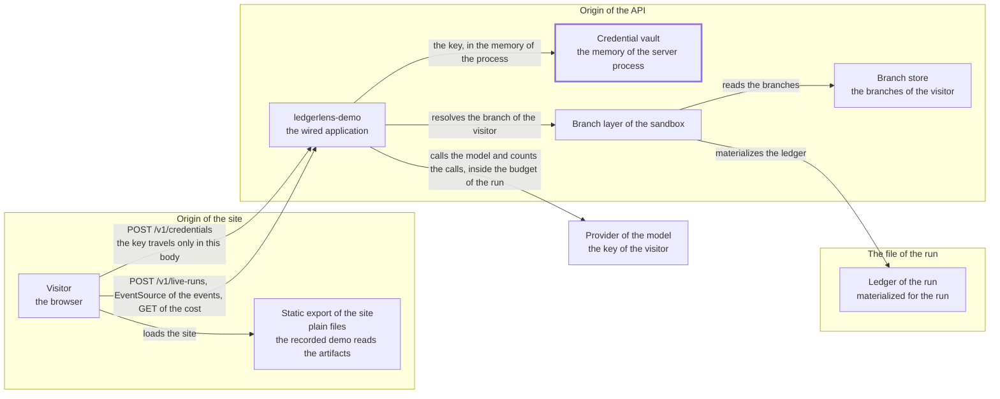
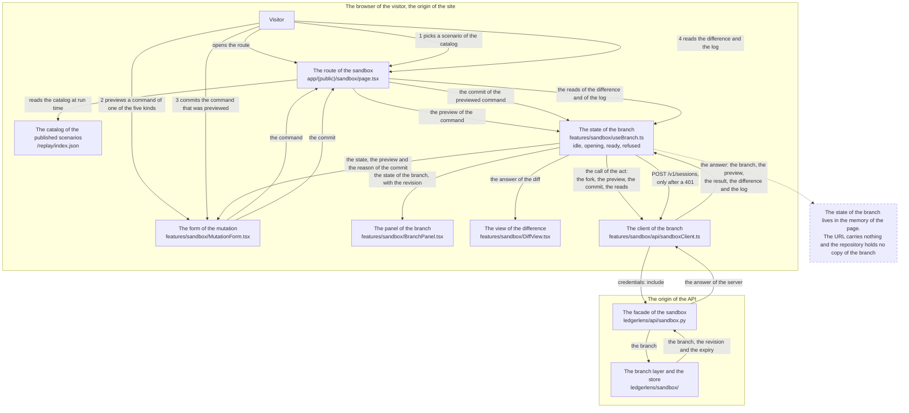
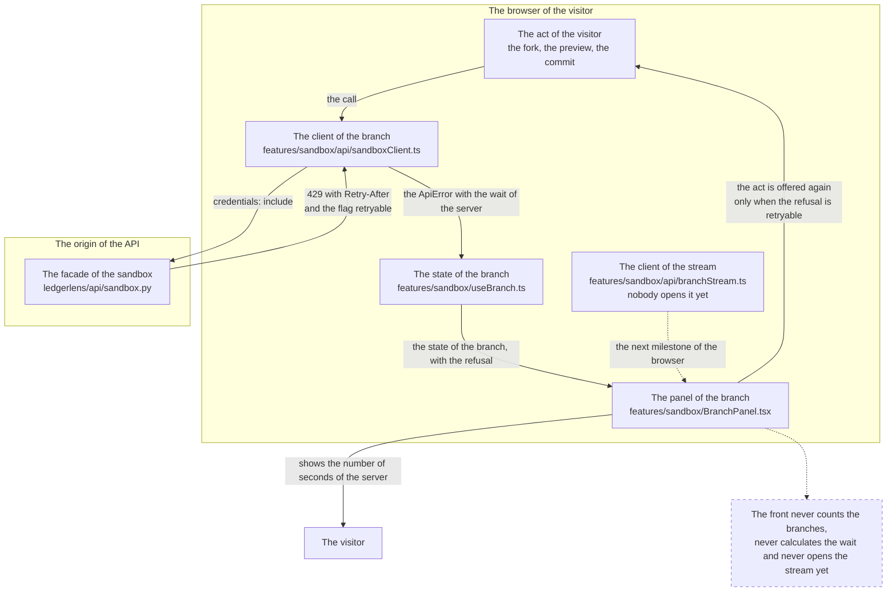

# The frontend of LedgerLens

The site of the demo has three rooms, and they live on two origins.

The **recorded demo** is a static export: a folder of plain files, published on the origin of the site, that any content
delivery network can serve. It reads the published artifacts of the replay and makes no request to anybody. The artifacts
of the repository live in `site/replay/`, and the build of the site copies them into `apps/web/public/replay/`, which is
where the static export picks them up. The copy is not tracked by git, so there is one truth and no second copy that can
go stale: the decision is
[ADR-042](decisions/ADR-042-the-site-of-the-demo-serves-the-published-artifacts.md).

The **live mode** is the backend. The browser calls the wired application of the demo (`ledgerlens-demo`) on the origin
of the API, with the cookie of the session, and the backend answers with the catalogue, the credential, the run, the
stream of the events and the cost. The two origins are different, so the backend answers the browser with the CORS
headers.

The **sandbox of the visitor** is the third room. Its route is `/sandbox`, it calls the same origin of the API with the
same cookie of the session, and it costs the visitor nothing: it forks a published case into a private branch of the
session, previews a typed mutation, commits it, reads the difference and the log of the branch, undoes the last
mutation and puts the branch back at the published base. The decision that fixed this front is
[ADR-044](decisions/ADR-044-the-interface-of-the-sandbox-in-the-frontend.md).

The decision that fixed the shape of the two rooms that call the backend is
[ADR-040](decisions/ADR-040-the-live-mode-on-the-origin-of-the-backend.md), and the architecture of the live mode is
drawn below.

## The three modes

| mode | label | what it calls | what it costs |
| --- | --- | --- | --- |
| the recorded demo | `deterministic_sandbox` | nothing, the artifacts are on the origin of the site | nothing |
| the sandbox of the visitor | `visitor_sandbox` | the backend, and nobody else | nothing |
| the live mode | `live_agent` | the backend, and the provider of the visitor | the money of the visitor, inside the caps of the run |

The three are separate sections of the page, and each one carries its own label. A recorded run is never labelled live,
a sandbox is never labelled live and a live run is never labelled recorded. The recorded demo keeps working when the
backend is down, when the product runs offline and when no key exists.

## How to run the site

The site needs Node 24 or newer (`apps/web/package.json` declares `>=24.0.0`, the lock file declares the same floor
and the gate installs with `npm ci --engine-strict`). The local run of the live mode needs the backend too, so
there are two commands, in two terminals.

The backend, with the origin of the site declared so that the browser may call it:

```bash
LEDGERLENS_CORS_ORIGINS=http://localhost:3000 uv run ledgerlens-demo --port 8010
```

The site:

```bash
cd apps/web && npm run dev
```

The site is then on `http://localhost:3000` and the backend is on `http://localhost:8010`.

To serve the export exactly as it is published, build it and serve the folder:

```bash
cd apps/web && npm run build && npm run preview
```

The export lands in `apps/web/out/`. It is a folder of plain files: `out/index.html` is the page of the site,
`out/replay.html` is the catalog of the scenarios and `out/replay/index.json` is the catalog itself, `out/replay/s01/`
holds the artifacts of the bundle of the scenario `S01` (`manifest.json`, `events.jsonl`, `provenance.json` and
`ledger.json`, the artifact of the ledger of the recorded demo, which the section "The ledger of the recorded demo"
describes),
`out/replay/scenario/S01.html` is the page of the scenario and `out/404.html` is the page of an address that the
site does not publish. The page of the catalog is the FILE `out/replay.html` and the artifacts are the FOLDER
`out/replay/`, and the two shapes are the reason why the route of a scenario carries the extra segment `scenario`.

## The URL contract

The origin of the backend is a public build variable, because the site is a static export and there is no server that
could read a variable at runtime.

- The name is `NEXT_PUBLIC_LEDGERLENS_API_BASE_URL`. The `NEXT_PUBLIC_` prefix is the convention of Next.js for a value
  that is inlined in the bundle of the browser, and it says out loud that the value is public.
- The default is `http://localhost:8010`, the port of `ledgerlens-demo`.
- The value is an origin without a trailing slash and without a path. The paths are joined as `${base}/v1/sessions`,
  `${base}/v1/models`, `${base}/v1/credentials`, `${base}/v1/live-runs`, `${base}/v1/live-runs/{runId}/events`,
  `${base}/v1/live-runs/{runId}/cost` and `${base}/v1/credentials/forget`. The sandbox joins the same origin with
  `${base}/v1/sandboxes`, `${base}/v1/sandboxes/{branchId}`, `${base}/v1/sandboxes/{branchId}/mutations`,
  `${base}/v1/sandboxes/{branchId}/mutations/preview`, `${base}/v1/sandboxes/{branchId}/undo`,
  `${base}/v1/sandboxes/{branchId}/reset`, `${base}/v1/sandboxes/{branchId}/diff` and
  `${base}/v1/sandboxes/{branchId}/history`. There is no second origin and no second rule.
- The default is `localhost` and not `127.0.0.1` on purpose: the site of `localhost` is `localhost`, so the cookie of
  the session travels between `http://localhost:3000` and `http://localhost:8010`. `127.0.0.1` is another host, and the
  browser would not send the cookie of one to the other.
- The variable never holds a secret. No `NEXT_PUBLIC_` variable of the repository may hold a provider key, and the
  bundle of the browser carries no secret of any kind.

When the origin does not answer, the live section of the page says so, in words, with the origin it tried, and the
recorded demo keeps working. The page never guesses and never falls back to another origin.

## The replay site

The replay site is the half of the demo that talks to nobody. It is a static export, it reads the published artifacts
of the recording, and it makes no request to the backend, to a provider or to any other service. The artifacts of the
repository live in `site/replay/`, the build of the site copies them into `apps/web/public/replay/`, and the copy is
not tracked by git, so the site always serves the artifacts the repository publishes
([ADR-042](decisions/ADR-042-the-site-of-the-demo-serves-the-published-artifacts.md)). The decision that closed this
half of the site is
[ADR-043](decisions/ADR-043-the-public-site-of-the-design-package-is-complete.md).

The catalog of the scenarios is at `/replay`. The route of a scenario is at `/replay/scenario/<id>`, for example
`/replay/scenario/S01`. It is NOT `/replay/<id>`, because the prefix `/replay` is both the page of the catalog of the
export (`out/replay.html`) and the folder of the published artifacts (`out/replay/`), so a bundle inside that prefix
could not be a page of the export and a folder at the same time, and a static file server would have to choose one
of them. The extra segment removes the ambiguity.

The route of a scenario is a server component, because a static export of a dynamic route needs the list of the
parameters at build time. The page reads the catalog of the site from the disk while the export is built, it hands the
card of the scenario to the reader and to the provider of the replay, it publishes one page per published scenario,
and a scenario the catalog does not publish is the page of 404, never a guess at run time.

**The reader of the catalog, and the order of the copy.** The reader of the catalog is
`apps/web/lib/replay/catalog.ts`, and it is the one module of the frontend that reads the disk. It looks for the copy
that the site serves first (`apps/web/public/replay/index.json`) and falls back to the source the repository publishes
(`site/replay/index.json`), because the copy is not tracked by git and a checkout that has never built the frontend has
no copy. A catalog that cannot be read, that is not a JSON document or whose card does not pass the contract of the
published artifacts stops the build with a reason: an empty catalog would build an export with no page of a scenario.
The copy is made before the unit tests run as well as before the build, through the hook `pretest` of the manifest of
the package, so that the suite of a checkout that has never built the frontend reads the same catalog the site serves.

**The URL of the replay.** The URL carries the identifier of the scenario in the path, and in the query string exactly
two keys, `tab` and `speed`, and nothing else ever. The five tabs are `execution`, `ledger`, `evidence`, `decision` and
`provenance`, and the three speeds are 1, 2 and 4. The helper that reads them (`apps/web/lib/state/urlState.ts`)
ignores every other parameter, whatever it holds, and falls back to the default of each field that is absent or that
is illegal. The URL never carries a key, a handle, an answer, the text of a run or any other thing that came from a
visitor.

The position of the playback is NOT in the URL. It is the transient state of the session of the replay, and a link
that carried it would be a link to a moment of a run for no gain.

The preferences of the last visit live in the `localStorage` of the origin of the site, under the key
`ledgerlens.view-preferences.v1`, and the stored payload holds the two fields of the preferences and nothing else
(`apps/web/lib/state/viewPreferences.ts`). The storage is NEVER a cookie: the cookie of the origin of the backend is
the identity of the session of the visitor, and the replay must never touch it. The URL wins over the store for the
fields the URL carries, and the store wins for the fields the URL does not carry.

**The state of the replay.** The reader of a recording is a state machine
(`apps/web/features/replay/ReplayProvider.tsx`), and its phases are `idle`, `loading`, `ready`, `playing`, `paused`
and `completed`. Its reducer is pure: it reads no clock, it draws no random number and it touches nothing outside its
arguments, so the same sequence of actions always ends in the same state. The state at a position always comes from
the reducer of the events of the repository (`reduceToIndex`, in `apps/web/lib/replay/reducer.ts`), never from a mutation
in place.

A refused artifact shows the reason and NOTHING else. The refusal empties the events, the manifest and the provenance,
puts the position at zero and keeps the reason in the state, and the reader renders the failure state alone: no tree,
no timeline, no evidence and no answer. A half drawn run is worse than no run, because a reader cannot tell which
parts of it are true.

**The failure of the site.** A refusal of a bundle is the state of the recording, and the failure of the site is the
failure of the page itself: the three boundaries of the site catch it, and they are `apps/web/app/error.tsx` (every
exception of every route, rendered inside the shell of the site), `apps/web/app/global-error.tsx` (the exception of
the shell or of the root layout, which draws its own document) and `apps/web/app/not-found.tsx` (an address that the
site does not publish). The three share one component, `SiteFailure`, so the site has one look of failure, and none
of them ever shows the message of the error, the stack, a path of the server or the name of an internal module. The
export is static and has no page of 500, so the boundary of the root is a boundary of the browser.

**The money and the timing.** The money of the interface is the decimal TEXT of the artifact, with the currency that
the artifact carries. The browser never multiplies it and never rounds it: the fraction is kept exactly as it was
written, and the amount is never turned into a binary float, because a binary float of a financial amount is a
different amount (`apps/web/lib/format/money.ts`). The currency of the run is another fact, read from the tool that
read the rate, and it is never assumed: the tool `get_reference_fx` is believed first, and the fallback accepts any
other tool whose name carries `fx`, `rate` or `exchange`, because the recording of a scenario may name the tool
differently.

**A percentage is not money.** A percentage never carries the currency of the run: it is a number that means
something else. The unit of every value of the breakdown of the calculation is read out of the NAME of the value,
because the name is where the recording declares the unit (`markup_pct`) and it is the name the reader sees in the
panel of the amounts. A name declares a percentage when one of its words is `pct`, `percent` or `percentage`, or when
the name carries the symbol `%`; every other name is money. The percentage is written with the symbol of the
percentage, with the same rule of the digits as the money, and a percentage that is not a decimal shows `Not
available`, because a unit written on a broken value would be an invention.

The original timing that the capture measured and the playback timing that the visitor sees are two separate things,
and they are formatted by two separate functions (`apps/web/lib/format/duration.ts`). The duration the capture
measured says how long the agent took, and the offset of the playback says how far the visitor has moved inside the
recording. The speed of the playback changes only how long the browser waits between two events: it never changes the
timing that the capture measured and it never changes the order of the events.

**The integrity of the bundle.** The client of the artifacts (`apps/web/lib/api/replay.ts`) computes the digest of
the file of the events and compares it with the digests that the manifest and the provenance publish, and it computes
the digest of the manifest and compares it with the `bundle_digest` of the provenance. A mismatch is a refusal, and
the refusal carries the expected digest and the observed one. The absence of the Web Crypto is NOT a refusal: the
check is then unknown, and an unknown check is not a broken bundle.

The panel of the provenance shows the digest of the bundle, the label of the mode, the kind of the capture, the moment
of the capture, the hashes and the freshness of the snapshot (`apps/web/lib/replay/provenance.ts`). Every word of that
panel was read from the artifact, a digest that was not read is shown as not available, and the freshness is fresh or
stale only on a comparison that was really made, so the panel says out loud when it could not be checked.



## The ledger of the recorded demo

The home page of the site promises three things: the ledger rows the run read, the policy it applied and the arithmetic
it did. The policy is in the tab of the evidence and the arithmetic is in the tab of the decision. **The ledger rows are
the fifth tab of the replay**, between the tab of the execution and the tab of the evidence, and they are read from a
published artifact like every other artifact of the site. The browser never calls anybody for them. The decision is
[ADR-045](decisions/ADR-045-the-ledger-of-the-recorded-demo.md).

### The artifact

The artifact is the ledger of the account of the recording, with the reads of the recording marked in it. It is
published per scenario, inside the folder of the scenario, beside the events, the manifest and the provenance, in the file
`site/replay/s01/ledger.json`.

The frozen source of that file is `data/eval/replay/ledger/s01.json`. It lives beside the folder of the bundle, OUTSIDE
the sealed bundle, and it is committed with it. The reason is the seal: `load_bundle` of `ledgerlens/replay/bundle.py`
refuses a folder that holds a file the manifest does not declare, so a file of the ledger inside the bundle would make
the bundle unreadable, and it would move the digest of the bundle, which is the sha256 of the manifest.

**The export is the only way the file reaches the site.** The export of `ledgerlens/replay/site_export.py` writes the
published file with the bytes of the frozen file, byte for byte, and it never writes it by hand: a hand edit of the
published file fails the check of the export, and a frozen file that was edited without publishing it fails the same
step. The build of the frontend copies `site/replay/` into `apps/web/public/replay/`, a copy that git does not track,
so there is one truth and no second copy that can go stale
([ADR-042](decisions/ADR-042-the-site-of-the-demo-serves-the-published-artifacts.md)).

The producer of the frozen file is `scripts/build_ledger_artifact.py`. It opens the bundle, it rebuilds the ledger of
the account the same way the capture did, it proves that the ledger it rebuilt is the ledger the recording read, and it
writes the file. It runs offline, with no key and with no network.

### The shape of the artifact

One JSON document, written with the format the repository uses everywhere (sorted keys, two spaces, a final line). It
carries the scenario, the version of the shape, the number of rows of a page, the digest of the ledger the recording
read and the list of the accounts.

**A movement is a row of the ledger, and it carries the six fields of the ledger of the branch** (`_ledger_items` of
`ledgerlens/sandbox/branch.py`), so that one table can draw the ledger of the recorded demo and the ledger of the
branch of the sandbox:

| field | what it holds |
| --- | --- |
| `kind` | `transaction`, `refund` or `chargeback` |
| `id` | the identifier of the movement |
| `at` | the moment of the movement |
| `amount` | the decimal text of the ledger, never a number |
| `currency` | the currency of the movement |
| `status` | the state of the movement |

**A read is one call of the tool `query_ledger` that the recording made**, and it carries:

| field | what it holds |
| --- | --- |
| `evidence_id` | the citation of the evidence, `sql:1` for the recording of `S01` |
| `seq` | the sequence number of the event that closed it |
| `tool` | the name of the tool |
| `sql` | the statement it ran |
| `columns` | the names of the columns it asked for |
| `row_count` | the number of rows it returned |
| `truncated` | the flag that says whether the result was cut |
| `records` | the identifiers the statement named |
| `rows` | the rows themselves, with the names of the columns |

The rows of a read keep the values the recording wrote and take the names of the columns the recording declared. The
artifact never invents a column, never reorders a value and never repairs one.

For the recording that the site publishes today, the artifact holds one account, `C-0412`, of the kind `customer`, the
name `Mariana Albuquerque Costa`, two movements and one read:

| kind | id | at | amount | currency | status |
| --- | --- | --- | --- | --- | --- |
| transaction | TX-2048 | 2026-10-15T09:12:00Z | 100.00 | EUR | refunded |
| refund | R-0731 | 2026-10-20T14:05:00Z | 549.31 | BRL | paid |

**The table shows the movements of the account, and a movement that a read names carries the words "Read by the run".**
The recording read the rates of the transaction `TX-2048` and nothing else: it never asked for the transaction and
never asked for the refund. So `TX-2048` carries the words and `R-0731` does not, and the detail of `R-0731` says in
words that the recording read no record of it. The two rates the run read (`5.6679` and `5.4931`) are the rows of the
read, and they are not money: a rate never wears the currency of a movement.

### The identity of the artifact

Three digests make a chain, and every link of it is checked.

- **`snapshot_sha256` of the artifact is the digest the manifest of the bundle declares.** It is the digest of the
  ledger the recording read, and it is the claim of identity between the artifact and the recording.
- **The digest of the published file `site/replay/s01/ledger.json` is declared in the provenance of the scenario**,
  under `artifacts`, with the key `ledger.json`.
- **The digest of the provenance file is declared in the card of the catalog**, with the key `ledger_sha256`.

The digest of the published file is pinned in the table of the pinned digests of `tests/replay/test_site_export.py`,
beside the digest of every other published file, and it is not written here a second time.

The browser checks the same chain with the Web Crypto, and the panel of the ledger says out loud that the integrity was
not checked when the browser offered no Web Crypto. The check of the export compares the published file with the bytes
the export would write, and the cross check of the digests compares the published file with the frozen file and the
digests the provenance and the card publish.

### The rules of the browser

- **The money is the decimal text of the artifact.** The amount of a movement is read as the text it is (`"100.00"`,
  `"549.31"`) and it is written with `formatMoney` of `apps/web/lib/format/money.ts`, which groups the digits and
  changes no digit. The browser never calls `Number`, never calls `parseFloat`, never multiplies, never rounds, never
  pads a fraction and never converts a currency. A binary float of a financial amount is a different amount.
- **The browser never sums the column.** There is no total row, there is no total in the caption and there is no total
  in the detail, and there will never be one. A total of the interface is a number that the browser calculated, and a
  number that the browser calculated is a number that no artifact carries.
- **A rate is not money.** The `applied_rate` of a read is a rate and not an amount: it carries no currency, it is
  written with the text of the artifact exactly as it was read, and it never wears the currency of the run. A unit
  written on a value would say something false about it.
- **The state of the visitor never goes in the URL.** The account that is chosen and the row that is open live in the
  memory of the panel and in nothing else. The query string carries `tab` and `speed`, the two keys the contract of
  ADR-043 allows, and a parameter that holds anything else is ignored.
- **The state is never only a colour.** The row that is open carries the words "Open", the movement that the run read
  carries the words "Read by the run", and the account that is chosen carries the state of the pressed button. The
  colour of a badge never carries a state alone.
- **The controls are never `disabled`.** The control of the pagination that would do nothing says so with
  `aria-disabled="true"` and a sentence a reader can hear, pointed at with `aria-describedby`. A focus that is dropped
  on the body of the document sends the next Tab back to the top of the page.

### The flow of the ledger



The diagram follows the code that is on the disk: the producer of the frozen artifact is the script
`scripts/build_ledger_artifact.py`, the export that writes the published file is `scripts/export_replay_site.py`, the
one module of the frontend that reads the published files is `apps/web/lib/api/replay.ts`, and the panel of the ledger
is the file `apps/web/features/ledger/LedgerPanel.tsx`, drawn by the tab of the replay in
`apps/web/features/replay/ReplayViewer.tsx`.

### What the milestone does not deliver

- **The ledger of the BRANCH of the sandbox.** The route `GET /v1/sandboxes/{id}/ledger` exists and the front does not
  call it. The ledger of a branch is the state of the branch of a visitor, it moves with the mutations and it lives on
  the origin of the backend. The row shape of this milestone is the shape of the branch ledger, so that the panel of
  the branch can be written against a contract that already exists.
- **The thousands of rows of the full ledger.** The simulated ledger holds 2483 movements over 24 merchants and 1418
  customers. The recording read the ledger of ONE account, and publishing the whole ledger would publish rows that no
  recording read.
- **The search.** The site has no search over the ledger. A search needs the rows of every account, and the artifact
  of this milestone holds the rows of one.
- **The published result of the recording.** The `run_result` of the bundle is still not published, and the claim of
  the recording is still rendered as `Not available`.
- **The link between the rate of the refund and the refund `R-0731`.** The recorded statement asked for `kind`,
  `applied_rate` and `applied_at`, and it did not ask for the identifier of the refund, so the artifact cannot say
  that the rate `5.4931` is the rate of the refund `R-0731`. What the debt wants is a new capture, not a new
  interface.

### The debt of the milestone

- **The identity of the ledger depends on the bytes of a file of SQLite.** The producer refuses on a machine with
  another version of SQLite, even when the rows are the same rows. What the debt wants is a digest of the CONTENT of
  the ledger, written by the capture next to the digest of the file, and that needs a new version of the contract of
  the bundle.
- **The artifact of a scenario is produced by a command that is not the capture.** A capture that is not followed by the
  producer leaves the gate red, and that is the rule and not an accident.
- **The catalog of the scenarios does not carry the account.** The card of the catalog publishes the digest of the
  artifact and the question of the scenario, and not the account whose ledger is published.
- **The table of the ledger reads the whole artifact into the memory of the browser.** The artifact of the recorded
  demo holds four rows and the pagination is a formality, but an artifact of the full ledger would hold thousands of
  rows and the browser would read all of them.
- **The search of the ledger, the full ledger and the ledger of the branch** are the three debts named in the section
  above.

## The tour of the architecture

The replay shows a run that already happened. The tour of the architecture shows **why the run is
allowed to happen at all**: the page `/engineering` draws the six subsystems of the system, every
node of the picture opens the exact module of the repository and the decision record that explains
why the module exists, and the engineering drawer explains the guard, the arithmetic and the
verification in plain language for the visitor who does not read code. The decision is
[ADR-046](decisions/ADR-046-the-architecture-tour-of-the-public-site.md).

### The page

The page is `/engineering`, it is static and it is public, and it belongs to the recorded demo, so
it calls nobody. It reads its content at build time and it asks the visitor for nothing: no key,
no account, no login, no cookie and no query string.

**The page shows the six subsystems of the run, in the order of the run.** The guard reads the
ledger, the copy of the ledger decides what the guard may read, the simulator builds the ledger,
the calculator does the arithmetic on what was read, the verifier checks what the answer said and
the recorder writes down what happened:

| node | module | record |
| --- | --- | --- |
| Query guard | `ledgerlens/tools/sql_guard.py` | ADR-005 |
| Scoped ledger copy | `ledgerlens/api/accounts.py` | ADR-038, ADR-045 |
| Decimal calculator | `ledgerlens/tools/calculator.py` | ADR-001, ADR-007 |
| Deterministic simulator | `ledgerlens/sim/pipeline.py` | ADR-009 |
| Verifier | `ledgerlens/verify/checks.py` | ADR-007 |
| Trace recorder | `ledgerlens/observability/trace.py` | ADR-013 |

### The typed source of the nodes

**The typed source of the nodes is `apps/web/features/architecture/nodes.ts`, and it is the ONE
source of the content of the page.** It holds a readonly array of six nodes, and every word the
page shows about a subsystem is a word of that array. There is no second file with the content of a
node and there is no text of the page that a model wrote.

The picture is an inline SVG drawn by the frontend, with fixed coordinates, and it is built by a
pure function of the array. It measures nothing, it reads no clock, it draws no random number, it
has no transition and no animation, and it adds no dependency to the frontend. The rule of
[ADR-041](decisions/ADR-041-the-interactive-diagrams-are-rendered-outside-the-repository.md) is
respected and not revised: the repository commits the typed source of a diagram and never the
rendered file of it, and the file `docs/diagrams/live-mode.architecture.json` is the source of the
diagram of the live mode, not the source of this page.

### The commit of the checkout

**The base of every link to the code is
`https://github.com/erikunha/ledgerlens/blob/<ref>/<path>`, and `<ref>` is the full commit of the
checkout the site was built from.** The commit is read at build time by `readRepositoryMeta` of
`apps/web/lib/repository.ts`, which runs `git rev-parse HEAD` in the root of the repository. Nobody
writes the commit by hand, and the build fails with a readable reason when the answer is not a
commit of forty lowercase hexadecimal characters.

A commit never ages and it survives the branch. A link to a branch shows the code of today, and
the sentence of the node was written for the code of the day the page was built. The footer of the
page carries the commit in full, so a reader who follows a link and sees a file knows which tree
the sentence was written for, and the page says out loud when the tree was not clean.

### The twin of the picture

**The accessible list is the twin of the picture, not a second copy of it.** It is rendered from
the same array, by the same component, it is always present in the page and it is never behind a
toggle. The two cannot disagree about a subsystem, because there is only one array.

The price of the twin is paid on purpose: the picture and the list carry the same six subsystems,
so a reader of a screen reader hears them twice. The price is worth it because the specification
asks for a clickable diagram and for an accessible list, and the two are wanted by the plan.

**The picture never animates.** It has no transition, no animation and no layout that depends on a
measurement, so the preference for reduced motion has nothing to switch off in it and the picture
is legible as a static picture in every case. The rule of `apps/web/app/globals.css`, which turns
every transition off under the preference, keeps its place and covers the rest of the site.

### The drawer of the engineering

**The drawer lives in `apps/web/features/architecture/EngineeringDrawer.tsx` and it is built on the
`Sheet` primitive of the design system.** The primitive is a Radix dialog, so the drawer carries
`role="dialog"`, the focus is trapped while it is open, the Escape key closes it and the focus
returns to the control that opened it.

**Two controls open it, and both open the same drawer.**

- The page of the architecture opens it with the node the visitor chose, so the drawer starts with
  the summary of that node.
- The replay opens it from the section of the calls of the tools, in the tab of the execution. The
  drawer explains the guard, the arithmetic and the verification and links to the module of each
  one, which is what the user story 5 asks for.

The drawer takes the context it was opened with and it says what that context is. Opened from the
replay with no call chosen, it says in words that it is not tied to one call, because a drawer
that pretends to be about a call it does not name is a drawer that lies.

### The flow of the tour



The diagram follows the code that is on the disk: the typed source of the nodes is the file
`apps/web/features/architecture/nodes.ts`, the picture and the list are drawn by
`apps/web/features/architecture/ArchitectureDiagram.tsx`, the drawer is the file
`apps/web/features/architecture/EngineeringDrawer.tsx`, the commit is read by
`apps/web/lib/repository.ts`, and the route is the file
`apps/web/app/(public)/engineering/page.tsx`.

### What the milestone does not deliver

- **No copy of a record and no copy of a module on the site.** The page links to the repository and
  it does not mirror it. A copy is a second source that drifts.
- **No rendered file of the diagram in the repository.** The picture is drawn by the frontend at run
  time from the typed source, and the tool of ADR-041 is not a dependency of the frontend.
- **No drawer of a tool call.** The drawer of the engineering tour explains three subsystems and it
  is a component of its own. The drawer of one call of the recording is the task T048 and it stays
  open with the work it names.
- **No request at run time.** The page reads nothing of the network and it computes no value.

### The debt of the milestone

- **The commit of the page is a promise.** Every link the page serves keeps opening the tree it
  describes, and a tree that is renamed leaves the links of the page pointing at a name that is
  gone.
- **The duplication of the picture and of the list is a cost that is paid on purpose.** The scan of
  the accessibility of the milestone has the last word on it.
- **The drawer of a tool call may open the drawer of the tour later.** The two meet at the context
  of the call, and the meeting is not a reason to wait.

## The rule of the same site

The session cookie is `ledgerlens_session`, it is `HttpOnly`, it is `SameSite=Lax` and it is `Path=/`. The cookie of a
`SameSite=Lax` cookie only travels inside its own site.

**The origin of the API must be published on the same site as the site of the interface**: the same registrable domain
and the same scheme. A site is what the cookie sees, not what the address bar shows, so `https://demo.example.com` and
`https://api.example.com` are one site, and `https://demo.example.com` and `https://api.other.com` are two.

The cookie is **not** changed to `SameSite=None`. That change would make the demo work across sites, and it would let
any site of the internet drive the API with the session of the visitor. A deployment that cannot serve the two origins
on the same site has to solve the cookie of the session first, and that answer is another ADR.

## The local run and the CORS origins

The backend answers the browser with the CORS headers only when the deployment declares the origins.

- The setting is `LEDGERLENS_CORS_ORIGINS`, a comma separated list of exact origins.
- The default is empty, and an empty list installs no CORS at all, so a deployment that declares nothing answers
  exactly as it answered before.
- A wildcard is refused with a readable error: a wildcard with credentials is illegal in the Fetch specification, and it
  would let any site drive the API with the session of the visitor.
- The origins that travel with the browser are the origins of the site. The local run declares
  `LEDGERLENS_CORS_ORIGINS=http://localhost:3000`, because the development server of Next serves the site on the port
  3000.
- The middleware adds no route, so the list of the routes of the wired application does not change.

Every call of the browser to the backend carries `credentials: "include"`, and the stream of the events is opened with
`EventSource` and `withCredentials: true`, so the cookie of the session travels with every one of them.

## The architecture of the live mode



The key of the visitor enters the vault in the body of `POST /v1/credentials` and in no other place. It never travels in
a path, in a header, in a query string or in a URL, and it never leaves the memory of the process of the server. The
handle that the server answers travels afterwards in the body of `POST /v1/live-runs` and in the body of
`POST /v1/credentials/forget`, and it is not a secret.

The typed source of the interactive version of this diagram is
[`docs/diagrams/live-mode.architecture.json`](diagrams/live-mode.architecture.json), and the decision that keeps the
rendered HTML out of the repository is
[ADR-041](decisions/ADR-041-the-interactive-diagrams-are-rendered-outside-the-repository.md).

## The sandbox of the visitor

The sandbox of the visitor is the third room of the site. It opens a private branch of a published case, previews a
typed mutation, commits it, reads the difference and the log of the branch, undoes the last mutation and puts the
branch back at the published base. It needs no key and no provider, and it costs the visitor nothing.

### The route of the sandbox

**The route of the sandbox is `/sandbox`.** The decision is
[ADR-044](decisions/ADR-044-the-interface-of-the-sandbox-in-the-frontend.md), and the reasons are these.

- The sandbox is a THIRD mode of the demo and not a part of one of the two. The recorded demo reads the published
  artifacts of the site and calls nobody, and the sandbox calls the origin of the backend. A route under `/replay`
  would say that the sandbox belongs to the recorded demo, and the prefix `/replay` is both the page of the catalog of
  the export (`out/replay.html`) and the folder of the published artifacts (`out/replay/`).
- The route is not under `/live` either. The live mode calls a provider with the key of the visitor and spends the
  money of the visitor, and the sandbox spends nothing.
- The route carries NO identifier of a scenario in the path. The catalog of the scenarios is read at run time from the
  published catalog of the site, and the visitor picks the case from a list of buttons on the page.
- The page is a client component, so the export writes one file, `out/sandbox.html`, and the file needs no parameter.

The route is linked from the home page `/`, which carries a third card next to the ones of the recorded demo and of the
live mode, and from the sandbox page itself, which links back to `/replay` and to `/live` in its header. The header of
the shell does NOT gain a link: it carries the name of the site and the indicator of the mode and nothing else.

### The origin of the calls

**The calls of the sandbox go to the origin of the backend, with the credentials of the visitor, exactly like the live
mode.**

- The origin is the one of the live mode and of the section about the URL contract above: the public build variable
  `NEXT_PUBLIC_LEDGERLENS_API_BASE_URL`, read by `apps/web/lib/api/config.ts` through `apiBaseUrl()`, with the default
  `http://localhost:8010`. There is NO second variable, NO second origin and NO second rule.
- Every call carries `credentials: "include"`, so the browser sends the cookie `ledgerlens_session` of the origin of
  the backend. The cookie is `HttpOnly`, `SameSite=Lax` and `Path=/`, and the rule of the same site holds: the origin of
  the API is published on the SAME SITE as the site of the interface, with the same scheme.
- **There is NO second copy of the branch in the repository.** The static export holds nothing of the branch of the
  visitor: no snapshot of the branch, no cache of the difference and no fixture of the log in `apps/web/public/`. The
  branch lives on the origin of the backend, in the store of the deployment, and the browser holds the identifier of the
  branch and nothing else.
- **When the origin does not answer, the interface says so in words, with the origin it tried, and it does not guess
  and does not fall back.** The transport raises the error of the transport of the repository, with the status `0` and
  the code `NETWORK_ERROR`, and the message names the origin, the method and the path. The recorded demo keeps working
  exactly as before, because it calls nobody.
- **The session is issued ONLY when the server says there is none.** A call that is refused with `401 SESSION_REQUIRED`
  triggers exactly one `POST /v1/sessions` and the call is retried exactly once. THE HOOK OF THE STATE OWNS THAT: the
  client of the branch (`apps/web/features/sandbox/api/sandboxClient.ts`) NEVER retries a call and NEVER asks for a
  session, and the hook (`apps/web/features/sandbox/useBranch.ts`) is the only place of the frontend of the sandbox that
  may issue one. Two places that retry would give two sessions to one visit, and `POST /v1/sessions` always issues a
  NEW session.

### The state of the branch

**The state of the branch lives in the memory of the page of the visitor and nowhere else.** It is never written to the
URL, to the `localStorage`, to the `sessionStorage` and to no cookie. The state holds the phase of the machine, the
identifier of the branch, the revision, the expiry, the state of the branch, the canonical hash, the preview that waits
for a commit, the difference, the log and the refusal.

**The phases are `idle`, `opening`, `ready` and `refused`.**

- `idle`: there is no branch in the state. The page shows the list of the published scenarios and the visitor opens the
  branch of the one they pick.
- `opening`: the fork is in flight.
- `ready`: the branch is there. The panel, the form and the view of the difference read the state.
- `refused`: the branch is gone or the server refused the last act and the branch cannot be shown. The state carries
  the refusal and nothing else of the branch.

**How the end of the session is known.** There are three ways, and all three clear the state.

1. The visitor asks for it. The panel carries the action "End the session", which calls `DELETE /v1/sessions/current`.
   Whatever the server answers, the state is cleared and the phase goes back to `idle`.
2. The server refuses with `401 SESSION_REQUIRED`. The cookie is gone, expired or was never issued: the hook issues the
   session once and retries the call once, and the state is cleared the same way when the retry fails with `401` again.
3. The server refuses with `410 BRANCH_EXPIRED`. The branch is gone and the session may still be alive: the branch of the
   state is cleared, the refusal is kept, and the panel offers to open the scenario again.

**What happens when the page is reloaded.** The state of the browser is LOST, and the branch of the visitor is NOT lost:
it lives on the origin, with the cookie of the session, and it is RECOVERED by the fork. The reuse rule of the fork
returns the branch that already exists, with its current revision, and the answer is `200` instead of `201`. The front
says the branch was FOUND and not CREATED, so that a visitor who reloaded the page understands that the work of the
branch is still there.

### The flow of the front of the sandbox



The diagram follows the code that is on the disk: the route of the sandbox is the file
`apps/web/app/(public)/sandbox/page.tsx`, the other five modules of the browser are the files of
`apps/web/features/sandbox/`, the route holds the state of the branch through the hook, the form of the mutation asks
the hook for the preview and for the commit, the panel of the branch and the view of the difference read the state, and
the client of the branch is the only module of `apps/web/features/` that reads the origin of the backend. The API of
the sandbox, with its eleven paths and the codes of its refusals, is in
[the document of the API of the sandbox](api/sandbox.md).

### The rules of the browser of the sandbox

- **The browser NEVER calculates a value.** The values before and after of the difference are the decimal texts of the
  server, rendered as they were sent, and the currency is a code that the same entry carries. The verdict is the label
  of the server (`within_expected_range`, `below_expected_range`, `above_expected_range` and `not_available`), and the
  front never decides a verdict. The revision is the integer of the server and the expiry is the ISO 8601 text of the
  server.
- **A mutation is COMMITTED only after a valid preview, and the preview that was shown is the preview that is
  committed.** The commit sends the command that was previewed, byte for byte, with the key of the preview and with the
  revision the preview was made at. The control of the commit is never `disabled`: it carries `aria-disabled` and the
  reason it points at, and the reason is a sentence of the interface ("preview the command first", "the preview is out
  of date, preview the command again", "the command would break a rule of the domain").
- **The refusal of the server is shown with the reason of the server and never with a guess.** A refusal that is about
  an act keeps the branch, and a refusal that means the branch is GONE clears the branch of the state.
- **The identity of the session never travels in the URL, in a header and in a path.** The URL of the sandbox is
  `/sandbox` and it carries NOTHING: no identifier of a branch, no identifier of a session, no revision and no text of a
  command.

## The lifecycle of the branch and the limits of the facade

The backend publishes the lifecycle of the branch as a stream of named events and it refuses the two limits of the
session with the same code and the same status. The decision is
[ADR-047](decisions/ADR-047-the-lifecycle-and-the-limits-of-the-branch.md), and this section says what the frontend
does with the two, and what it does NOT do.

### The client of the stream of the branch

**The client of the stream of the branch is its own file, `apps/web/features/sandbox/api/branchStream.ts`, beside the
client of the branch.** It EXISTS, it is typed to the eight names of the branch stream, and it is NAMED in the fence of
the network (`apps/web/tests/unit/network-fence.test.ts`), because a stream IS the network. What does NOT exist is the
wiring: NOTHING calls the client today and the browser does NOT open the stream yet. The client of the live mode,
`apps/web/lib/api/events.ts`, CANNOT be reused: it is typed to the
`TraceEvent` of a run and it closes its source on the terminal events of a run, and the names of the events of a branch
and their payloads are another vocabulary. A client of a stream of another vocabulary that reused it would carry the
vocabulary of the run into the branch.

**The client shares the transport of the repository.** The transport is the origin of the backend and the joining of the
paths, `apiUrl` of `apps/web/lib/api/config.ts`, plus the source of the browser opened with the credentials of the
session, exactly like the client of the live mode opens its source. There is no second origin and no second rule
(ADR-040).

**The client holds the EIGHT names of the branch stream and nothing else.** Each name means exactly one thing:

| name | what it carries |
| --- | --- |
| `branch.opened` | the facts of the creation of the branch and the state of the branch at the moment of the opening |
| `branch.mutation.committed` | the revision, the hash, the command and the kind of the commit |
| `branch.undone` | the revision, the hash, the command, the kind and the event of the log that the undo took back |
| `branch.reset` | the revision, the hash of the branch and the hash of the base |
| `branch.expired` | the moment the branch dies and the state of the branch |
| `stream.resync` | the identifier the client sent and the reason the resume could not be proven |
| `stream.closed` | the reason the stream ended |
| `stream.heartbeat` | the moment and the sequence of the last event of the lifecycle |

**The reader and the writer of the stream are pure and they are the shape of the wire.** The reader takes a piece of
text and gives back the name, the sequence and the payload, and it refuses a payload that carries no `schema_version`,
no `branch_id`, no `seq` or no `at` with a reason that names the field that is missing. The writer gives back the text
the server writes: the `id:` line, the `event:` line, the `data:` line and the blank line. The `Last-Event-ID` of a
reconnection is the bare decimal integer of the sequence, with no prefix and no name, because the browser sends that
header by itself and the server expects the exact text of the `id:` line.

**The browser does NOT open the stream yet.** The function that opens the connection, `openBranchStream`, is the API
that the milestone of the browser will use, and NOTHING calls it today. The front keeps polling by hand, exactly as
ADR-044 said it would. The fence of the network (`apps/web/tests/unit/network-fence.test.ts`) names the modules that
are allowed to read the network, and the client of the stream of the branch IS NAMED in that fence today: a stream IS
the network, and an exception is always a name and never a silence.

### The wait of the server

**The `ApiError` of the transport (`apps/web/lib/api/client.ts`) carries the wait of the server.** When the answer is a
`429`, the client reads the header `Retry-After` and puts its TEXT in the `ApiError`, and the value is `null` when the
header is not there. The difference between "the server said nothing" and "the server said zero" is the difference
between a refusal that carries no wait and a refusal that carries a wait of no time at all.

**The panel of the branch shows that number and it never calculates one.** The panel of the branch
(`apps/web/features/sandbox/BranchPanel.tsx`) draws the wait as the number of seconds that the server wrote, next to
the code and the message of the refusal. It is not a chronometer: the panel does not count it down, it does not ask the
clock of the browser how much is left and it does not compute anything at all. The reason is the same reason the front
never computes the time that is left of the expiry (FR-031): the clock of the browser is not the clock of the server.

### What the frontend does NOT do

- **The front NEVER counts the branches of the session.** The server names the count and the cap in the message of the
  refusal, and the panel shows that message as it is. A front that counted the branches itself would count the branches
  it knows about and not the ones it does not, and it would show a number that the server never wrote.
- **The front NEVER computes the wait.** The wait is the text of the header `Retry-After`, and it is shown as it was
  sent.
- **The front NEVER opens the stream of the branch yet.** The client exists, it is typed and it is tested, and the page
  keeps polling by hand until the milestone of the browser.
- **The front NEVER tells the two limits apart by the code.** Both answer `429` with the code `RESOURCE_LIMIT_EXCEEDED`,
  and the flag `retryable` is the difference: the rate of the requests is retryable and the cap of the branches of the
  session is not. The panel reads the flag when it decides whether to offer the action again, and a control that would
  do nothing is never `disabled`: it carries `aria-disabled` and points at the reason with `aria-describedby`.

### The flow of the limits



The diagram follows the code that is on the disk: the client of the branch is the file
`apps/web/features/sandbox/api/sandboxClient.ts`, the state of the branch is the hook `apps/web/features/sandbox/useBranch.ts`,
the panel is the file `apps/web/features/sandbox/BranchPanel.tsx`, and the client of the stream of the branch is the
file `apps/web/features/sandbox/api/branchStream.ts`. The API of the sandbox, with its twelve paths, the eight names of
the stream and the two limits of the session, is in [the document of the API of the sandbox](api/sandbox.md).

## The two gates

```bash
bash scripts/gate.sh      # ruff, pytest offline, the check of the export, the cross check of the digests, the measurement of the budget
bash scripts/gate_web.sh  # npm ci, typecheck, lint, vitest, next build
```

The Python gate is the one that runs everywhere, including in GitHub Actions. The Node gate is the one of the frontend,
and it runs in the second job of the same workflow, with the Node 24 and the cache of npm. The Node gate is a separate
script and it is not folded into `scripts/gate.sh`, because that one is the gate of a Python repository and it runs in
places where Node is absent. A gate that fails because a tool is missing is not a gate.

**The Python gate runs five steps, in this order**, and it stops at the first failure:

1. the lint, `uv run ruff check`;
2. the suite offline, `uv run pytest -q`;
3. the check of the export, `uv run python scripts/export_replay_site.py --check`;
4. the cross check of the digests, `uv run python scripts/verify_replay_digests.py`;
5. the measurement of the budget, `uv run python scripts/measure_replay_budget.py`.

The last two steps read the disk and write nothing, and each one of them can also be run alone, against the same tree.
The transcript of a real run is in
[the record of the run of the gate](../specs/001-r1-public-replay/recorded-gate-run.md), and it says plainly that the
run it records happened before the two last steps joined the gate, so a reader knows which steps that transcript covers.

The end to end suite of Playwright (`npm run test:e2e`) is a local command and it is not part of the gate: the download
of the browsers is heavy.

## The rules of the deployment

1. The site is published as plain files, on the origin of the site. It is a static export, so a content delivery
   network can serve it with no server of the repository.
2. The origin of the API is published on the **same site** as the site of the interface, with the same scheme, so the
   cookie of the session travels.
3. The origin of the site is declared in `LEDGERLENS_CORS_ORIGINS` of the backend, as an exact origin, never as a
   wildcard.
4. The build of the site receives the origin of the API in `NEXT_PUBLIC_LEDGERLENS_API_BASE_URL`, and the variable
   holds no secret.
5. The live mode stays off by default on the backend: with `LEDGERLENS_OFFLINE=1` the routes that hold or spend a
   credential answer `503` with the code `LIVE_MODE_OFFLINE`, and the recorded demo keeps working.
6. The key lives in the memory of one server process. A deployment with more than one process needs a sticky session
   for the routes of the live mode, or one process for the demo.

The deployment does not change the way the replay is published, and it does not publish the replay from the backend.
