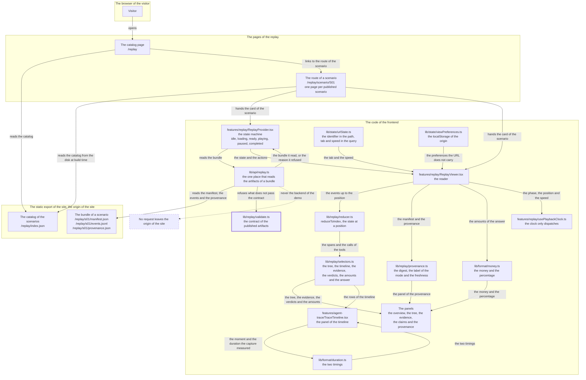
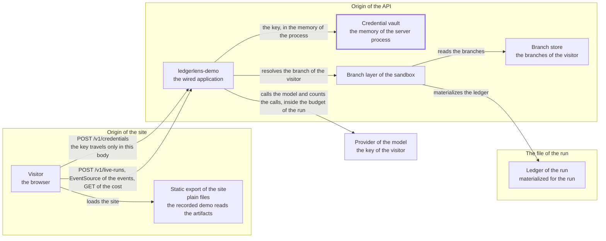

# The frontend of LedgerLens

The site of the demo has two halves, and they live on two origins.

The **recorded demo** is a static export: a folder of plain files, published on the origin of the site, that any content
delivery network can serve. It reads the published artifacts of the replay and makes no request to anybody. The artifacts
of the repository live in `site/replay/`, and the build of the site copies them into `apps/web/public/replay/`, which is
where the static export picks them up. The copy is not tracked by git, so there is one truth and no second copy that can
go stale: the decision is
[ADR-042](decisions/ADR-042-the-site-of-the-demo-serves-the-published-artifacts.md).

The **live mode** is the backend. The browser calls the wired application of the demo (`ledgerlens-demo`) on the origin
of the API, with the cookie of the session, and the backend answers with the catalogue, the credential, the run, the
stream of the events and the cost. The two origins are different, so the backend answers the browser with the CORS
headers.

The decision that fixed this shape is
[ADR-040](decisions/ADR-040-the-live-mode-on-the-origin-of-the-backend.md), and the architecture of the live mode is
drawn below.

## The two modes

| mode | label | what it calls | what it costs |
| --- | --- | --- | --- |
| the recorded demo | `deterministic_sandbox` | nothing, the artifacts are on the origin of the site | nothing |
| the live mode | `live_agent` | the backend, and the provider of the visitor | the money of the visitor, inside the caps of the run |

The two are separate sections of the page, and each one carries its own label. A recorded run is never labelled live,
and a live run is never labelled recorded. The recorded demo keeps working when the backend is down, when the product
runs offline and when no key exists.

## How to run the site

The site needs Node 24 or newer (`apps/web/package.json` declares `>=24.0.0`, the lock file declares the same floor
and the gate installs with `npm ci --engine-strict`). The local run of the live mode needs the backend too, so
there are two commands, in two terminals.

The backend, with the origin of the site declared so that the browser may call it:

```bash
LEDGERLENS_CORS_ORIGINS=http://localhost:3000 uv run ledgerlens-demo --port 8010
```

The site:

```bash
cd apps/web && npm run dev
```

The site is then on `http://localhost:3000` and the backend is on `http://localhost:8010`.

To serve the export exactly as it is published, build it and serve the folder:

```bash
cd apps/web && npm run build && npm run preview
```

The export lands in `apps/web/out/`. It is a folder of plain files: `out/index.html` is the page of the site,
`out/replay.html` is the catalog of the scenarios and `out/replay/index.json` is the catalog itself, `out/replay/s01/`
holds the artifacts of the bundle of the scenario `S01` (`manifest.json`, `events.jsonl` and `provenance.json`),
`out/replay/scenario/S01.html` is the page of the scenario and `out/404.html` is the page of an address that the
site does not publish. The page of the catalog is the FILE `out/replay.html` and the artifacts are the FOLDER
`out/replay/`, and the two shapes are the reason why the route of a scenario carries the extra segment `scenario`.

## The URL contract

The origin of the backend is a public build variable, because the site is a static export and there is no server that
could read a variable at runtime.

- The name is `NEXT_PUBLIC_LEDGERLENS_API_BASE_URL`. The `NEXT_PUBLIC_` prefix is the convention of Next.js for a value
  that is inlined in the bundle of the browser, and it says out loud that the value is public.
- The default is `http://localhost:8010`, the port of `ledgerlens-demo`.
- The value is an origin without a trailing slash and without a path. The paths are joined as `${base}/v1/sessions`,
  `${base}/v1/models`, `${base}/v1/credentials`, `${base}/v1/live-runs`, `${base}/v1/live-runs/{runId}/events`,
  `${base}/v1/live-runs/{runId}/cost` and `${base}/v1/credentials/forget`.
- The default is `localhost` and not `127.0.0.1` on purpose: the site of `localhost` is `localhost`, so the cookie of
  the session travels between `http://localhost:3000` and `http://localhost:8010`. `127.0.0.1` is another host, and the
  browser would not send the cookie of one to the other.
- The variable never holds a secret. No `NEXT_PUBLIC_` variable of the repository may hold a provider key, and the
  bundle of the browser carries no secret of any kind.

When the origin does not answer, the live section of the page says so, in words, with the origin it tried, and the
recorded demo keeps working. The page never guesses and never falls back to another origin.

## The replay site

The replay site is the half of the demo that talks to nobody. It is a static export, it reads the published artifacts
of the recording, and it makes no request to the backend, to a provider or to any other service. The artifacts of the
repository live in `site/replay/`, the build of the site copies them into `apps/web/public/replay/`, and the copy is
not tracked by git, so the site always serves the artifacts the repository publishes
([ADR-042](decisions/ADR-042-the-site-of-the-demo-serves-the-published-artifacts.md)). The decision that closed this
half of the site is
[ADR-043](decisions/ADR-043-the-public-site-of-the-design-package-is-complete.md).

The catalog of the scenarios is at `/replay`. The route of a scenario is at `/replay/scenario/<id>`, for example
`/replay/scenario/S01`. It is NOT `/replay/<id>`, because the prefix `/replay` is both the page of the catalog of the
export (`out/replay.html`) and the folder of the published artifacts (`out/replay/`), so a bundle inside that prefix
could not be a page of the export and a folder at the same time, and a static file server would have to choose one
of them. The extra segment removes the ambiguity.

The route of a scenario is a server component, because a static export of a dynamic route needs the list of the
parameters at build time. The page reads the catalog of the site from the disk while the export is built, it hands the
card of the scenario to the reader and to the provider of the replay, it publishes one page per published scenario,
and a scenario the catalog does not publish is the page of 404, never a guess at run time.

**The URL of the replay.** The URL carries the identifier of the scenario in the path, and in the query string exactly
two keys, `tab` and `speed`, and nothing else ever. The four tabs are `execution`, `evidence`, `decision` and
`provenance`, and the three speeds are 1, 2 and 4. The helper that reads them (`apps/web/lib/state/urlState.ts`)
ignores every other parameter, whatever it holds, and falls back to the default of each field that is absent or that
is illegal. The URL never carries a key, a handle, an answer, the text of a run or any other thing that came from a
visitor.

The position of the playback is NOT in the URL. It is the transient state of the session of the replay, and a link
that carried it would be a link to a moment of a run for no gain.

The preferences of the last visit live in the `localStorage` of the origin of the site, under the key
`ledgerlens.view-preferences.v1`, and the stored payload holds the two fields of the preferences and nothing else
(`apps/web/lib/state/viewPreferences.ts`). The storage is NEVER a cookie: the cookie of the origin of the backend is
the identity of the session of the visitor, and the replay must never touch it. The URL wins over the store for the
fields the URL carries, and the store wins for the fields the URL does not carry.

**The state of the replay.** The reader of a recording is a state machine
(`apps/web/features/replay/ReplayProvider.tsx`), and its phases are `idle`, `loading`, `ready`, `playing`, `paused`
and `completed`. Its reducer is pure: it reads no clock, it draws no random number and it touches nothing outside its
arguments, so the same sequence of actions always ends in the same state. The state at a position always comes from
the reducer of the events of the repository (`reduceToIndex`, in `apps/web/lib/replay/reducer.ts`), never from a mutation
in place.

A refused artifact shows the reason and NOTHING else. The refusal empties the events, the manifest and the provenance,
puts the position at zero and keeps the reason in the state, and the reader renders the failure state alone: no tree,
no timeline, no evidence and no answer. A half drawn run is worse than no run, because a reader cannot tell which
parts of it are true.

**The failure of the site.** A refusal of a bundle is the state of the recording, and the failure of the site is the
failure of the page itself: the three boundaries of the site catch it, and they are `apps/web/app/error.tsx` (every
exception of every route, rendered inside the shell of the site), `apps/web/app/global-error.tsx` (the exception of
the shell or of the root layout, which draws its own document) and `apps/web/app/not-found.tsx` (an address that the
site does not publish). The three share one component, `SiteFailure`, so the site has one look of failure, and none
of them ever shows the message of the error, the stack, a path of the server or the name of an internal module. The
export is static and has no page of 500, so the boundary of the root is a boundary of the browser.

**The money and the timing.** The money of the interface is the decimal TEXT of the artifact, with the currency that
the artifact carries. The browser never multiplies it and never rounds it: the fraction is kept exactly as it was
written, and the amount is never turned into a binary float, because a binary float of a financial amount is a
different amount (`apps/web/lib/format/money.ts`). The currency of the run is another fact, read from the tool that
read the rate, and it is never assumed: the tool `get_reference_fx` is believed first, and the fallback accepts any
other tool whose name carries `fx`, `rate` or `exchange`, because the recording of a scenario may name the tool
differently.

**A percentage is not money.** A percentage never carries the currency of the run: it is a number that means
something else. The unit of every value of the breakdown of the calculation is read out of the NAME of the value,
because the name is where the recording declares the unit (`markup_pct`) and it is the name the reader sees in the
panel of the amounts. A name declares a percentage when one of its words is `pct`, `percent` or `percentage`, or when
the name carries the symbol `%`; every other name is money. The percentage is written with the symbol of the
percentage, with the same rule of the digits as the money, and a percentage that is not a decimal shows `Not
available`, because a unit written on a broken value would be an invention.

The original timing that the capture measured and the playback timing that the visitor sees are two separate things,
and they are formatted by two separate functions (`apps/web/lib/format/duration.ts`). The duration the capture
measured says how long the agent took, and the offset of the playback says how far the visitor has moved inside the
recording. The speed of the playback changes only how long the browser waits between two events: it never changes the
timing that the capture measured and it never changes the order of the events.

**The integrity of the bundle.** The client of the artifacts (`apps/web/lib/api/replay.ts`) computes the digest of
the file of the events and compares it with the digests that the manifest and the provenance publish, and it computes
the digest of the manifest and compares it with the `bundle_digest` of the provenance. A mismatch is a refusal, and
the refusal carries the expected digest and the observed one. The absence of the Web Crypto is NOT a refusal: the
check is then unknown, and an unknown check is not a broken bundle.

The panel of the provenance shows the digest of the bundle, the label of the mode, the kind of the capture, the moment
of the capture, the hashes and the freshness of the snapshot (`apps/web/lib/replay/provenance.ts`). Every word of that
panel was read from the artifact, a digest that was not read is shown as not available, and the freshness is fresh or
stale only on a comparison that was really made, so the panel says out loud when it could not be checked.



## The rule of the same site

The session cookie is `ledgerlens_session`, it is `HttpOnly`, it is `SameSite=Lax` and it is `Path=/`. The cookie of a
`SameSite=Lax` cookie only travels inside its own site.

**The origin of the API must be published on the same site as the site of the interface**: the same registrable domain
and the same scheme. A site is what the cookie sees, not what the address bar shows, so `https://demo.example.com` and
`https://api.example.com` are one site, and `https://demo.example.com` and `https://api.other.com` are two.

The cookie is **not** changed to `SameSite=None`. That change would make the demo work across sites, and it would let
any site of the internet drive the API with the session of the visitor. A deployment that cannot serve the two origins
on the same site has to solve the cookie of the session first, and that answer is another ADR.

## The local run and the CORS origins

The backend answers the browser with the CORS headers only when the deployment declares the origins.

- The setting is `LEDGERLENS_CORS_ORIGINS`, a comma separated list of exact origins.
- The default is empty, and an empty list installs no CORS at all, so a deployment that declares nothing answers
  exactly as it answered before.
- A wildcard is refused with a readable error: a wildcard with credentials is illegal in the Fetch specification, and it
  would let any site drive the API with the session of the visitor.
- The origins that travel with the browser are the origins of the site. The local run declares
  `LEDGERLENS_CORS_ORIGINS=http://localhost:3000`, because the development server of Next serves the site on the port
  3000.
- The middleware adds no route, so the list of the routes of the wired application does not change.

Every call of the browser to the backend carries `credentials: "include"`, and the stream of the events is opened with
`EventSource` and `withCredentials: true`, so the cookie of the session travels with every one of them.

## The architecture of the live mode



The key of the visitor enters the vault in the body of `POST /v1/credentials` and in no other place. It never travels in
a path, in a header, in a query string or in a URL, and it never leaves the memory of the process of the server. The
handle that the server answers travels afterwards in the body of `POST /v1/live-runs` and in the body of
`POST /v1/credentials/forget`, and it is not a secret.

The typed source of the interactive version of this diagram is
[`docs/diagrams/live-mode.architecture.json`](diagrams/live-mode.architecture.json), and the decision that keeps the
rendered HTML out of the repository is
[ADR-041](decisions/ADR-041-the-interactive-diagrams-are-rendered-outside-the-repository.md).

## The two gates

```bash
bash scripts/gate.sh      # ruff, pytest offline, the check of the export
bash scripts/gate_web.sh  # npm ci, typecheck, lint, vitest, next build
```

The Python gate is the one that runs everywhere, including in GitHub Actions. The Node gate is the one of the frontend,
and it runs in the second job of the same workflow, with the Node 24 and the cache of npm. The Node gate is a separate
script and it is not folded into `scripts/gate.sh`, because that one is the gate of a Python repository and it runs in
places where Node is absent. A gate that fails because a tool is missing is not a gate.

The end to end suite of Playwright (`npm run test:e2e`) is a local command and it is not part of the gate: the download
of the browsers is heavy.

## The rules of the deployment

1. The site is published as plain files, on the origin of the site. It is a static export, so a content delivery
   network can serve it with no server of the repository.
2. The origin of the API is published on the **same site** as the site of the interface, with the same scheme, so the
   cookie of the session travels.
3. The origin of the site is declared in `LEDGERLENS_CORS_ORIGINS` of the backend, as an exact origin, never as a
   wildcard.
4. The build of the site receives the origin of the API in `NEXT_PUBLIC_LEDGERLENS_API_BASE_URL`, and the variable
   holds no secret.
5. The live mode stays off by default on the backend: with `LEDGERLENS_OFFLINE=1` the routes that hold or spend a
   credential answer `503` with the code `LIVE_MODE_OFFLINE`, and the recorded demo keeps working.
6. The key lives in the memory of one server process. A deployment with more than one process needs a sticky session
   for the routes of the live mode, or one process for the demo.

The deployment does not change the way the replay is published, and it does not publish the replay from the backend.
