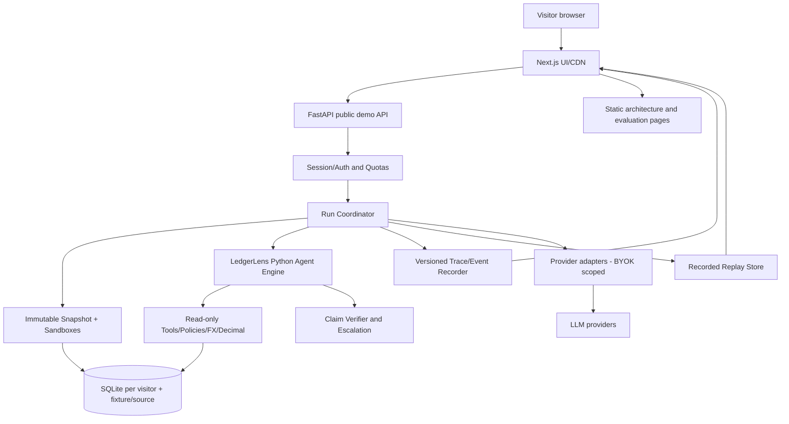

# System architecture - presentation separated from intelligence

## Decision

**Preserve the Python codebase; extend with a thin FastAPI facade; add a Next.js web front end.** The Python domain/agent package remains the source of truth for tools, policies, evidentiary decisions, financial calculations and simulation.

Do **not** write parallel TypeScript business logic, install new agent frameworks just for marketing, or convert the domain to a distributed system for a small public demo.

## Reference component diagram



## Suggested repository layout (incremental, additive)

```text
ledgerlens/
├── ledgerlens/                # existing Python core; retain semantics
│   ├── agents/
│   ├── tools/
│   ├── verify/
│   ├── sim/
│   ├── memory/
│   ├── observability/
│   ├── demo_api/            # NEW: public API, session, endpoints, guards
│   ├── sandbox/             # NEW: branch/event handling
│   ├── replay/              # NEW: recorded bundles and signature/provenance
│   └── providers/           # NEW: per-run model profile factory
├── apps/
│   └── web/                 # NEW: Next.js, React, TypeScript
│       ├── app/
│       ├── features/
│       ├── components/
│       ├── lib/api/
│       ├── lib/models/
│       └── tests/
├── app/                      # legacy Streamlit demo; keep until parity
├── data/
│   ├── sample/               # existing public derived sample
│   ├── scenarios.json
│   ├── replay/               # versioned sanitized reference artifacts
│   └── eval/
├── docs/
│   ├── adr/
│   ├── api/
│   ├── threats/
│   └── tutorials/
├── tests/
│   ├── api/
│   ├── sandbox/
│   ├── security/
│   └── e2e/
├── pyproject.toml
└── uv.lock
```

Avoid forcing Python into pnpm. `apps/web` owns its `package.json` and lockfile; a small root `Makefile` or `justfile` can run both. If repo later grows to multiple JS packages, introduce a JS workspace then. The existing Python module tests must continue to work unchanged.

## Request paths

### Recorded replay (no key)

Browser → static artifact manifest via CDN or FastAPI → trace data/events + sanitized result → client time controller animates stored events. **Never** call an LLM in replay. Each artifact contains source trace capture time, model/provider, run metadata, data hash and published schema version.

### Deterministic sandbox

Browser → session-bound FastAPI → validate mutation → append scoped event / rebuild projection → read scoped table and run deterministic assertions → return preview/evidence. If visitor wants a new text investigation, ask them to enter BYOK Live; never synthesize a fake LLM answer.

### Live agent

Browser → FastAPI `POST /runs` with case+session+model-profile+limits (but **not raw API key** in run payload) → create run token → background worker executes original Python integrator under a `RunContext` → callbacks normalize spans → SSE client receives versioned events → final verification → immutable sanitized run/result. Browser may request cancellation; server enforces timeout even if client disconnects.

## Session and state strategy

Initial public demo can have **one Python backend instance / process** with memory-bounded ephemeral credential references and temp-backed SQLite per session. This is a consciously constrained deployment, not horizontally scalable infrastructure. Prevent parallel browser tabs from corrupting the same branch via expected revision and locks; provide idempotent retries. Session cookie: signed, opaque, HttpOnly, Secure, SameSite=Lax/Strict as appropriate; server rotates key and expires sessions.

Do not put an API key, raw ledger copy, policy content intended to be private, or agent memory in cookies. Implement max concurrent runs, session TTL, backend temp directory quotas and cleanup. If moving to multi-instance, introduce a shared session store/object storage and explicit routing; avoid claiming horizontal readiness until tested.

## Storage

| Data class | Physical storage | Lifetime | Rules |
|---|---|---|---|
| Published baseline | Immutable SQLite/manifest under version control or deployed artifact | versioned | checksum verified |
| Public replay | Static JSON+gzip artifacts with sanitized content | versioned | no secrets/real PII |
| Visitor branch | Private temp SQLite and event overlay | short TTL | owned by session, deleted |
| Session metadata | server memory or bounded internal SQLite | short TTL | no API key values |
| BYOK | process memory only, scoped by session/ephemeral handle | short TTL | never on disk/trace |
| Online run trace | in-memory bounded ring buffer; optional sanitized short-term temp | short TTL | access controlled |
| Eval results | versioned JSON/CSV in repository | immutable releases | sample count and provenance |

## API boundary and layering

`apps/web` imports only TypeScript client types. The FastAPI public facade translates HTTP to Python application services. `ledgerlens/demo_api/` may import `ledgerlens/agents` and `ledgerlens/sim`; the core **must not import Next.js, Streamlit or web framework types**. CLI, Streamlit and web share the engine. Define ports for `SnapshotRepository`, `SandboxRepository`, `ModelClientFactory`, `TraceSink`, `ReplayRepository` and `RunBudget` rather than concrete global env state.

## Work execution

- Runs are bounded asynchronous tasks with fixed maximum concurrent sessions/runs; avoid an in-process unbounded thread per click.
- For a single demo host, use a bounded executor; use any event loop-friendly technique consistent with LangGraph callbacks. Preserve cancel/deadline propagation into tool execution and provider calls; process-level kill if a native NLI worker hangs.
- SSE is appropriate for server → browser spans, using server-sent `id`, `event`, retry/reconnect behavior and heartbeat. Enforce ownership at subscribe time. Events are idempotent by monotonic sequence; reconnect via `Last-Event-ID` only while the run and bounded buffer remain available.
- A long-running or failed provider should never hold the entire UI; replay still works if live backend is down.
- Hot path stores **public data only**; no real account number, user-provided sensitive financial data or actual payment processor credentials.

## Practical deployment profile

**Tier 0 - completely static:** Next.js exported/static pages with replay artifacts; best reliability and cost for recruiters.

**Tier 1 - interactive public portfolio:** Next.js deployed on a managed frontend host; a single low-cost Dockerized FastAPI/uv process with bounded CPU/memory on a managed container host; constrained ephemeral files; CI deploy. The interactive features transparently degrade when unavailable.

**Tier 2 - optional heavier live evaluation:** separate on-demand worker/host for NLI and provider calls if CPU exceeds quotas. No GPU required for replay. Avoid paid always-on GPU unless real measurements justify it.

Config must include allowed origins, HTTPS, CSP, proxy header policy, uploads disabled initially, session TTL, per-IP/session rate limits, model call caps, timeouts and resource guards. A cloud instance can restart: ephemeral sessions are intentionally lost and visitors are told so.

## No architectural theater

No Kubernetes, service mesh, agent swarm, event bus or model-serving fleet without measured need. The strongest story is **a disciplined domain engine with security, evals, durable evidence and outstanding UX**, not the number of repositories or frameworks.
