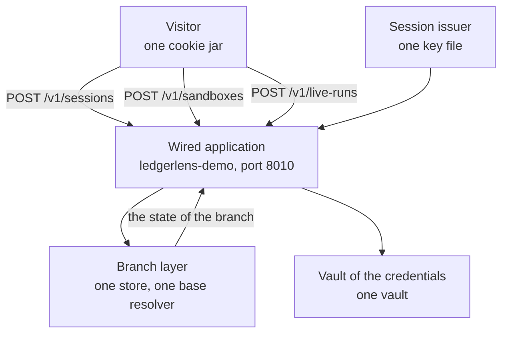

# The live mode in five minutes: bring your own key

This is the quickstart of the live mode of LedgerLens. It is written for a reader who has never seen the
repository: it says how to run one case with a key of your own on a machine of your own, and how to take that key
back afterwards.

The live mode is the branch of the demo where the visitor brings the key of a model provider. Everything else of the
demo (the replay and the deterministic sandbox) keeps working with no key at all.

What the mode promises, in one paragraph: the key arrives once, over one request, and lives in the memory of the
server until the session ends, until you forget it, until its time to live passes or until the server restarts. It is
never written to a file, a log or a trace, and it never travels back to the client. What the run costs is what your
provider charges you, inside the caps that the request carries. And the run answers about the ledger of the branch
of the visitor, which the visitor forked in the sandbox, and never about the ledger of the configuration.

The binding documents are [the specification](spec.md), [the task list](tasks.md),
[ADR-035, the facade of the live mode](../../docs/decisions/ADR-035-the-facade-of-the-live-mode.md),
[ADR-038, the live run reads the ledger of the branch of the visitor](../../docs/decisions/ADR-038-the-live-run-reads-the-ledger-of-the-branch-of-the-visitor.md) and
[ADR-039, the wired application of the demo](../../docs/decisions/ADR-039-the-wired-application-of-the-demo.md).

## 1. What you need

- Python 3.12 (the repository pins it in `.python-version`) and [uv](https://docs.astral.sh/uv/).
- `curl` and `python3` for the commands below.
- A key of a model provider, and an account that may pay for the calls. The server accepts the providers it
  publishes: `openai`, `anthropic`, `google` and `local`.
- No key and no network at all, if you follow
  [the rehearsal of the appendix A](#appendix-a-the-whole-flow-without-a-key-and-without-a-network): the same flow
  runs against a scripted provider.

## 2. Install

From a clone of the repository:

```bash
uv sync --extra api --extra dev --extra app
```

The `api` extra carries `fastapi`, `uvicorn` and `jsonschema`, and the routes of the live mode need all three. The
`dev` extra carries `pytest` and `ruff`, which the gate of the repository runs, and the `app` extra carries
`streamlit`, which the interface of the demo uses. In this repository the command above changes nothing: the
lockfile is already resolved with the three extras.

## 3. Start the demo

The demo of the visitor is served by one command:

```bash
uv run ledgerlens-demo --port 8010
```

That command serves the wired application of the demo: the live mode and the sandbox of the visitor in one
application, over one session issuer, one store of branches, one branch layer and one vault of the credentials
([ADR-039](../../docs/decisions/ADR-039-the-wired-application-of-the-demo.md)). The visitor is one visitor over the two
facades, so the branch that the sandbox forks is the branch that the live run reads.

The command takes `--host` and `--port`, the way the internal ledger API takes them, and it prints the address it
serves:

```text
INFO:     Uvicorn running on http://127.0.0.1:8010 (Press CTRL+C to quit)
```

Two other commands live in the repository and neither one serves the demo of the visitor:

| Command | What it serves |
| --- | --- |
| `ledgerlens-sim` | the simulator of the data. |
| `ledgerlens-api` | the internal read-only ledger API (`ledgerlens/api/ledger_service.py`): a transaction by id, a settlement by id, the settlements of a merchant, the replay of a webhook and the health of the service. It is not the sandbox of the demo, and the sandbox facade has no command of its own. |

### 3.1 What the wired application serves

One port, one application, the two facades of the demo:

| Route group | What it serves |
| --- | --- |
| the eleven routes of the live mode (the section [the eleven routes](#the-eleven-routes)) | the credential, the catalogue and the run |
| the eleven routes of the sandbox | the branch of the visitor, its ledger, its mutations and its history |

The application serves ONE session of each kind, and the choice is written in the factory, never in the order of two
lines of code:

- `POST /v1/sessions` is the route of the live mode, because its answer is the superset: the three fields of the
  session, the capability of the live mode, the disclosure of the storage, the disclosure of the erasure and the
  no-store headers.
- `DELETE /v1/sessions/current` is the route of the sandbox, because it is the complete one: it deletes the branches
  of the session, it purges the memory of the case and it drops the credentials of the session.

The other route of each kind is dropped from the composition, by path and by method, so the application answers twenty
routes: the eleven of the live mode and the nine of the sandbox that the two contracts do not share.

So the visitor sees one cookie and one session over the two facades: the branch that the sandbox forks is the branch
that the live run reads.



Three things about that wiring are worth naming out loud:

- The issuer reads the key file `data/runtime/shared-session.key` and it signs the cookie of the two facades. The
  file holds the signing key of the cookie, not your provider key. The two facades keep their own issuers by
  default, and the factory is what makes them one visitor.
- The store of branches and the base of the scenarios are shared, so the branch that the sandbox forks is the
  branch that the live run reads. The live facade is given the branch layer itself, and the sandbox facade builds
  its own layer over the same store and the same base resolver, so the two cannot disagree about what a branch
  holds.
- The cookie carries no port, so the same cookie jar is the same visitor in the two of them.

The answer that proves that the demo is up is the catalogue, which needs no key and no network:

```bash
curl -sS http://127.0.0.1:8010/v1/models
```

```json
{"models":[{"profile_id":"openai-gpt-4.1-mini","provider":"openai","model_id":"gpt-4.1-mini","display_name":"GPT-4.1 mini","capabilities":["chat","tool_calling"],"status":"tested","enabled_in_public_demo":true,"pricing":{"source":"manual","last_verified":"2026-11-08","input_per_1m_usd":"0.40","output_per_1m_usd":"1.60"}}]}
```

Make sure the product does not run offline. `LEDGERLENS_OFFLINE=1` refuses the live mode with a readable reason
(the section [the offline state](#the-offline-state) says exactly how), so if your `.env` carries it, start the
server with `LEDGERLENS_OFFLINE=0 uv run ledgerlens-demo --port 8010` instead. The process environment wins over the
`.env` file.

The program of 91 lines that this document used to ask the reader to copy is gone: the wiring of the two facades is
a deployment written down in the repository, and the command above is it.

### 3.2 What the plain factory does

The factory of the repository alone serves the live facade alone, with no branch layer, so it has no ledger of the
visitor to read:

```bash
uv run uvicorn ledgerlens.api.byok:create_app --factory --port 8012
```

Every run of that server is refused, with the reason in the body. It never falls back to the ledger of the
configuration, because that ledger holds the rows of every account of the repository. The body of the run is checked
against the published contract before anything else, so the refusal below comes with a body that matches it and
that names nothing real:

```bash
cat > run-of-the-plain-factory.json <<'JSON'
{
  "mode": "live_agent",
  "scenario_id": "S01",
  "sandbox_id": "sb_0000000000000000",
  "expected_revision": 0,
  "account_id": "C-0412",
  "question": "Why was my card payment of 120,50 BRL reversed on 2026-11-03?",
  "variant": "A",
  "model_profile_id": "openai-gpt-4.1-mini",
  "credential_handle": "handle_that_names_nothing_real",
  "limits": {
    "max_model_calls": 4,
    "max_tool_calls": 4,
    "max_wall_seconds": 60,
    "max_output_tokens": 512,
    "max_estimated_usd": "0.50"
  }
}
JSON

curl -sS -o /dev/null -c jar-plain.txt -X POST http://127.0.0.1:8012/v1/sessions
curl -sS -i -b jar-plain.txt -H 'Content-Type: application/json' \
  --data-binary @run-of-the-plain-factory.json http://127.0.0.1:8012/v1/live-runs
```

```http
HTTP/1.1 503 Service Unavailable

{"code":"BRANCH_LAYER_MISSING","message":"this deployment has no branch layer, so there is no ledger of the visitor to read: the run is refused instead of reading the ledger of the configuration","retryable":false,"request_id":"req_d2b5d388b5612abc"}
```

The rest of that server works: the catalogue, the session and the credential answer as usual. Only the run needs the
branch layer, and a deployment that serves the live mode has to wire one. The command of the section 3 is that
deployment, written down in the repository.

## 4. The session

The wired application has one session of each kind, and the session of the visitor is the one of the live mode. The
visitor is anonymous, and the session is what decides what the visitor may read: a run belongs to the session that
started it, and so does a branch.

```bash
curl -sS -i -c jar.txt -X POST http://127.0.0.1:8010/v1/sessions
```

```http
HTTP/1.1 201 Created
x-ledgerlens-key-storage: the key is not stored: it lives in the memory of the server and the credential is dropped when the session ends
x-ledgerlens-key-erasure: the memory of the machine cannot be guaranteed to be erased: the server drops the key when the credential ends, but no runtime can promise that no copy of the text of the key survives in the memory of the interpreter or in a swap of the operating system
cache-control: no-store
pragma: no-cache
expires: 0
set-cookie: ledgerlens_session=sess_c60974f44328d7c665ed248be87386c4.1795292044.fb5f98df25ae07e3d78d04fa8cef2903; HttpOnly; Max-Age=14400; Path=/; SameSite=lax

{"id":"sess_c60974f44328d7c665ed248be87386c4","expires_at":"2026-11-21T20:14:04.411504+00:00","mode_capabilities":["deterministic_sandbox","live_agent","recorded_replay"]}
```

The answer carries the capability of the live mode, the disclosure of the storage, the disclosure of the erasure and
the no-store headers, because it is the answer of the live mode. The sandbox of the demo has a session route too,
and the wired application drops it: the visitor gets one session, not two.

The file `jar.txt` is the cookie jar of `curl`. Every later command carries it with `-b jar.txt`, and the session
cookie is what ties the key, the branch, the run and the cost report to you. The same jar opens the branch of the
sandbox and the run of the live mode, because the two facades share the issuer of the wiring.

Two facts about this cookie, because they surprise people:

- The cookie of the live mode and the cookie of the sandbox have the same name (`ledgerlens_session`) and they are
  signed with different keys by default: the live mode reads `data/runtime/live-session.key` and the sandbox reads
  `data/runtime/sandbox-session.key`. The two facades are the same visitor only when the deployment gives them the
  same session issuer, and that wiring is a decision of the deployment
  ([ADR-035](../../docs/decisions/ADR-035-the-facade-of-the-live-mode.md)). Out of the box they are two visitors,
  and a handle of one session is refused in the other. The factory of the section 3.1 gives them one issuer, and
  that is the only reason the branch of the next section is visible to the live mode.
- That key file holds the signing key of the cookie, not your provider key. Your provider key never reaches the
  disk.

The two facades alone are still two visitors, and the plain factory of the section 3.2 proves it: it has its own
issuer, so the cookie of the wired application is refused there, and the answer is the resource `Error` of the
contract and never a `500`:

```bash
curl -sS -i -b jar.txt -H 'Content-Type: application/json' --data-binary @run-of-the-plain-factory.json \
  http://127.0.0.1:8012/v1/live-runs
```

```http
HTTP/1.1 401 Unauthorized

{"code":"SESSION_REQUIRED","message":"no valid session","retryable":false,"request_id":"req_af2d952e78ba0e8b"}
```

## 5. The branch of the visitor

A live run reads the ledger of the branch of the visitor, and the branch is forked in the sandbox. The fork is
the route of the sandbox facade, and it takes the id of a scenario:

```bash
curl -sS -b jar.txt -c jar.txt -H 'Content-Type: application/json' --data-binary '{"scenario_id":"S01"}' \
  -o branch.json -w "%{http_code}\n" http://127.0.0.1:8010/v1/sandboxes
```

```text
201
```

```json
{"id":"sb_43893ee0600d93c9093ccae1","base_snapshot_id":"sample-42","snapshot_sha256":"11bfc352b82635985c22cda35a1610dc0f81c556bb813258649515d548a6ecf9","revision":0,"expires_at":"2026-11-21T17:14:04.422644+00:00"}
```

The answer is the branch: its id, the snapshot it was cut from, the hash of that snapshot, the revision it is at
and the moment it expires. The branch belongs to the session of the cookie, and a branch of another session is
refused with the same answer as a branch that never existed.

Forking the same scenario twice returns the branch that already exists, with the status `200` instead of the
`201` of the first fork, so the number of branches of a visitor never grows.

The branch holds the rows of one account, and the account is the one of the scenario. The answer of the fork does
not name it, so the run has to name it too:

```bash
uv run python -c "from ledgerlens.demo import accounts_of, load_manifest; print(accounts_of(load_manifest(), 'S01')[0])"
```

```text
C-0412
```

Keep the two numbers at hand, the id of the branch and the account of the scenario. The next section needs both.

## 6. The catalogue and the price

The catalogue is the only list of models the visitor may pick. It shows the models the server really tested, with
their capabilities and their price.

```bash
curl -sS http://127.0.0.1:8010/v1/models
```

```json
{"models":[{"profile_id":"openai-gpt-4.1-mini","provider":"openai","model_id":"gpt-4.1-mini","display_name":"GPT-4.1 mini","capabilities":["chat","tool_calling"],"status":"tested","enabled_in_public_demo":true,"pricing":{"source":"manual","last_verified":"2026-11-08","input_per_1m_usd":"0.40","output_per_1m_usd":"1.60"}}]}
```

Only a profile whose tool calling was really exercised and that is enabled in the public demo enters that list. A
model of the allowlist that was not tested is not in the catalogue, and the server refuses it by itself when a
request names it.

The price of one model, with its provenance and the day it was last checked:

```bash
curl -sS http://127.0.0.1:8010/v1/models/openai-gpt-4.1-mini
```

```json
{"model":{"profile_id":"openai-gpt-4.1-mini","provider":"openai","model_id":"gpt-4.1-mini","display_name":"GPT-4.1 mini","capabilities":["chat","tool_calling"],"status":"tested","enabled_in_public_demo":true,"pricing":{"source":"manual","last_verified":"2026-11-08","input_per_1m_usd":"0.40","output_per_1m_usd":"1.60"}},"price_known":true,"price_note":"the price was verified on 2026-11-08 and comes from manual"}
```

A model whose price was never verified shows no amount at all, never a guess:

```bash
curl -sS http://127.0.0.1:8010/v1/models/openai-gpt-4.1
```

```json
{"model":{"profile_id":"openai-gpt-4.1","provider":"openai","model_id":"gpt-4.1","display_name":"GPT-4.1","capabilities":["chat"],"status":"experimental","enabled_in_public_demo":false,"pricing":{"source":"unknown","last_verified":null,"input_per_1m_usd":null,"output_per_1m_usd":null}},"price_known":false,"price_note":"the price of this model is unknown, so no amount is shown"}
```

## 7. Hand the key over, without putting it anywhere it should not be

The key may not sit in a URL, in a command line that ends in a shell history, in a file that outlives the session or
in a log. The commands below read the key from the keyboard without echoing it, and pass it to the server through
the standard input of `curl`. The key is never in the arguments of a process, so it never shows up in the process
list. The shell hands it on through a temporary file of its own, which bash removes as soon as the command is over,
and the variable that holds it is unset right after the call.

```bash
read -rs -p "paste the provider key: " KEY; echo
python3 -c 'import json,sys; json.dump({"provider":"openai","api_key":sys.stdin.read().strip()}, sys.stdout)' <<< "$KEY" \
  | curl -sS -b jar.txt -c jar.txt -H 'Content-Type: application/json' --data-binary @- http://127.0.0.1:8010/v1/credentials \
  | tee credential.json
unset KEY
```

The answer carries the handle, the provider and the expiry, and never the key:

```json
{"handle":"UeCR2XM1UN9EQbk_3JmB0C-renOpozDmxBvy8rXVTfQ","provider":"openai","created_at":"2026-11-21T16:14:04.461298+00:00","expires_at":"2026-11-21T17:14:04.461298+00:00"}
```

The handle is what the rest of the flow uses. The file `credential.json` holds only the handle, the provider and
two dates, so it is safe to keep for the length of the session.

Two things to know about that answer:

- Accepting a key does not call the provider. The route checks the shape of the key and the name of the provider,
  and it hands out a handle. The provider sees your key for the first time in the run. A key that does not work is
  refused by the provider during the run, and the answer of the run says so.
- The headers of that answer say what the product does with the key: `X-LedgerLens-Key-Storage` says that the key
  is not stored and that the credential is dropped when the session ends, `X-LedgerLens-Key-Erasure` says that no
  runtime can promise that no copy of the text of the key survives in the memory of the interpreter or in a swap of
  the operating system, and `X-LedgerLens-Billing-Disclosure` says that your provider may charge you for the calls.

## 8. Run a case

A run carries a model, a question, a scenario and the caps of the run. The contract asks for four of them (the
calls of the models, the output tokens, the calls of the tools and the wall clock) and accepts two more: the cap of
the money and the cap of the input tokens. The cap of the input tokens is checked on the plan of the run, before the
call, because the size of the request is known before the call. The body is the published contract of the request
([live-run-request.schema.json](contracts/live-run-request.schema.json)), and the server checks it before it does
anything.

The body names the branch of the visitor, and the two values that name it are the ones of the section 5: the id of
the branch and the account of the scenario.

```bash
HANDLE=$(python3 -c 'import json; print(json.load(open("credential.json"))["handle"])')
BRANCH=$(python3 -c 'import json; print(json.load(open("branch.json"))["id"])')
ACCOUNT=$(uv run python -c "from ledgerlens.demo import accounts_of, load_manifest; print(accounts_of(load_manifest(), 'S01')[0])")

cat > run.json <<JSON
{
  "mode": "live_agent",
  "scenario_id": "S01",
  "sandbox_id": "$BRANCH",
  "expected_revision": 0,
  "account_id": "$ACCOUNT",
  "question": "Why was my card payment of 120,50 BRL reversed on 2026-11-03?",
  "variant": "A",
  "model_profile_id": "openai-gpt-4.1-mini",
  "credential_handle": "$HANDLE",
  "limits": {
    "max_model_calls": 4,
    "max_tool_calls": 4,
    "max_wall_seconds": 60,
    "max_output_tokens": 512,
    "max_estimated_usd": "0.50"
  }
}
JSON

RUN=$(curl -sS -b jar.txt -H 'Content-Type: application/json' --data-binary @run.json http://127.0.0.1:8010/v1/live-runs \
  | tee run-start.json | python3 -c 'import json,sys; print(json.load(sys.stdin)["run_id"])')

echo "run: $RUN"
```

The answer names the run and the mode:

```json
{"run_id":"run_ba3070d327ed8eb5","status":"running","mode":"live_agent"}
```

What each field of the body means:

- `mode` is `live_agent` for a live run. The route of the live mode refuses `deterministic_sandbox`, because the
  sandbox has its own route.
- `model_profile_id` is a `profile_id` of the catalogue. A name that is not in the allowlist of the server is
  refused, and a profile whose status is not `tested` is refused with the reason.
- `variant` is the architecture of the case. `A` runs without the tools of the agent, `B` and `C` need a model that
  calls tools natively, and `D` needs the strict requirement. A model that lacks the capability is refused with the
  capability named, and it is never replaced by another model.
- `scenario_id`, `sandbox_id`, `expected_revision` and `account_id` name the branch of the visitor, and they are
  checked against it before the run starts. The `sandbox_id` is the id of a branch of the session, the
  `expected_revision` is the revision that branch is at, and the `account_id` is the account of that branch. A
  branch of another session, a branch that expired, a branch that cannot prove its own state, an account that is
  not the account of the branch and a revision that moved are all refused, and no provider is called, so a refused
  run spends no money of the visitor.
- `limits` are the caps of the run. They are checked before the money of the visitor is spent, and the cap of the
  money is checked against the worst case that the other caps allow.

The refusals of the branch are the codes of the contract of the sandbox, so the two facades cannot disagree about
what a branch holds. Every one of them happens before the first call of the provider:

| Code | Status | What it means |
| --- | --- | --- |
| `NOT_FOUND` | 404 | The `sandbox_id` is not a branch of this session. A branch of another session answers the same way. |
| `BRANCH_EXPIRED` | 409 | The branch outlived its time to live. Fork the scenario again. |
| `HASH_MISMATCH` | 409 | The branch cannot prove its own state. Fork the scenario again. |
| `ACCOUNT_MISMATCH` | 422 | The `account_id` of the request is not the account of the branch. |
| `REVISION_MOVED` | 409 | The branch is at another revision than the one the request expected. |
| `BRANCH_LAYER_MISSING` | 503 | The deployment has no branch layer, so there is no ledger of the visitor to read. |

The model of the request is checked before the branch of the visitor is read, because the model is a property of the
request itself, and a request that names a model the server may not run is refused with no money of the visitor spent
either way.

The body may never carry a raw key. The route takes the handle of a credential and nothing else.

## 9. Follow the run and read what it cost

The state of the run:

```bash
curl -sS -b jar.txt http://127.0.0.1:8010/v1/live-runs/$RUN
```

```json
{"run_id":"run_ba3070d327ed8eb5","status":"completed","answer":"the payment was reversed by the issuer, not by the merchant","error":null,"best_effort":false,"cancel_requested":false,"provider":"openai","model_profile_id":"openai-gpt-4.1-mini","model_id":"gpt-4.1-mini"}
```

The trace of the run, as a stream of events that ends with the terminal event:

```bash
curl -sS -N -b jar.txt http://127.0.0.1:8010/v1/live-runs/$RUN/events
```

```text
event: run.started
event: span.started
event: span.ended
event: run.status
event: span.started
event: span.ended
event: run.status
event: span.started
event: span.ended
event: run.status
event: run.completed
```

Every event carries a line of data beside its name, and the first one says which ledger the run read: the branch,
its revision and the hash of the state that was read.

```text
event: run.started
data: {"at": "2026-11-21T16:14:05.083+00:00", "event_type": "run.started", "mode": "live_agent", "parent_span_id": null, "payload": {"account_id": "C-0412", "branch_id": "sb_43893ee0600d93c9093ccae1", "branch_revision": 0, "budget": {"max_estimated_usd": "0.50", "max_input_tokens": null, "max_model_calls": 4, "max_output_tokens": 512, "max_tool_calls": 4, "max_wall_seconds": 60.0}, "canonical_hash": "11bfc352b82635985c22cda35a1610dc0f81c556bb813258649515d548a6ecf9", "model_id": "gpt-4.1-mini", "model_profile_id": "openai-gpt-4.1-mini", "provider": "openai", "scenario_id": "S01", "variant": "A"}, "run_id": "run_ba3070d327ed8eb5", "schema_version": "1", "seq": 1, "span_id": null}
```

Every run ends with exactly one terminal event: `run.completed`, `run.failed` or `run.cancelled`. Whatever happened,
the partial trace stays visible.

The cost of the run:

```bash
curl -sS -b jar.txt http://127.0.0.1:8010/v1/live-runs/$RUN/cost
```

```json
{"run_id":"run_ba3070d327ed8eb5","status":"completed","model_calls":3,"tool_calls":0,"calls_by_model":{"gpt-4.1-mini":3},"input_tokens":360,"output_tokens":72,"elapsed_seconds":0.02,"observed_cost_usd":"0.0002592","estimated_cost_usd":"0.0017592","price_known":true,"money_cap_authoritative":true,"cut_by":null,"usage_without_reservation":[],"note":"the observed cost and the estimated cost are two numbers: the first is what the provider reported and the second is what the run planned"}
```

The observed cost and the estimated cost are two numbers and never one. The observed one is what the provider
counted, the estimated one is what the run planned. A run whose model has no verified price shows no amount at all
and says that the price is unknown.

To stop a run that is still going:

```bash
curl -sS -b jar.txt -X POST http://127.0.0.1:8010/v1/live-runs/$RUN/cancel
```

The calls that had not started never start, and the answer says that the cancellation of a call that was already at
the provider is a best effort and not a guarantee. A run that is already over says so:

```json
{"run_id":"run_ba3070d327ed8eb5","status":"completed","best_effort":false,"message":"the run was already over: its status is 'completed', and there was nothing to stop"}
```

## 10. Revoke the key

There are two ways, and both take effect at once.

Forget one credential, with its handle:

```bash
cat > forget.json <<JSON
{"handle": "$HANDLE"}
JSON

curl -sS -b jar.txt -H 'Content-Type: application/json' --data-binary @forget.json http://127.0.0.1:8010/v1/credentials/forget
```

```json
{"forgotten":true,"message":"the key is gone"}
```

Forget every credential of the session, by ending the session:

```bash
curl -sS -o /dev/null -w "%{http_code}\n" -b jar.txt -X DELETE http://127.0.0.1:8010/v1/sessions/current
```

```text
204
```

The answer of the forgetting is the same when there was no key to forget, so the route never tells a visitor
whether a handle of another session exists:

```json
{"forgotten":false,"message":"there was no key to forget"}
```

The key also dies when the time to live of the credential passes (one hour by default, and never longer than the
session that holds it) and when the server restarts, because the key lives in the memory of the process and
nowhere else. The vault is bounded: 64 credentials at the same time by default, and a credential that fails three
times is dropped.

When you are done, remove the files that hold the handle and the cookie:

```bash
rm -f jar.txt jar-plain.txt jar-offline.txt credential.json run.json run-start.json forget.json branch.json \
  run-of-the-plain-factory.json
```

## 11. The eleven routes

| Route | What it does |
| --- | --- |
| `POST /v1/sessions` | Issues the session of the visitor and sets the cookie. |
| `DELETE /v1/sessions/current` | Ends the session and drops every credential of that session. |
| `POST /v1/credentials` | Accepts the key of the visitor and answers with a handle. |
| `POST /v1/credentials/forget` | Drops one credential at once. |
| `GET /v1/models` | The catalogue of the models the visitor may pick. |
| `GET /v1/models/{profile_id}` | The price of one model, with its provenance. |
| `POST /v1/live-runs` | Starts a live run and answers with its identifier. |
| `GET /v1/live-runs/{run_id}` | The state of a run, its answer and the reason it ended. |
| `GET /v1/live-runs/{run_id}/events` | The trace of the run, until the terminal event. |
| `POST /v1/live-runs/{run_id}/cancel` | Cancels a run that is still going. |
| `GET /v1/live-runs/{run_id}/cost` | What the run consumed, and the two costs. |

A run belongs to the session that started it. A run of another session answers `404` with the code `NOT_FOUND`,
exactly like a run that never existed, so a visitor cannot learn that a run of another visitor exists.

The flow of this document uses two routes of the sandbox facade, on the same port, `8010`, because the wired
application serves the two facades as one visitor:

| Route | What it does |
| --- | --- |
| `POST /v1/sandboxes` | Forks the scenario into a private branch of the session, and answers with the branch. |
| `GET /v1/sandboxes/{sandbox_id}` | The state of the branch: the revision, the hashes and the expiry. |

## The offline state

With `LEDGERLENS_OFFLINE=1` the whole product runs with no key and no network: the replay and the deterministic
sandbox keep working exactly as before. The live mode is refused with a readable reason, because a run that cannot
call a provider would be a run that lies about its own mode.

Start the server offline, and open a session of its own, because the session of the section 4 is over by now:

```bash
LEDGERLENS_OFFLINE=1 uv run ledgerlens-demo --port 8011
```

```bash
curl -sS -o /dev/null -c jar-offline.txt -X POST http://127.0.0.1:8011/v1/sessions
```

Now ask for a run:

```bash
curl -sS -i -b jar-offline.txt -H 'Content-Type: application/json' --data-binary @run.json http://127.0.0.1:8011/v1/live-runs
```

```http
HTTP/1.1 503 Service Unavailable

{"code":"LIVE_MODE_OFFLINE","message":"the live mode is off because the product runs offline (LEDGERLENS_OFFLINE=1); the replay and the sandbox keep working exactly as before","retryable":false,"request_id":"req_b255ea7c8c3c91b7"}
```

The routes that hold or spend a credential answer `503` with the code `LIVE_MODE_OFFLINE`: that is
`POST /v1/credentials` and `POST /v1/live-runs`. The routes that hold nothing and spend nothing keep answering:
`GET /v1/models`, `GET /v1/models/{profile_id}`, `POST /v1/credentials/forget` and `DELETE /v1/sessions/current`.

```bash
curl -sS http://127.0.0.1:8011/v1/models
curl -sS -b jar-offline.txt -H 'Content-Type: application/json' --data-binary @forget.json http://127.0.0.1:8011/v1/credentials/forget
```

```json
{"forgotten":false,"message":"there was no key to forget"}
```

The offline state comes before the branch: a run offline is refused whatever the branch says.

## Appendix A: the whole flow without a key and without a network

The live mode refuses to run offline, so the flow above cannot be rehearsed with `LEDGERLENS_OFFLINE=1`. It can be
rehearsed with the scripted provider of the domain: the fake adapter of the repository answers what the script tells
it to answer and never opens a socket. Nothing is billed, no key is needed, and the shape of every answer is the shape
of the live one.

The command of the section 3 serves the provider of the visitor, so the rehearsal serves the same wired application
with the fake adapter of the domain, through the same factory of the repository:

```bash
uv run python - <<'PY'
"""Serves the wired application with the scripted provider of the domain: no key and no network."""
import uvicorn
from ledgerlens.api.wiring import build_wired_app
from ledgerlens.byok.adapter import FakeProviderAdapter

ANSWER = "the payment was reversed by the issuer, not by the merchant"


def scripted(provider, api_key):
    """The provider of the rehearsal: the same answer, every call, and never a socket."""
    adapter = FakeProviderAdapter(provider=provider, api_key=api_key)
    for _ in range(8):
        adapter.script_answer(ANSWER, input_tokens=120, output_tokens=24)
    return adapter


uvicorn.run(build_wired_app(adapter_factory=scripted), host="127.0.0.1", port=8010)
PY
```

The script of the fake holds eight answers, and the run of this document asks the model three times, so the script
never runs out.

The key you paste in the section 7 is then never read: paste a placeholder, for example `not-a-real-key`. Every
other command of the document runs as it is written, against the port `8010`.

The answers quoted in this document come from that rehearsal, and the numbers of the scripted provider are the ones
of the run above: three model calls, 360 input tokens, 72 output tokens, an observed cost of `0.0002592` US$ and an
estimated cost of `0.0017592` US$.

The fake is a test double, not the product. It proves the shape of the flow; it does not prove that a real provider
answers.

## Appendix B: check a body before you send it

The published contract of the request is a file of the repository, so a body can be checked without a server, without
a key and without a network:

```bash
uv run python - <<'PY'
import json
from pathlib import Path
from jsonschema import Draft202012Validator

schema = json.loads(Path("specs/003-r3-bring-your-own-key/contracts/live-run-request.schema.json").read_text())
body = json.loads(Path("run.json").read_text())
errors = sorted(Draft202012Validator(schema).iter_errors(body), key=lambda e: list(e.absolute_path))
print("errors:", len(errors))
for error in errors:
    print(" -", list(error.absolute_path), error.message)
PY
```

```text
errors: 0
```

## Appendix C: the endpoints the server may call

The server calls only the endpoints its providers publish, and in public mode it refuses the addresses that reach
the machine itself: the link-local range, where the metadata of a cloud machine lives, and the loopback range,
where the services of the host live. The check is a pure function of the text of the endpoint, so it can be read
without a network:

```bash
uv run python - <<'PY'
from ledgerlens.byok.adapter import ALLOWED_ENDPOINTS, endpoint_verdict

for provider, endpoints in ALLOWED_ENDPOINTS.items():
    print(provider, endpoints)

for provider, endpoint in [
    ("openai", "https://api.openai.com/v1"),
    ("openai", "https://169.254.169.254/v1"),
    ("openai", "http://127.0.0.1:11434/v1"),
    ("openai", "https://api.openai.com/v1/chat"),
]:
    verdict = endpoint_verdict(provider, endpoint)
    print(provider, endpoint, "->", "allowed" if verdict is None else f"{verdict.code}: {verdict.message}")
PY
```

```text
openai ('https://api.openai.com/v1',)
anthropic ('https://api.anthropic.com/v1',)
google ('https://generativelanguage.googleapis.com/v1beta',)
local ('http://127.0.0.1:11434/v1', 'http://localhost:11434/v1')
openai https://api.openai.com/v1 -> allowed
openai https://169.254.169.254/v1 -> link_local: the endpoint 'https://169.254.169.254/v1' points to the link-local address 169.254.169.254, which the public demo refuses because it reaches the machine itself
openai http://127.0.0.1:11434/v1 -> loopback: the endpoint 'http://127.0.0.1:11434/v1' points to the loopback address 127.0.0.1, which the public demo refuses because it reaches the machine itself
openai https://api.openai.com/v1/chat -> not_published: the endpoint 'https://api.openai.com/v1/chat' is not an allowed endpoint of the provider 'openai', whose published endpoints are: https://api.openai.com/v1
```

In this milestone the visitor never chooses an endpoint: the request of a run carries no endpoint, and the adapter
uses the default endpoint of the provider. The check above is what a deployment that points the adapter at an
endpoint of its own gets.

## What is promised and what is not

Promised, and covered by the tests of the repository:

- The key never reaches a file, a log, a trace, an error message or an answer. The adapter scrubs it out of the
  error of the provider, and the coordinator scrubs everything it writes with the secret of the run, at every depth
  of a payload.
- The key lives in the memory of the process and nowhere else, and it is dropped when the session ends, when you
  forget it, when its time to live passes, when it fails too often or when the server restarts.
- The answer of the credential route never carries the key. It carries the handle, the provider and the expiry.
- A handle of another session is refused with the same answer as a handle that never existed.
- The catalogue shows only the models that were really tested, and the price of a model that was never verified is
  absent and never a guess.
- Every run ends with exactly one terminal event, and a run that would pass a cap stops at once and names the cap
  that stopped it: the report of the run carries that name in `cut_by`.
- The money of a run comes out of the code and never out of the model. It is a `Decimal` from the request to the
  report, and the report carries it as text.
- A run reads the ledger of the branch of the visitor, and only that ledger. The branch is the one that was forked
  in the sandbox, the account of the request is checked against the account of the branch, the revision is checked
  against the revision of the branch, and the tools of the agent cannot read the rows of another account whatever
  SQL the model writes. A deployment without a branch layer refuses every run instead of reading the ledger of the
  configuration.

Not promised, and said out loud by the product itself:

- No runtime can promise that the memory of the machine is erased. The server drops the key when the credential
  ends, but a copy of the text of the key may survive in the memory of the interpreter or in a swap of the
  operating system. The answer of every route that describes a run carries the header `X-LedgerLens-Key-Erasure`
  that says so.
- The key of the visitor is the money of the visitor. LedgerLens never makes a financial operation, in any mode, and
  the bill of the run comes from your provider.

## The codes you may see

| Code | Status | What it means |
| --- | --- | --- |
| `LIVE_MODE_OFFLINE` | 503 | The product runs offline, so the live mode is off. |
| `BRANCH_LAYER_MISSING` | 503 | The deployment has no branch layer, so the run has no ledger of the visitor to read. |
| `SESSION_REQUIRED` | 401 | The session cookie is missing, malformed, expired or wrongly signed. A run of another session is a `NOT_FOUND`, not a `SESSION_REQUIRED`. |
| `UNKNOWN_PROVIDER` | 422 | The provider is not one the live mode publishes. |
| `CREDENTIAL_REFUSED` | 422 | The key is empty or too long. |
| `MODEL_NOT_ALLOWED` | 422 | The model is not in the allowlist, or its status is not `tested`. |
| `CAPABILITY_MISSING` | 422 | The model lacks the capability the architecture needs. |
| `WRONG_MODE` | 422 | The body asked for the deterministic sandbox on the route of the live mode. |
| `MODE_NOT_ALLOWED` | 403 | The session may not run the live mode. |
| `INVALID_REQUEST` | 422 | The body does not match the published contract. |
| `NOT_FOUND` | 404 | No such run, no such model, no such branch of this session, or a run of another session. |
| `RUN_RUNNING` | 409 | The run is still running, so it has no cost report yet. |
| `BRANCH_EXPIRED` | 409 | The branch of the visitor outlived its time to live. |
| `HASH_MISMATCH` | 409 | The branch cannot prove its own state. |
| `REVISION_MOVED` | 409 | The branch is at another revision than the one the request expected. |
| `ACCOUNT_MISMATCH` | 422 | The account of the request is not the account of the branch. |
| `CONTRACT_UNAVAILABLE` | 503 | The deployment lacks `jsonschema`, so the server cannot check a body. |

A refusal of the facade never repeats a value of the visitor. The name of the model, the name of the provider and
the value of any field of the body are never quoted back, because the visitor may have put the key of their
provider in any of them.
