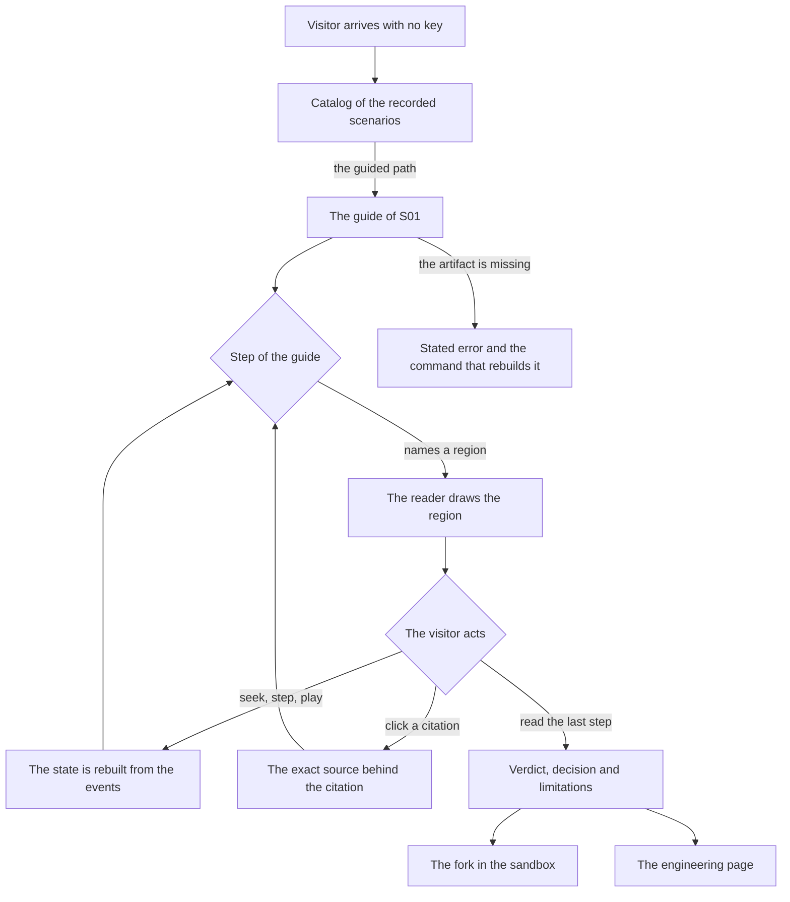

# Implementation Plan: Cold start guided replay

**Branch**: `feature/v3` | **Date**: 2026-11-23 | **Spec**: [spec.md](spec.md)

**Input**: Feature specification from `specs/007-r1-cold-start-guided-replay/spec.md`

## Summary

The repository already records, exports and plays a run. A visitor who arrives at the site with no key gets a
catalog of scenarios and a reader of the trace, and nothing else. The reader is honest and complete, and it
assumes that the visitor knows what a LangGraph span, a tool call and a verdict are. The design package asks for the
missing half: a cold start that takes a visitor who knows nothing to one resolved case in under three minutes, with
no key, no login and no backend.

The plan is small because the hard part is already built. The guide is a list of steps, each one naming a region of
the reader and one sentence that explains it. It is data, it lives in `apps/web/lib/replay/guide.ts`, and the reader
draws it. The page that opens the guided path is the page of the recorded demo with the first scenario already
chosen.

Three things in the package are answered differently by the repository, and the plan says so instead of copying the
package. The package proposes a route `GET /replays/:id` that serves the bundle; the repository is a static export
and serves the bundle as a file, so no route is added. The package proposes a rollback to a static HTML page when
the React runtime fails; the reader is already a static export, so the rollback is the removal of one file of data.
The package proposes the measurement of the three minutes with consented analytics; the repository has no
analytics and this milestone does not add any, so the number stays a hypothesis and the report says so.

The rest of the package is carried as it is: honest events in their real order, seek, the SQL of the run, the
citation that opens the exact source, the conclusion with its limitations, the path into the sandbox, the refusal
when the artifact is missing, and the keyboard and the mobile test of the path.

## Technical Context

**Language/Version**: TypeScript 5 and React for the frontend, Python 3.12 for the core
**Primary Dependencies**: Next.js, the primitives of `apps/web/components/ui/`, and the static artifacts of the
export
**Architecture**: the guide is data that the reader draws, the state of the playback stays in the reducer of the
reader, and the guide reads the bundle and never the backend
**Storage**: the guide lives in the source of the frontend, and the artifacts it walks live in
`apps/web/public/replay/`
**Testing**: vitest for the units of the frontend, Playwright for the keyboard and the mobile paths, and the gate
of the frontend `scripts/gate_web.sh`
**Constraints**: no request that leaves the site on the guided path, no key, the money of a cited row stays exact,
and the recording stays immutable

## The shape of the guided path

The guide never owns the layout. It names a region and the reader draws it, so a change in the layout does not
break the guide and a change in the guide does not break the reader.

## The decisions the plan takes

1. **The guide is data.** A step is a region, a sentence and the kind of the step. The page maps the steps to the
   regions of the reader and nothing else. The advantage is that the guide is testable without a browser and that
   the removal of the guided path is the removal of one file.
2. **The guide adds no verdict.** The last step shows the verdict of the bundle and the sentence of the agent. A
   guide that paraphrases the decision would be a second source of truth about a case, and ADR-074 decided that the
   decision belongs to the code.
3. **The playback state is not duplicated.** The guide reads the position of the reducer and writes nothing. The
   browser keeps the playback position and nothing else, as the package asks.
4. **The missing artifact is loud.** The reader refuses the whole bundle and names the file and the command. It
   never draws an empty trace, because an empty trace reads as a case with no evidence.
5. **The three minutes is a hypothesis.** No event of the guide leaves the browser in this milestone. The claim
   about the time is stated as a target in the specification and it is measured only when a consented measurement
   exists and is published with its own decision record.

## What exists and what the plan adds

| Area | In the repository today | What the plan adds |
|---|---|---|
| The recording and its bundle | `ledgerlens/replay/bundle.py`, `capture.py` and `site_export.py` | Nothing. |
| The reader | `apps/web/features/replay/ReplayViewer.tsx` and `apps/web/lib/replay/reducer.ts` | The guide that points at it. |
| The playback | `apps/web/features/replay/usePlaybackClock.ts` and `ReplayControls.tsx` | Nothing. |
| The steps of the cold start | Nothing | `apps/web/lib/replay/guide.ts` and the component that draws it. |
| The proof that no provider is called | Nothing that a test asserts | One Playwright test that fails on any request that leaves the site. |
| The three minutes | Not measured | Nothing. The number stays a hypothesis. |
| The rollback | Not needed | The removal of the file of the guide. |

## The risks

- **A guide that describes a trace the reader does not show.** The guide is checked against the regions of the
  reader by a unit test, and every step names a region that exists. A step that names no region fails the test
  before the page that draws it is written.
- **A seek that rebuilds a different history.** The reducer is the only owner of the position, and a unit test
  asserts that the state after two seeks to the same position is identical. The risk is a second state kept by the
  guide, and the rule that the guide keeps no state removes it.
- **A citation that opens a nearby record.** The resolution of a citation is by identity and not by text. The test
  asserts that every citation of the recorded scenario resolves to the record it names and that a missing source
  produces a refusal.
- **A number that stops being exact.** The money of a cited row is read as a `Decimal` string, and the unit test
  fails while a cited amount is rounded to a float.
- **A step that states a verdict the bundle does not carry.** ADR-060 and ADR-074 make the sentence of the agent
  the sentence of the surface. The test of the guide fails while a step states a verdict that the bundle does not
  carry.
- **A guided path that only works with a mouse.** The keyboard test and the mobile test are in the gate of the
  frontend, and they cover the controls of the guide and not only the controls of the reader.

## The strategy for the validation

Every task ships its test before its code. The unit tests of the guide run without a browser and fail on a step that
names no region, on a last step with no limitation and on a guide that does not name the capture. The end to end
tests run against the static export with the network disabled, and the test that watches the requests of the page is
the proof that the recorded demo calls nobody. The gate of the frontend runs the unit tests, the lint, the type
check and the build, and it runs the keyboard and the mobile tests of the path.

## What is out of scope

- The recording of new scenarios and the export of the site.
- The sandbox that the guide links to, which belongs to [specs/008](../008-r2-isolated-sandbox-mutations/spec.md).
- The evidence graph behind the citations, which belongs to
  [specs/010](../010-r8-evidence-graph-and-provenance/spec.md).
- The analytics of the site, and every event that would leave the browser.
- The live mode, which needs a key and is not a cold start.
- A new decision record: the guide changes no accepted decision and proposes none. The questions it raises, such as
  the consent of the measurement, are the business of a later milestone that measures something.

## The definition of done

1. The guided path opens a scenario with no key and with the network disabled, and a test fails while it issues a
   request that leaves the site.
2. Every step of the guide names a region of the reader, and a unit test says so.
3. The state after two seeks to the same position is identical, and the unit test says so.
4. Every citation of the recorded scenario resolves to the record it names, and a missing source produces a
   stated refusal.
5. The last step carries the verdict, the decision, at least one limitation and the two paths that continue the
   visit.
6. The keyboard and the mobile tests of the path are in the gate of the frontend and are green.
7. A missing artifact produces a stated error with the command that rebuilds it, and no event is drawn.
