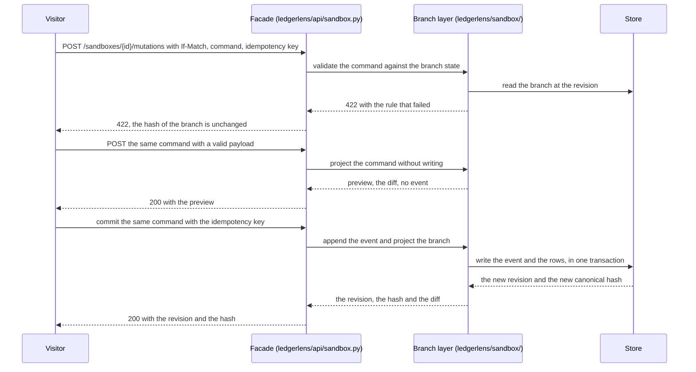
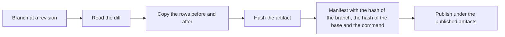

# Implementation Plan: Isolated sandbox mutations

**Branch**: `feature/v3` | **Date**: 2026-11-23 | **Spec**: [spec.md](spec.md)

**Input**: Feature specification from `specs/008-r2-isolated-sandbox-mutations/spec.md`

## Summary

The branch layer of the repository is built. A visitor forks a published base into a private branch, previews a typed
mutation, commits it, reads a deterministic diff and resets the branch to the base. The isolation between the
sessions, the idempotence of the commit, the atomicity of the write, the expiry and the undo are all there and all
covered by tests.

What the design package asks for that the repository does not have is the suite that holds the acceptance scenarios
of the package over the seeded scenarios, the property tests that hold the invariants of the branch over a generated
sequence of commands, and the diff of a mutation published as an artifact with a hash. The package asks also for a
screenshot of the diff. The repository publishes data with a manifest and a hash, so the diff is published as data
and the screenshot is not built.

The port therefore adds proof where the repository has behaviour and adds no behaviour where the repository has
proof. That is the honest reading of the package against the code, and the specification says it in the status
section.

The technical approach stays inside the layer that owns the domain. The branch, the command, the event and the diff
are the domain of `ledgerlens/sandbox/`, and the facade of `ledgerlens/api/sandbox.py` serves them. The export of
the diff is a reader of the branch, like ADR-028 decided, and it lives with the other readers of the branch. The
domain never imports the facade.

## Technical Context

**Language/Version**: Python 3.12 for the core
**Primary Dependencies**: FastAPI for the facade, the existing `ledgerlens/sandbox/` package, and SQLite for the file
backed store
**Architecture**: the branch layer sits behind the store interface, the mutations are typed commands and the commit
is atomic, and every new test is a test of the layer and not of the facade
**Storage**: the branches under `data/runtime/sandbox/`, the published bases under
`data/runtime/sandbox-bases/` and the published diffs under `data/eval/replay/` when they are published
**Testing**: pytest offline with `LEDGERLENS_OFFLINE=1`, the seeded scenarios S01, S02 and S03
**Constraints**: the published base is never written, the money is exact and never a float, a refused command changes
nothing, and the suite runs with no key and no network

## The path of one mutation

The refusal at the top of the diagram is the case that matters most for the money: the command is refused before
anything is written, so the hash of the branch cannot move.

## The three things this milestone adds

### 1. The conformance suite of the acceptance scenarios

The acceptance scenarios of the package are six sentences: two sessions that edit the same transaction, a mutation
that is retried, a wrong precision, a reset, a request to modify the source events, and a mutated rate that
invalidates the old answer. The repository holds every one of them as a test, but spread over files and mostly
against S01 alone. The suite gathers them into one file, runs each of them over S01, S02 and S03, and names the
scenario it ran. A rule that holds for S01 and not for S03 is caught, and a test that only ever ran S01 is no
longer the only proof of the rule.

### 2. The property tests of the branch

The properties are few and they are the ones a reader of the code checks by eye: the revision of a branch is the
count of its events, the hash of a branch is the hash of its projected state and is reproduced from the events
alone, and a refused command changes neither. The properties are checked over a generated sequence of commands, so
that a sequence nobody wrote by hand, such as a preview between two commits or a command that breaks an invariant
in the middle of a run, is covered.

The first task of the milestone decides how the generator is written. The repository carries no property testing
library, and the choice is between adding one and writing a seeded generator of the sequences of commands. The
decision belongs to the record of the milestone, because it decides what the suite of the repository depends on.

### 3. The published diff

The diff of a branch is a read, under ADR-028. The published artifact is that read, copied, hashed and labeled with
the hash of the branch, the hash of the base and the command that reproduces the mutation. The export is a pure
function of the branch, so running it twice gives the same bytes, and a third party can confirm the result with a
hash. The export refuses a branch whose hash does not match the one it read, the same way the export of the site
refuses a bundle that names an account and has no artifact of the ledger.

## The decisions the plan takes

1. **No behaviour is added to the branch layer.** The rules exist and are proven. The milestone adds proof and one
   reader that copies a read.
2. **The conformance suite names the scenario it ran.** A test that runs over three scenarios and reports nothing
   about them is a test that could pass by running none of them.
3. **The property generator is seeded and deterministic.** A test that fails with a seed nobody can read is a test
   nobody can fix.
4. **The published diff is data and not a picture.** The package asks for a screenshot. The repository publishes
   data with a manifest and a hash, and a picture cannot be verified by a third party.
5. **The domain never imports the facade.** The export of the diff lives with the readers of the branch and not in
   `ledgerlens/api/`.

## What exists and what the plan adds

| Area | In the repository today | What the plan adds |
|---|---|---|
| The branch, the command, the event and the projector | `ledgerlens/sandbox/` | Nothing. |
| The preview and the commit | `ledgerlens/sandbox/mutation.py` | Nothing. |
| The isolation, the idempotence, the reset and the undo | The tests of `tests/sandbox/` | One conformance suite that runs them over S01, S02 and S03. |
| The properties of the branch | Nothing | One file of property tests over a seeded generator. |
| The published diff | Nothing | One reader and one export with a manifest and a hash. |
| The screenshot of the diff | Nothing | Nothing. The diff is published as data. |

## The risks

- **A conformance suite that passes because it ran nothing.** Every test of the suite names the scenario it ran
  and the number of the commands it sent, and a test that runs no scenario fails.
- **A property test that is slow.** The generator stays over the seeded scenarios and over a small number of
  commands, and the test is marked with the marker of the slow tests when it needs the real sample.
- **A property that is not true of the base.** The properties are stated over the branch and not over the base, and
  the first case of the generator is the branch with no command.
- **An export that changes the state of the branch.** The export reads and copies. A test reads the revision and
  the hash before and after the export and expects them to be the same.
- **A published artifact that no longer matches the branch.** The export refuses a branch whose hash moved between
  the read and the write, and the manifest carries the hash of the branch.
- **A generated sequence that writes to the repository.** The generator works on the temporary store of the tests
  and never on `data/runtime/sandbox-bases/`.

## The strategy for the validation

Every task ships its test before its code. The conformance suite is the test of the rules that already exist, and it
is written first, so that the rules it gathers are seen to pass before anything is added. The property tests are
written before the generator. The export of the diff is written after its test, which refuses an export that moved
the branch and an export that is not byte identical when it runs twice.

The gate of the Python side runs the whole suite offline, with no key and no network.

## What is out of scope

- Any change to the branch layer, to the store interface or to the facade.
- The live mode and the reading of the ledger of the branch by a live run.
- The review of a case by a person, which belongs to
  [specs/012](../012-r10-human-review-and-approval/spec.md).
- The cost of a mutation and the cost of the review of a case, which belong to
  [specs/011](../011-r9-cost-per-case-and-decision-utility/spec.md).
- The multi agent work of the design package, which stays behind a flag and out of the runtime until a paired
  comparison measures a gain, under ADR-P007.
- The deployment of the facade with more than one worker, which is a decision of the deployment and not of the
  repository.

## The definition of done

1. The conformance suite of the acceptance scenarios of the package runs over S01, S02 and S03 and is green.
2. The properties of the branch hold over the generated sequences of commands, and the generator is seeded and
   deterministic.
3. The export of a diff is byte identical when it runs twice, and it carries the hash of the branch, the hash of the
   base and the command that reproduces the mutation.
4. The published base and the sample of the repository are byte identical before and after the whole suite.
5. The gate of the Python side is green offline.
