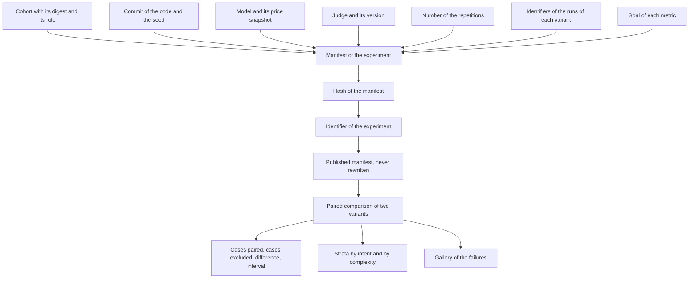
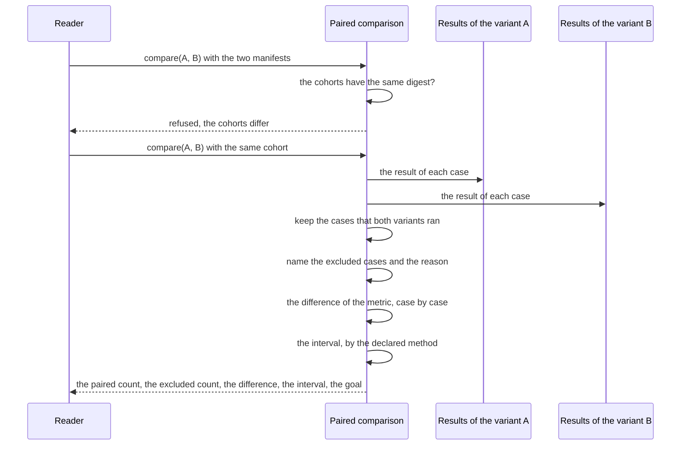

# Implementation Plan: Paired evaluation arena

**Branch**: `feature/v3` | **Date**: 2026-11-23 | **Spec**: [spec.md](spec.md)

**Input**: Feature specification from `specs/009-r4-paired-evaluation-arena/spec.md`

## Summary

The repository runs the three variants of the agent, scores them with code, pins every dataset with a digest and
publishes two reports. The report of the online run already says the honest thing that the package asks for: the
trajectory of the full agent with equivalent tools is 0.73 and the goal is 0.80, and the goal was not met. What the
report does not have is the machinery that makes a comparison checkable.

A mean over three runs of thirty cases is a number, but it is not a comparison. It does not say which cases the two
variants won, it does not say that the two variants ran the same cases, it does not say which judge produced it, and
it cannot be reproduced by a third party because the seed, the commit and the identifiers of the runs are not
pinned in one object. The arena is that object and the comparison over it.

The plan builds four things. The manifest of an experiment pins every input of a measurement and is hashed into the
identifier of the experiment, so a judge that changes produces a different experiment and never a rewritten number.
The paired comparison computes the difference case by case over a cohort that both variants ran, names the cases it
excluded and names the method that computed the uncertainty. The stratification splits the comparison by intent and
by complexity and refuses to give a mean to a stratum that is too small. The gallery holds the cases a variant lost
and the runs that failed, and it never holds the answer key of the held out set.

The comparison reads the results of runs that already happened. It never calls a model, and it never decides to run
one. That is a constraint of ADR-037 and of the FR-013 it carries: one run has one model, and the four slots of the
agent are four views of that model.

## Technical Context

**Language/Version**: Python 3.12 for the core
**Primary Dependencies**: the existing `ledgerlens/eval/` package, `pytest` and the standard library only
**Architecture**: the manifest of the experiment is a pure value that hashes itself, the comparison is a function of
two results and one manifest, and the gallery is a read of the results of a run
**Storage**: the published manifests and results under `data/eval/experiments/`, and the reports that exist under
`data/eval/`
**Testing**: pytest offline with `LEDGERLENS_OFFLINE=1`, the scripted model for the runs
**Constraints**: the money of the cost of a run is `Decimal`, the answer key of the held out set is never published,
a published experiment is never rewritten, and the comparison never calls a model

## The shape of an experiment

The hash of the manifest is the identifier of the experiment. A judge that changes, a cohort that moves, a seed
that changes and a goal that moves all produce a different identifier, and none of them rewrites the number that was
published before.

## The pairing, and what it refuses

Three refusals matter here. A comparison over two cohorts is refused, because the difference of the means of two
different sets of cases is not a comparison. A comparison whose comparator never ran publishes no result at all,
because a number against a missing number is not a number. And a missing run of one case is excluded and named,
because a zero in its place would turn an infrastructure failure into a quality signal.

## The decisions the plan takes

1. **The manifest is a pure value that hashes itself.** The identifier of an experiment is a hash of the manifest,
   and the manifest carries the digest of the cohort, the role of the cohort, the commit, the seed, the model, the
   judge and its version, the number of the repetitions, the identifiers of the runs and the goal of each metric.
2. **The uncertainty method is declared and never chosen by the reader.** The result names the method and carries
   no interval that the method did not produce. The first task of the milestone chooses the method and writes the
   choice down in the record of the milestone.
3. **A stratum that is too small carries no mean.** The minimum is declared in the result, and a stratum below it
   is marked as too small. A mean over three cases is a number that reads as a measurement and is not one.
4. **The gallery never leaks the key.** The gallery holds the answer of the variant, the expected facts of the case
   and the evidence it cited. It never holds a label of the held out set, under ADR-069.
5. **The comparison reads and never runs.** A comparison that called a model would be a new run, and a new run has
   its own manifest and its own identifier. It also breaks the promise of ADR-037, that one run has one model.

## What exists and what the plan adds

| Area | In the repository today | What the plan adds |
|---|---|---|
| The variants and the runner | `ledgerlens/eval/run.py` | Nothing. |
| The evaluators and the four trajectory modes | `ledgerlens/eval/evaluators.py` | Nothing. |
| The manifest of the datasets | `ledgerlens/eval/manifest.py` | Nothing. |
| The reports | `data/eval/report_offline.md` and `data/eval/report_online.md` | Nothing. They are preserved as they are. |
| The manifest of an experiment | Nothing | `ledgerlens/eval/experiment.py`. |
| The paired comparison and the stratification | Nothing | `ledgerlens/eval/paired.py`. |
| The gallery of the failures | Nothing | `ledgerlens/eval/failures.py`. |
| The command that reproduces an experiment | Nothing | The command lives in the manifest and the test that runs it. |

## The risks

- **A comparison over two cohorts.** The refusal is checked against the digest of the cohort and not against its
  name, because a cohort with another name and the same cases is the same cohort.
- **A missing run counted as a zero.** The exclusion is counted and named, and the mean is computed only over the
  paired cases.
- **A judge that changes under a published number.** The identifier of the experiment is a hash of the manifest,
  and a published manifest is never rewritten. The test reads the published artifact before and after the new
  experiment and expects them to be the same bytes.
- **An interval that came from nowhere.** The result names the method, and the test refuses a result that carries
  an interval and no method.
- **A goal reported as met.** The test fails while the target of 0.80 is reported as met over a score of 0.73.
- **A gallery that leaks the key.** The test reads the published gallery and refuses any label of the held out set.
- **A rerun that does not reproduce.** The command in the manifest runs on the same commit and the test compares the
  bytes of the result with the published ones.
- **A report that is rewritten by a new experiment.** The historical reports of the variants A, B and C are read by
  the test and their bytes are compared before and after the milestone.

## The strategy for the validation

Every task ships its test before its code. The manifest is a value, so its tests are unit tests with no run and no
model. The comparison is a function of two results, so its tests use a small fixture of results written by hand
with the cases that the acceptance scenarios describe: a case that both variants ran, a case that only one ran and
a run that failed. The gallery is a read, so its tests read a fixture and refuse a label of the held out set. The
rerun test is the slow one, because it runs the experiment, and it carries the marker of the slow tests.

## What is out of scope

- The calibration of the verifier and the thresholds of the metrics.
- The cost per correctly resolved case and the risk weighted utility, which belong to
  [specs/011](../011-r9-cost-per-case-and-decision-utility/spec.md).
- The interface of the arena. The first milestone publishes the result and the report reads it.
- The multi agent variant D of ADR-P007, which stays behind a flag until a comparison of this specification measures
  a gain that outweighs its cost, its latency and its risk.
- The publication of the held out set and of its key.
- Any change to the existing reports and to the runner of the evaluation.

## The definition of done

1. The manifest of an experiment pins the cohort, its digest and its role, the commit, the seed, the model, the
   judge, the number of the repetitions, the identifiers of the runs and the goals, and its hash is the identifier
   of the experiment.
2. A published experiment is never rewritten, and the historical reports of the variants A, B and C keep the 0.73
   against the goal of 0.80.
3. A comparison over two cohorts is refused, and a comparison over the same cohort names the paired cases, the
   excluded cases, the difference and the method of the uncertainty.
4. A goal that was not met is reported as a goal that was not met.
5. Every stratum names its count, and a stratum below the minimum carries no mean.
6. The gallery holds the failed runs and never holds a label of the held out set.
7. The rerun of a published experiment on the same commit produces the same bytes.
