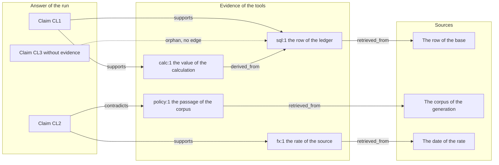
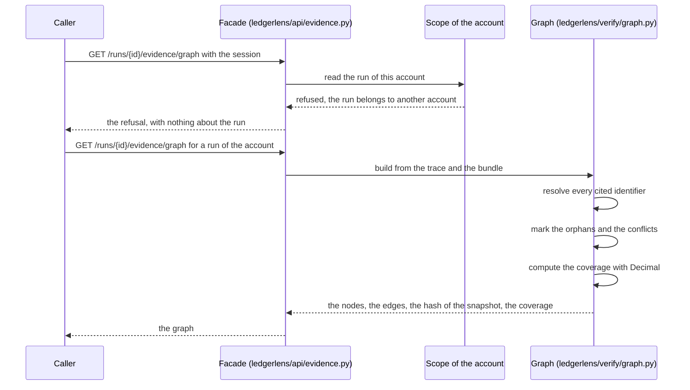

# Implementation Plan: Evidence graph and provenance

**Branch**: `feature/v3` | **Date**: 2026-11-23 | **Spec**: [spec.md](spec.md)

**Input**: Feature specification from `specs/010-r8-evidence-graph-and-provenance/spec.md`

## Summary

The repository has the pieces of the graph and not the graph. A claim of the answer carries the identifiers of the
evidence it was checked against. The evidence has a kind, a tool, a reference and the moment it was retrieved. The
verdict of the claim names the evidence it was computed on. The published bundle carries all of it with a digest, and
the panel of the provenance shows the digest of the bundle, the mode of the capture and the hashes.

What does not exist is the relation between those pieces. A reviewer cannot ask how the row of the ledger stands
behind the claim, cannot see that a citation names nothing, cannot see that the rate of the run and the rate of the
policy disagree, and cannot read how much of the answer the evidence holds. The graph is that relation, and it is a
read over what the repository already publishes.

The plan builds the graph in the domain, in `ledgerlens/verify/graph.py`, and serves it with one route. The graph is
built in memory from the trace of the run and the evidence of the bundle, and it is published as an artifact with a
hash when it is published at all. No graph database is added, as the package itself asks.

Four rules hold the design together. A cited identifier that resolves to nothing makes the claim an orphan and never
attaches it to a near match. A disagreement between two sources is an edge of conflict and never a change of the
verdict. The scope of an account is applied when the data is read and not when the graph is drawn. And a sentence of
the model is a hypothesis that never supports a claim, because the numbers come from the tool and the label comes
from the evidence.

## Technical Context

**Language/Version**: Python 3.12 for the core
**Primary Dependencies**: the existing `ledgerlens/verify/` package, `ledgerlens/replay/` for the bundle, FastAPI
for the route, and the standard library only
**Architecture**: the graph is a pure function of the trace and the bundle, it lives in the domain, and the facade
reads it without the domain ever importing the facade
**Storage**: no new store. The published graph lives beside the published bundle as an artifact with a manifest and a
hash
**Testing**: pytest offline with `LEDGERLENS_OFFLINE=1`, with the published bundle of the scenario S01 as the
fixture
**Constraints**: no graph library, no graph database, no float in the coverage, the domain never imports the API,
and the graph never becomes a second verdict

## The shape of the graph

Two shapes in that picture carry the rules of the design. The claim `CL3` has no edge at all: an unresolved citation
produces an orphan and not a link to the nearest record. And the claim `CL2` carries an edge of conflict next to its
edge of support: the disagreement is visible and the verdict of the claim is untouched.

## The path of a request

The scope is applied before the graph is assembled. A graph that is filtered at the interface shows the rows of one
account inside the shape of another, and the count of the filtered nodes is published so that a reader knows that
the graph is smaller than the run.

## The decisions the plan takes

1. **The graph is built in memory and never stored as a second truth.** It is a pure function of the trace and the
   bundle. When it is published, it is published as an artifact with a manifest and a hash, like every other
   published artifact of the repository.
2. **The resolution is by identity and never by similarity.** A cited identifier that no tool returned is an
   orphan. The nearest string match is a fabricated citation.
3. **The conflict is an edge and never a verdict.** The verdict of a claim is the one the run computed. The graph
   shows that two sources disagree and it does not decide which one is right.
4. **The coverage is a `Decimal`.** The share of the claims that reach a source is a fraction of counts, and it is
   computed as one.
5. **The rationale of the model is a node of its own kind.** It is held, it is marked as a hypothesis and it never
   supports a claim.

## What exists and what the plan adds

| Area | In the repository today | What the plan adds |
|---|---|---|
| The evidence and the claims | `ledgerlens/schemas.py` and `ledgerlens/verify/claims.py` | Nothing. |
| The verdict | `ledgerlens/verify/checks.py` | Nothing. |
| The bundle and its provenance | `ledgerlens/replay/bundle.py` and `site_export.py` | Nothing. |
| The relation between the pieces | Nothing | `ledgerlens/verify/graph.py`. |
| The route that serves the graph | Nothing | `ledgerlens/api/evidence.py`. |
| The published graph | Nothing | An artifact with a manifest, when it is published. |
| The drawing of the graph | Nothing | Nothing. The first milestone serves data. |

## The risks

- **A near match that looks like a citation.** The resolution is by identity and the test refuses a graph that
  connects an unresolved citation.
- **A graph that contradicts the verdict.** The graph never writes the verdict and the test compares the verdict of
  the bundle with the verdict that the graph carries.
- **A node of another account.** The scope is applied when the data is read, and the test builds the graph without
  the interface and expects the same result.
- **A cycle that hides a derivation.** The builder refuses a cycle and names it.
- **A float in the coverage.** The coverage is a `Decimal` and the test refuses a float.
- **A graph library creeping in.** The test reads the modules of `ledgerlens/` with `ast` and refuses an import of
  a graph library, the same way the guard of the vector library works.
- **The domain importing the API.** The test reads the modules of `ledgerlens/verify/` with `ast` and refuses an
  import of `ledgerlens.api`.
- **A graph that grows without a bound.** The builder works over the trace of one run and refuses a trace that
  exceeds the ceiling of the run, the same way the loop of the agent has a ceiling.

## The strategy for the validation

Every task ships its test before its code. The fixture of the tests is the published bundle of the scenario S01,
which is already in the repository and already has a digest. The tests build the graph over that bundle and over
three hand made fixtures: one with an unresolved citation, one with two rates of different dates and one with a
sentence of the model that explains something.

The route is tested against the same fixtures through the facade of the repository, so the scope of the account is
exercised through the same code that a visitor exercises.

## What is out of scope

- The verifier, the checks and the thresholds. The graph reads the verdict and never changes it.
- The published bundle and the export of the site.
- The drawing of the graph and the interface of the graph.
- The review of a case by a person, which belongs to
  [specs/012](../012-r10-human-review-and-approval/spec.md).
- A graph database, a persistent store of the graph and an incremental update of it. The graph is recomputed from
  the run, and a run is immutable.

## The definition of done

1. The graph is built from the trace and the bundle, with four kinds of node and six kinds of edge.
2. A cited identifier that resolves to nothing makes the claim an orphan, and no claim is connected to a record by
   the similarity of its text.
3. A disagreement between two sources is an edge of conflict, and the verdict of the claim is the one the run
   computed.
4. The coverage is a `Decimal` over the number of the claims, and the hash of the snapshot travels with the graph.
5. The scope of the account is applied when the data is read, and no node of another account is in the graph.
6. No module of `ledgerlens/` imports a graph library, and no module of `ledgerlens/verify/` imports
   `ledgerlens.api`.
7. The gate of the Python side is green offline.
