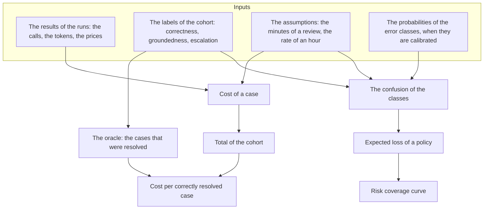
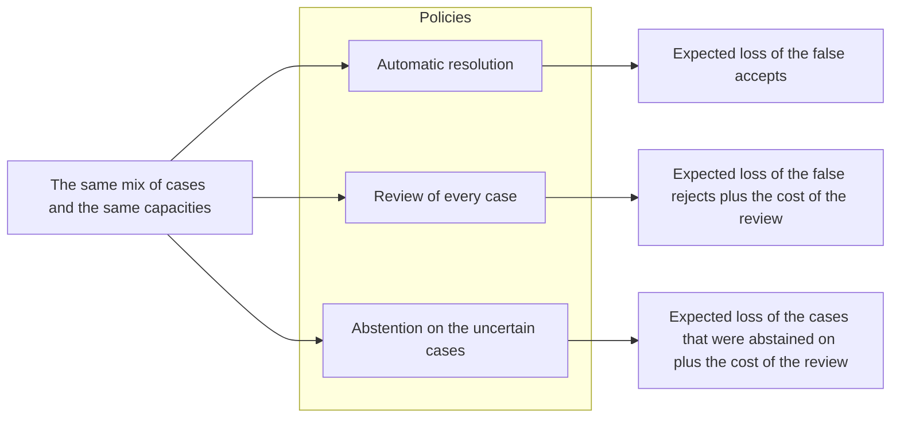

# Implementation Plan: Cost per correctly resolved case and risk weighted decision utility

**Branch**: `feature/v3` | **Date**: 2026-11-23 | **Spec**: [spec.md](spec.md)

**Input**: Feature specification from `specs/011-r9-cost-per-case-and-decision-utility/spec.md`

## Summary

The repository knows what a live run cost. The coordinator of the budget counts the calls of every model, the
registry carries the price of each model with the source that publishes it and the day it was last verified, and the
report of the run refuses to print a dollar amount when the price was never checked. That is the first half of the
economics and it is built.

The second half is not. The repository has no module that says what a case cost over a cohort, no denominator of
resolved cases, no cost of a human review, and no way to weigh a decision against a loss. The milestone of
[specs/005](../005-r4-runtime-latency-and-cost-per-case/spec.md) promised an economics module and did not build it,
so this specification builds it and says so in the status section of the specification.

The plan is two modules and one set of assumptions. The cost module computes the money of a case, the total of a
cohort and the cost per correctly resolved case, with `Decimal` everywhere and with the provenance of every price. The
utility module consumes the typed labels that the code produced, computes the expected loss of a policy with the
error classes kept apart, and draws the risk coverage curve. The assumptions module holds the numbers that the
repository cannot measure, such as the minutes of a review and the rate of an hour, and every result that uses one
carries it.

Two rules keep the module honest. A price that was never verified leaves the total unmeasured, and a probability that
was never calibrated leaves the expected loss unknown. Neither is a zero. And the module never chooses a model: it
compares the results of the runs that already happened, because one run has one model under ADR-037 and the FR-013
it carries. A design that routes between models by cost is a different piece of work, it stays behind a flag, and it
is published only after a paired comparison measures a gain, under ADR-P007.

## Technical Context

**Language/Version**: Python 3.12 for the core
**Primary Dependencies**: the standard library only, the existing `ledgerlens/byok/budget.py` for the cost of a run
and the existing `ledgerlens/eval/evaluators.py` for the labels of the cohort
**Architecture**: the economics package is a leaf of the domain, it computes and it never calls a model and never
imports the API, and the labels come in from the cohort
**Storage**: no new store. The published results are artifacts with a manifest and a hash, like every other published
artifact of the repository
**Testing**: pytest offline with `LEDGERLENS_OFFLINE=1`, with hand written fixtures of costs, of labels and of
assumptions
**Constraints**: every amount is a `Decimal`, no float touches the money, the module never recommends and never
publishes a return, and the cost of a review is an assumption and never a fact

## The shape of the computation

The two branches share the cohort and the assumptions and nothing else. The left branch is money and it is exact.
The right branch is a probability and it is often unknown, and the module says so instead of inventing a number.

## The three policies compared

The false accept and the false reject never share a number. A system that resolves everything pays for the cases it
was wrong about; a system that reviews everything pays for the cases it did not need to escalate; a system that
abstains pays for the uncertainty it kept. Which one is better depends on the losses, and the losses are assumptions
of the reader.

## The decisions the plan takes

1. **The oracle comes from the code.** A case is correctly resolved when the correctness evaluator finds the
   expected facts, the groundedness evaluator finds the claims supported, and the case was not sent to a person. A
   case that a cap cut is scored as a case that was cut. The module never recomputes a verdict.
2. **The categories of the cost do not overlap.** The model, the compute, the review and the error assumption are
   four categories and a category that counts the same money twice is refused.
3. **An unknown is not a zero.** An unverified price leaves the total unmeasured. An uncalibrated probability leaves
   the expected loss unknown. A loss that nobody knows leaves the total of the utility unknown with the class that
   is missing named.
4. **The assumptions travel.** Every result that uses an assumption carries it, and the assumptions are in the
   interface, never in the code.
5. **The module never calls a model.** It reads the results of the runs that already happened. The comparison is
   over cohorts, never over a routing decision.

## What exists and what the plan adds

| Area | In the repository today | What the plan adds |
|---|---|---|
| The cost of a live run | `ledgerlens/byok/budget.py` | Nothing. The economics module reads it. |
| The registry of the prices | `ledgerlens/byok/registry.py` | Nothing. |
| The labels of the cohort | `ledgerlens/eval/evaluators.py` and `ledgerlens/verify/escalation.py` | Nothing. |
| The panel of the cost | `apps/web/features/evals/CostPanel.tsx` | Nothing. The panel keeps presenting the report of the server. |
| The economics module | Nothing | `ledgerlens/economics/cost.py`, `utility.py` and `assumptions.py`. |
| The cost of a case and the cost per resolved case | Nothing | `ledgerlens/economics/cost.py`. |
| The risk weighted utility and the risk coverage curve | Nothing | `ledgerlens/economics/utility.py`. |
| The calibration of the probabilities | Nothing | Nothing. The module publishes the probabilities as unknown until a calibration exists. |

## The risks

- **A float in the money.** Every amount is a `Decimal`, and the test reads the module with `ast` and refuses a
  binary float literal in a path that computes money.
- **A price that was guessed.** The registry refuses a price that was not verified, and the cost module refuses to
  print a total without one.
- **A category that counts the same money twice.** The cost module refuses the overlap and names the two
  categories.
- **A denominator that hides the cases that went to a person.** The denominator is published next to the number, and
  the cases that went to a person are listed.
- **A comparison over two cohorts.** The refusal is checked against the digest of the cohort and not against its
  name.
- **A probability that was never calibrated read as a measurement.** The module publishes the interval or the
  unknown, and the test refuses a point.
- **An overlapping class summed anyway.** The utility refuses the sum and names the overlap.
- **A claim of a return.** The module refuses the question and states what it can state.
- **A module that starts calling models.** The test reads the modules of `ledgerlens/economics/` with `ast` and
  refuses an import of a model or of a registry that calls one.

## The strategy for the validation

Every task ships its test before its code. The tests of the cost are unit tests with hand written fixtures of the
calls, of the tokens, of the prices and of the labels. The tests of the utility use a fixture of four classes with
known counts and known losses, so that the expected loss of the fixture can be computed by hand and written down in
the test. The tests of the comparison use two cohorts with different digests and expect the refusal.

The gate of the Python side runs the whole suite offline, with no key and no network.

## What is out of scope

- The cost of a live run, the two costs of the run and the registry of the prices.
- The latency of a turn.
- The queue of the review, the capacity of the reviewers and the waiting time, which belong to
  [specs/012](../012-r10-human-review-and-approval/spec.md).
- The paired comparison between two architectures, which belongs to
  [specs/009](../009-r4-paired-evaluation-arena/spec.md). This specification consumes its cohort and its labels.
- The calibration of the probabilities of the error classes.
- Any recommendation about staffing, about regulation or about a business decision.
- The routing of a model by cost, which stays behind a flag and out of the runtime under ADR-P007.

## The definition of done

1. Every amount of the economics module is a `Decimal`, and every price carries its source and the day it was last
   verified.
2. The cost per correctly resolved case is the exact division of the total by the number of the resolved cases, with
   the denominator visible, and a cohort with no resolved case produces no number and a reason.
3. A comparison over two cohorts is refused.
4. An unverified price produces no dollar amount, and the report names the price that is missing.
5. Every report of the cost names the assumptions it used.
6. The expected loss separates the false accepts from the false rejects, refuses the sum of two overlapping classes
   and publishes an uncalibrated probability as unknown or as a range.
7. The module publishes no return, and it never calls a model and never imports the API.
8. The gate of the Python side is green offline.
