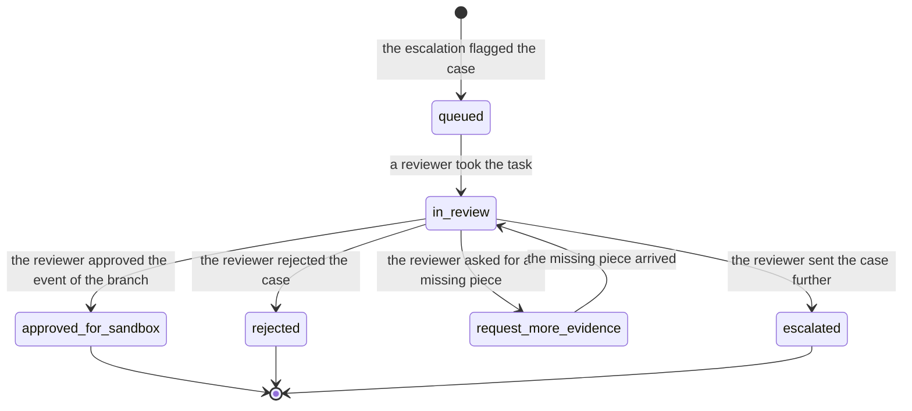
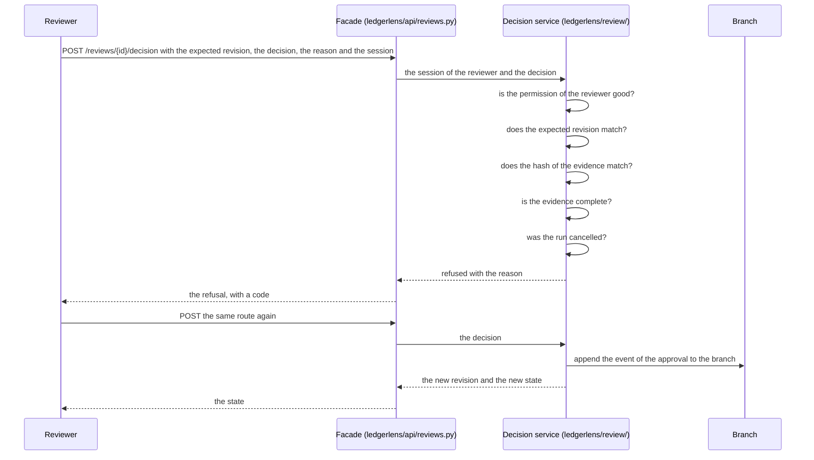
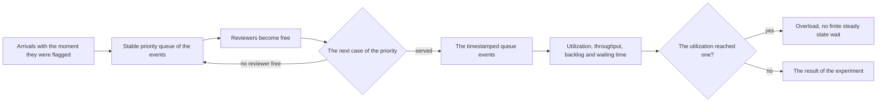

# Implementation Plan: Human review queue and approval state machine

**Branch**: `feature/v3` | **Date**: 2026-11-23 | **Spec**: [spec.md](spec.md)

**Input**: Feature specification from `specs/012-r10-human-review-and-approval/spec.md`

## Summary

The repository decides that a case goes to a person. The escalation module reads the rows and the trace, names the
policy section that decided, and returns a verdict of `requires_human_review` with an action of
`escalate_to_human`. That is where the case stops. There is no queue, no task, nobody who decides, and no state.

The design package asks for both halves of what comes next. The queue simulator answers the capacity question of a
system that escalates, with a discrete event simulation and no model in the loop. The approval state machine makes
the responsibility of the review inspectable and impossible to bypass by a sentence that came out of a tool.

The plan is two new pieces of the domain and one route. `ledgerlens/review/` holds the task, the state machine and
the decision service, with the events of the decisions appended and never rewritten. `ledgerlens/economics/queue.py`
holds the simulator, in the package that
[specs/011](../011-r9-cost-per-case-and-decision-utility/spec.md) creates, because the package says so and because
the cost of the review and the capacity of the review belong together.

Three rules hold the design together. The agent prepares the evidence and never decides: the identity of the
reviewer comes from the session and never from the text of a tool, of a record or of a model. An approval binds to
the branch event it approves and to the hash of the evidence the reviewer read, and it never reaches a live run or a
payment. And the runtime stays a single agent with a deterministic verifier, under ADR-P007, so a specialist
dispatch of the review is a separate piece of work behind a flag, and the review never changes the model of a run,
under ADR-037 and the FR-013 it carries.

## Technical Context

**Language/Version**: Python 3.12 for the core
**Primary Dependencies**: the standard library, the existing `ledgerlens/sandbox/` for the branch and
`ledgerlens/verify/escalation.py` for the rule that escalates
**Architecture**: the review is a domain with its own events, the facade serves it, and the domain never imports the
facade. The simulator is a pure function of its experiment and the seed
**Storage**: the tasks and their events live beside the branch they review, under the same rules of the session and
of the expiry
**Testing**: pytest offline with `LEDGERLENS_OFFLINE=1`, with hand written fixtures of tasks and of arrivals
**Constraints**: the review never reaches a live run and never moves money, the identity of the reviewer comes from
the session, the history of a task is append only, and the simulator holds no identity of a visitor

## The state of a task

Every arrow in that diagram is a transition that appends an event. The table of the transitions is the only place
where the states are declared, and a transition that is not in the table does not exist.

## The path of a decision

The four checks happen before anything is written. A decision that fails one of them moves nothing, and the refusal
names the check that failed.

## The queue

The events of the queue are `(at, sequence, type)`, and the sequence breaks the ties so that the same seed always
gives the same schedule. The simulation never calls a model and never asks one how long a review takes: the review
time is a distribution the experiment declares.

## The decisions the plan takes

1. **The task is append only.** The state of a task is the state that the events say, and the events are never
   rewritten. A reader of the history sees what happened, in the order it happened.
2. **The identity comes from the session.** A decision carries the session and never the name of a reviewer that
   the model wrote. A decision that names its reviewer is refused.
3. **The approval binds to what the reviewer read.** The decision carries the expected revision and the hash of the
   evidence, and a mismatch is refused with a conflict.
4. **The review never leaves the sandbox.** The approval appends an event to a branch. The module of the review
   never imports a live run and never imports a payment client, and a test reads the modules with `ast` to prove
   it.
5. **The simulator is a simulation.** It holds no identity of a visitor, it declares its arrivals, and it never
   presents its capacity as a staffing plan.
6. **The state machine never changes the model of a run.** Under ADR-037 and the FR-013 it carries, a review never
   re-runs a case with another model, and any specialist dispatch of the review stays behind a flag under
   ADR-P007.

## What exists and what the plan adds

| Area | In the repository today | What the plan adds |
|---|---|---|
| The rule that escalates | `ledgerlens/verify/escalation.py` | Nothing. |
| The numbers of the policy | `ledgerlens/policy_limits.py` | Nothing. |
| The branch that an approval applies to | `ledgerlens/sandbox/` | Nothing. |
| The domain of the review | Nothing | `ledgerlens/review/task.py`, `state_machine.py` and `service.py`. |
| The route that takes a decision | Nothing | `ledgerlens/api/reviews.py`. |
| The queue simulator | Nothing | `ledgerlens/economics/queue.py`. |
| The interface of the reviewer | Nothing | Nothing. The first milestone builds the domain, the route and the simulator. |
| The link from the escalation to a task | Nothing | The service that opens a task when the escalation flags a case. |

## The risks

- **A decision that moves the state without the permission of a person.** The permission is checked before the
  transition, and the identity of the reviewer comes from the session only.
- **A sentence that approves.** The state machine never reads the text of a tool, of a record or of a model, and the
  test builds a task whose evidence carries such a sentence and expects nothing to move.
- **A double decision.** The expected revision is compared before the transition and a stale one is refused.
- **An approval that leaves the sandbox.** The test reads the modules of `ledgerlens/review/` with `ast` and refuses
  an import of a live run or of a payment client.
- **A reviewer of another session.** The refusal says nothing about the task, the same way the refusal of a branch
  says nothing about its existence.
- **A simulation that divides by zero.** A queue with no reviewer and an overloaded queue are both reported
  without a division and without a finite steady state wait that does not exist.
- **Two policies compared over two different arrivals.** The comparison refuses it and says that the arrivals were
  not the same.
- **A capacity number read as a staffing plan.** The report states that the simulation is a laboratory and that
  the review time is an assumption.
- **A queue that starves the critical cases.** The waiting time of the critical class is published apart, and a
  starved class is named.

## The strategy for the validation

Every task ships its test before its code. The tests of the state machine are unit tests over a table of the
transitions and over hand written tasks: one complete, one with a missing piece of evidence, one of a cancelled run
and one whose evidence carries a sentence that claims an approval. The tests of the simulator use a toy fixture of
arrivals that can be worked out by hand, with two reviewers, four arrivals and a review time of a fixed length.

The route is tested through the facade of the repository, so the session and the refusal codes are exercised the way
a reviewer exercises them.

The gate of the Python side runs the whole suite offline, with no key and no network.

## What is out of scope

- The rule that escalates and the policy of the review.
- The cost of the review and the utility of a decision, which belong to
  [specs/011](../011-r9-cost-per-case-and-decision-utility/spec.md).
- The interface of the queue and of the reviewer role.
- The live mode. A review never reads a live run and never approves one.
- The multi agent dispatch of the review, which stays behind a flag under ADR-P007 until a paired comparison
  measures a gain.
- The staffing of a real operation and any advice about it.
- The shared store of the tasks. The first milestone keeps the tasks beside the branch they review, under the rules
  of the session and of the expiry.

## The definition of done

1. The states of a task are the six declared ones, every transition appends an event, and no other transition is
   possible.
2. A decision whose identity came from the model, whose revision is stale, whose snapshot moved or whose evidence is
   incomplete is refused and moves nothing.
3. The number of the transitions applied without the permission of a reviewer is zero over the whole suite.
4. An approval appends an event to a branch and reaches nothing else.
5. The same seed gives the same schedule of the reviewers, and the report names the utilization, the throughput,
   the backlog and the waiting time.
6. A queue with no reviewer and an overloaded queue are reported without a division by zero and without a finite
   steady state wait.
7. The waiting time of the critical class is published apart, and a starved class is named.
8. The gate of the Python side is green offline.
