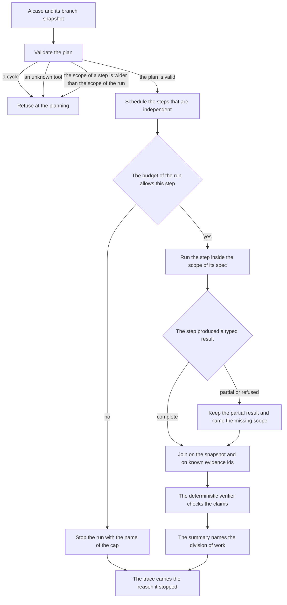
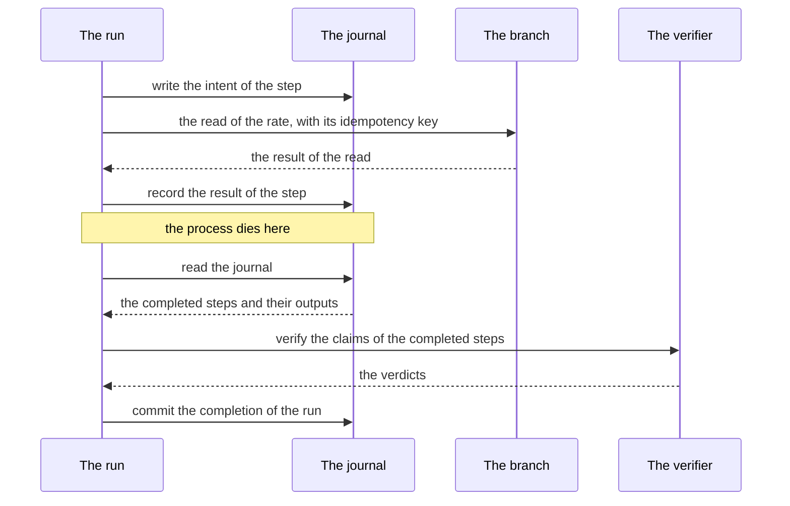

# Implementation Plan: The multi-agent orchestration studio

**Branch**: `feature/v3` | **Date**: 2026-11-23 | **Spec**: [spec.md](spec.md)

**Input**: Feature specification from `specs/013-r11-multiagent-orchestration-studio/spec.md`

## Summary

The design package proposes a studio of multi-agent orchestration: a dispatcher that sends parts of a case to
specialists, a graph that is checkpointed and resumed, and a paired comparison that decides whether any of it
is worth the extra latency and the extra money. The repository ships none of it, and it ships the opposite of
it on purpose: one agent, one deterministic verifier, one model per run.

So the port is not the package. The port is a studio that is off by default, that may only be opened by an
experiment that was registered before it ran, that is measured against the single agent over the same cases
with the same snapshot, and whose result is published whether it is a gain or a loss. The red line of
ADR-P007 is the shape of the whole milestone: the main runtime stays a single agent with a deterministic
verifier, and the studio earns its place with a measurement or stays off with a published negative result.

The work divides into four parts, and the order is the order of the risk.

**First the baseline is frozen.** The single agent of the shipped path is the reference arm of the comparison,
and a reference that moves is not a reference. This part records the behavior of the shipped path, the
snapshot it reads and the number it produces over the set of the comparison, so that the studio is measured
against something and not against a memory of something.

**Second the dispatcher is built behind a flag.** It owns the policy and the registry of the tools, it
validates a plan that is a directed acyclic graph before any step runs, it schedules the independent steps
under a concurrency cap, and every step spends from the budget of the run that the coordinator of
`ledgerlens/byok/budget.py` already enforces. The permissions of a specialist are the intersection of the
permissions of its parent with the permissions of its own spec, so a subagent can never widen the scope of a
run, and a tool outside the allowlist is refused and never called. The verifier stays deterministic and stays
the last word: a specialist proposes, the calculator and the verifier decide.

**Third the run becomes resumable.** The journal of the run records the steps, their attempts, their inputs
and their outputs. A resume reads it, reuses the output of a completed step, runs again only a step that did
not complete and that is idempotent and read-only, and refuses a step whose snapshot or whose configuration
version changed, because a step that reads a different branch is not the same step. A resume never carries a
credential of a visitor across the restart.

**Fourth the comparison is registered and published.** The manifest of the experiment names the set, the
snapshot, the two arms and the rule that decides the result, and it is written before the experiment runs. The
result is published with its denominator and its uncertainty, and the decision that follows it is published
too, including the decision that keeps the flag off.

## Technical Context

**Language/Version**: Python 3.12 for the core
**Primary Dependencies**: the existing `ledgerlens` core, LangGraph for the graph of the agent and its
checkpointer, and the offline provider fake for the tests
**Architecture**: the studio lives in the domain, next to the agent of `ledgerlens/agents/integrator.py`, and
it never imports the API layer; the flag is read from the configuration of the core
**Storage**: the journal of a run and the manifest of a comparison live under `data/runtime/` for a first
version, and the durable store is a later decision
**Testing**: pytest offline with `LEDGERLENS_OFFLINE=1` and the scripted model for every step of the studio
**Constraints**: ADR-P007, ADR-037 and FR-013, the budget of the run, money as `Decimal`, no change in
`docs/v3/`, and no branch, no commit and no push

## What the package proposes, and what the repository has

| Subject | The package | The repository today |
|---|---|---|
| Runtime | A dispatcher with specialists and a graph | One agent, six tools, one deterministic verifier |
| Plan | A directed acyclic graph, validated before it runs | No plan object exists |
| Budget | Caps per role and in aggregate | `ledgerlens/byok/budget.py` counts every model of the run |
| Result of a step | Typed status, evidence, spend and error | The claim and the verdict of the verifier |
| Permissions | The intersection, never the union | The tools are bound by the agent and the live bridge |
| Journal and resume | A journal of the run and a resume | The sandbox commits idempotently, the agent does not resume |
| Proof | A pre-registered paired comparison | The held out set and its blind labelling exist |
| Verifier | Deterministic, before the summary | Deterministic, already |
| Model of a run | Not addressed | One model per run, four slots as four views of it |

## The dispatcher, and where the money stops it

The join is where the honesty of the studio is decided. Two results are joined only when they carry the same
snapshot and only when their evidence identifiers resolve to a record of the run. An invented identifier is
refused. A disagreement over an amount is settled by the deterministic calculator of the repository, or it
becomes a named abstention, and it is never settled by counting the votes: the amount of a settlement is
arithmetic, and arithmetic has no majority.

## The journal and the resume

A resume reads the journal and reuses the output of the step that completed. It runs again only a step that
did not complete and that is idempotent and read-only, because a step that writes may have written before the
process died and the repository cannot know. A step whose snapshot changed is not run again: it needs a new
run, because a number that was read from another branch is not the number of this case. A resume never
rehydrates a credential of a visitor: the vault of the live mode is scoped to its session, and a resume
without a fresh authorization stops with that reason.

## The comparison, and the rule that decides it

The comparison is a paired one. The two arms run over the same cases, with the same snapshot of the branch,
with the same tools and the same verifier, and the only difference is the shape of the runtime. The manifest
of the experiment is written before the experiment runs and names the set of the comparison, the denominator
and the rule. The set is a set of the manifest of the datasets, so it is never read by anything but the final
scoring of the comparison (ADR-053, ADR-059).

The measures are the ones the package names and the ones the repository already knows how to compute: the
correctness of the answer, the share of the claims that the verifier supported, the cost per correct case, the
p95 of the latency, the depth of the longest chain and the critical path. The comparison reports them for both
arms and names the uncertainty of the difference. A run of the studio that costs more and answers the same is
not a gain, and the manifest says so before the experiment runs, not after.

## The risks

- **A studio that looks better because the baseline was worse.** The risk is a comparison against a
  degraded baseline. The guard is that the baseline arm is the shipped code with no change, run over the same
  snapshot, and that the manifest names the commit of the baseline.
- **A fan-out that spends more than the single agent.** The risk is a studio that buys a worse answer for a
  bigger bill and that no measurement would survive. The guard is the budget of the run, enforced by the one
  coordinator that already enforces it, and the test that stops a run at the cap.
- **A specialist that widens the scope of the run.** The risk is a research question that becomes a data
  leak. The guard is the intersection of the permissions, the refusal of the unknown tool and the test that
  expects both refusals and no tool call.
- **A disagreement settled by a vote.** The risk is a number that came from a majority of models instead of
  from the arithmetic. The guard is the calculator of the repository and the named abstention.
- **A resume that repeats an effect.** The risk is a branch of a visitor that carries a duplicated event.
  The guard is the idempotency key that the commands of the branch already carry and the test that commits
  twice and counts the events of the projection.
- **A result that is published only when it is good.** The risk is a study that hides its negative outcome.
  The guard is that the decision that follows the result is part of the publication, and that the flag stays
  off with a published negative result.
- **A studio that becomes the default by inertia.** The risk is a flag that nobody turns off because it is
  already on. The guard is that the flag is off in the shipped configuration and that the gate refuses a
  configuration that opens it without a registered experiment.

## The strategy for the validation

Every task ships its test before its code, and the gate of the Python side is the one that runs everywhere. The
tests of the studio are offline and use the scripted model, so no test of the dispatcher opens a socket and
the whole suite runs with no key. The test of the flag, the test of the budget, the test of the scope and the
test of the conflict are the four that hold the red line of ADR-P007, and each of them is written to fail
before the code it proves.

## What is out of scope

- The families of orchestration that the package lists and that this milestone does not build: the debate,
  the council, the map-reduce batch, the adaptive router, the handoff and the human checkpoint.
- Any external agent, any remote MCP call and any protocol of an external specialist.
- A durable workflow engine. The package itself allows the checkpointer of LangGraph for a first version, and
  the decision of a durable store is a later milestone.
- The choice of the model of each slot. That is ADR-078 (in preparation) and it is written before any code of
  the routing.
- The frontend of `apps/web/`. The interface of the studio is the trace and the published recording.

## The definition of done

1. The flag of the studio is off in the shipped configuration, and a run that asks for it without a registered
   experiment is refused.
2. The dispatcher validates a plan before any step runs, refuses a cycle, refuses an unknown tool and refuses a
   step whose scope is wider than the scope of the run.
3. Every step spends from the budget of the run, and a run that a cap stopped carries the name of the cap and
   its partial result.
4. A join accepts only known evidence identifiers and a matching snapshot, and a disagreement over an amount
   ends with the value of the calculator or with a named abstention.
5. A crash and a retry leave the branch exactly where the crash left it.
6. A resume reuses the output of a completed step, refuses a step whose snapshot changed and never rehydrates
   a credential.
7. The trace of a run names the specialist that answered each part of the question.
8. The manifest of the comparison was written before the experiment ran, and the result was published with its
   denominator, its uncertainty and the decision that follows it.

## The questions this milestone answers

- **Where the studio lives.** In the domain, next to the agent of `ledgerlens/agents/integrator.py`, and never
  in the API layer, because the domain never imports the API and a studio that lived in the API could not be
  measured against the shipped path.
- **What a specialist is.** A versioned spec of what it may read, which tools it may call, what it may spend
  and what it must return. A specialist is a role, not a process: it can be a deterministic function of the
  repository, and in the first version most of them are.
- **What happens to the verifier.** Nothing. It stays deterministic and it stays the last word, because the
  package says so and because the red line of ADR-P007 says so.
- **What the journal of the run is.** A file backed record under `data/runtime/` for a first version, with the
  steps, their attempts, their inputs and their outputs. The durable store is a later decision and the ADR
  that takes it is not written here.
