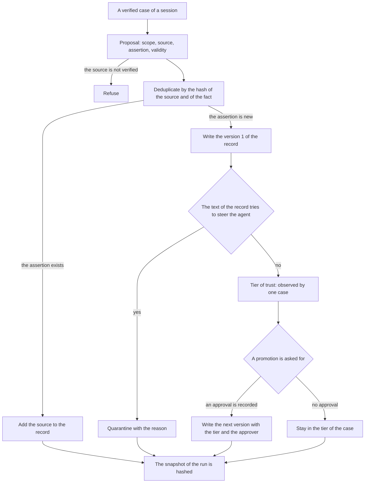

# Implementation Plan: The versioned memory with a poisoning quarantine

**Branch**: `feature/v3` | **Date**: 2026-11-23 | **Spec**: [spec.md](spec.md)

**Input**: Feature specification from `specs/014-r12-versioned-memory-with-quarantine/spec.md`

## Summary

The design package proposes a memory that is versioned, that carries a trust tier and an approval state, and
that quarantines what a poisoned case put in it. The repository has a memory already: the case memory of
`ledgerlens/memory/long_term.py` holds what a verified case concluded, it refuses anything the verifier did
not support, and it lives in the folder of the session that owns it. The memory of today has no version, no
tier, no approval and no quarantine, and it keeps its own file and its own index.

So the port is the four things the repository does not have, and nothing else. A record gains a version, a
trust tier, an owner and an approval state. A promotion needs an approval and the approval is recorded as
such. The same assertion proposed by two cases becomes one record with two sources, deduplicated by the hash
of the source and of the fact. A record that was meant to steer the agent is quarantined with a reason, and a
quarantine is a state and not a deletion, because a reason that nobody can read is not a reason. And a run
reads a frozen snapshot of the memory, so that a replay of an old case is the old case and not a new one
wearing its name.

The rules of the repository keep their place in all of this. The recalled text is data: it arrives as the
output of the tool `recall_cases`, the system prompt of the agent is the one of the repository, and the
allowlist of the tools is decided by the code and never by a text that a case wrote. The text of a visitor is
never kept beyond the session that owns it, because the folder of the session dies with the session. The
memory of one session is never visible in the retrieval of another one.

## Technical Context

**Language/Version**: Python 3.12 for the core
**Primary Dependencies**: the existing `ledgerlens` core, the FAISS stack of the case memory and the SQLite
of the working memory
**Architecture**: the versioned memory lives in the domain, in `ledgerlens/memory/`, next to the case memory
it extends; it never imports the API layer and it never writes SQL
**Storage**: the records, their versions and their approvals live in the folder of the memory of the session,
and the snapshots of a run live with the run
**Testing**: pytest offline with `LEDGERLENS_OFFLINE=1`, with the scripted model and with the verifier of the
repository for the cases that propose a record
**Constraints**: the rule that only what was verified gets in, the scope of the session, the expiry of the
session, the reproduction of the published bundle, no change in `docs/design/`

## The four parts, and the order of the work

**First the record and its versions.** The record of the versioned memory is a typed object with a version, a
trust tier, an owner and an approval state, and the record of a case points to the version it read. The
storage is the store of the session, beside the file of the case memory, because the memory of a session
lives in the folder of that session and the new records live in the same place (ADR-030). The version is
monotonic per record, and a new version never overwrites the old one: the old one stays because a run of
last week points at it.

**Second the proposal and the promotion.** A proposal carries a scope, a source evidence, an assertion, a
period of validity and the reviewer that approved it. A proposal without a verified source is refused, and
this is the same rule the case memory already holds, read from the other side. A promotion needs an approval,
and the approval is a record with a date and a flag that says whether it was simulated. The repository has no
human approval queue, so the first version simulates the reviewer in the offline path and the record says so
in its own text. A simulation that hid itself would be a fake reviewer.

**Third the deduplication and the quarantine.** The deduplication is by the hash of the source and of the
fact, so the same assertion from two cases is one record with two sources and the provenance of both is
kept. The quarantine is a state of a record: the record is refused as an attempt to steer the agent, the
reason is written down, the record is not retrieved and not even when it is the best match of the set, and a
person may release it. The quarantine is not a deletion, because a memory that quietly forgets a poisoned
record teaches nothing about the attack.

**Fourth the frozen snapshot.** A run reads a snapshot of the memory and the snapshot is hashed, and the
digest travels with the run and with the published bundle, so that a replay reads the memory of its
generation and the reader of the bundle can check it (ADR-073).

## The retrieval, and what a reader may believe

A retrieval of the memory returns typed references with their tier of trust, and it never returns a
quarantined record. The tier travels with the record and not with the answer, because the reader of a recall
must be able to see how the fact entered the memory. The attribution precision is the measure that says
whether the memory is worth the complexity, and the count of quarantined records is the measure of the
attack. Both are measured over the set the manifest of the datasets names, and neither is a generalization
until it is measured.

The boundary between the memory and the policy is the boundary of the repository. A recalled text is the
output of a tool, and the code of the repository decides which tools exist and what they may do. The
laboratory of the repository is worth something exactly because that boundary is not negotiable by a text that
a case wrote.

## The risks

- **A record that becomes a policy by repetition.** The risk is that a case states a rule often enough and
  the memory treats it as a fact of the company. The guard is that a record is never read into a prompt as an
  instruction and that a promotion needs a recorded approval.
- **A quarantine that only catches the bad cases.** The risk is a filter that removes the obviously hostile
  text and lets the polite one through. The guard is the test that a quarantined record is absent from every
  retrieval, not only from the query it matches best.
- **A snapshot that does not freeze.** The risk is a replay that reads the memory of today and produces an
  answer that is not the answer of its generation. The guard is the digest of the snapshot in the bundle and
  the test that reads it.
- **A version that overwrites.** The risk is a record that changes under a run that points at it. The guard
  is the monotonic version and the test that expects the version of an old run to still exist.
- **A memory that outlives the session.** The risk is the text of a visitor kept forever in a new store.
  The guard is the scope of the deletion, the expiry of the session and the test that expects the folder of
  the session to be gone.
- **A deduplication that loses a source.** The risk is a record that says a fact was observed once when it
  was observed twice, and a reader that believes it. The guard is the hash of the source and of the fact and
  the test that expects two sources on the record.

## The strategy for the validation

Every task ships its test before its code, and the gate of the Python side is the one that runs everywhere.
The tests of the memory are offline and use the scripted model, so no test opens a socket. The four tests
that hold the rules are the test that only what was verified gets in, the test that a recalled text changes
nothing of the tools, the test that a quarantine holds against the best match and the test that the scope of
a deletion is the owner of the record. Each of them is written to fail before the code it proves.

## What is out of scope

- The comparison of the retrieval strategies of the package. The baseline stays the dense FAISS index of
  `ledgerlens/retrieval.py`, and the package itself says that a new retrieval must be measured and not
  declared.
- The ingestion of documents and the graph of the knowledge.
- The human approval queue and the review service of a real promotion.
- The frontend of `apps/web/`.
- The change of the file format of the case memory of today. The migration of the existing records is a
  decision of the implementation.

## The definition of done

1. Every record carries a version, a trust tier, an owner and an approval state, and the record of an old run
   points to the version it read.
2. A proposal without a verified source is refused, and a promotion without a recorded approval is refused.
3. The same assertion from two cases is one record with two sources.
4. A quarantined record is absent from every retrieval, its reason is readable and a person may release it.
5. A recalled text changes neither the tools of the agent nor its system prompt.
6. A deletion takes the records of its owner and nothing else, and the folder of the session is gone.
7. A replay reads the snapshot of the memory of its generation, and the digest of that snapshot is in the
   bundle.

## The questions this milestone answers

- **Where the versioned memory lives.** In `ledgerlens/memory/`, next to the case memory it extends, and
  never in the API layer, because the domain never imports the API.
- **What the approver is.** A simulated reviewer in the offline path, recorded as simulated in the approval.
  The repository has no review service, and a reviewer that hid itself would be a fake.
- **What a quarantine is.** A state of a record with a reason, not a deletion, so that the attempt is
  readable and reversible by a person.
- **Where the snapshots live.** With the run, in the folder of the memory of the session, because a snapshot
  that outlived its session would keep the text of a visitor alive.
