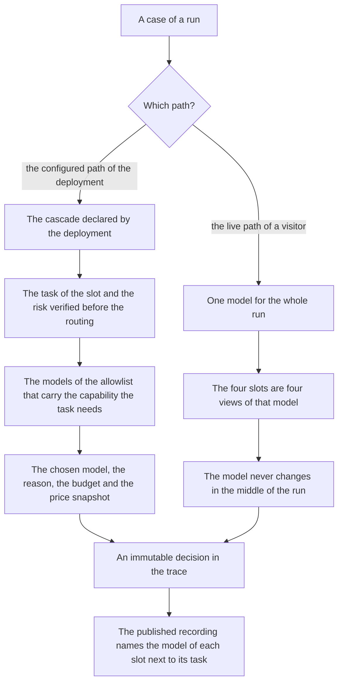
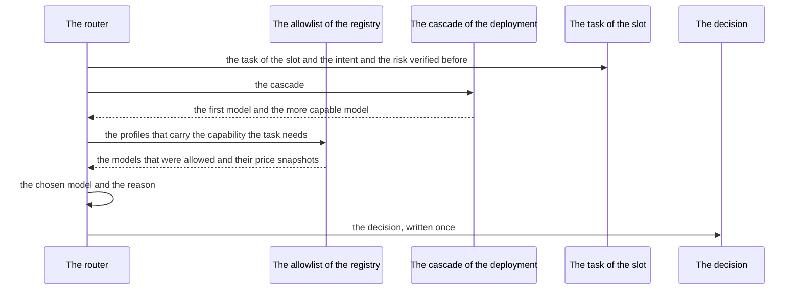

# Implementation Plan: The inference routing and the cost of the run

**Branch**: `feature/v3` | **Date**: 2026-11-23 | **Spec**: [spec.md](spec.md)

**Input**: Feature specification from `specs/016-r15-inference-routing-and-finops/spec.md`

## Summary

The repository has a server side allowlist of tested models, a coordinator that counts every model of a run, two
costs that are never mixed and a price that is absent when it was not verified. It has no router: one model
serves the whole run, and the four slots of the agent are four views of it. The design package proposes a
router that picks a model per task, records the decision as immutable trace metadata and falls back inside a
budget when a provider fails.

The port is that router, and it starts with the decision that the repository is taking now: ADR-078 (in
preparation), the routing between models by task. The direction of ADR-078 is fixed and this specification
respects it. The routing layer chooses the model of each of the four slots the repository already has, the
model of the agent, the triage, the SQL and the policy, by the task the slot does. The verifier stays
deterministic and is never a model. The routing is a fixed cascade that the deployment declares, a first
model for the light work and a more capable model for the investigation, chosen on the intent and the risk
that were verified before the routing and on the capability the provider really has, and it never accepts an
address of a server that a visitor wrote. Every decision is immutable metadata of the trace and names the
case, the task, the risk tier, the models that were allowed, the model that was chosen, the reason, the
budget and the price snapshot. A price that was not verified is unknown and never zero.

And the rule that the repository has already written down keeps its force: a model chosen by a human is never
silently replaced. In the live path one run has exactly one model and the four slots are four views of that
same model, and the model never changes in the middle of the run (ADR-037, FR-013). The cascade belongs to
the configured path of the deployment and to the capture of the published recordings, and the published
recording says which model did which task, so a reader sees the division of the work.

The order of the work is the order of the risk. First the decision of ADR-078 is written, because a routing
that nobody decided is a routing that drifts. Then the typed decision and its store, because the decision is
the record that makes the rest checkable. Then the router, the cascade and the trace. Then the fallback,
the comparison and the publication.

## Technical Context

**Language/Version**: Python 3.12 for the core
**Primary Dependencies**: the existing `ledgerlens` core, the allowlist of the registry and the coordinator of
the budget
**Architecture**: the routing lives in the domain, in `ledgerlens/routing/`, next to the registry it reads;
it never imports the API layer and it never writes SQL
**Storage**: the decisions of the routing live with the run, and the cascade of the deployment lives in the
configuration of the core
**Testing**: pytest offline with `LEDGERLENS_OFFLINE=1` and the fake adapter of the provider
**Constraints**: ADR-034, ADR-037 and FR-013, money as `Decimal`, a price that was not verified is absent,
no change in `docs/v3/`, and the decision of ADR-078 before the code

## The decision, and the two paths it governs

The two paths are the same code with a different input. The live path passes one model and the router records
that it was the choice of the visitor and that nothing was substituted. The configured path passes the
cascade and the router records the reason of the choice. A reader of a trace cannot tell which path a run
took from the shape of the decision, so the decision names the path too.

## The decision, and the nine fields

The decision is written once. The nine fields are the ones the package names and the ones ADR-078 requires:
the case, the task of the slot, the risk tier, the models that were allowed, the model that was chosen, the
reason, the budget the slot had, the price snapshot the choice was made against, and the path the run took.
A second write of the same decision is refused, because a record that can change is not a record and a
comparison between two routes is only readable if the decisions of the two arms cannot be rewritten.

The price snapshot is the price of the chosen model with its source and the day it was last verified, and it
carries the label that says it is stale when it is older than the freshness the registry declares. A model
whose price was never verified has no snapshot of a price at all: the cost panel says that the price is
unknown and shows no dollar amount, because zero would read as "the model was free" and it was not.

## The router and the cascade

The capability of the provider is the only ground the choice stands on, and it comes from the registry that
the repository already has: a profile whose tool calling was never exercised carries the status `experimental`
or `disabled`, and the router refuses it with that status in the message. A profile whose price is unknown can
still be chosen, because the cost of a run is not the reason to route, and the panel will say that the price
is unknown.

## The fallback, and the budget that stops it

A fallback happens only when a pre-consented strategy of the deployment allows it and the remaining budget of
the run covers it. The router never raises the spend of a run by itself and never changes the provider of a
run outside the consent of the visitor. A failure with no retry budget stops the run with an explicit reason,
and the reason is a field of the result and not a word in a log. The fallback uses the coordinator of
`ledgerlens/byok/budget.py`, because a second enforcer would be a second source of the truth about the caps.

## The risks

- **A silent replacement of a model.** The risk is a run that answers under the name of a model that a
  visitor did not choose. The guard is FR-003 and FR-004, and the test that expects one model in every
  request of a live run.
- **A decision that changes.** The risk is a comparison between two routes that cannot be trusted because
  the decisions may be rewritten. The guard is the immutability of the decision and the test that a second
  write is refused.
- **An invented price.** The risk is a cost panel that shows a number nobody checked. The guard is the
  registry, which carries no amount for a price that was not verified, and the test that expects no dollar
  amount at all.
- **A router that becomes a way in.** The risk is a server that calls an address that a visitor wrote. The
  guard is that the router chooses only among the models of the allowlist of the server and that the address
  of a provider comes from the registry.
- **A cascade that is chosen by a price.** The risk is a routing that picks the cheapest model and calls it
  a capability. The guard is that the cascade is declared by the deployment and that the capability of the
  provider decides the eligibility of a model.
- **A risk tier that was guessed.** The risk is a reason of the routing that is a guess. The guard is that the
  tier is verified before the routing and that a case whose tier was not verified routes to the heavier tier
  and says so.
- **A router that changes the live path.** The risk is a live run that ends with two models under one
  identifier. The guard is that the live path passes one model and the router records that the choice of the
  visitor was kept.

## The strategy for the validation

Every task ships its test before its code, and the gate of the Python side is the one that runs everywhere.
The tests of the routing are offline and use the fake adapter, so no test opens a socket and no test reads a
key. The three tests that hold the honesty of the routing are the test that a live run keeps one model, the
test that a human choice is never replaced and the test that a price is never invented.

## What is out of scope

- The adaptive policy that learns the route from a comparison.
- The ensembles of several models and the debate.
- The local mode of a model the visitor runs.
- Any change of the live path, of the registry or of the budget. The router reads them and never writes them.
- The frontend of `apps/web/`, apart from the cost panel that shows the price that is unknown.

## The definition of done

1. ADR-078 exists in `docs/decisions/`, it was written before the code, and it names the routing between
   models by task, the fixed cascade, the honesty rules and the trace metadata.
2. The decision of the routing carries its nine fields and cannot be written twice.
3. The four slots are routed by their task, and the verifier is never among the routed models.
4. A live run uses one model for the whole run and a model chosen by a human is never replaced.
5. A model without a verified price shows no dollar amount and says that the price is unknown, and a stale
   price is labeled stale.
6. The cascade declared by the deployment is the one that routes, and a profile that was never tested is
   disabled with the reason.
7. A model that carries an address of a visitor is refused with the name of the rule.
8. A fallback happens only with a strategy and a budget, and the failure without a budget stops the run with
   the reason.
9. The published recording of a routed run names the model of each slot next to its task.

## The questions this milestone answers

- **Where the routing lives.** In the domain, in `ledgerlens/routing/`, next to the registry it reads, and
  never in the API layer.
- **Which rule chooses the model.** The cascade that the deployment declares, filtered by the capability the
  provider really has. Not the price: a price that was not verified is unknown, and a route chosen by an
  unknown price is a route chosen by nothing.
- **What happens to the live path.** Nothing. One model for the whole run, and the decision records that the
  choice of the visitor was kept.
- **What the reason of a decision is.** The task, the risk tier, the capability that made the model eligible
  and the position of the model in the cascade, in those words, so that a reader can check it.
