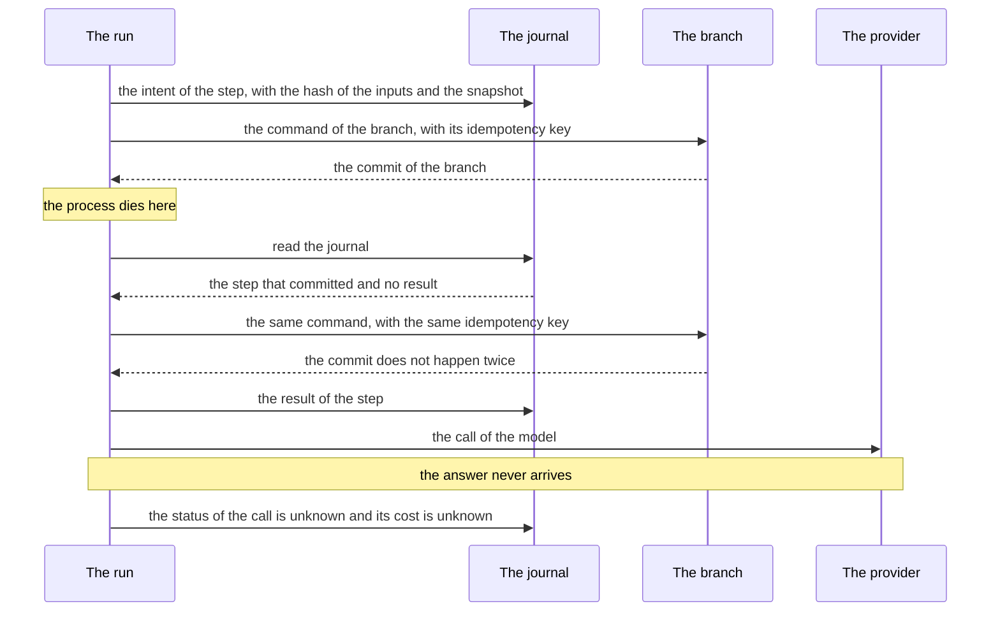
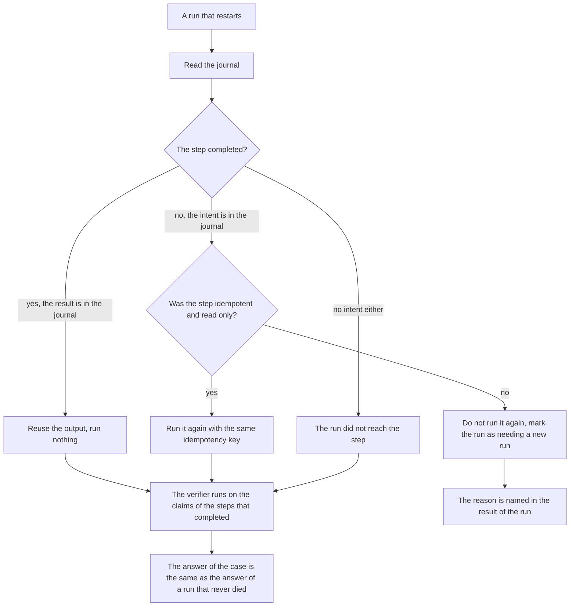

# Implementation Plan: The durable operations and the forensic traces

**Branch**: `feature/v3` | **Date**: 2026-11-23 | **Spec**: [spec.md](spec.md)

**Input**: Feature specification from `specs/017-r16-durable-operations-and-forensic-traces/spec.md`

## Summary

The design package proposes a run that restarts without losing evidence and without doing the same work
twice, and a trace that a reader can read as a forensic record. The repository already holds half of this.
The branch of a visitor is durable: the command carries an idempotency key and the digest of its payload,
the store is idempotent on the identifier of the event, the commit is atomic, a write that fails loses
nothing, the writes of a branch are serialised, and the state of the branch is a pure function of the base
and of the log. That half is not rebuilt by this milestone and not renamed. The other half does not exist: a
run of the agent writes nothing durable, dies with its steps half done, and cannot be resumed.

So the port is the second half. A run writes a journal: the intent of a step before it runs, with the hash of
its inputs and the snapshot it reads, and its result after it ran, with the reference of the output, the status
and what it spent. The numbers of the journal grow by one and never go back, so the order of a run is
readable after the fact. A run that dies restarts from the journal, reuses the outputs that completed, runs
an interrupted step again with the same idempotency key, and leaves the branch of the visitor exactly where
the crash left it. A provider call whose answer never arrived is marked with an unknown status, its cost is
unknown and is never zero, and the run neither repeats the call nor claims a success it cannot prove. And the
forensic export gives a stranger the shape of the run, with the parent of every span, the order of the
events, what each step spent, and the sentence that says what was redacted.

## Technical Context

**Language/Version**: Python 3.12 for the core
**Primary Dependencies**: the existing `ledgerlens` core, the sandbox store and the projector of the branch,
the trace of the observer and the fake provider
**Architecture**: the journal lives in the domain, in `ledgerlens/durability/`, next to the trace it feeds;
it never imports the API layer and it never writes SQL of its own
**Storage**: the journal of a run lives in the folder of the session that owns the run, beside the folder of
the branch, and the forensic export lives with the published bundle
**Testing**: pytest offline with `LEDGERLENS_OFFLINE=1`, with the scripted model and the fake provider, and
with an injected clock so that a deadline is proved by moving the clock
**Constraints**: ADR-021, ADR-025, ADR-026, ADR-032, ADR-013, the budget of the run, money as `Decimal`, no
change in `docs/design/`, and no rebuild of the sandbox

## The journal, and the order of its writes

The order of the writes is the reason the restart is safe. The intent goes to the journal before the step
runs, so a step that ran and left no result is visible as such. The commit of the branch happens before the
result is written, and it is idempotent, so a crash between the two repeats a commit that does nothing. The
provider call comes after the journal knows that the step started, so a call whose answer never arrived is an
unknown status and not a lost line.

## The restart, and what it may run again

A step that writes is not run again, because the repository cannot know whether the write happened before the
process died. That is the same rule the sandbox follows: the commit of a branch is idempotent, and a step
that is not idempotent does not belong in a journal that promises a restart.

## The forensic export

The export is the trace of the run in a shape a reader can check: the spans, the parent of every span, the
order of the events and what each step spent. The redaction is the redaction of the repository: a value that
looks like a key is replaced, and the export says what it redacted and how many values it redacted. The raw
content of a prompt is not exported by default, because the trace of the repository stays in the session of the
person who asked (ADR-013) and a published export is read by strangers.

The conventions of OpenTelemetry are used where they apply, and the repository keeps the shape of its own
span. The trace is a published contract and a contract that is replaced by a standard is a contract that
breaks.

## The risks

- **A restart that duplicates an effect.** The risk is a branch of a visitor that carries a duplicated event
  or a projection that was applied twice. The guard is the idempotency key of the commit of the branch and
  the test that kills a run between the commit and the journal.
- **A step that writes and is run again.** The risk is a command that is not idempotent and a branch that
  carries two of it. The guard is that only a step that is idempotent and read only is run again, and that the
  other one marks the run as needing a new run.
- **A status that is assumed.** The risk is a provider call that is reported as done when the answer never
  arrived, and a visitor charged twice for it. The guard is the unknown status, the absence of a dollar amount
  and the absence of a second call.
- **A journal whose order is not readable.** The risk is a history that cannot be read after the fact. The
  guard is the number that grows by one and never goes back.
- **A trace that leaks.** The risk is a value that looks like a key or a raw prompt in an export that
  strangers read. The guard is the redaction of the repository and the sentence that says what was redacted.
- **An exporter that takes the run down.** The risk is a run that ends with an error of the exporter instead
  of an answer for the visitor. The guard is that the export is a convenience and its failure is recorded
  locally.
- **A recovery that is never exercised.** The risk is a restart that was never run. The guard is the fault
  injection fixture in the continuous integration.

## The strategy for the validation

Every task ships its test before its code, and the gate of the Python side is the one that runs everywhere.
The tests of the durability are offline, with the scripted model and the fake provider, and the clock is
injected, so a deadline is proved by moving a clock and not by waiting. The three tests that hold the
guarantee are the test that the durable side of the sandbox is unchanged, the test that a restart leaves the
branch where the crash left it, and the test that a provider call whose answer never arrived is an unknown
status and not a zero.

## What is out of scope

- The temporal database as the backend of the durability.
- The conformance of the trace to the conventions of OpenTelemetry as a whole. The repository keeps the shape
  of its own span, which is a published contract.
- Any change of the sandbox, of its store, of its projector or of its events.
- The multi-agent runtime of `specs/013-r11-multiagent-orchestration-studio/`. The journal serves the single
  agent of today and the studio reads the same journal when it exists.
- The frontend of `apps/web/`.

## The definition of done

1. The durable side of the sandbox is unchanged and its own tests keep passing.
2. Every step of a run has an intent and a result in the journal, and the numbers of the journal grow by one.
3. A restart reuses the outputs that completed, does not duplicate the update of the projection and leaves the
   branch where the crash left it.
4. A provider call whose answer never arrived is marked unknown, shows no dollar amount and is not repeated.
5. The forensic export holds the parent of every span, the order of the events and the spend of every step,
   holds no value that looks like a key and no raw prompt by default, and says what it redacted.
6. A cancelled run starts no tool after the barrier and marks its incomplete claims.
7. The fault injection fixture runs in the continuous integration and every kill recovers.
8. A replay of a published bundle writes nothing.
9. The retry of a provider that answered with a rate limit stops at the deadline or at the budget.

## The questions this milestone answers

- **Where the journal lives.** In the domain, in `ledgerlens/durability/`, and on the disk in the folder of
  the session that owns the run, beside the folder of the branch. The store of a deployment is a later
  decision.
- **What a restart may run again.** Only a step that is idempotent and read only. The reason is the same as
  the reason of the sandbox: the repository cannot know whether a write happened before the process died.
- **What the unknown status is.** A state of a call of the provider, with its cost unknown and not zero, and
  a run that names it instead of hiding it.
- **Whether the sandbox is rebuilt.** It is not. It is durable, it is proven by its own tests, and this
  milestone adds a second durable thing next to it.
