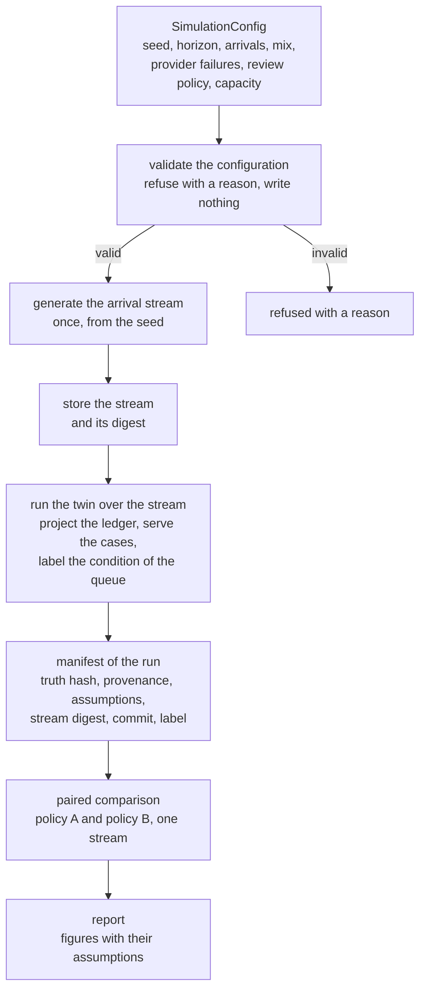
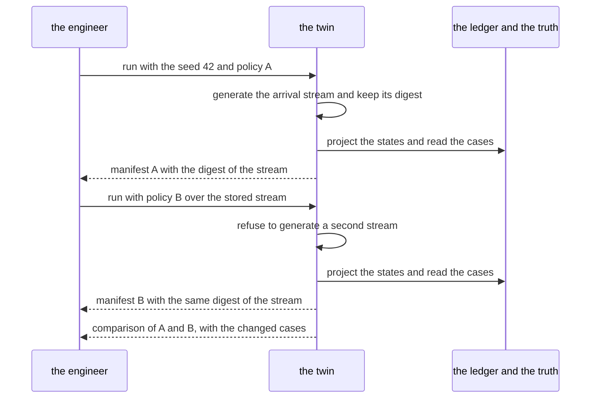

# Implementation Plan: Operations digital twin

**Branch**: `feature/v3` | **Date**: 2026-11-23 | **Spec**: [spec.md](spec.md)

**Input**: Feature specification from `specs/018-r17-operations-digital-twin/spec.md`

## Summary

The repository can generate a world of payments, project it deterministically and let a visitor change one field
of a branch and read the diff. It cannot say how cases arrive, how many cases a team can carry at once, what a
queue does when it never drains, or what changes when a review policy changes. The twin adds exactly that: a
modelled arrival process, a capacity of slots, a labelled condition of the run, and a paired comparison of two
policies over one stream of arrivals.

The twin is a research instrument, not a product. It runs no model, calls no provider and touches no payment
network. Every number it publishes is a number about the synthetic world it simulated, and every figure carries
the assumptions that produced it. The one thing it is careful about is the difference between a measurement and a
model: the arrival distribution is a model and is labelled as one everywhere it appears.

The design follows the shape the repository already uses rather than the shape the package suggests. The package
proposes a `SimulationConfig` and a `SimulationManifest`; the repository already has a seeded generator with a
manifest of truth in `data/scenarios.json`, a canonical hash of the branch state under ADR-032, and a bundle
manifest that carries the sha256 of every file and the commit of the code under ADR-014 and ADR-017. The twin
therefore produces a manifest with the same discipline: canonical bytes, no clock, no path of the machine, the
digest of the truth it was computed on and the commit it was produced from.

## Technical Context

**Language/Version**: Python 3.12
**Primary Dependencies**: the existing `ledgerlens` core, `random` with a seeded `Random` per component, `Decimal`
for every money figure
**Architecture**: the twin is a layer over the simulator and never beside it. The generator, the event log and the
projector stay in `ledgerlens/sim/` as they are, and the twin adds the arrival process, the capacity model, the
run and the comparison in `ledgerlens/sim/twin/`
**Storage**: the truth stays in `data/scenarios.json` and the ledger in the committed artifact; the manifests of the
runs go under `data/eval/twin/` when a run is committed, and a run that is not committed stays in the directory of
the caller
**Testing**: pytest offline with `LEDGERLENS_OFFLINE=1`, the scripted model where a model is involved at all, and
the seed 42 of the repository
**Constraints**: no key and no network, money as `Decimal`, the domain never speaks SQL and never imports the
API, no change in `docs/v3/`, and no change in an accepted decision record

## What the repository already does, and what the twin adds on top

| Layer | Exists | Added by the twin |
|---|---|---|
| events | `ledgerlens/sim/events.py`, an append-only log with a canonical json | arrival events and the service events, in the same log and with the same canonical form |
| truth | `data/scenarios.json`, the truth of the twelve planted scenarios | the digest of the truth inside the manifest of a run, so a reader knows which world the run measured |
| projection | `ledgerlens/sim/projector.py` | nothing. The twin projects the same tables and adds the queue of the pending cases |
| branches | `ledgerlens/sandbox/` with typed mutations, an atomic commit and a diff that is a read | the paired comparison, which is two branches of the twin over one stream |
| capacity | nothing | a count of slots, a service time per case and the condition of the queue |
| manifest | `ledgerlens/replay/bundle.py` for a recording | a manifest for a simulation, with the same canonical rules and without the mode of a bundle |

The two published catalogs are unaffected. `data/eval/replay/` holds the recordings of the scripted model and
`data/eval/replay-real/` holds the recordings of a real model, and a twin run is neither. The check of the export
in `scripts/gate.sh` must keep passing after every task of this milestone, and a task that writes under those two
folders is a defect.

## The shape of the twin

The paired comparison is the reason the stream is stored instead of generated twice.

## The decisions the twin has to make, and how it makes them

**The arrival process.** The repository has no arrival data. ADR-009 keeps the public data for the parts that
exist and the simulation for the gaps, and the arrival of the cases is a gap. The twin therefore takes the
distribution as a parameter, writes it in the manifest, and never presents a count of arrivals as a measurement.
The distribution of the shipped configuration is documented in `docs/twin.md` with the reasoning.

**The capacity.** The package calls it `staff_count`. The repository has no people in it, and a number of people
would be a claim the twin cannot support. The twin models a number of slots and a service time per case, and the
report says "slots" and never "analysts".

**The review policy.** The twin does not add an escalation. It reads the one that `ledgerlens/verify/escalation.py`
computes today, so the decision a case waits for is the decision the product makes.

**The condition of the queue.** A run is either in a steady state or it is labelled `queue_never_drains`. There is
no third state and no number for a run that never drained: the throughput of such a run is a property of the
horizon and not of the system.

**The manifest.** Canonical bytes, the digest of the truth, the provenance of the source, the assumptions, the
digest of the arrival stream, the commit of the code and the label of the run. It holds no clock and no path of
the machine, so two runs of the same configuration produce the same bytes on two machines.

## The risks

- **A twin that looks like a measurement of a real operation.** Every figure of the report carries the assumptions
  and the reference to the run, and the report never says that a policy saved money in a real operation. The guard
  is a test that reads the report.
- **A comparison of two different worlds.** The second run of a paired comparison reads the stored stream and
  refuses to generate another one. The guard is the digest of the stream inside both manifests and a test that
  expects them to be equal.
- **A twin that drifts into the published catalogs.** A run of the twin is not a bundle of the agent. The guard is
  a test that runs the twin and finds the two catalogs and the export of the site untouched.
- **A capacity model that becomes a claim about people.** The vocabulary of the twin is slots and service time.
  The guard is the report test and the vocabulary of the report.
- **A label that is missing.** A run whose condition was not determined is not published. The guard is the manifest
  test, which expects a label on every manifest.
- **Money that leaves `Decimal`.** Every money figure of the twin is a `Decimal`, and the cost per case is an exact
  division. The guard is the comparison test, which recomputes the published figure.

## What is out of scope

- Any model. The twin runs no model and the comparison is over the deterministic verifier and the simulator.
- The multiagent topology. ADR-P007 keeps the runtime a single agent with a deterministic verifier.
- The queue of the live mode and the scheduling of a person.
- The publication of a twin run in the site. The publication of an artifact with the digest discipline of the
  catalogs is the work of the proof-of-work export.
- The rewrite of the generator, of the projector and of the sandbox. The twin reads them.

## The definition of done

1. The configuration is typed and an invalid one is refused before anything is written.
2. Two runs of the same configuration with the seed 42 produce a byte for byte equal manifest, and so does a third
   run with another hash seed of the interpreter.
3. The manifest carries the digest of the truth, the provenance, the assumptions, the digest of the arrival stream,
   the commit and the label of the run.
4. A paired comparison reads one arrival stream and names the cases whose decision changed.
5. Every money figure is recomputable with `Decimal` and the cost per case is undefined with a reason when the
   denominator is zero.
6. A run whose queue never drains carries the label and publishes no throughput.
7. The twin runs with the network disabled, imports no API module and speaks no SQL in the domain layer.
8. The two published catalogs and the export of the site are untouched by a run of the twin.
9. The gate of the Python side is green.
