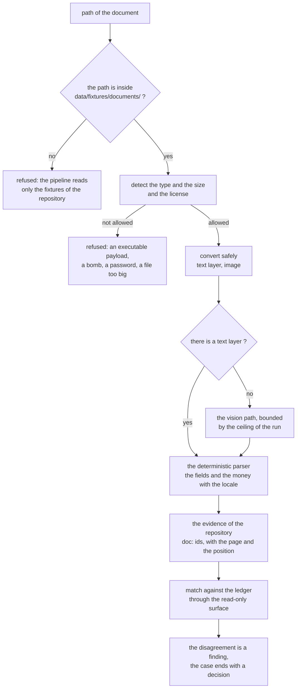

# Implementation Plan: Source-grounded document extraction

**Branch**: `feature/v3` | **Date**: 2026-11-23 | **Spec**: [spec.md](spec.md)

**Input**: Feature specification from `specs/019-r18-source-grounded-document-extraction/spec.md`

## Summary

The repository reads three things: the ledger, the corpus of the policies and a reference rate. It cannot read a
picture of a receipt, and it has no way to hold two accounts of the same event at once. This milestone adds a
document pipeline that reads the fields of a document, says where on the page it read each one, and hands the
result to the verifier as evidence.

The rule that shapes every decision of this milestone is that a document is a source of a claim and never an
authority. The ledger states what happened; the corpus states the rules; a document states what someone wrote
down about it. When a document and the ledger disagree, the case ends with a named decision that a person has to
look at, exactly as ADR-074 decides for every other disagreement in the repository. The pipeline never writes to
the ledger, and no task of this milestone may add such a write.

The second rule is that the deterministic path ships first. The offline gate runs with no key and no network, so a
pipeline whose only path asks a vision model could never be part of it. The deterministic parser reads the text
layer of a document and parses the money with the locale of the document. The vision path exists, it is bounded by
the ceiling of the run of ADR-054, and it never publishes a value on its own: a value that only the model read
carries the kind of confidence that names the doubt.

The third rule is that nothing of a visitor is kept. ADR-P009 forbids the collection of real financial documents,
and the pipeline reads only the synthetic fixtures of `data/fixtures/documents/`. The refusal happens before the
file is opened, so a document that was never allowed to be read is never read.

## Technical Context

**Language/Version**: Python 3.12
**Primary Dependencies**: the existing `ledgerlens` core, `pypdf` for the text layer of a PDF and Pillow for the
images, both optional and both behind the refusal of the file that needs them
**Architecture**: the pipeline is infrastructure under `ledgerlens/documents/` and reaches the domain through one
tool under `ledgerlens/tools/documents.py`. The tool returns `Evidence` records of the repository and never a
second kind of evidence
**Storage**: the fixtures of the documents under `data/fixtures/documents/` with their manifest and their license,
and the manifest of an extraction in the result of the tool, never in a database
**Testing**: pytest offline with `LEDGERLENS_OFFLINE=1`, the scripted model of `ledgerlens/offline.py` for the
vision path
**Constraints**: no key and no network, money as `Decimal`, the domain never speaks SQL and never imports the
API, no change in `docs/design/`, and no change in an accepted decision record

## The shape of the pipeline

The vision path never goes around the deterministic parser. A model reads a field, the parser reads the same
field, and only a value both of them agree on becomes a value.

## What the repository has to change, and how little

The change to the core is small and it is deliberate. The evidence model of `ledgerlens/schemas.py` gains one
member in `EvidenceSource` and one in `ToolName`, and the scheme of `ledgerlens/tools/envelope.py` gains one
member. The trace contract of ADR-013 carries the same vocabulary, so the trace of a run with a document evidence
is the same shape as every other trace. The catalog of the tools of `tests/test_tools_catalog.py` requires the
name, the description and the kind of integration of the new tool to be in `docs/tools.md` and in
`docs/contracts/tools.md`, and that is where the description of the tool for the model is written.

Everything else is new and lives in its own folder:

| Module | What it does |
|---|---|
| `ledgerlens/documents/detect.py` | the type, the size, the license and the refusals |
| `ledgerlens/documents/convert.py` | the text layer of a PDF and the decoding of an image, with no shell out |
| `ledgerlens/documents/fields.py` | the fields of the repository, with the page and the position |
| `ledgerlens/documents/money.py` | the locale and the `Decimal` of a monetary field |
| `ledgerlens/documents/match.py` | the match against the ledger through the read-only surface of the domain |
| `ledgerlens/documents/redact.py` | the addresses and the payment details of a shared copy |
| `ledgerlens/tools/documents.py` | the tool that the agent calls, with the envelope of the tools |

## The rules that the money follows

A monetary field of a document is a `Decimal` and never a float. The Brazilian fixture says `1.000,00` and the
American fixture says `1,000.00`, and both are one thousand and zero cents. The difference between a document and
the ledger is computed with `Decimal` and is published with both currencies named. A field with more decimal
places than the currency admits is reported with the excess, never rounded away silently, because the rounding of
a document is not a rounding of the ledger.

The tool never corrects the ledger. The ledger is read through `ledgerlens/tools/ledger_api.py`, the same way the
other tools read it, and a disagreement ends the case with a decision that names it.

## The risks

- **A document that becomes an accounting entry.** The guard is a test that takes the digest of the ledger of a
  fixture before an extraction and after it, and expects the two to be equal, plus a test that expects the
  disagreement to be a decision.
- **A guess that reads as a value.** The guard is the kind of confidence on every field and the rule that only a
  value the parser confirmed becomes a value.
- **A payload inside a document.** The guard is the four refusals of the file security test, each of them before
  the file is opened, and a temporary directory that is empty after each of them.
- **A document of a visitor that gets stored.** The guard is the refusal for a path outside the folder of the
  fixtures, with a spy over the open, so the test proves the file was not read and not only that it was refused.
- **A second kind of evidence that the verifier does not know.** The guard is the extension of the scheme of the
  envelope and of the literals of the schemas, with a test that the id of a document evidence matches the scheme.
- **A model that decides.** The guard is the test of the vision path: with no model reachable the tool refuses, and
  with the scripted model the number of the calls stays inside the ceiling of the run and no field that only the
  model read becomes a value.
- **A tool that the catalog does not know.** The guard is `tests/test_tools_catalog.py`, which fails when the code
  and the two documents disagree.

## What is out of scope

- The upload of a document by a visitor. ADR-P009 is a safety invariant and the decision to change it needs a
  record of its own.
- The storage of a document and the retention of one after a run.
- The voice, the video and the audio.
- The reranker, the memory and the retrieval over documents.
- The publication of a document in the site.

## The definition of done

1. Every field of every extraction carries the digest, the page, the position, the name, the value, the kind of
   confidence, the version of the extractor and the license.
2. The amount of the Brazilian fixture is one thousand and not one, and every monetary field is a `Decimal`.
3. The ledger of a fixture is byte for byte the same before and after an extraction, and a disagreement is a named
   decision.
4. A field that cannot be read with certainty carries no value and the case asks the person.
5. The four dangerous files and every path outside the folder of the fixtures are refused before the file is opened.
6. No module of `ledgerlens/documents/` imports `ledgerlens.api` and none carries a SQL string.
7. With no model reachable the tool refuses, and the calls of the model stay inside the ceiling of the run.
8. The tool is in `docs/tools.md` and in `docs/contracts/tools.md` with the same description as the code.
9. The gate of the Python side is green.
