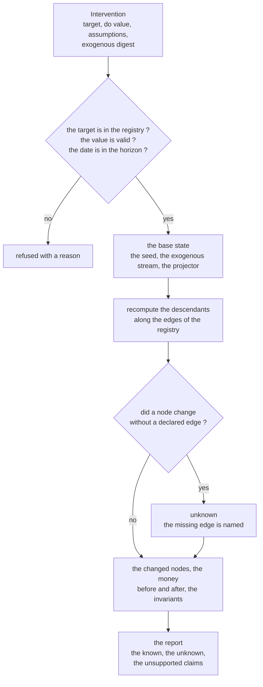
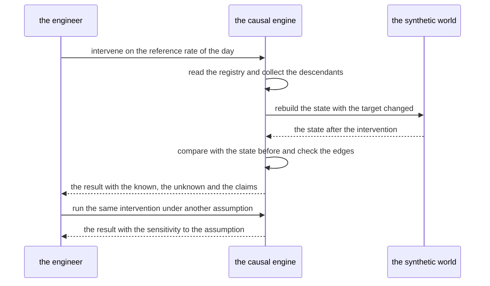

# Implementation Plan: Causal counterfactual interventions

**Branch**: `feature/v3` | **Date**: 2026-11-23 | **Spec**: [spec.md](spec.md)

**Input**: Feature specification from `specs/020-r19-causal-counterfactual-interventions/spec.md`

## Summary

The repository can change one field of a branch and read the difference between two states. It cannot say what
caused the difference, and it cannot say what would have happened if a rule had been different. This milestone
adds a registry of the structural functions of the synthetic world, a typed intervention over that registry, and a
report that separates three things that look alike: a difference that the registry explains, a difference that the
registry does not explain, and a statement of cause that nobody can check.

The rule that decides everything is that the registry is the only source of a dependency. It is written by hand
over the code that already exists: the exchange rate of `ledgerlens/sim/fx.py`, the settlement of
`ledgerlens/sim/pipeline.py`, the rules of the policies read by `ledgerlens/retrieval.py`, the calculator of
`ledgerlens/tools/calculator.py` and the escalation of `ledgerlens/verify/escalation.py`. Every edge names the
function that implements it, so a reader can open the edge and find the code. Nothing is learned from an
observation: a node that is not in the registry is never a descendant of anything, and the evidence graph of the
repository keeps its meaning of a link, which is a citation and not a cause.

The second rule is that the intervention stays inside the simulation. The result of an intervention is a statement
about the synthetic world of the repository, and every sentence of the report says so. The package is explicit
that an intervention must not be presented as a prediction of what would have happened to a real merchant, and the
report is checked by a test that reads it.

The third rule is that the difference and the cause are separate outputs. The sandbox already computes the
difference, and it does it well. The engine of this milestone recomputes the descendants of the target along the
edges of the registry, and a node that changes without a declared edge is reported as `unknown` with the missing
edge named. That is the whole point of the milestone: a tool that says "because" when it cannot is worse than a
tool that says nothing.

## Technical Context

**Language/Version**: Python 3.12
**Primary Dependencies**: the existing `ledgerlens` core, `Decimal` for every money figure, and the twin of the
previous specification for the arrival stream
**Architecture**: the registry under `ledgerlens/causal/registry.py` is a declaration, the engine under
`ledgerlens/causal/engine.py` reads the world through the simulator and the projector, and the report under
`ledgerlens/causal/report.py` says what is known and what is not
**Storage**: nothing new is persisted. The registry is code, the interventions are records, and the results are
written by the caller
**Testing**: pytest offline with `LEDGERLENS_OFFLINE=1`, the seed 42 of the repository, and the invariants of
`ledgerlens/sandbox/invariants.py`
**Constraints**: no key and no network, money as `Decimal`, the domain never speaks SQL and never imports the
API, no change in `docs/v3/`, and no change in an accepted decision record

## The shape of the intervention

The comparison between two interventions reuses the mechanic of the twin: one base, one exogenous stream, two
targets.

## The four families of the registry

The registry covers what the repository actually computes.

| Family | Nodes | Where the code is |
|---|---|---|
| exchange rate | the reference rate of a day, the applied rate of a transaction, the markup of a merchant | `ledgerlens/sim/fx.py` and `ledgerlens/tools/fx.py` |
| policy | the rule of a policy of the corpus, the window of a deadline, the ceiling of a markup | `ledgerlens/retrieval.py` and `data/policies/` |
| settlement | the net of a settlement, the fee of a settlement, the date of a settlement | `ledgerlens/sim/pipeline.py` and `ledgerlens/sim/calendars.py` |
| review | the escalation of a case, the deadline of a dispute, the decision of the verifier | `ledgerlens/verify/escalation.py` and `ledgerlens/verify/checks.py` |

Every edge names the two nodes it connects, the function that implements it and the reason of the edge. The reason
matters: an edge that exists because a function reads a value is different from an edge that exists because a
policy says so, and a reader has to be able to tell.

## The rules that the money follows

Every amount of a result is a `Decimal`. The result says the value before, the value after and the difference,
and the difference recomputed with `Decimal` is the published difference. A result that says "the cost went up"
without the two values is not a result, and the report test checks that.

An intervention on the reference rate of a day does not rewrite the applied rate of the history. The applied rate of
a transaction is the rate that was applied on the day of the transaction, and the reference rate of a later day
does not reach into the past. The test of the engine checks every applied rate of the ledger before and after the
intervention.

## The risks

- **A silent cause.** The risk is the largest one of the milestone. The guard is the registry: only a declared
  edge makes a descendant, and a change without a declared edge is `unknown` with the missing edge named.
- **A registry that drifts from the code.** Every edge names the function that implements it, and a test reads the
  registry and expects every named function to exist in the code. An edge whose function was renamed is a broken
  edge, and the test says so.
- **An intervention that rewrites the past.** The guard is the test of the applied rates of the ledger.
- **A compound intervention that hides one of its targets.** The guard is the record that names both targets and
  the test that expects the compound result to differ from the sum of the two single results.
- **A report that reads as a prediction.** The guard is the test that reads the report and refuses a sentence that
  says what a real merchant would have received.
- **A comparison of two different worlds.** The guard is the digest of the exogenous stream, which has to be the
  same in the two runs.
- **A broken invariant.** The guard is the refusal of the intervention and the state of the world after the
  refusal.

## What is out of scope

- Any model of causality that is learned from the data.
- Any claim about a real merchant, a real bank or a real policy of the world.
- The publication of an intervention in the site.
- The multiagent topology. ADR-P007 keeps the runtime a single agent with a deterministic verifier.
- The rewrite of the simulator, of the projector and of the sandbox. The engine reads them.

## The definition of done

1. The registry names the nodes of the four families, and every edge names the two nodes it connects and the
   function that implements it.
2. The three invalid interventions are refused before anything is written, with the name of the field that is
   wrong.
3. Two runs over the same base carry the same digest of the exogenous stream, and the changed nodes are the
   descendants of the target.
4. A change without a declared edge is `unknown` and is listed as an unsupported causal claim.
5. An intervention on the reference rate leaves every applied rate of the ledger unchanged.
6. Every amount of the result is a `Decimal` and every difference recomputes exactly.
7. The compound intervention names both targets and its result is not the sum of the two single results.
8. The result carries its assumptions and the sensitivity to them.
9. No sentence of the report says what a real merchant would have received.
10. The run writes nothing under the two published catalogs and the export of the site still passes its check.
11. The gate of the Python side is green.
