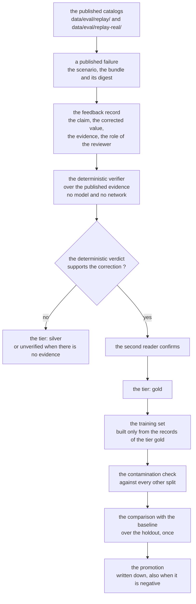

# Implementation Plan: Verified feedback to evaluation and training

**Branch**: `feature/v3` | **Date**: 2026-11-23 | **Spec**: [spec.md](spec.md)

**Input**: Feature specification from `specs/021-r20-verified-feedback-to-evaluation-and-training/spec.md`

## Summary

The repository publishes two catalogs of recorded scenarios, and ADR-068 says that they hold the failures and not
only the cases the agent resolves. The failures are read and nothing else happens with them. They do not become a
regression, they do not become a dataset, and no model is trained on them. This milestone closes that loop with one
rule in front of it.

**Model output never becomes training data without the deterministic verdict as its gate.**

The rule is not a sentence for the documentation. It is a field of a record. The verdict of a feedback record is
the verdict of the deterministic verifier of `ledgerlens/verify/checks.py`, computed over the published evidence of
the bundle, offline, with no model and no network. The verdict of the NLI model never fills that field, and the
agreement of a model with a proposed correction never promotes a record. A record is `gold` only when the
deterministic verdict supports the correction and a second reader confirmed it, and a training set is built only
from the records of the tier `gold`.

That rule is what makes the loop safe to run in public. The two catalogs are published, so anyone can propose a
correction. Without the gate, the loop would be a machine that trains a model on the agreement of another model,
and the number it produced would measure nothing. With the gate, the loop is a machine that turns a published
failure into a regression set that a person reviewed and that the code of the repository verified.

The milestone ships the loop and the measurement, not the training. The dataset is built, the comparison with the
baseline runs, the negative result is kept, and the promotion of a candidate is written down. The training of a
model waits for a dataset that a human has reviewed and goes behind the flag of ADR-P007, which is the only place
where a specialist model is allowed to exist.

## Technical Context

**Language/Version**: Python 3.12
**Primary Dependencies**: the existing `ledgerlens` core, the verifier of `ledgerlens/verify/checks.py`, the
manifest of `ledgerlens/eval/manifest.py`, `Decimal` for every money value
**Architecture**: the loop is a set of small modules under `ledgerlens/feedback/`: the record, the tier, the
registry, the contamination check and the promotion. The records live under `data/eval/feedback/` and the training
sets under `data/eval/datasets/`
**Storage**: the records and the training sets are files in the repository, with the digests of the manifest of the
datasets, and the archive of an experiment under `data/eval/experiments/`
**Testing**: pytest offline with `LEDGERLENS_OFFLINE=1`, and the verifier of the repository with no model
**Constraints**: no key and no network, money as `Decimal`, the domain never speaks SQL and never imports the
API, the held out set stays reserved, no change in `docs/v3/`, and no change in an accepted decision record

## The loop

The gate is the arrow from the record to the tier. Every arrow into the tier passes through the deterministic
verdict, and nothing else does.

## The four tiers of a record against the three roles of a dataset

The two axes are separate and the milestone keeps them separate.

| Axis | Values | Where it lives | Who decides |
|---|---|---|---|
| the tier of a record | `gold`, `silver`, `unverified` | the registry of the records, `data/eval/feedback/` | the deterministic verdict and the second reader |
| the split of a dataset | `tuning`, `validation`, `held_out` | the manifest of the datasets, `data/eval/datasets.json` | the person that publishes the dataset, under ADR-052 and ADR-062 |

A `gold` record may land in a `tuning` dataset or in a `validation` dataset. It never lands in a `held_out`
dataset, because the held out set is reserved by the content of the case under ADR-065, and the key of that set is
never published in any form.

## The rules that the data follows

- **The verdict of a record is a decision.** It is the verdict of `ledgerlens/verify/checks.py` over the published
  evidence of the bundle, exactly as ADR-073 re-verifies a published bundle offline. The NLI model may disagree,
  and ADR-075 says so in the note of the manifest of a real bundle. When they disagree, the deterministic one is
  the one that is written down.
- **A correction is a `Decimal` when it is a money value.** The comparison with the value of the ledger is exact.
- **The digest of the source travels with the record.** The record names the bundle, the catalog of the bundle and
  the digest of the bundle, so a reader can find the evidence of the record in the published catalog and check it.
- **The permission of a record says what it may be used for.** A record whose permission is an evaluation never
  enters a training set, whatever its tier.

## The risks

- **A loop that trains a model on its own output.** This is the risk the red line of ADR-P007 names and the one
  the gate exists for. The guard is the tier: a record whose only support is an output of a model is never `gold`
  and never enters a training set.
- **A contamination that the identifiers do not see.** The guard is the check that compares the content of the
  case and not only its identifier, under ADR-065.
- **A holdout that stops being a holdout.** The guard is the guard of the tuning of `ledgerlens/eval/manifest.py`,
  which refuses a tuning against a dataset whose role is `held_out` and refuses the published report of the
  measurement by its path and by the digest of its bytes, under ADR-067.
- **A promotion that hides a negative result.** The guard is the comparison, which is written down whatever its
  result.
- **A visitor that poisons the shared set.** The guard is the refusal of the registry for a record whose source is a
  session of a visitor, and the sandbox that keeps the feedback in the session.
- **A specialist model that appears without a comparison.** The guard is the test that expects no weight and no
  model artifact under the folder of the feedback, and that the modules of `ledgerlens/feedback/` import no
  training library.
- **A record that is not reproducible.** The guard is the digest of the source in the registry and the refusal of
  the check when the digest does not match the disk.

## What is out of scope

- The training of a model, of a reranker and of an intent model. The milestone produces the dataset and the
  measurement.
- The multiagent topology of ADR-P007.
- The change of the prompts and of the thresholds.
- The publication of the key of the held out set, in any form, including a hash.
- The acceptance of a feedback from a visitor as a record of the repository.

## The definition of done

1. The verdict of every record is the verdict of the deterministic verifier over the published evidence of the
   bundle, computed offline with no model and no network.
2. A record whose only support is an output of a model is never `gold` and never enters a training set.
3. A training set holds only the records of the tier `gold`.
4. The record names the catalog of its bundle and the digest of the bundle.
5. The registry carries the digest, the permission and the tier of every record and refuses an entry whose digest
   does not match the disk.
6. A training set that holds a case of another split under an alias is refused.
7. The guard of the tuning still refuses the held out set and the published report of the measurement.
8. A candidate that is worse on the holdout is not promoted and the negative result is kept.
9. The feedback of a visitor stays in the session of the visitor.
10. No model is trained, no weight is written and the runtime of the agent does not change.
11. The gate of the Python side is green.
