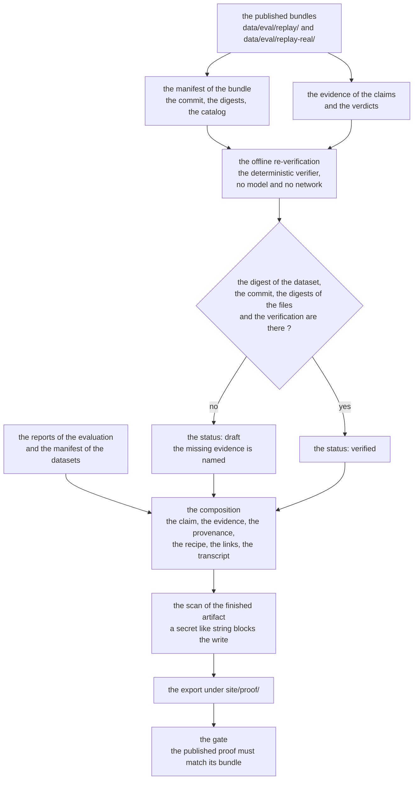

# Implementation Plan: Portable proof of work

**Branch**: `feature/v3` | **Date**: 2026-11-23 | **Spec**: [spec.md](spec.md)

**Input**: Feature specification from `specs/022-r22-portable-proof-of-work-export/spec.md`

## Summary

The repository publishes two catalogs of recorded scenarios. Every bundle names the commit it was produced from,
carries the digest of every file, and is re-verified offline by the deterministic verifier with no model and no
network. What a reader cannot do is carry that check anywhere: there is no single artifact that says what was
done, which commit did it, what evidence it rests on and how to redo it.

This milestone composes that artifact and publishes it, with the discipline of the two catalogs and not less.
An artifact is a claim about the code of the repository, and it carries the commit, the digests, the evidence of
the claims, the verdicts, the recipe and the links to the commit it names. The status of the artifact is `draft`
or `verified`, and it is `verified` only when the digest of the dataset is there, the commit is there, the digest of
every file matches the disk and the offline re-verification passes. A missing evidence makes a draft with no
badge, because a badge that a missing digest does not remove means nothing.

The package proposes a runtime route with unguessable identifiers and an access scope to enforce. The repository
publishes a static site, so the artifact is a file built by the same export path, under `site/proof/`, and its
identifier is the digest of the bundle it was made from. The access scope moves to the moment of the build: a
private case never becomes an artifact, so there is no artifact whose access has to be checked when it is served.

The package also asks that there be no ability to forge employer proof. The repository does not issue proof of
employment and publishes nothing about a person. The artifact states a technical claim about the code, and a
reader who wants to know what an engineer did reads the artifact and the code.

## Technical Context

**Language/Version**: Python 3.12 for the export, TypeScript and Next.js for the page of the site
**Primary Dependencies**: the existing `ledgerlens` core, `jsonschema` for the validation of the artifact, the
redaction of `ledgerlens/observability/callbacks.py`
**Architecture**: the composition under `ledgerlens/proof/`, the export under `scripts/export_proof_site.py` next
to `scripts/export_replay_site.py`, and the page under `apps/web/app/(public)/proof/`
**Storage**: the canonical bundles under `data/eval/replay/` and `data/eval/replay-real/`, the published artifacts
under `site/proof/`, and the reports the numbers come from under `data/eval/`
**Testing**: pytest offline with `LEDGERLENS_OFFLINE=1`, the vitest and the end to end checks of the frontend
**Constraints**: no key and no network, no change in `docs/design/`, no change in the two catalogs and no change in an
accepted decision record

## The shape of the artifact

## The composition, section by section

| Section | Where it comes from | What it may not do |
|---|---|---|
| the claim | the name of the scenario and the question of the bundle | it may not state a result that no claim of the run carries |
| the evidence | the events of the bundle and the evidence of the claims | it may not cut the fields of a record, under ADR-073 |
| the verdicts | the verdicts of the deterministic verifier, re-verified offline | it may not carry a verdict of the NLI model as if the code had given it |
| the provenance | the manifest of the bundle and the index of the catalog | it may not drop the digest of the dataset or the commit |
| the numbers | the reports under `data/eval/` | it may not carry a number that is not in the report it names |
| the recipe | the command of the capture and the commit | it may not name a command that does not reproduce the run |
| the links | the paths of the commit that the artifact names | it may not point at a path of another commit |
| the transcript | the text of every media | it may not be dropped when the media is dropped for the budget |

## The rules that the artifact follows

- **The numbers come from a report.** The build reads the report, takes the number and writes the path and the
  digest of the report next to it. A number that is not in the report fails the build. This is the same rule the
  repository follows for the reports of the evaluation, and it is what keeps an artifact from drifting away from
  the code.
- **The digests are the digests of the disk.** The digest of a file of the bundle in the artifact is the digest of
  that file on the disk, and the check of the gate compares them. The export of the two catalogs already has this
  discipline in `scripts/verify_replay_digests.py`, and the proof export uses the same script.
- **The redaction is the last wall.** The trace is redacted when it is written, and the finished artifact is
  scanned again, because the artifact carries prose and a report that the trace does not carry. The scan uses the
  `redact` of `ledgerlens/observability/callbacks.py`.
- **A draft is a draft.** The status is decided by the presence of the evidence and by the offline
  re-verification, and nothing else. No person promotes an artifact by hand.

## The risks

- **An artifact that publishes a secret.** The guard is the scan of the finished artifact and the refusal that
  writes nothing.
- **A badge that means nothing.** The guard is the status rule: `verified` requires the digest of the dataset, the
  commit, the digests of the files and the passing of the offline re-verification.
- **A number that drifted from its report.** The guard is the rule that the number is read from the report and
  that the build fails when it is not there.
- **A link that points at a commit that does not exist.** The guard is the check that every link resolves inside
  the commit that the artifact names.
- **An artifact that leaks the input of a visitor.** The guard is that the export reads the published catalogs and
  never a session, plus the test that exports every artifact and looks for a key, a session id and a path of a
  machine.
- **An artifact that a screen reader cannot read.** The guard is the transcript of every media and the
  accessibility check of the frontend.
- **A proof that reads as a claim about a person.** The guard is the scope rule and the test that reads the
  artifact and refuses a sentence about an employer or a hiring decision.
- **An export that breaks the two catalogs.** The guard is that the export writes only under `site/proof/` and the
  check of the catalogs keeps passing.

## What is out of scope

- The proof of a person, of an employer or of a hiring decision.
- The publication of the key of the held out set.
- The analytics of the visits to the proof.
- Any change to the two catalogs, to their export and to their bundles.
- The runtime route of the package. The site is static and the artifact is a file.

## The definition of done

1. The artifact carries the commit, the digest of every file of the bundle, the digest of the snapshot, the digest
   of the dataset and the catalog.
2. The offline re-verification gives the verdict the artifact publishes.
3. An artifact with a missing evidence is `draft`, names what is missing and carries no badge.
4. The identifier of an artifact is the digest of the bundle.
5. The artifact satisfies the schema of the package.
6. An export whose content carries a secret like string is refused and writes nothing.
7. Every number of the artifact is in the report it names, with the digest of that report.
8. No artifact carries a key, a session id or a path of a machine.
9. Every media carries a transcript and the transcript survives the budget of the site.
10. No sentence of the artifact is about an employer or a hiring decision.
11. Every link resolves inside the commit that the artifact names.
12. The export is published under `site/proof/` and the gate refuses a published proof that does not match its
    bundle.
13. The two catalogs are untouched and their check still passes.
14. The gate of the Python side and the gate of the frontend are green.
